# Lesson exercise prototype specification

Status: **Draft 0.77 — P5-05: play-test times and exam rules for reading**. Date: 2026-10-20.

This document specifies the prototype and its phased implementation. It is the maintained requirements document: no separate requirements file exists. It does not authorize starting implementation before the specification review. The backlog is in [ISSUES.md](ISSUES.md) and published as GitHub issues in `bastian-schnitzler/lesson_prototype`.

## Lesson session architecture

This overview covers only what happens from the moment a lesson starts: how the lesson is loaded and turned into an attempt, what the browser keeps while the learner works, and which parts every lesson category shares. Details are in sections 5 (session, scoring, timing) and 6–9 (category flows); offline generation and the catalog are in sections 2–4.

### From Start lesson to the results

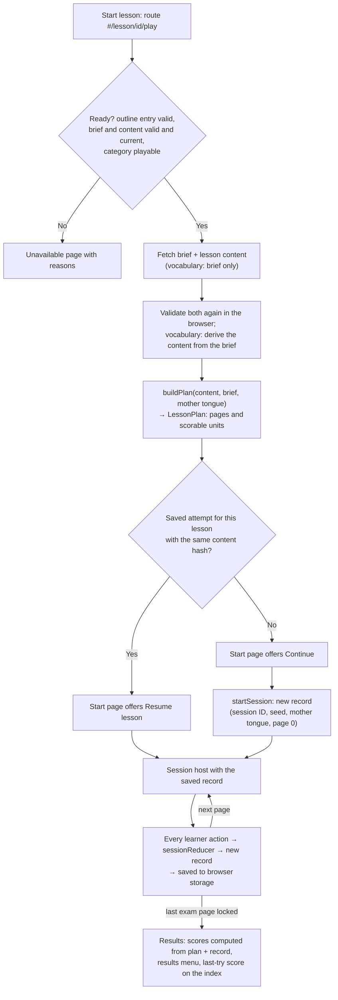

1. **Readiness.** The play route looks up the lesson in the manifest (built from the outlines, briefs and lesson files, section 3). It starts only when the outline entry, the brief and (except for vocabulary) the lesson content are valid and current and the category is playable (vocabulary, grammar, functions, reading). Otherwise it lists the reasons. Nothing is generated at this point.
2. **Load and validate.** The browser fetches the published JSON files and validates them again with the same schemas and checks as the build. A vocabulary lesson has no content file: `vocabularyLesson(brief)` derives its stages from the brief (D47). Grammar, function and reading lessons read `content/lessons/<id>.json`.
3. **Plan.** `buildPlan` flattens the content into a **lesson plan**: the concrete pages in order (with the exam info page in front of the exam), each with its items and its **units**. A unit is one scorable answer (one gap, one matching pair, one pronoun row, one word order) in one of four kinds: `text`, `choice`, `order` or `spot`. The plan resolves the mother tongue, accepted answers, explanations and time limits. It is rebuilt from the files on every load and never stored.
4. **Start or resume.** The start page shows the lesson outline. Continue creates a new **session record** (`startSession`): a random session ID and shuffle seed, the content hash, the mother tongue fixed for the attempt, page 0. A saved active record with the same content hash is offered as Resume lesson instead; a record for changed content cannot be resumed.
5. **Run.** The session host renders the current page. Every action (typing a draft, Check/Continue, turning a card, a countdown expiry, choosing a results entry) goes through one pure `sessionReducer(plan, record, action)`; the new record is saved to browser storage at once, so a reload resumes on the same page with the same answers, shuffles and deadlines.
6. **Results.** When the last exam page locks, the record turns `completed` and the results page shows the final score, the exam answers and a menu of the scored exercises. The last-try score appears on the index until a full reload (D11).

### Data kept while a lesson runs

Everything stays in the learner's browser; there is no server and no account. Scores, progress and results are **derived**, never stored: they are recomputed from the plan and the record whenever they are shown.

| Where | Key / owner | Content | Lifetime |
| --- | --- | --- | --- |
| Browser storage | `lesson-prototype:session:<lessonId>` | The **session record** of the current attempt (one per lesson), see below. | Until the lesson is restarted or storage is cleared; a completed record stays but cannot be resumed. |
| Browser storage | `lessonPrototype.preferences.v1` | Mother tongue, interface language, autoplay switch (D45). | Across lessons and reloads. |
| Memory | Lesson plan | Pages, units, accepted answers, explanations, limits; built from the files. | Rebuilt on every load. |
| Memory | Last-try scores | The final score of each lesson completed since the app was loaded (index column). | Lost on a full reload (D11). |
| Memory | Remaining exam time, voice status | Computed from the stored deadline and the browser's speech voices. | Recomputed every 250 ms / on voice changes. |

The **session record** (`SessionRecord`, `src/domain/session/session.ts`):

| Field | Meaning |
| --- | --- |
| `sessionId`, `lessonId`, `contentHash`, `lang`, `level` | Identity of the attempt; the hash ties it to the exact lesson files. |
| `motherTongue`, `seed` | Fixed at start: the mother tongue of all prompts, and the seed of every shuffle (matching columns, choices, token banks), so resume and results show the same order. |
| `startedAt`, `updatedAt`, `status`, `pageIndex`, `phase` | Where the learner is: active or completed, the current page, and `answering`, `feedback` (practice page checked) or `results`. |
| `drafts` | Unlocked answers per unit ID (typed text, chosen option, token order, selected word and correction). |
| `locked` | Per unit: the submitted response, its outcome (`fully_correct`, `orthography_only`, `incorrect`, `unanswered`), points, whether time ran out, the interface language at submission, and the gender chosen after a `des` answer. Locked answers never change. |
| `completed`, `revealed` | Pages already finished (for duration-weighted progress) and presentation progress that must survive a reload: turned flashcards, shown dialogue lines, a reading document put away after its skim (`skimmed`; the skim countdown itself has no saved deadline and restarts after a reload, section 9). |
| `exam` | Per exam page: start time, absolute deadline and timeout flag, so a reload cannot extend the countdown (section 5). |
| `skippedNoVoice` | Listening pages skipped without a French voice; they are left out of scores and progress. |
| `selection` | The results entry shown (final exam, an exam part or an exercise). |
| `pageTimes` | Play-test times per page (P5-05): entered, first checked, skim document put away, left. Recorded for every category; never used for scores, progress or deadlines; absent in older records. |

### Shared and category-specific parts

The session is one pipeline for every category. Item types are named per category (`vocabulary_…`, `grammar_…`, `function_…`, `reading_…`) because their content schemas differ, but most of them map to **shared exercise renderers** in `rendererRegistry`: a category adds a `buildPlan` case per item type and points it at an existing renderer, and needs its own renderer only for an exercise no other category has. Everything that works on units, pages and records is shared.

| Exercise renderer | Used by item types | Shared by |
| --- | --- | --- |
| `UnitsRenderer` (typed gap, multiple choice, word order, error spotter, translation field, with inline and card feedback) | `vocabulary_typed_gap`, `vocabulary_listening_choice`, `vocabulary_translation_exam`, `vocabulary_listening_dictation`, `grammar_gap_choice`, `grammar_gap_typing`, `grammar_word_order`, `grammar_error_spotter`, `function_translation_exam`, `reading_order` (pieces as tokens) | all four |
| `UnitsRenderer` inside a dialogue context (the line or reply above the task) | `function_word_order`, `function_dialogue_gap_choice` | functions, on the shared controls |
| `Gap` + `TextControl` inside dialogue lines | `function_dialogue_gap_typing` | functions, on the shared controls |
| `MatchingRenderer` (two columns, pairs, curves, slide after Check) | `vocabulary_matching`, `grammar_person_matching`, `function_matching`, `reading_keyword_matching` | all four |
| `GenderRenderer` (masculine/feminine per noun) | `vocabulary_gender_select`, `function_gender_select` | vocabulary, functions |
| `FlashcardsRenderer` | `vocabulary_flashcards`, `reading_flashcards` (the key words) | vocabulary, reading |
| `IntroductionRenderer` | `vocabulary_introduction` | vocabulary only |
| `ExplanationRenderer`, `PlaceholderRenderer`, `PronounMatchRenderer`, `PronounTypingRenderer` | `grammar_explanation`, `production_feedback_placeholder`, `grammar_pronoun_form_match`, `grammar_pronoun_form_typing` | grammar only |
| `FunctionFlashcardsRenderer`, `DialogueRenderer`, `ListeningReplyRenderer` | `function_flashcards`, `function_dialogue`, `function_listening_choice` | functions only |
| `DocumentRenderer` (document view, skim countdown **Time to skim**), `QuestionRenderer` (questions on the shared `ChoiceControl`; true / false in fixed order) | `reading_document`, `reading_skim_choice`, `reading_choice`, `reading_true_false` | reading only |

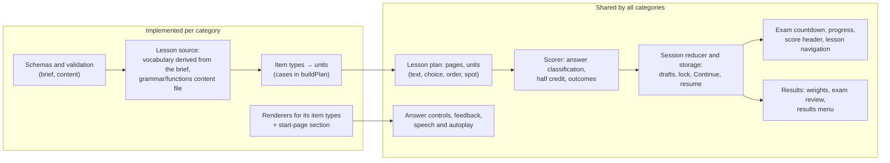

| Layer | Shared by all categories | Vocabulary only | Grammar only | Functions only | Reading only |
| --- | --- | --- | --- | --- | --- |
| Loading and readiness | Manifest, readiness reasons, fetch, browser re-validation (`PlayPage`, `validateBrief`/`validateContent`) | No content file: `vocabularyLesson(brief)` derives the six stages | Content file | Content file | Content file |
| Schemas and checks | Common envelope, localized texts, accepted answers, provenance and hashes (`artifactCommon`) | Targets, groups, genders, exam forms (`schemas/vocabulary.ts`) | Rules, blocks, length and exam-coverage checks (`schemas/grammar.ts`) | Situation, roles, expressions, words (`schemas/functions.ts`) | Genre, situation, key words, two documents, word ranges and skim speeds per level (`schemas/reading.ts`, `domain/readingLesson.ts`, `validation/reading.ts`) |
| Plan | `buildPlan`, page roles (presentation, practice, exam), exam info page, unit kinds `text` / `choice` / `order` / `spot`; noun gender data on translation exam units | Group interleaving (introduction then flashcards per group) | New verbs; teaching block per page | Expression and word terms (`functionsTerms`) | Documents and key words (`readingPlanData`); items → units in `readingUnits` |
| Scoring | `scoreUnit`, `classifyAnswer` (accents/case half credit, apostrophes, spaces), the plural-noun gender rule of translation exams (`des` + gender), 35 % practice / 65 % exam, rounding | – | – | – | – |
| Session flow | `sessionReducer`, one Continue (Check → feedback → Continue), auto-submit of single choices, success flash, storage and resume | Required reveals: flashcards | Production-feedback placeholder (an item with no units) | Required reveals: flashcards and dialogue lines (Next line) | Required reveals: key-word flashcards; the skim phase (document put away, `skimmed`) |
| Timing and progress | Absolute exam deadlines, countdown box, duration-weighted progress, live score header, lesson navigation sidebar | Listening exam pages start their countdown when the voice is ready | – | – | Skim countdown on a practice page (no saved deadline) |
| Exercise renderers (table above) | `UnitsRenderer` with `TextControl`, `ChoiceControl`, `OrderControl`, `SpotControl`, `Gap`, inline and card feedback: typed and multiple-choice gaps, word order, error spotter, listening choice and dictation, translation exam; `MatchingRenderer`; `GenderRenderer` (vocabulary and functions) | Introduction, flashcards | Explanation with form table, pronoun–form matching (token bank), pronoun–form typing, placeholder | Expression flashcards, model dialogue, listening reply; dialogue context around shared controls | Document view, skim and questions; flashcards, matching board and word-order control reused |
| Audio | Speech synthesis, voice check, no-voice help page, autoplay | Listening tasks need a voice to start | Pronoun + form spoken together | Dialogue lines and replies | Key words spoken on the flashcards; checks speak nothing |
| Start page and results | Start page frame and outline, results card, exam review, results menu | Colour-coded word groups | New verbs table | Situation, roles and expressions | Situation and key-word count; sections Key words, The document, Final exam |
| Copy | Interface messages (en/fr/de), exercise instructions (`lessonCopy`) | – | – | – | Reading messages (`reading.*`) |

A few item-type checks still sit in shared code where a category needs special handling: which pages need reveals before Continue, listening pages, the article hint of translation exams, the exam part names in the lesson navigation, and for reading the skim heading **Answer from memory**, the piece separator of ordering answers, the fixed order of true / false options and silent checks.

**Adding a category** (reading, section 9, was added this way) means: its brief and content schemas and checks; either a content file or a derivation from the brief; a `buildPlan` case per new item type mapping it to the four unit kinds; a `rendererRegistry` entry per new item type, pointing at a shared renderer where the exercise exists already and at a new renderer only otherwise; its start-page section; and enabling it in `PLAYABLE_KINDS`. Scoring, the reducer, storage and resume, timing, progress, navigation and results then work without change.

## 1. Goal, inputs, and scope

Build a React application with one `index.html` entry point that discovers every outline JSON in `content/outlines/`, lists the selected learning-language/level course, reads files prepared offline through Gemini, presents lesson steps sequentially, and shows exercise, exam, and total scores. Ordinary lessons should take approximately **10–15 minutes**. Vocabulary lessons requiring a larger inventory may take longer to cover their outline intent fully.

The requested roadmap names phases 0–5. This specification follows those six phases; the earlier phrase “two phases” is treated as superseded by the detailed roadmap.

### Repository inputs

| Input | Observed state | Treatment |
| --- | --- | --- |
| `content/outlines/*.json` | Discover all files; currently only fr/A1 is present | Build-derived course catalog, selected-course ordering, globally unique lesson IDs. |
| `content/outlines/fr-a1.json` | `lang: fr`, `level: A1`, 120 ordered entries | Authoritative IDs, classification, intent, titles, and order. |
| [src/schemas/common.ts](../src/schemas/common.ts) and [outline.ts](../src/schemas/outline.ts) | Maintained language, level, kind, topic/theme and outline contracts | Shared definitions used by the catalog, app and artifact schemas. |
| [src/schemas/artifacts.ts](../src/schemas/artifacts.ts), [vocabulary.ts](../src/schemas/vocabulary.ts), [grammar.ts](../src/schemas/grammar.ts), [artifactCommon.ts](../src/schemas/artifactCommon.ts) | Executable multilingual brief/content schemas from P1-03 | Category factories and shared payload validation; these are the active schema contracts. |
| [src/validation/artifacts.ts](../src/validation/artifacts.ts) | Current artifact and cross-reference validation | Checks metadata, locale coverage, IDs, hashes, coverage and brief/content consistency. |

The existing French A1 outline has **48 grammar, 48 vocabulary, 14 functions, and 10 reading** entries. Display all 120 entries when fr/A1 is selected; discover additional courses from all outline files without hard-coded filenames. A category remains visible but cannot start until its requirements and renderers exist (functions: section 8; reading: section 9).

Prototype scope excludes accounts, placement tests, daily goals, streaks, inferred CEFR progression, live tutoring, and learner synchronization. Those features are outside the prototype requirements.

### Decisions and open points for review

Confirmed decisions are identified below. Other defaults make the draft concrete and remain subject to review.

| ID | Decision | Proposed default / clarification |
| --- | --- | --- |
| D1 | Authoritative requirements | **Confirmed:** SPEC is the maintained requirements document. It incorporates the original vocabulary/grammar requirements and the user's later decisions; where a decision refines an original requirement, the decision applies. |
| D2 | Where generation runs | **Confirmed:** an offline local Node generator writes repository files; GitHub Pages serves pre-generated content. Lesson clicks never trigger generation. |
| D3 | Meaning of standalone | **Confirmed:** `index.html` is the entry point served on GitHub Pages. React reads the outline and generated brief/lesson JSON files; bundled module assets are allowed. |
| D4 | Language preferences | **Confirmed:** mother tongue has single-select en/fr/de options; interface language is an independent fr/en/de combobox. Generate learner support text in all three languages and native translations for every mother tongue other than the learning language. Defaults remain en/en; learning language comes from the selected outline. This supersedes the English-only requirement. A mother tongue equal to the learning language is disabled (D38). |
| D5 | Filters | **Confirmed:** four independently toggled category buttons; all active initially. No selection shows an empty state with a reset link. Original ordinals do not change. |
| D6 | Scores and confirmation | **Confirmed:** final exam contributes **65%**, practice contributes **35%**. Continue locks practice answers, shows visual feedback and the correct answer when needed, then a second Continue confirms and advances. Flashcards/review screens are completion-only. |
| D7 | Answer matching | **Confirmed:** distinguish fully correct free text, correct letters with accent/capitalization errors, and incorrect answers. Normalize Unicode, spacing, and typographic apostrophes; full correctness preserves accents and case. Accent/case-only credit is 50% under D17. |
| D8 | Gender/articles | **Confirmed:** apply gender and noun article rules only where grammatically applicable. Non-nouns are not assigned invented gender or articles. |
| D9 | Audio | **Confirmed:** browser speech synthesis in the selected learning language (French for the initial course). Audio speaks the target's written teaching form; the IPA pronunciation text is shown, not spoken. Without a suitable voice, every Listen control becomes an **Install language** button that opens the voice-installation help (D42). |
| D10 | Personalized grammar feedback | **Confirmed:** show the fixed localized production-feedback placeholder before the final exam; its en text is “Individual feedback would be here on production.” Individual feedback analysis is deferred to production. |
| D11 | Session persistence | **Confirmed:** browser storage supports session reload/resume. **Confirmed:** the index last-try score is in memory only and clears on a full page reload; never restore it from stored attempts. |
| D12 | Broad vocabulary outlines | **Confirmed:** allow the number of targets necessary for the outline, with grouped presentation. Such lessons may exceed 10–15 minutes. Do not truncate an inventory at 15 or 32 or change its existing lesson ID. |
| D13 | Phase 4/5 allocation | Phase 4 functions, phase 5 reading, each blocked on its requirements review. **Functions requirements agreed in P4-01** (D50, D51, section 8); **reading requirements agreed in P5-01** (D54, section 9), implemented from P5-02 on. |
| D14 | Vocabulary target count | **Changed (P6-02, feedback #1):** every lesson takes at most 15 minutes, so the standard is **8 targets** per vocabulary lesson (9 when few are nouns); fewer only for an unusually demanding load, explained in the brief's count rationale. Large finite inventories (numbers, the alphabet) are no longer taught completely: the brief chooses the most useful targets, and the outlines stay unchanged. (P2-04 had 18 targets.) Mix easier and harder targets where the topic allows it, without forcing a mix. |
| D15 | Index and detail navigation | **Confirmed:** one Content button labeled only Outline, Draft, or Content (highest available artifact) opens the combined detail page. Actions contains only Start lesson, available for complete, valid, supported lessons. Detail header has Lesson overview, Raw JSON / Structured view, and Start lesson when available, in that order directly under the page title, plus shared language preferences. On the same row, right-aligned, **Outline**, **Draft** and **Content** buttons scroll to the matching section. |
| D16 | Lesson header and exams | **Confirmed:** duration-weighted progress percentage and current earned score against total possible; timed exam pages only, with results after the complete exam. **Confirmed (P0-02):** keep the practice contribution visible and unchanged during exams to avoid leaking correctness, with no pending label. |
| D17 | Orthography-only points | **Confirmed:** 50% credit when letters are correct but accents or case differ. Full correctness earns 100%; other incorrect answers earn zero. |
| D18 | Exam countdown limits | **Confirmed:** each lesson brief specifies a time limit for every exam page, based on its task. Content generation preserves those limits. **Exception (P5-01 review):** reading derives its exam limit (1.5 × the page estimate, section 9) until the team re-evaluates the limits (P5-05). |
| D19 | Final results | **Confirmed:** final results show exam answers by default; the results sidebar (P6-01, D53; formerly a button menu) selects any previous exercise result, with score aggregates always visible. |
| D20 | Correction explanations | **Confirmed:** whenever practice shows the right answer after an error, also show a short pre-generated explanation from lesson content. |
| D21 | Vocabulary noun gender | **Confirmed:** stage 4 integrates a scored gender select-box exercise for nouns and then shows the reviewed overview with right/wrong indicators. All vocabulary is on one page; non-nouns have no gender input. **Changed (P06-00):** the gender page shows only the nouns; words without a gender are left out. A lesson without nouns has no gender stage and no replacement overview. |
| D22 | Structured artifact viewer | **Confirmed:** render artifact objects as React/HTML cards, tables, and exercise previews. Outline rendering is shared across categories; Draft and Content rendering are category-specific. Raw JSON is a header-toggle tree view with the root expanded and small containers expanded by default. |
| D23 | Mockup organization | **Confirmed:** keep only Salt sources under `docs/mockups/`, grouped by lesson overview, artifact view, vocabulary lesson, and grammar lesson, then by numbered lesson folders, with double-numbered grammar exercises. Keep one README in the root mockup folder. Mirror every source in synchronized plantuml code fences in Markdown; no PNG/SVG files are stored in the mockup folder. |
| D24 | Branch names | **Confirmed (revised in P0-02):** use the logical issue ID from ISSUES.md followed by a short description: `P<phase>-<two-digit-issue>-<short-description>`, for example `P0-02-claude-spec-review`. Keep the ID uppercase and use lowercase words separated by hyphens for the description. Before starting an issue, switch to its branch or create it from up-to-date main. |
| D25 | Results presentation | **Confirmed:** follow the supplied screenshot with flat separated rows on a dark background, correctness icons, muted labels, red incorrect answers, green correct answers, and amber accent/case-only credit. Keep the score summary and prior-exercise menu. |
| D26 | GitHub issue synchronization | **Confirmed:** after initial issue creation, every change to `docs/SPEC.md` or `docs/ISSUES.md` must refresh the published GitHub issues accordingly, keeping the backlog aligned with the latest specification. |
| D27 | Shared page design | **Confirmed:** apply the results page's dark design consistently to the lesson index, artifact views, start pages, explanations, all exercises, exams, feedback, and results. |
| D28 | Accent correction wording | **Confirmed:** correction explanations name the accent or diacritic. French feedback uses terms such as accent aigu, accent grave, and accent circonflexe; German feedback says “written with umlaut ä/ö/ü” as applicable. |
| D29 | Review and retirement gates | **Confirmed:** after initial spec refinement, review with Claude, then retire the superseded requirements source (done in P0-03). Executable brief/content schemas are maintained in src/schemas; P1-04 retires superseded definitions after schema/import/build checks. |
| D30 | Mockups from implementation | **Confirmed:** each implementation phase ends with a dedicated issue to improve its mockups from the actual prototype pages; phases 4/5 remain requirements-dependent. **Confirmed:** that issue is always the last issue of its milestone, with the highest logical ID in the phase and dependencies covering every other issue of the phase; adding an issue to a phase renumbers it so the mockup issue stays last. **Updated (P06-00):** vocabulary, grammar and function screens are rendered from the prototype itself (section 10, `make screens`); their mockup issues refresh and review those screens instead of editing Salt sources. |
| D31 | GitHub issue titles/milestones | **Confirmed:** titles follow `P<phase>-<two-digit-issue>: <description>`, matching `P0-01: Create spec`. Group every issue under milestones named Phase 0–Phase 5. |
| D32 | Workflow commands | **Confirmed:** create the Makefile in P1-01. Use Make targets for workflow tasks, extending it in subsequent issues. Generation, local browser run, build, tests, help, and mockup synchronization have documented targets. |
| D33 | Screenshot references | **Confirmed:** use the supplied landing and corrected setup/start/exam/results screenshots as the design reference; supersede the English website link. Carry visual patterns across all prototype pages without adding the reference app's features. |
| D34 | Multi-course index | **Confirmed:** discover all content/outlines JSON; single-select learning language (fr initially) and available level, followed by independent Voc/Grammar/Func/Reading options. |
| D35 | Multilingual artifacts | **Confirmed:** briefs and content carry required native translations for every available mother tongue and en/fr/de interface-language support text, with stable shared target/item IDs and answer keys. Switching preferences does not call Gemini. |
| D36 | Raw JSON tree | **Confirmed:** header button toggles Raw JSON / Structured view. Expand the root initially; show primitive leaves and expand objects/arrays with at most three immediate children, collapsing larger containers. An only child (the single entry of its parent) is always expanded, whatever its size. |
| D37 | Session language controls | **Confirmed:** mother tongue can be applied only on the starting/index page and is immutable during a session; other pages show its group read-only. Interface language remains switchable during sessions. |
| D38 | Mother tongue equal to learning language | **Confirmed (P0-02):** the mother-tongue option equal to the selected course's learning language is shown disabled on the starting page, with an accessible explanation; otherwise flashcards, matching and the translation exam become copy tasks. This reverses the earlier “do not hide fr” rule. If a course change makes the current choice equal to the learning language, select the first other option in en, fr, de order and announce the change. Artifacts omit native translations in the learning language. |
| D39 | Exam article policy | **Confirmed (P0-02):** keep the original rule. Nouns are taught and examined with the indefinite article wherever it is grammatical, even where an outline intent quotes definite forms (`le père`, `la cuisine` become `un père`, `une cuisine`). Elided `l'` would hide gender. Only forms with no grammatical indefinite article use explicit exceptions (proper names such as countries, verbs, numerals, letters, set phrases, `je suis étudiant`). |
| D40 | Accent homographs, ligatures and umlaut digraphs | **Changed (P3-03):** a wrong or missing accent is a spelling mistake, also where it makes another word (`a/à`, `ou/où`, `la/là`, `du/dû`, `sur/sûr`): `orthography_only` (0.5), like any other accent error. Content no longer marks accent-sensitive words (the `accentSensitive` field is removed). Ligature and umlaut substitutes are `orthography_only` (0.5): `oe` for `œ`, `ae` for `æ`, and for German `a`/`ae` for `ä`, `o`/`oe` for `ö`, `u`/`ue` for `ü`. |
| D41 | Listening exercise | **Confirmed (P0-02):** vocabulary gains a listening exercise: in practice the learner hears a target and chooses it from four options; in the exam the learner hears a target and writes it. A dedicated phase 1 issue (P1-11) adds it. |
| D42 | No speech voice | **Confirmed (P0-02), revised in P2-04:** a lesson with listening tasks is blocked on its start page until a learning-language voice is installed (personalised install help, no Start/Resume). If the voice disappears during a lesson, a listening page is replaced by a help page explaining browser speech synthesis and how to install a voice, personalised to the detected operating system and browser, with a Skip button to continue to the next exercise. Skipped listening units are recorded in the session only; they are left out of scores, denominators, progress and results review. |
| D43 | Answer keys during an active exam | **Confirmed (P0-02):** known prototype limitation. Generated content is public static JSON, so the artifact page is not locked during an active exam; no UI change. |
| D44 | Vocabulary completion | **Confirmed (P0-02):** phase 2 requires all 48 fr/A1 vocabulary lessons to be generated, reviewed by sampling, and playable, matching the grammar requirement for phase 3. **Updated (P2-06):** the remaining 38 briefs and lessons are written directly by Claude (brief first, then lesson) instead of with the offline generator; the same validation, provenance and review rules apply. **Updated (P2-04, D47):** a vocabulary lesson is its brief, so P2-06 writes briefs only. |
| D45 | Preference persistence | **Confirmed (P0-02):** mother tongue and interface language persist in browser storage across full reloads; en/en apply only on first visit or when storage is unavailable. |
| D46 | Formatted teaching text | **Confirmed (P2-05):** vocabulary introduction text and grammar explanation text are restricted Markdown, one string per locale. Allowed: paragraphs separated by a blank line, bulleted (`- `) and numbered (`1. `) lists, `**bold**`, and `` `learning-language form` `` for forms in the course language. Not allowed: headings, quotes, tables, code fences, links, images, HTML, italics or nesting. The app parses it into semantic elements (no `innerHTML`, no Markdown library); learning-language forms render highlighted with `lang` set. Validation rejects other syntax and requires the same block structure and the same learning-language forms in every locale. Other prose (headings, brief plans, answer explanations) stays plain. The twenty samples were reformatted by hand rather than regenerated. |
| D47 | Vocabulary lesson = brief | **Confirmed (P2-04):** a vocabulary lesson consists of its brief only; there is no vocabulary file in `content/lessons/`. The brief defines the introduction per word group, the words and every exercise text (explanations, gap sentences, listening options); the application derives the same six stages for every vocabulary lesson, with every word in every exercise (flashcards, matching, gender/overview, typed gap, listening choice, translation and dictation exam) and fixed page durations and exam limits (section 6, "Derived vocabulary lesson"). In the exam, nouns are accepted only as indefinite article + noun, in translation and dictation alike (D39). Grammar lessons keep brief and content file. |
| D48 | Person matching | **Confirmed (P3-02 review):** grammar has a seventh practice type, `grammar_person_matching`: the vocabulary matching board with person rows (three singular rows, a gap, three plural rows; three rows when only one number is taught), in translation mode (mother-tongue pronoun → French pronoun) or forms mode (French pronoun → verb form). Every pronoun or verb-form lesson (topics `pronouns`, `verbs_morphology`) has one, except the imperative lesson; checking behaves exactly like vocabulary matching and keeps the gap. |
| D49 | Grammar lesson length | **Changed (P6-02, feedback #1):** a grammar lesson takes at most 15 minutes: at least 22 scored practice units (about 22–35) and an exam of 2–4 pages with at least 10 scored units (P3-07 had 34 and 16, about 15–25 minutes), 2–4 exercises of 4–8 items per teaching block, one person matching board per verb, and realistic per-unit estimates (section 7, "Lesson length"). Grammar briefs list `newVerbs` (verbs no earlier vocabulary lesson taught, with translations), shown on the start page and the first explanation page. |
| D50 | Function lesson flow | **Confirmed (P4-01):** a function lesson is built on 4–10 expressions (4 since P6-02, so that a lesson takes about 15 minutes; phrases and sentence starts such as `Je voudrais …`) and 0–6 additional words (about 4). Sequence: flashcards (expressions French on the front, words as in vocabulary), a model dialogue revealed line by line with flippable lines (translation and note), matching of expressions and of words, word order of one example sentence per expression with only the tokens as prompt, dialogue gaps with four expression choices; exam part 1 builds replies to role A from tokens with 0–3 distractors and only the dialogue as context, exam part 2 is a new dialogue unrolled line by line whose expression gaps are typed. Details in section 8. **Revised in the P4-05 review:** word flashcards first, then expression flashcards, both with the mother tongue on the front; a gender and overview page for the words after matching; every exam-dialogue line shows its mother-tongue translation; word-order tokens admit exactly one order. **Revised again in the P4-05 review:** dialogue gaps come before word order, followed by a listening choice (role A heard, four replies heard, choose the fitting one). **Changed (P06-00, feedback #9):** the gender page, now labelled **Gender**, lists only the nouns, as in vocabulary (D21); words without a gender are left out, and a lesson without nouns has no gender page. |
| D51 | Function artifacts and authoring | **Confirmed (P4-01):** a function lesson has a brief and lesson content, like grammar. The brief holds the situation, the two roles and the expressions and words with example sentences; the model dialogue, all exercises and the exam are generated in the lesson content. Claude first writes three test lessons by hand (`fr-greetings-and-goodbyes`, `fr-ordering-at-a-cafe`, `fr-asking-the-way`); the product owner decides on generation of the remaining eleven after their review. |
| D52 | Autoplay mode | **Confirmed (P4-05 review):** a header switch **Autoplay**, the last control on the right, on by default and stored with the preferences (D45). When on, learning-language audio plays by itself: turning a flashcard to French; each line of a function model dialogue as it appears; connecting a matching pair or clicking a French box (person boards in forms mode: pronoun + form, e.g. `nous sommes`, `j'ai`); placing a form in a pronoun row; entering a dialogue gap, a listening choice or a dictation (the prompt; dialogue gaps play nothing when checked); and, as a practice page is checked, together with the green or red marking, the correct answer (gap sentences except dialogue gaps, error-spotter sentences, word-order sentences, pronoun + form of pronoun rows; listening choices play nothing when checked, since the word or role A's line was just heard (P6-02)). Prompts on entering a page wait for speech in progress. Exam answers are never spoken. Section 5, "Autoplay". |
| D53 | Lesson navigation | **Confirmed (P6-01):** a sidebar shows the lesson's learning points as a vertical timeline (design V2): one numbered circle per point in its start-page section colour, filled when done (the number stays), ringed when current; the exam last with a flag. The start page lists the same points under lettered sections (A, B, C…). Navigation only shows the way: no point can be reopened. During the exam the sidebar lists the exam pages with tasks and time limits; on the results page it selects the part shown. Phones show the points as a horizontal row of numbered markers combined with the progress bar, with a tooltip per marker. |
| D54 | Reading lesson flow | **Confirmed (P5-01 review, 2026-10-15):** "prepare, then read": five fixed stages (flashcards and matching of 4–6 key words, a skim of the main document with a countdown after which the document is put away, 3–4 detail questions beside the open document, one ordering task, and an exam of 5 questions on one timed page about a second document of the same genre); one document layout for every genre; multiple choice and true / false only, no evidence marks; the shared 35 / 65 weights (D6); key-word meanings by mother tongue, interface text localized, documents and questions in the course language; skim time from the actual word count; ten hand-written fr/A1 test lessons. Exceptions to section 5 and D18 and the open points with their issues: section 9. |

## 2. Runtime and delivery architecture

### Agreed generation and delivery architecture

Use React and TypeScript source modules, a small build tool such as Vite, shared Zod schemas, and an offline Node generation CLI. `make build` produces `dist/index.html`, module assets, and public content files. Runtime content stays as separate JSON so the combined detail page can inspect the actual artifacts.

There are two operating modes:

| Capability | Local authoring mode | GitHub Pages demo |
| --- | --- | --- |
| List/filter lessons | Yes | Yes |
| View existing brief/content | Yes | Yes |
| Play implemented lessons | Yes | Yes, if artifacts are deployed |
| Prepare missing brief/content | Offline CLI calls Gemini and writes files; then rebuild | No generation UI; deploy the prepared files. |
| Store API key | Local `.env`, read by Node | No key in HTML, JavaScript, deployed files, or browser storage. |
| Persist attempts | Browser storage | Browser storage |

GitHub Pages publishes static files and provides no application backend; offline generation follows that hosting constraint. See [GitHub Pages documentation](https://docs.github.com/en/pages/getting-started-with-github-pages/what-is-github-pages).

The static UX feedback page `docs/feedback.html` is published with the app at `docs/feedback.html` (`make build` copies it into `dist/`, `make check-dist` and the smoke check fetch it). The index header links to it (**UX feedback**), and the page links back to the lessons (P06-00). Each feedback item has the anchor `#issue-<n>`, where `<n>` is its number in the sidebar (`docs/feedback.html#issue-9`), so pull requests and issues link to it as `feedback #n`.

The browser reads the manifest and JSON files over HTTP in both modes. The generator resolves requested IDs across the discovered outline catalog and runs separately from the UI. No browser preparation endpoint, generating state, spinner, or generation animation is required.

### Proposed repository structure

```text
index.html
src/
  app/                 # routes, course list, combined detail page, session host
  components/          # common UI, exercise shell, audio control
  artifacts/           # shared Outline and category-specific Draft/Content views
  exercises/           # typed exercise renderers and shared interaction controls
  schemas/             # executable outline, brief, lesson, session schemas
  domain/              # preparation client, transitions, scoring
generator/
  cli.ts               # single-lesson and ordered batch generation
  briefs.ts            # validated preparation, reuse, retries, atomic writes and batches
  gemini.ts            # local configuration and structured-output REST adapter
  prompts.ts           # category prompts and model-compatible structural schemas
  units.ts             # shared call budget, repairs and locked atomic saves
  content.ts           # sectioned grammar lesson content generation and local assembly
  vocabulary.ts        # vocabulary brief generation: word inventory, then exercise-text sections (P2-04)
  contentPrompts.ts    # content section schemas and prompts
content/
  outlines/<lang>-<level>.json  # all outline files; fr-a1.json is the initial course
  briefs/<id>.json
  lessons/<id>.json
Makefile               # workflow entry point, introduced in P1-01
docs/SPEC.md
docs/ISSUES.md
docs/mockups/
  README.md
  01-lesson-overview/    # lesson index
  02-artifact-view/      # vocabulary/, grammar/, and shared raw-json/ tree views
  03-vocabulary-lesson/  # 01-startpage, stages in folders 02–07, 08-results
  04-grammar-lesson/     # 01-startpage, 02-00 explanation, 02-01…06 exercises
                         # 03-feedback-placeholder, 04-exam, 05-results
.env.example
.gitignore
dist/                  # generated deployment output
.github/workflows/    # validation, build, Pages deployment
```

Use **`content/lessons/`**, plural, throughout. The singular `content/lesson/` in the request is treated as a typo. Do not keep a second competing storage location. Generated briefs and lessons are individual files keyed by the existing outline IDs, replacing the older aggregate lesson-file convention for this prototype. Vocabulary lessons have no file in `content/lessons/`: their brief is the whole lesson (D47); the catalog ignores such a file with a warning.

P1-03 established executable schema modules and shared definitions. After P1-04 retirement, `src/schemas/common.ts` owns the shared enums and language/level validators; the category-specific factories in `src/schemas/artifacts.ts` resolve the maintained brief/content contracts. Application, catalog, build and future generator code must import these maintained modules.

### Makefile workflow

Create the root **Makefile in P1-01**, together with the React skeleton. From that bootstrap onward, all workflow tasks use Make targets: setup, local run, generation, build, checks, and tests. Documentation and CI invoke `make`; recipes may call Node/package-manager/test tools internally. Every subsequent issue adds or extends the targets applicable to its work, updates `make help`, and documents required arguments. Before a target is implemented, it must fail clearly rather than report a successful no-op.

Define user configuration at the top of the Makefile, including:

```makefile
BROWSER_CMD ?= xdg-open
PORT ?= 5173
```

P1-01 owns the shared catalog scanner (outline validation, duplicate course/ID rejection, deterministic ordering, and manifest derivation); P1-02's `make build` and the P1-05/P1-07 generators reuse it rather than reimplementing discovery. `make run` refreshes the derived course catalog from current outline files using the shared catalog scanner, starts the local HTTP development server, waits for it to be ready, and opens the app's `index.html` URL using `BROWSER_CMD`. Resolve the configured base path correctly. Serve over HTTP so React modules and JSON fetches work. Show the URL, report browser-launch errors, and stop the server cleanly on interruption. Users can edit the top variable or override it, for example `make run BROWSER_CMD=firefox`.

| Target | Behavior | Introduced / extended |
| --- | --- | --- |
| `make help` | Default target; overview of implemented targets, arguments, prerequisites, and configuration. | P1-01; every issue adding workflow tasks. |
| `make install` | Install the project's locked dependencies and required development tools. | P1-01. |
| `make run` | Serve the local index over HTTP and open it in the configured browser. | P1-01. |
| `make build` | Build `dist/index.html`, module assets, static JSON, and the derived content manifest. | P1-02 and subsequent build/content changes. |
| `make brief ID=<lesson-id>` | Validate the outline ID/category and generate a missing brief; reuse valid existing briefs. Add `REGENERATE=1` to explicitly replace one file. | P1-05. |
| `make briefs-missing` | Generate missing supported-category briefs across catalog courses serially, preserving each outline order. | P1-05. |
| `make sample-briefs` | Prepare the first ten fr/A1 grammar and first ten fr/A1 vocabulary briefs for user review. | P1-06. |
| `make generate ID=<lesson-id>` | Generate the missing brief first, then missing lesson content (vocabulary: the brief only, D47); validate before save and reuse valid existing files. | P1-07; new category support in phases 4/5. |
| `make generate-missing` | Prepare missing briefs/content serially, one lesson after another across catalog courses, preserving each outline order. | P1-07; new category support in phases 4/5. |
| `make sample-lessons` | Prepare the twenty approved-brief sample lessons for user review. | P1-08. |
| `make test` | Run unit, component, schema, and fake-adapter integration checks appropriate to implemented features. | P1-01 test setup; extend across later issues. |
| `make test-e2e` | Run browser end-to-end checks against fixture-backed local pages, and the real-content grammar journeys (Playwright project `course`, P3-06). | Test setup in P1-01; session coverage in P1-09; category journeys in phases 2/3. |
| `make test-all` | Run mockup consistency checks, `make test`, and `make test-e2e`; fail if any required suite fails. | P1-01 test setup; extend across later issues. |
| `make preview` | Build, then serve `dist/` under `/lesson_prototype/` exactly like Pages. | P1-02. |
| `make check-dist` | Build, then check `dist/` under the Pages path with HTTP requests and a headless browser. | P1-02; CI. |
| `make smoke` | HTTP smoke check of the published site (`SITE_URL`). | P1-02; CI deploy job. |
| `make issues-sync` | Refresh the published backlog from SPEC/ISSUES, including milestone assignments, copied diagrams, and source-derived preview URLs; requires GitHub access and existing issue mappings. | P1-01 workflow interface after publication. |
| `make mockups-sync` | Update embedded Markdown PlantUML source from the canonical `.puml` files and the rendered-screen blocks from `scripts/screens.ts`. | P1-01; screens P06-00. |
| `make screens` | Capture the vocabulary, grammar and function lesson screens from the running prototype as PNG and self-contained HTML snapshots under `docs/mockups/` (`ONLY=<path-prefix>` for a subset). | P06-00. |
| `make mockups-check` | Reject stale, missing, or orphaned source/Markdown copies; check the source-only folder policy. | P1-01; CI and phase-closing mockup issues. |

The generator scans the same outline catalog as the build; language and level come from the matching entry. Catalog ordering is deterministic by language code then CEFR level, retaining each file's entries order. Single-ID generation requires `ID`; missing or unknown IDs produce clear nonzero errors. Until function/reading generation is implemented, a request for either category fails explicitly. Batch generation skips those categories and reports the skipped entries. Enable them only after their reviewed schemas and generators are implemented in phases 4/5; then the same targets include them without new command conventions.

Batch generation is serial by default and reports each lesson's outcome. `GEMINI_CONCURRENCY` (1–8) lets that many workers take lessons in outline order at once; worker n starts n × `GEMINI_WORKER_STAGGER_S` seconds after the first, and outcomes are still listed in outline order. It preserves successful artifacts, continues to other supported lessons after a per-lesson failure, and exits nonzero if any supported lesson failed. Validate/reuse existing files; handle stale/invalid artifacts through the existing explicit regeneration policy. Read Gemini credentials/model only in the offline generator. These commands do not bypass sample review gates: phase 1 prepares the named sample batches for approval before course expansion.

### Offline generator environment

```dotenv
# Local generator only; copy this file to .env and fill GEMINI_API_KEY and GEMINI_MODEL.
# One or more keys separated by commas; later keys are used in order when a key's quota is exhausted.
GEMINI_API_KEY=
# Gemini models with structured JSON output, best first, separated by commas.
GEMINI_MODEL=
# Batch targets: briefs generated at once (1–8, default 1) and seconds between worker starts (default 30).
GEMINI_CONCURRENCY=1
GEMINI_WORKER_STAGGER_S=30
```

Require a configured model rather than guessing one. Each request starts with the first configured model and tries every key of the comma-separated `GEMINI_API_KEY` list up to three times, pausing 5 s and then 15 s between attempts; only after every key of a model has failed does it move on to the next model. Transient failures (HTTP 429, server errors, network errors) are retried; other errors stop the request. A model/key pair that answers all three attempts with HTTP 429 has exhausted its quota and is skipped for the rest of the run. The CLI rereads `.env` before every request, so keys or models added while a batch runs are used right away; an unreadable file keeps the previous configuration. Requests time out after 500 s. Each attempt is reported with its lesson ID, and provenance records the model that produced the saved response. `.env` is ignored by Git, excluded from build output, and never exposed with a client-side environment prefix. Generation errors must not log API keys. CI uses fixture content and does not require paid generation calls.

P1-05 implements `.env.example` and reads local `.env` only when a model call is needed. Valid-file reuse and rejected unknown/unsupported IDs need no credentials. The configured model must support structured JSON output. Model names are public provenance metadata, excluded from the build's secret-value scan; API keys remain subject to leak checks.

### Build and hosting

The build scans every `content/outlines/*.json`, validates each outline, copies all outlines and valid generated artifacts into `dist/content/`, and creates `dist/content/manifest.json`. Its `courses` catalog records course key, `lang`, `level`, relative outline URL, source hash, and ordered lesson IDs; artifact entries record availability, source hashes, and a validity status: `valid` (schema and cross-reference checks pass and the recorded input hashes match the current outline entry and brief), `stale` (valid but generated from older inputs), `invalid`, or `malformed` (not JSON). Start lesson requires both files to be `valid`. This manifest is derived from files, never hand-maintained. Pages does not expose a directory listing: the browser discovers courses through this catalog, then fetches the selected outline. Adding an outline requires a rebuild/redeploy, with no app source changes. Invalid outlines, duplicate language/level pairs, or globally duplicated lesson IDs fail the catalog build and generation preflight; do not silently overwrite per-ID artifacts or merge ambiguous courses. Rebuild after generating content to update a static deployment.

Use hash routes for Pages, for example `#/lesson/<id>` for details and `#/lesson/<id>/play` for the session, so a refreshed route still loads `index.html`. All asset and content URLs respect the repository base path. Prefer deployment of the generated `dist` artifact via GitHub Actions over committing build output.

Pages settings verified in P1-02 (2026-10-06): source **GitHub Actions** (`build_type: workflow`), HTTPS enforced, deployments limited to `main` through the `github-pages` environment, published URL **https://bastian-schnitzler.github.io/lesson_prototype/**. The repository is private; GitHub Pro provides Pages and Actions minutes for it, and the published site itself is public. `.github/workflows/pages.yml` runs `make test-all` and `make check-dist` on every push and pull request, then deploys `dist/` from `main` and runs `make smoke` against the published URL. `make check-dist` serves the build under `/lesson_prototype/` locally and checks it with HTTP requests and a headless browser; `make smoke SITE_URL=…` checks the deployed index, outlines, content, assets, a refreshed hash route, and that `.env` is not served.

## 3. Lesson discovery and offline preparation

### Lesson index and combined detail page

The index can display every course discovered in `content/outlines/`. At the top of the page, above the “Your lessons” heading, place one grouped filter bar with **Learning language**, **Level**, then **Categories** in that order; each group's label stands in front of its options on the same line, and the groups are visually separated. Learning language and level are single-select segmented/radio groups; categories are independent checkbox/toggle options in the order **Voc / Grammar / Func / Reading**. Learning-language options come from catalog `lang` values; level options come only from courses for that language. Select `fr` on initial load when available, otherwise the first catalog language. Initially select A1 when available, otherwise the lowest available CEFR level; preserve the current level on a language change only if it exists for the new language. Sort levels A1, A2, B1, B2, C1, C2 (the shared CEFR level enum); never invent unavailable options. The current repository therefore shows fr and A1 only. Additional-language/level fixtures verify the controls without adding authored courses to the scope.

A selected language/level displays that outline's rows in `entries` order. Ordinals are local to that file and remain stable under category filtering. Keep category selection when switching courses. Returning from a lesson restores its course context; concurrent fetches must not display a late response from a previous selection. Show clear no-courses, no-levels, loading, invalid-manifest and failed-outline states. Store the last-try map by globally unique lesson ID so switching courses cannot show another lesson's result.

### Shared language preferences and locale behavior

The shared page header shows **Mother tongue** as a single-select option group with `en`, `fr`, `de`, and **Interface language** as a combobox with values `fr`, `en`, `de`. Keep them independent from the learning-language and level filters. Defaults remain mother tongue en and interface language en. **Mother tongue is editable/applied only on the starting page (the index/lesson overview).** On artifact pages, lesson-start confirmation, active practice/exams and results, its header option group is disabled/read-only and shows the selected value. Return to the starting page to choose the mother tongue for a new attempt. Interface language remains editable on every page, including an active session. Preferences survive in-app navigation and full reloads: **confirmed (P0-02, D45)**, the selected mother tongue and interface language are stored in browser storage and restored on reload. The en/en defaults apply only when nothing is stored or storage is unavailable; a restored mother tongue equal to the selected course language falls back under D38. This does not change D11: the last-try score map is still never stored. Session resume restores the recorded mother tongue without changing it; interface language can be changed immediately after resume. Leaving an active exam to return to the starting page does not pause or extend its saved deadline.

Mother tongue chooses stored translations, flashcard recall text, matching native labels, overview translations, and translation-exam source prompts. Interface language chooses application labels, buttons, empty/error states, instructions, objectives, explanations, correction feedback, result labels, and the production placeholder. Learning-language examples, sentence gaps, pronouns, teaching forms, required answers, accents, canonical IDs and JSON property names remain unchanged. Outline `workingTitle` and original `intent` remain in the source language; generated support text may be localized in addition. A mother tongue equal to the learning language is disabled (D38): for French courses the fr option is visible but unavailable, with an accessible reason. If a learning-language change makes the current mother tongue equal to the new course language, select the first other option in en, fr, de order and announce the change.

Changing mother tongue on the starting page or interface language on any page updates the appropriate presentation immediately without generation, refetching artifacts solely for locale changes, or changing readiness. Interface changes during a lesson redraw instructions/explanations and chrome without resetting response drafts, locks, progress, scores, deadlines, or the selected results view. **Confirmed:** capture mother tongue when starting an attempt and keep it immutable for that session. There is no mother-tongue switch inside an active session. A new choice on the starting page applies only to a new attempt; resumed/completed attempts retain their recorded mother tongue. Artifact translations use the starting-page choice, while result source prompts retain the attempt choice. Preserve the displayed source prompt and submission language context in result records. Neither locale switch may expose suppressed exam feedback.

Keep application UI strings in a local en/fr/de message catalog, including accessible names, validation messages and the fixed production-feedback placeholder. Generated support copy comes from the selected interface-language entry in the artifacts. No runtime translation API or silent fallback to another language: missing required locale keys make generated artifacts invalid/stale until regenerated and validated. Locale presence can be checked automatically; translation accuracy and equivalent meaning across all three languages require the sample review gate. Browser pronunciation follows the outline's learning language; French remains the initial course and uses French speech. Without a learning-language voice, Listen controls become **Install language** buttons that open the voice-installation help (D42).

### Selected-course rows and artifact navigation

Each outline entry has one row with its original 1-based ordinal, `workingTitle`, category, **Content**, **Score on last try**, and **Actions** columns. Keep titles and ordinals stable under filters.

The Content column contains exactly one button linking to `#/lesson/<id>`. Its label communicates the artifact state:

| Button label | Artifacts available on the detail page | Start lesson |
| --- | --- | --- |
| Outline | Shared Outline view only | Unavailable |
| Draft | Outline and category-specific Draft view | Unavailable |
| Content | Outline, category-specific Draft and Content views | Available when validated and supported |

“Draft” is the UI name for the brief file in `content/briefs/<id>.json`; it does not introduce a fourth file or a new storage directory. Every row already has an outline entry. A content file without its required brief is an incomplete state, not ready. The button label reflects the highest artifact present, even if it needs review; a separate warning/accessible description and the detail page explain validity or missing dependencies. Short labels do not change what the combined page shows.

**Score on last try** shows the weighted total of the latest completed attempt during the current loaded app instance. It starts blank; an unfinished first attempt leaves it blank. Starting a later attempt keeps the previous completed score until the new attempt finishes. Display a real 0% result as 0%, not as blank. Returning to the overview through app navigation retains the value; a full reload of index.html or any app route clears the in-memory map. Do not store it in localStorage/sessionStorage or derive it from persisted attempt history. It is the latest result, not the best score. Reviewing an old completed session after reload does not repopulate it. Completing a resumed active attempt during the current load does.

Actions contains only **Start lesson**, rendered only when all three artifacts exist, are valid/current, and their category/renderers are implemented. Incomplete and pending-category rows have an empty Actions cell. The title and Content button do not start a lesson. Functions/reading still have readable outline/detail pages while their implementation is pending.

The detail page stacks the available **Outline**, **Draft**, and **Content** sections on one page, using structured React components and semantic HTML. Cards, tables, lists, and read-only exercise previews are the primary presentation; the user can understand all artifacts without opening raw JSON. The header contains, directly under the page title and in this order, **Lesson overview** (back to the selected course), **Raw JSON** (a view toggle), and **Start lesson** when available, alongside shared language preferences. On the same row, right-aligned, **Outline**, **Draft** and **Content** buttons scroll to the matching section (from Raw JSON they first restore the structured view). No generation controls or answer-key shortcuts inside active sessions. Missing sections have a short explanatory label; malformed/stale artifacts are inspectable with their validation errors, while Start remains unavailable.

Four independently toggled category options follow learning language and level at the index top, all three groups on one line on wide screens (P4-05 review); all categories are active initially. The label “Voc” maps to `vocabulary`, “Func” to canonical `functions`. Filters preserve `entries` order and original ordinals. No selected categories shows an empty state with a reset link.

### Structured artifact components

Use one `LessonArtifactPage` for all lesson categories. Its header offers **Lesson overview**, **Raw JSON** / **Structured view**, and **Start lesson**, the latter subject to the same readiness rules as the index, plus shared language preferences and the right-aligned **Outline** / **Draft** / **Content** section jump buttons. The page stacks the sections present for that lesson; it never substitutes a JSON text area for the structured view. Each section has a heading and clear spacing. Missing artifacts have a brief message. Invalid artifacts retain a diagnostic raw-data view and validation errors; they cannot start a session.

`OutlineSummary` is shared across vocabulary, grammar, functions, and reading. It renders the original ordinal, `workingTitle`, `intent`, the selected outline's learning-language/level metadata, category badge, and the applicable topic/theme. Preserve the original source-language intent; localized support text is additional. The lesson ID can appear as secondary metadata; topic/theme show only their localized name, not the canonical value as a second tag. Outline-only views for pending categories already work in phase 1.

Resolve Draft and Content components through a registry keyed by the artifact's validated `kind`, keeping category payloads typed rather than reading arbitrary object properties into a generic JSON viewer:

| Component | Structured presentation |
| --- | --- |
| `VocabularyBriefView` | Objective and duration cards; target inventory as numbered group tabs (one target group shown at a time) with learning-language form and selected-mother-tongue translation, word class, applicable gender/articles, and difficulty; target-count/difficulty rationale; six-stage plan and scoring policy; per-exam-page coverage and time limits. |
| `GrammarBriefView` | Objective/duration and coverage; 2–4 teaching blocks as numbered tabs (one block card shown at a time) with rules, worked examples, common pitfalls, and proposed exercise types; mixed-exam coverage, answer-unit plan, and each page's time limit. |
| `VocabularyContentView` | Numbered stage outline and grouped page tabs; selected-page cards with introduction text, front/reveal flashcard previews, matching pairs, noun-gender/overview table, contextual typed gaps and reference words, and translation-exam pages. Show the actual prompts, teaching forms, accepted answers, point units, generated explanations, durations, and timers where applicable. |
| `GrammarContentView` | Numbered step outline and grouped page tabs; selected explanation/block cards with form tables and examples; read-only previews for each defined exercise type, including pronoun rows, choice/typed gaps, word tokens, and error spotting. Include the production-feedback placeholder and mixed exam pages, accepted answers, point units, explanations, durations, and countdown limits. |
| `ReadingBriefView` | Objective, duration, genre, situation and reader task; the key words with their selected-mother-tongue translation and explanation; the planned documents with their target words and allowed range; the skim focus, the planned detail questions and the exam question types (section 9). |
| `ReadingContentView` | Both documents in the reading layout with their word counts, key words highlighted in the main document; then the shared page outline and page tabs with every question, option, answer, explanation, ordering task, `skimSeconds`, page estimate and the exam limit. |

Shared presentation helpers can render section cards, metadata, target rows, form tables, answer keys, and timing badges. Categories compose those helpers around their own schemas. Render generated strings as text within React components; layout comes from the application. Speech controls play supported learning-language examples (French in these samples). Native disclosure/expansion controls can shorten long arrays, but **every** target, block, exercise item, answer variant, and explanation must remain accessible. Raw JSON is available through the header mode toggle described below; structured presentation remains the default.

Structured Content begins with a numbered outline of the lesson steps, including each step’s page range. Below it, provide a wrapping bar of page tabs (`Page 1`, `Page 2`, …), with numbered step headings grouped directly above their corresponding tabs. Use consistent color accents across outline entries, group headings and the selected page; numbers and labels must identify groups without relying on color. When the available width is exceeded, wrap step groups onto additional lines; page buttons within an oversized group also wrap. The bar must not scroll horizontally or make the document overflow. Clicking an outline entry opens that step’s first page; clicking a page tab shows only that page’s content below the tabs, with its numbered step heading. All pages and their complete content remain accessible. Support tablist/tabpanel semantics, visible selection, and arrow-key/Home/End navigation. Language changes preserve the selected page. These controls navigate inspection pages without creating or changing a learner attempt.

The artifact header’s Start lesson action uses the same height, font size and padding as Lesson overview and Raw JSON / Structured view. It may retain its primary color treatment, but must not use the taller primary-button sizing.

Artifact exercise previews are **read-only content inspection**: they show answer keys for review, create no attempt, award no score, start no countdown, and do not reuse an active learner session. A displayed exam time limit is metadata. Provide these previews in phase 1 for sample review without waiting for phase 2/3 playable interactions; reuse presentational components where appropriate once the interactive renderers exist. Function Draft/Content views exist since P4-02; reading Draft/Content views arrive with the reading schemas (P5-02), while its common Outline view remains available.

### Raw JSON tree view

On the artifact page, **Raw JSON** switches the main content from category-specific cards to a read-only JSON tree. Change that same button's caption to **Structured view** to return to the cards; translate both captions through the interface catalog. Keep Lesson overview, conditional Start lesson, the selected artifact, and language preferences intact. Do not add extra raw-data buttons inside sections. Toggling creates no session, runs no timer, and preserves fetched objects and the structured view's expansion/scroll state.

The tree root is a view wrapper `{ outline, draft?, content? }` containing the selected original outline entry and each available parsed file, without rewriting values or adding missing-artifact null placeholders. Explicitly label it as the combined artifact object. Raw mode exposes **all** stored en/fr/de keys rather than selecting one locale. When an artifact parses but fails Zod validation, display its unchanged object with its validation message. Malformed JSON cannot form a tree: show its parse error and unchanged raw text for that file as an exceptional diagnostic fallback.

Initialize expansion by each node's own immediate children: the root is expanded; primitive values (including null, booleans and zero) are visible leaves with no toggle; arrays/objects with **0–3 children** are expanded (empty containers show `[]` / `{}` inline); arrays/objects with **more than three children** are collapsed, **unless the node is the only child of its parent**: an only child is always expanded, so a single-entry wrapper never hides its content behind an extra click. Apply this rule recursively whenever a parent is first expanded, rather than counting descendants. The root exception applies even when its size exceeds three. User toggles override the defaults for the current lesson/view; preserve that state across mode or locale changes and reset it on a different lesson.

Show object keys, array indices, value types and child counts clearly. Keep canonical JSON keys/values unchanged when interface language changes. Escape strings as text, expose every node on expansion, and allow wrapping/scrolling without overflowing the page. Use accessible tree semantics and keyboard expansion/collapse; the same generic tree supports every category. Verify scalar roots and deeply nested diagnostic JSON as well as normal artifact objects.

### Offline generation and static playback flow

This replaces the original click-triggered generation cascade. Authors prepare files offline; the browser loads published files and validates readiness. There is no “Generating” state or generation animation in the application.

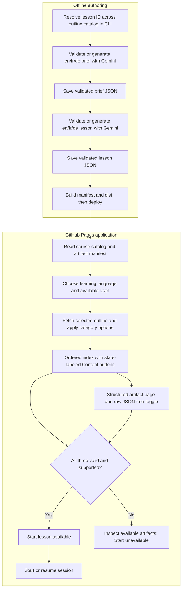

On Start lesson, read and validate the outline, brief, content, hashes, step plan, and renderer support. A missing file, network error, malformed JSON, or stale manifest discovered after clicking produces an actionable readiness error and a return to overview. It never triggers generation. Successful checks open the start/resume page with objective and estimated duration; its Continue action enters the session.

### Generator behavior

The CLI reuses shared preparation functions for single lessons and ordered batches:

1. Resolve immutable metadata from the selected outline entry and course metadata.
2. Choose the category-specific schema and prompt. Brief generation receives the outline; content generation receives the outline and validated brief.
3. Request structured JSON with a JSON Schema derived from the Zod structural contract and supported by the configured Gemini model. Zod refinements remain local validation rules.
4. Parse and validate the response with the full Zod schema, then perform cross-reference and pedagogical checks. Model-constrained JSON alone does not prove correct teaching content.
5. Assemble trusted metadata locally and atomically save the validated object at the canonical path. Reject IDs/classifications that contradict the selected outline.

Gemini supports structured JSON output and a subset of JSON Schema. Keep local validation, including checks that cannot be represented in the generation schema. See [Gemini structured output documentation](https://ai.google.dev/gemini-api/docs/structured-output).

A single structured-output response may not fit a complete multilingual lesson: a 21–31-target vocabulary lesson with en/fr/de explanations for every answer unit can exceed the model's output limit. Content generation may therefore request separately validated sections (for example per stage or per teaching block) and assemble them locally into the one canonical lesson file. Parts fully determined by the validated brief, such as flashcard sides, matching pairs, and noun-gender rows, should be assembled locally rather than regenerated. The saved file remains a single atomic write after the assembled object passes full validation.

Use a bounded policy: at most three model calls per generation unit (a brief, or one content section) including transient retries or schema repair, with capped backoff. Supply field-level validation errors on a repair attempt. Content failure preserves a valid saved brief; the next CLI run resumes the missing stage. Existing valid artifacts are reused without Gemini calls. Invalid/stale files require an explicit CLI regeneration option. Write a temporary file and rename only after validation; failed replacement retains any valid prior artifact. Deduplicate preparation for an ID and serialize batches by default. Diagnostic generation status belongs in CLI output, not the learner UI.

The P1-05 brief implementation uses `make brief ID=<id> REGENERATE=1` for explicit replacement, including a valid file when the author requests it. `make briefs-missing` never forces replacement: it reports stale/invalid/malformed files as failures requiring individual review and continues with other IDs. Retries for HTTP 429, server errors and network/timeouts share the three-call budget with JSON/Zod/semantic repairs; backoff between generation calls is capped at four seconds, while each call first works through the configured models and keys as described under the environment below. Permanent API errors stop immediately. Raw API errors and credentials are never printed. Repair requests include the previous payload and field-level errors.

P1-07 implements content generation with `make generate ID=<id>` (brief first when missing, then content; `REGENERATE=1` replaces the content only) and `make generate-missing`. Since P2-04 a vocabulary lesson is its brief (D47): `make brief`/`make generate` first request the word inventory (the brief without exercise texts, about 18 targets in groups), then three sections that fill it: `introduction` (one formatted text per word group), `words` (per word the explanation, noun-gender explanation, optional disambiguated matching label and optional exam prompt) and `practice` (per word the typed-gap sentence with its four reference words and explanation, and four listening options). The parts are merged into one brief, `estimatedMinutes` is computed from the derived pages, and the whole brief is validated and saved once; issues on `groups.N.introduction` go to the introduction section, on the word texts and matching labels to `words`, on `gap`/`listeningOptionTargetIds` to `practice`, and all others to the inventory (a repaired inventory regenerates every section). Grammar content is requested per teaching block (explanation plus the planned exercise items) and for the exam. For grammar the generator assembles step order, page IDs, page durations split from the brief plan, exam time limits, step labels, page instructions and the production placeholder locally. The assembled lesson passes full validation before one atomic save; issues on `steps.N` are attributed to the section that produced that step, and only that section is repaired within its three-call budget. Provenance lists every model used and the input hashes of the outline entry and brief.

In-process calls for the same canonical path share one pending operation. An exclusive `<id>.json.lock/` rejects a concurrent second process rather than paying for duplicate generation. Normal completion/failure removes the lock and temporary file. After a crash, the author may remove the lock only after confirming no generator is running. Temporary files and lock directories are ignored by Git and excluded from manifest/build copying. Recheck the per-entry outline hash before saving so an edit during generation cannot silently save an out-of-date response. Envelopes and provenance are assembled locally; the model supplies a strict category payload and cannot override trusted IDs or metadata. Full local validation retains constraints omitted from Gemini's supported JSON Schema subset.

Record schema version, generation timestamp/model/prompt version, and canonical input hashes. Hash canonical JSON (sorted keys, no insignificant whitespace). The outline hash covers only the lesson's own outline entry plus its course `lang`/`level`, so editing one outline entry does not mark every lesson in that course stale. A brief stores its outline hash; a lesson stores its outline and brief hashes. Changed inputs or incompatible schemas mark dependent content stale. Rebuild and redeploy after generation; the manifest and runtime use the same hash rules.

## 4. Schema design

### Shared envelope

Briefs and lesson files use an envelope with:

| Field | Purpose |
| --- | --- |
| `schemaVersion` | Explicit compatibility version. |
| `id`, `kind`, `lang`, `level` | Must equal the outline/course metadata. |
| `locales` | Required supported locale set en/fr/de; files serve every mother-tongue/interface combination. No single nativeLanguage in an artifact. |
| `topic` or `theme` | Grammar requires topic only; other kinds require theme only. |
| `title`, `objective`, `estimatedMinutes` | Learning-language title, localized en/fr/de objective, shared numeric duration. |
| `provenance` | Generator/model/prompt details and applicable input hashes. |

Use strict objects, bounded nonempty strings and arrays, unique stable nested IDs, and category discriminators. The maintained vocabulary/grammar briefs express the category-specific plan, translated targets and localized support text; content schemas express renderable payloads rather than a competing generic brief.

Separate **brief planning** from **renderable lesson content**. Grammar content generation must use `GrammarLessonContentSchema`, not a brief schema again. Vocabulary is the exception since P2-04 (D47): the brief holds every exercise text and the renderable lesson is derived from it by the application (`src/domain/vocabularyLesson.ts`), never stored. An exercise prompt/answer set belongs in the lesson content; the brief specifies what those exercises must teach and cover.

### Multilingual brief/draft and content contract

P1-03 implemented **both** category-specific brief schemas and lesson-content schemas; the brief is called Draft in the UI. The maintained contracts require multilingual support. Require complete locale maps on every localized field rather than three parallel lesson files. Keep canonical artifact paths `content/briefs/<id>.json` and `content/lessons/<id>.json` (vocabulary: the brief only, D47), stable item/target/rule IDs, one ordered page plan, one set of learning-language accepted answers, and shared scoring/timing values.

The structural Zod building blocks are illustrated below; the maintained executable definitions and bounds are in `src/schemas/artifactCommon.ts`:

```ts
const LocaleSchema = z.enum(['en', 'fr', 'de']);
const SupportTextSchema = z.string().trim().min(1); // Add shared field-specific bounds.
const LocalizedTextSchema = z.strictObject({
  en: SupportTextSchema,
  fr: SupportTextSchema,
  de: SupportTextSchema,
});
const TranslationVariantsSchema = z.array(SupportTextSchema).min(1);
// Built per course: every locale except the course's learning language.
const nativeTranslationsSchema = (lang: Locale) =>
  z.strictObject(
    Object.fromEntries(
      LocaleSchema.options.filter((l) => l !== lang).map((l) => [l, TranslationVariantsSchema]),
    ),
  );
```

`Locale` is `z.infer<typeof LocaleSchema>`. Non-locale learning languages (none at present) keep all three keys.

Use `LocalizedTextSchema` for generated objectives, introduction copy (restricted Markdown, D46), learner-facing step labels/instructions, rule explanations, teaching notes, pitfalls, and every scored answer unit's `answerExplanation`. Use the course's native-translations schema for vocabulary meanings and worked-example translations; translation-source prompts use corresponding localized native-language text, selected by mother tongue. If an exercise uses longer native prompts, its prompt map has required entries for every mother tongue other than the learning language under the same item ID. Canonical learning-language terms, example sentences, gaps, tokens, answer keys and pronunciation text remain single fields in `lang`; do not translate the assessed answer to the interface or mother tongue.

Vocabulary briefs include translation variants for every available mother tongue (en/de for French courses) for every target and native prompt, plus all three support-language objective/context/explanation plans. Grammar briefs include all three objective/rule-plan/pitfall variants and worked-example translations for every available mother tongue. Content generation receives the outline, full multilingual brief, category schema and explicit locale requirements; it fills the same IDs and shared plan with all three support-language realizations. Validate identical assessed meaning and answer-key applicability across translated prompts during pedagogical review; locale-specific examples must not silently change the expected answer or item difficulty.

Require all three keys with nonempty values throughout nested payloads; do not accept partial localization as a valid lesson, duplicate per-locale target inventories, or a single nativeLanguage artifact. Record the locale contract in provenance/versioning, bump the schema version for this incompatible change, and treat prior English-only artifacts as stale under the existing explicit regeneration policy. Readiness and generation reuse require the complete current locale contract. Zod catches missing/empty/wrong-shape maps; human review checks actual language/translation quality and translated accent explanations. Numeric durations, points, limits and enum/reference keys are not localized.

The initial reviewed sample set remains the first ten fr/A1 vocabulary and first ten fr/A1 grammar lessons, but **each** brief/content file now includes en/fr/de. These are twenty lesson IDs, not sixty separate lessons. Additional outline courses are discoverable from phase 1; their teaching/content support follows the same shared contract without inventing missing function/reading requirements.

### Vocabulary brief

`VocabularyBriefSchema` defines:

- Learning objective, outline coverage notes, explicit target count, count rationale, difficulty-balance notes, duration estimate, and prerequisites if any. The target array must match the planned count; larger inventories require grouping and an appropriate longer duration estimate.
- Target entries: `id`, learning-language base term, required native translations for every available mother tongue, word class, gender where applicable, grammatical number, teaching display form, exam form(s), and pronunciation text (IPA, shown to learners and reviewers; audio speaks the teaching display form, because speech synthesis would read IPA symbols literally).
- Noun article policy: indefinite article where applicable, plural form where needed, and explicit exceptions for phrases, verbs, letters, numerals, proper names, or other unsuitable forms. A required article belongs in the full accepted exam answer, not in a heuristic added by the UI. In the exam nouns are accepted **only** as indefinite article + noun, in translation and dictation alike (D47); so the brief must give the indefinite form: for nouns without `articleException`, the teaching form, every exam form and every gender variant start with the agreeing `un`/`une`/`des`. Use the indefinite article wherever it is grammatical, even when the outline intent quotes definite forms (D39): `le père` and `la cuisine` are taught and examined as `un père` and `une cuisine`, and plural-only nouns use `des`. Only targets with no grammatical indefinite form (countries and other proper names, verbs, numerals, letters, set phrases, or predicative professions such as `je suis étudiant`) use explicit exception forms. The validator enforces agreement: `un`/`une` follow the noun's accepted genders in the singular and `des` the plural, and a singular target never accepts a plural form. There are no per-target accepted variants: the exam forms are the only fully correct answers (plus gender variants such as `espagnole` when a translation prompt does not say which is meant), derived by one shared rule. Genuine alternative spellings belong among the exam forms; accent, capital and ligature differences are graded by the shared classifier (50 %), and definite or bare noun forms are wrong because the exam always asks for the indefinite article. The teaching form is one of the exam forms (adjectives may show their gender pair, `espagnol, espagnole`), and `articleException` is set only when no exam form uses an indefinite article.
- One planned context for each target, and contextual ambiguity notes where a translation has several valid answers.
- **Exercise texts (P2-04, D47):** the brief is the whole lesson, so it contains everything the learner reads. Each word group has a formatted `introduction` (restricted Markdown, D46). Each target has `explanation` (why the French form means this word; shown when matching, listening choice, translation or dictation is corrected), `genderExplanation` (nouns only: lexical gender and indefinite article; null otherwise), `matchingLabel` (a disambiguated native label when two words of one derived matching page would share a translation; null otherwise), `examPrompt` (a native prompt when the first translation does not say which gender/number is meant; null otherwise), `gap` (a context sentence `before` + gap + `after` taking the word without its article, article-free `accepted` answers, four distinct non-clickable `referenceTargetIds` including the word of which only the word fits, and a sentence-specific `explanation`) and `listeningOptionTargetIds` (four distinct written options including the word, preferably similar-sounding).
- **No plan:** the brief has no stage, duration or exam-page plan. Every word takes part in every exercise and the application derives pages, durations and exam limits by fixed rules (section 6, "Derived vocabulary lesson"); `estimatedMinutes` must equal the derived page estimates rounded to minutes. Nouns get a gender row on the one gender page (lemmas without articles or gender clues while answering); lessons without nouns keep an unscored overview.

The standard is **8 targets per vocabulary lesson**, 9 when few are nouns (D14, changed in P6-02): every lesson takes at most 15 minutes. Use fewer only for an unusually demanding load; a large finite inventory (numbers, the alphabet) is taught through its most useful targets. Mix straightforward and harder targets within each lesson's outline topic where the topic allows it, rather than concentrating difficult items in dedicated difficult-only lessons; do not force a mix or mark targets as harder only to create one. Consider spelling, pronunciation, phrase length, gender/article exceptions, and required written forms when assessing the load. The brief explains its target count and difficulty balance in `countRationale`. Organize the words in 2 groups of about 4 related words (3 only when the topic needs them).

Treat the standard as a planning guide and validate it against the authored briefs and sample completion times. Repeated retrieval improves retention, with a time-on-task tradeoff, so leave enough time to practice the targets. See [Nakata's within-session retrieval study](https://doi.org/10.1017/S0272263116000280). Because every word takes part in every exercise (about 98 s per noun, 96 s per other word, plus 20 s per group and 20 s for the gender page), 8 words give a lesson of about 14 minutes and 18 words one of about 30 minutes.

Across the 48 vocabulary lesson slots, the standard of 8 gives a baseline of **about 400 taught targets** (864 under the former standard of 18). This is a planning estimate, not a guaranteed distinct-word count; repeated targets, multiword expressions, alphabet letters, and numerals must be distinguished when reporting vocabulary coverage. Since P6-02 the ten vocabulary lessons in `content/` have 8–9 words each and take 14–15 minutes; the outlines did not change.

Count one taught word or phrase as one target: `un livre` is one target, and a multiword expression is one target, not one per token. Repeated appearances of a target in the six stages do not increase the target count.

The schema still accepts larger counts (up to 60 targets), but the 15-minute limit applies to every lesson. Do not narrow the outline or split existing IDs to fit the limit; choose the targets instead. Validate target-count consistency and pedagogical coverage instead. Examples and translations must support the intended A1 lesson without unrelated prerequisite grammar.

### Grammar brief

`GrammarBriefSchema` defines:

- Topic, objective, prerequisites, scope boundaries, and duration budget.
- **2–4 teaching blocks**, each with stable ID, rule IDs, bite-sized explanation plan, learning-language examples with translations for every available mother tongue, pitfalls/irregularities, and a targeted exercise plan.
- Exercise plan entries (2–4 per block, 4–8 items each) with allowed type, item count, and assessed rule IDs, meeting the length rules of section 7 (D49). Choose pronoun-form exercises only for topics where they fit.
- `newVerbs`: the verbs the lesson introduces that no earlier vocabulary lesson taught, with translations for every mother tongue (P3-07).
- Common pitfalls and irregularities for teaching explanations and item-level corrections. A personalized diagnosis/error catalogue is not required for the prototype.
- A fixed feedback-placeholder stage and final exam blueprint covering the taught rules. The exam uses typed sentence gaps, typed pronoun forms, and word order when sentence structure is assessed. Plan 2–4 exam pages with at least 16 scored units, their duration estimates, and a positive countdown limit for every exam page.

Keep the pedagogy explicit enough that the lesson generator fills a defined plan rather than independently inventing its sequence.

### Renderable lesson content

`LessonContentSchema` is a discriminated union by kind. Grammar lessons are stored files; the vocabulary lesson has the same shape but is derived from the brief and never stored (D47). Each supported kind has ordered steps and typed exercise items. Supported step roles include introduction, explanation, exercise, overview, feedback, and exam; the schema validates the category-specific sequence.

Each step has `id`, role, label, relevant brief/rule/target references, and a typed payload. Each concrete learner page has a unique `pageId` and positive `estimatedDurationS`; every exam page additionally has positive `timeLimitS` copied from its brief plan (vocabulary: derived, section 6). Validate that the envelope's `estimatedMinutes` equals the summed page estimates rounded to the nearest minute, rather than trusting two independently generated figures. A page may contain one item or a group of answer units. Validate that the generated page inventory and timer limits match the brief. Each scored exercise has `type`, stable `itemId`s, instructions, prompts, full answer keys (vocabulary exam answers derive from the brief's exam forms), and item-level feedback/rule references. Every scored answer unit also has a required short localized en/fr/de `answerExplanation`, pre-generated with the correct answer and shown whenever a correction is revealed. Variant-specific explanations may be provided when answers differ. Validate that explanations are present and nonempty; they describe the relevant meaning, spelling, gender/article, or grammar rule, rather than merely repeating the answer. For noun gender, explain the lexical gender and appropriate article without inventing a universal spelling-based rule. The grammar feedback step uses the application's fixed production-placeholder text; the model does not generate individualized feedback. Rendering and scoring use the discriminator; the model does not return executable JavaScript, arbitrary components, or arbitrary HTML.

| Exercise discriminator | Payload essentials | Scored units |
| --- | --- | --- |
| `vocabulary_flashcards` | Target IDs; front native / back French display and pronunciation | Completion only |
| `vocabulary_matching` | Unique left/right entry IDs, pair keys, shuffled display order | One per pair |
| `vocabulary_gender_select` | All target IDs, noun lemmas, accepted genders, select options, answer explanations; reviewed overview uses locked row results | One per applicable noun |
| `vocabulary_typed_gap` | Sentence segments, one gap, four noninteractive reference choices, accepted article-free answers | One per gap |
| `vocabulary_translation_exam` | Native prompt and accepted full French answers | One per target |
| `vocabulary_listening_choice` | Target ID (audio speaks its teaching form), four distinct written learning-language options with one answer ID | One per item (practice) |
| `vocabulary_listening_dictation` | Target ID (audio speaks its teaching form), accepted written answers including the spoken teaching form with its required article | One per item (exam) |
| `grammar_person_matching` | Mode (`translation` or `forms`), rows by person (`1sg`–`3pl`) with the left prompt (mother-tongue pronoun or French pronoun), the French answer and an explanation | One per row (French box) |
| `grammar_pronoun_form_match` | Pronoun rows, form token IDs, valid assignments | One per row |
| `grammar_pronoun_form_typing` | Pronoun rows and accepted forms | One per row |
| `grammar_gap_choice` | Sentence gap and four distinct choices with answer ID | One per gap |
| `grammar_gap_typing` | Sentence segments, gap answer(s), optional hint | One per gap |
| `grammar_word_order` | Stable token IDs, accepted token sequences | One per sentence |
| `grammar_error_spotter` | Tokenized sentence, faulty token ID, correction mode and answers | One per sentence; detection and correction must both be right |
| `reading_keyword_matching` | Key-word IDs; meanings, terms and explanations from the brief | One per key word |
| `reading_skim_choice`, `reading_choice` | Course-language question, 3–4 options, answer ID | One per question |
| `reading_true_false` | Course-language statement, answer `true` / `false` | One per statement |
| `reading_order` | Pieces of information, 1–2 accepted orders | One per task |

Introduction, grammar explanations, reading flashcards and reading documents (`reading_flashcards`, `reading_document`) use unscored payloads; the reading items are specified in section 9. Stage 4 exists only when the lesson has nouns (P06-00); it is scored, followed by an unscored reviewed display on the same page; count its noun answers once, with no extra score for acknowledging review. The exam is a **container of scored items**, potentially mixing supported types; it is not a seventh universal exercise interaction. Phase 1 must model this before phase 2 begins.

Reference validation rejects missing targets/rules, duplicate nested IDs, unknown exercise types, empty exams, incomplete brief coverage, invalid answer keys, and incorrect category sequences. Duplicate displayed form text is allowed when distinct tokens/forms are needed; score assignments by grammatical validity, not arbitrary token identity.

Native-language labels shown together in one matching group or on the stage-4 overview must be unique within that group for **each** locale; where two targets share a translation in some locale, the content adds a short disambiguating note for that locale. Translation-exam prompts must disambiguate gender/number when a mother tongue does not mark it (for example English “French (woman)” or “student (female)”), or the item must accept every valid form. Error-spotter items contain exactly one faulty token replaced by a correction; omissions or insertions (such as a missing `ne`) are not error-spotter items.

Content stores canonical item and choice order. Matching sides, gap choices, and word-order banks are shuffled at runtime with a seed stored in the session, so resume and results review show the same order without changing answer identity.

P1-03 implements these contracts in `src/schemas/artifactCommon.ts`, `vocabulary.ts`, `grammar.ts` and `artifacts.ts` (structural Zod schemas that convert to JSON Schema), with cross-reference, coverage, timing and wording checks in `src/validation/artifacts.ts` and the shared free-text classifier in `src/domain/answers.ts`. Contract fixtures for noun vocabulary, non-noun vocabulary with listening, conjugation grammar and non-conjugation grammar live in `tests/fixtures/content/`.

Store word-order punctuation and repeated tokens explicitly. Do not split sentences with a simplistic space-only parser. Allow multiple correct sequences/answers when linguistically valid, while ensuring prompts make the intended answer assessable.

### Formatted teaching text (D46)

Vocabulary `vocabulary_introduction.text` and grammar `grammar_explanation.text` are generated as **restricted Markdown**, one string per interface locale. One parser (`src/domain/richText.ts`) serves the validator and the renderer (`RichText`). Any other prose field stays plain text.

**Syntax**

| Element | Write | Renders as |
| --- | --- | --- |
| Paragraph | text; a blank line separates paragraphs (a single line break becomes a space) | `<p>` |
| Bulleted list | every line of the block starts with `- ` | `<ul>` |
| Numbered list | every line of the block starts with `1. `, `2. `, … | `<ol>` |
| Key idea | `**bold**`, plain text inside | `<strong>` |
| Learning-language form | `` `un livre` ``, `` `je suis` ``, `` `Il est médecin.` `` | highlighted span with `lang` set to the course language |

Not allowed: headings, block quotes, tables, code fences, `*`/`+` bullets, `*italics*`, links, images, HTML, literal `\n`, markup inside bold or inside backticks, and a list without a blank line before and after it.

**How to write it (generation guidance)**

- **Introduction (one per target group):**
  1. A short lead paragraph names the topic or pattern, with one `**bold**` key idea.
  2. A list gives the group's targets, one per line, as `` `teaching form` `` followed by "– meaning" and an optional short example sentence.
  3. A closing paragraph adds one useful observation (gender, pronunciation, spelling) or a study tip.

  Do not quiz the learner.
- **Grammar explanation (one per teaching block):**
  1. A rule paragraph states the rule, with one `**bold**` key idea.
  2. A list gives the forms or cases, one per line, each with a backticked example.
  3. A final paragraph or list names the typical pitfall.

  The separate form table and examples are rendered after the text, so the text should not repeat them in full.
- **Backticks** go around every learning-language word, form or sentence quoted in the text, in every locale, including the French locale. Do not use them for interface-language words, IPA or endings such as -er.
- **Parity:** en, fr and de have the same paragraphs and lists in the same order, and exactly the same backticked forms. Only the surrounding prose is translated.
- **Length and tone:** keep paragraphs to one to three sentences and lists to at most about eight items. The text stays within the long-text limit of 1,200 characters per locale. The tone addresses the learner directly.
- **Answer policy:** the text must not contradict the answer policy. It shows nouns with the indefinite article that the exam asks for, and it does not promise alternative spellings that are not exam forms.

Example (en and de of one introduction; fr has the same structure and forms):

```text
These six classroom objects are **masculine**: they take `un`.

- `un livre` – book
- `un cahier` – exercise book

Learn each word together with its article – the article tells you the gender.
```

```text
Diese sechs Gegenstände sind **maskulin**: Sie haben `un`.

- `un livre` – Buch
- `un cahier` – Heft

Lerne jedes Wort mit seinem Artikel – der Artikel zeigt das Genus.
```

**Validation and rendering**

- Content validation reports every syntax error with its locale and block.
- It requires the same block structure (for example `p|ul:6|p`) and the same multiset of backticked forms in every locale.
- Plain text without markup is still valid, as one paragraph.
- The renderer produces only `p`, `ul`, `ol`, `li`, `strong` and `span` elements and never interprets HTML.
- The content prompt (`content-v2`) carries these rules, so regenerated lessons follow them. The twenty samples were reformatted by hand.

## 5. Session, scoring, progress, and exam timing

### Shared session contract

Use React composition: a shared `ExerciseShell`, a typed renderer registry, reusable matching/typing/token-order controls, pure scorers, and a session reducer. Avoid making every interaction inherit from a large component class.

`LessonSessionSchema` stores:

- Session ID, lesson ID, content/schema hash, timestamps, and status (`active`, `completed`, `abandoned`).
- Current step/page/item and phase (`answering`, `practice_feedback`, `exam`, `results`), plus completed pages and their estimated durations.
- Draft and locked responses, correctness class, accent/case differences, earned/possible points, confirmation state, and item/rule references (plan units carry the assessed grammar `ruleIds`).
- Presentation progress that must survive resume, such as revealed flashcards, keyed by page and item (`revealed`), and listening pages skipped without a voice (`skipped_no_voice`).
- Exam page start times, absolute deadlines, time limits, timeout flags, and answers; no public item correctness during the exam.
- Final-results selection (exam by default or an earlier exercise), linked to immutable response records; reviewing results never runs the exercise again.
- Scoring policy version, 35% practice / 65% exam weights, and 50% orthography-only credit.
- Final results computed from responses and policy, never supplied by the model.

Separately, application state holds the in-memory last-completed-score map for the index. This map is never serialized with session records and resets on full reload.

Store learning language/level, attempt mother tongue, interface language at submission, and the original displayed native prompt with response records. Save after meaningful transitions. Session/result headers show the saved attempt mother tongue, even if the starting-page preference now differs; artifact headers show the current starting-page preference. Resume only when the content hash is compatible; changed content starts a new attempt with an explanation. Restart creates a fresh session. Locks, confirmations, timeout events, and repeated clicks are idempotent. Storage failure keeps the in-memory session and shows a persistence notice.

### One Continue action

Practice pages have one primary footer button: it reads **Check** while answering and **Continue** once the feedback is shown (P2-03). There is no separate Submit button. Answer controls (choices, input fields, draggable tokens), audio, and card-flipping remain available as required by their interaction type.

1. While answering, Continue locks the current page's response(s), records first-submission points, and shows immediate visual feedback **on that page**, without navigating away.
2. Fully correct answers receive a clear success state. Orthography-only errors receive a distinct partial-correct state and the correctly accented/capitalized answer. Incorrect answers receive an error state and the correct answer. Both correction states also show the short pre-generated explanation of why that answer is right, including row-level corrections in grouped tasks. Include text/icons so color is not the only signal.
3. Inputs become read-only. Continue remains the only primary action; pressing it again acknowledges the feedback and advances. It does not rescore or require retyping the correction.
4. **Single-answer pages (P2-04 review):** on every practice page whose items each ask for exactly one answer (typed gap, listening choice, multiple choice, one typed word, word order, error spot) and on matching pages, a fully correct answer skips the feedback view: only the chosen answer (the selected option, the paired boxes and their curves, the placed tokens, the typed field, or for typed gaps the correct reference card) briefly lights up green; the rest of the content area stays unchanged, and the next page follows. Pages with several answers per item (gender rows, conjugation tables) always keep their checked view. Exam pages never use it. A wrong answer on such a page shows no feedback card (P2-04 review round 2): a typed field turns red and the correct answer follows it in green (typed gaps: the green reference card above instead); among choices (listening choice, multiple choice) the chosen wrong option turns red and the correct option green; the page waits for Continue. Only a half-point answer (accents or capitals) turns the field amber and shows an explanation ("Almost – …" and the generated explanation) **below** the Continue button, so the button keeps its place. Word order and error spotting keep their feedback card. **Multiple choice (P4-05 review):** on practice pages with one multiple-choice answer (multiple-choice gaps, dialogue gaps) choosing an option submits the page at once, without a Check button; since P6-02 this includes vocabulary listening choices, whose options are written (dialogue listening choices keep Check, because their replies are only heard); a right answer then plays the green animation and moves on, a wrong one is marked in place and waits for Continue. The answer cannot be changed while the animation plays. **Reading (P5-01 review):** pages that show a document (skim, detail, structure) always keep their checked view and wait for Continue, also when every answer is right, and the skim question is confirmed with Check; the reading key-word matching follows this rule like vocabulary matching. **Typed pronoun rows (P4-05 review):** a pronoun-typing page with every row right also plays the green animation and moves on without Continue; with a mistake the rows are marked in place and the page waits for Continue.

Unscored presentation/review pages use Continue once to advance when their review requirements are met. Empty required answers disable Continue in practice. An exam page may submit a blank answer, recorded as unanswered for zero credit.

Exam Continue locks the current answers and immediately advances (the only exception is the missing-article info of vocabulary exam pages, section 6), showing no correctness, corrections, earned points for that page, or answer-revealing style. After the final exam page is submitted or times out, open the **final results page** with the exam selected by default, all score aggregates, and a button menu for earlier exercise results. Record the final weighted score in the current app instance’s last-try map once.

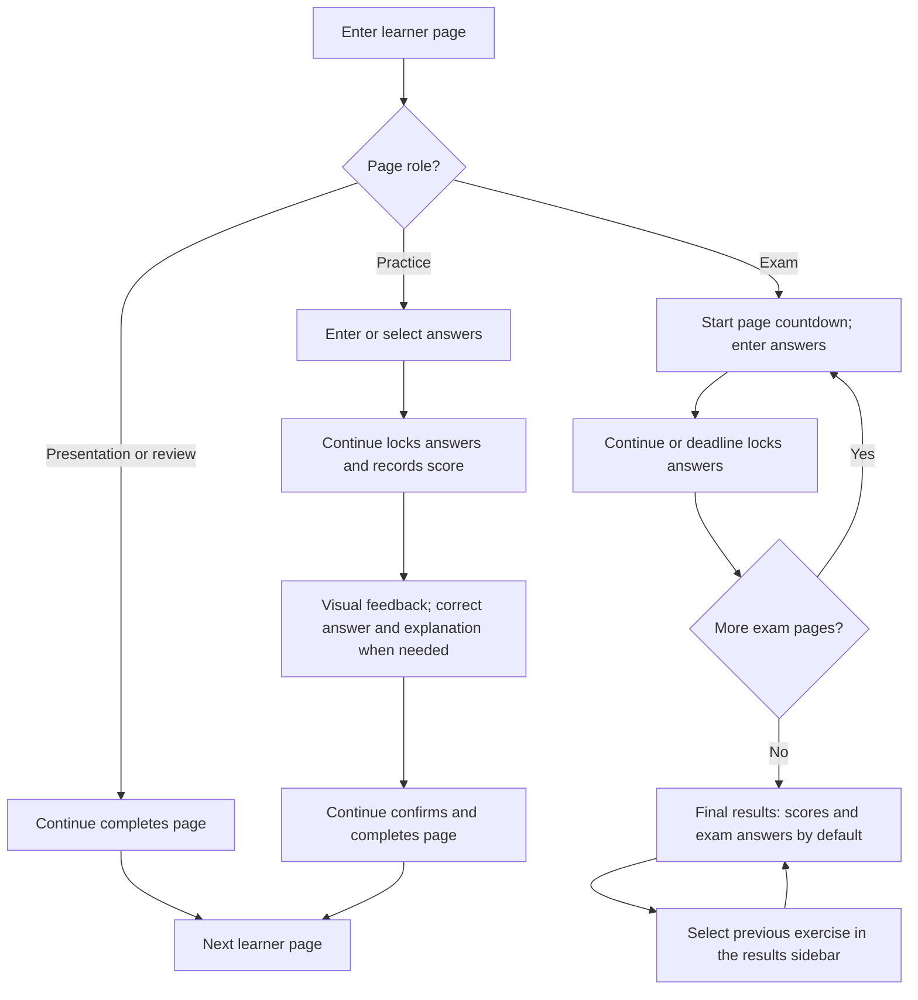

### Autoplay (D52)

The header switch **Autoplay** (on by default, stored with the preferences) lets the application speak learning-language text by itself, using the same browser speech as the Listen controls (D9); without a voice nothing is played. Triggers:

| Situation | Spoken |
| --- | --- |
| Turning a flashcard to its French side (vocabulary, function words and expressions) | the word or expression, at the click |
| A line of a function model dialogue appears (first line, Next line) | the line |
| Matching: clicking a French box, or connecting a pair | the French box; person boards in forms mode the pronoun with its form (`nous sommes`, `j'ai`) |
| Pronoun/form assignment: a form is placed in a row | pronoun + form |
| A dialogue gap, a listening choice or a dictation page opens | role A's line or the word to be heard (waits for speech in progress); dialogue gaps play nothing when checked |
| A practice page is checked (with the start of the green or red marking; multiple choice at the click) | the correct answer: gap (not dialogue-gap) and error-spotter sentences, word-order sentences, pronoun + form of pronoun rows; listening choices play nothing when checked, since the word or role A's line was just heard (P6-02) |

Exam answers are never spoken; matching and gender pages speak nothing extra on Check.

### Lesson navigation (P6-01, D53)

Every lesson page from the first learner page to the results has a **sidebar** left of the content on screens wider than 960 px (the page widens to about 1320 px). Reading pages keep it too (P5-06): the sidebar is neither collapsed nor narrowed for the document; reading lays its pages out by the width left to the task (section 9). Its content depends on the phase:

- **Learning:** "Your lesson", "x of n points done" and a vertical timeline (design V2 of the 2026-10-09 feedback). The points come from the plan (`src/domain/session/outline.ts`): every theory page is a point (vocabulary introduction or flashcards of a group, grammar explanation named by its heading, function flashcards or dialogue, reading flashcards); consecutive practice pages of one step form one point; the exam is the last point. The points are numbered 1, 2, 3… through the lesson; each circle has the colour of its start-page section and keeps its number when done (filled, no tick). The current point is ringed and says "You are here"; others say "Done" or "Not yet open"; the exam shows its flag and its number of tasks. The production-feedback placeholder and the exam info page belong to the exam point.
- **Exam:** "Final exam", "p pages · t questions" and one row per exam page with its kind (translation, dictation, mixed…), its number of questions and time limit (the learner-facing copy says "questions", never "tasks", P6-02); done pages are ticked ("Answered"), the current page says "in progress"; below, "Each page has its own countdown. You see your results only after the whole exam."
- **Results:** "Your results" replaces the former button menu: **Final exam** with its score first, its parts nested below with "x of y" (vocabulary: Translation, Dictation; functions: Translation, Replies, Dialogue; reading has one exam page and no parts), then every scored exercise with its score, coloured by outcome as before. Only the selected part is shown; selecting **Final exam** shows its first part.

Navigation only shows the way (product-owner decision): no learning point can be reopened, neither from the sidebar nor from the phone strip, and there is no Previous button. Locks, drafts, countdowns and deadlines are never touched by navigation; it is derived from the saved session, so it survives a reload, a resume and a change of interface language.

**Phones (960 px and narrower):** there is no sidebar and no drawer. The session header shows the learning points as a horizontal row of numbered round markers in place of the progress bar: done markers are filled, the current one is ringed, the exam has its flag, and the connecting line fills up to the last done point. The percentage and the score follow on the next line. Pressing a marker shows a tooltip below the header with the point's number, title and state; Esc or a press elsewhere closes it, and so does moving to the next page. Each marker is a button with a full accessible name ("2. Multiple-choice gaps 1: You are here"). On the results page the result parts stand above the answers.

### Duration-weighted progress and live score header

All active lesson pages use a consistent header: lesson title, a progress bar with percentage, and **current score / total possible lesson score**. Pages without answers (introduction, theory, flashcards, the exam info page and the feedback placeholder) show no score, because `0 / 100` means nothing there (P06-00); progress stays. Exam pages add their countdown in the task area. Keep the header visually separate from the centered task card.

Progress follows the **estimated length of completed learner pages**, not their count, answer correctness, or elapsed wall time:

```text
progress = 100 × sum(estimatedDurationS of completed learner pages)
                 / sum(estimatedDurationS of all learner pages)
```

Flatten the plan to actual presentation pages, matching groups, typed pages, and exam pages. Credit each page once on completion/advance; do not count both a parent step and its children. Include unscored teaching/review and the grammar production placeholder. The final results page and its selected exercise reviews are post-lesson review, excluded from the progress denominator and displaying 100%. A practice page awaiting feedback confirmation is not yet complete. The generated start-page duration estimate should agree with the summed page estimates.

Use **100 weighted lesson points** as the common header denominator:

```text
visible practice contribution = 35 × earned practice units / all possible practice units
final exam contribution       = 65 × earned exam units / all possible exam units
```

During practice, show earned practice contribution out of 100. Pending units have earned no points; the denominator includes the full lesson's possible points from the start. This is accumulated credit, not accuracy on attempted answers. After the exam, add its contribution and show the final score out of 100.

To preserve delayed exam feedback, keep the header's earned score at the practice contribution throughout the exam, with no “pending” label or other exam-score indicator (D16). Do not update the header after individual exam answers: changes would reveal correctness. Progress and countdown may update normally. Publish the complete exam contribution on the final results page, which also shows exercise scores and raw points in its menu/review.

### Per-page exam countdown

**Practice has no countdown. Every exam page has one**, with its `timeLimitS` specified by the lesson brief for that task and copied into the lesson content (grammar). Vocabulary exam limits follow the derived per-word rule of section 6 (D47). **Exception (P5-01 review):** the reading skim page is a practice page with a countdown (section 9); it has no absolute deadline and restarts after a reload, and reading derives its exam limit from the page rules (D18 exception).

Start the countdown when the exam page becomes active. Display remaining minutes/seconds in a box to the right of the page heading (P6-02, feedback #6): the label "Time left", the time in large digits and a bar of the remaining share of the page limit; in the last 10 seconds the box, digits and bar turn red. On exam pages with more than one typed answer (vocabulary translation and dictation, grammar typed gaps, function translation; not the function exam dialogue) every task is a numbered card, the task on the left and its field on the right, stacked on phones (P6-02, feedback #26). Continue submits before expiry; expiry automatically locks the page's current draft answers and advances through the same transition. Valid drafted answers are graded normally; unanswered units earn zero. Mark timed-out pages in the feedback review.

Use an absolute deadline and recompute remaining time from it, so tab throttling, a page reload, or resume cannot reset or extend the allotted time. Persist the deadline. An expired current page is finalized on resume. Resolve a simultaneous Continue/timeout once; input after the deadline cannot alter the locked result. Tests use a fake clock. A new exam page gets its own brief-defined limit on activation. Exam answer feedback, audio of the target answer, hints, gender badges, and backward answer editing stay unavailable until the complete exam finishes. The only exception is a listening-dictation page, whose prompt **is** the target audio; it may be replayed until the page locks.

Known prototype limitation (D43): during an active exam the learner can return to the overview and open the lesson's artifact page, whose Content previews show answer keys. Generated content is public static JSON on Pages, so the prototype does not lock the artifact page.

### Free-text correctness and points

Orthography feedback must **name the mark**, rather than saying only “is written with é” or another accented character. Apply this wording to result pages and their pre-generated explanations, as well as the same corrections shown during practice and artifact inspection. For French, use the appropriate name:

| Mark | Example feedback wording |
| --- | --- |
| é | “Use an accent aigu on e.” |
| è | “Use an accent grave on e.” |
| ê | “Use an accent circonflexe on e.” |
| ç | “Use a cédille on c.” |
| ë | “Use a tréma on e.” |
| œ / æ | “Write the ligature œ (o and e joined).” / “Write the ligature æ.” |

For German umlauts, use “The word is written with umlaut ä” (or ö/ü as applicable), also when the learner typed the digraph `ae`/`oe`/`ue`. This is a wording convention for future German content, not an expansion of the French A1 prototype. Keep the full correct answer visible separately. Generated explanations must use the mark appropriate to the actual target spelling; generation prompts and content review enforce this wording. Credit remains unchanged.

All free-text responses have three assessable outcomes, plus unanswered:

| Result | Comparison | Credit per answer unit |
| --- | --- | --- |
| `fully_correct` | Matches an accepted answer including accents and upper/lowercase | 1 point |
| `orthography_only` | Same letters/word sequence; differences are only accents and/or upper/lowercase | 0.5 points |
| `incorrect` | Wrong letters, words, word order, article, or other unaccepted content | 0 points |
| `unanswered` | No answer supplied | 0 points |

First normalize Unicode NFC, trim/collapse whitespace (including no-break and narrow no-break spaces used before French `? ! : ;`), and normalize typographic apostrophes **without removing case or accents**. Compare against full accepted answers. If none matches, compare copies with case folded and combining accent marks removed to detect `orthography_only`. A second orthography comparison also expands `œ`→`oe`, `æ`→`ae`, `ä`→`ae`, `ö`→`oe`, `ü`→`ue` on both sides before removing marks, so `soeur` for `sœur` and `Maedchen` or `Madchen` for `Mädchen` earn 0.5 (D40). This includes accents that make another word (`la` for `là`, `a` for `à`): an accent is a spelling mistake, not a deliberately chosen word (D40). Preserve the original submitted text and the expected answer for feedback. Do not use the draft's `foldText`: it also changes distinct letters/ligatures. Required articles stay part of the comparison.

Examples: expected `un café`, answer `un café` earns 1; `un cafe` or `Un café` earns 0.5; `une café` earns 0; expected `la sœur`, answer `la soeur` earns 0.5; expected `Il va à Paris.`, answer `Il va a Paris.` earns 0.5. Explicit valid variants can earn full credit if the content declares them accepted. Both practice and exams use the same classification; exam classifications remain hidden until final results.

Non-text tasks earn 1 or 0 per atomic unit. Multi-row tasks earn credit per row; word-order/error-spotter sentences are whole units. Where a text correction is involved, an otherwise correct error-spotter answer may receive the text's 0.5 orthography credit. The detection must also be right. Continue locks first-submission points; acknowledging feedback cannot improve them.

### Weighted totals and final results menu

```text
exercise score = 100 × earned exercise points / possible exercise points
practice score = 100 × all earned practice points / all possible practice points
exam score     = 100 × earned exam points / possible exam points
total score    = 0.35 × practice score + 0.65 × exam score
```

Store raw points, including halves, and round only displayed percentages and weighted scores to one decimal place, half up, from the unrounded value (78.25 displays as 78.3). Exclude unscored screens from score denominators. Mixed exam sections contribute within the 65% exam share according to their possible points, counted once. For example, 80% practice and 60% exam produce 67% total.

The final results page shows the weighted total, practice/exam aggregates and weights, and scores for each scored exercise. **Exam results are selected by default**: show every task, the original locked learner answer, a correct accepted answer, correctness/points, timeout markers, and the pre-generated explanation where an answer needs correction. Include sub-answers on grouped pages. This is answer review, separate from the pre-exam production-feedback placeholder.

Use the supplied results screenshot as the layout reference: a dark page with flat answer rows, a correctness icon aligned to each prompt, muted “Your answer” / “Correct answer” labels, and thin slate dividers. Incorrect answers use red; accepted correct answers use green. Accent/case-only answers use an amber icon/text, explicitly show 0.5 credit, and show the fully correct spelling in green. Always include text classification and points so color is supplementary. A fully correct answer identical to the accepted answer can appear once in green; do not repeat an identical correction line. When an accepted variant differs from the displayed teaching answer, show both. Show short pre-generated explanations for corrections, plus timeout/unanswered markers when applicable. Keep the weighted score summary and exercise-result menu above the answer list; use the same row component for exam and previous practice results. This layout does not change grading or release exam feedback early.

The results sidebar (P6-01) selects **Final exam** (or one of its parts) or any earlier exercise result by step/block label. For vocabulary with nouns this includes Matching, Gender, and Typed gaps. Repeated grammar exercise types have unique block labels. Completion-only exercises such as flashcards can show their completion record instead of an invented correctness score. Keep aggregate scores visible while the selected result changes. Non-noun lessons have no Gender menu entry. Each review uses stored locked responses and explanations, with the original accent/case visible; changing menu selection does not rescore, alter progress, restart timers, or edit answers. There is no separate mandatory exam-feedback-to-summary transition. Lesson overview and Restart lesson are the final page's navigation actions.

No pass/fail gate is required. A pass label and threshold remain optional future decisions.

### Phase 1 implementation (P1-09)

`src/domain/session/` holds the pure session engine: `plan.ts` flattens content and brief into concrete pages (presentation, practice, exam) with scorable answer units (text, choice, token order, error spot); `session.ts` contains the record, scoring, the reducer for draft/Continue/expiry/results selection, duration-weighted progress, the header score and final results; `storage.ts` saves one attempt per lesson in browser storage. `src/session/` provides the start/resume page, the session host with header and countdown, the results page, and a renderer registry keyed by item type.

The registry starts with **baseline renderers** for every vocabulary and grammar item type, so both categories are playable from phase 1: text fields for typed units, radio choices for gaps and listening, selects for matching, gender and pronoun/form assignment, token buttons for word order and error spotting, tables for introduction/overview, and disclosure cards for flashcards. Phases 2/3 replace individual registry entries with the full interactions (drag and drop, card flipping, audio-first listening and the no-voice help page) without changing the session host or scoring. Speech uses the browser's speech synthesis with the course language.

## 6. Vocabulary learning flow

Keep six stages, integrating noun-gender practice into the overview stage and listening into the practice and exam stages (D41):

1. **Introduction:** the formatted group text (D46) only, without a word table. In the learner session each group's introduction page is followed directly by that group's flashcards (introduction 1, flashcards 1, introduction 2, …); artifact previews keep the step order.
2. **Flashcards:** all cards of a group on one page, in two columns on wide screens and one below the other on phones. The front shows only the native-language meaning; a flip button in the top-right corner turns the card to the French side only (teaching form with a large speaker button that reads it aloud, applicable gender, and the context sentence with a small speaker button that reads the whole sentence) and back, without changing the card's size. The first flip of each card is stored in the session (`revealed`), so progress survives a resume, and Continue is enabled once every card of the page was turned.
3. **Matching:** connect native/French targets in manageable groups. The two columns are shuffled independently from the session seed; the learner selects an item on either side and then its partner on the other (pointer, touch or keyboard: every item is a button). Each French form has a small speaker button inside its box. On wide screens (from 720 px) the columns stand apart and a Bézier curve starts at the inner middle of the selected box and follows the pointer; over a box of the other column it stops at that box's inner border, and a click docks it onto the partner; every pair stays joined by its curve. On phones pairs are numbered instead. Paired boxes have a purple border; pairs stay editable until Continue, and choosing a taken partner moves it. Applicable French forms show gender. Continue (enabled once every pair is assigned) locks one unit per French form. Continue stays greyed out (no extra hint) until every pair is assigned. There is no separate correction view (P2-04 review round 3): after Check every French box glides (1.2 s, frame by frame, starting slowly, speeding up and settling) into the row of its correct meaning; the slide also plays when the system asks for reduced motion, because it shows where each word belongs (Windows reports reduced motion whenever its animation effects are off), and the curves are redrawn every frame so they move with the boxes. When every pair is correct, the content area then flashes green as before (background and border, 0.9 s; boxes and curves keep their colours, the purple curves are drawn thin) and the next page follows. Otherwise a summary ("4 of 6 pairs correct") replaces the hint, correctly matched French boxes turn green and wrongly matched ones red (each level with its correct meaning), only the wrong pairs keep their curve, now red and dashed (phones: numbered badges on the wrong pairs only), the other curves disappear, and the page waits for Continue. Matching shows no explanations.
4. **Gender exercise and reviewed overview (step label **Gender**):** show **all nouns on one page**. Words without a gender (verbs, adjectives, other word classes) are left out (P06-00). Nouns have a select box with an initially unanswered state and appropriate gender options. While answering, show noun lemmas without articles, gender tags, or audio that supplies an article. This temporarily overrides the earlier stages' gender-display rule so the answer is not exposed. Preserve explicit gender/context policies for nouns that accept more than one gender. Continue locks all noun choices and scores one unit per noun. The same page then becomes the overview, showing the learner's selected gender, correct gender and teaching form, right/wrong indicators, translations and audio; it shows no explanations (see the layout below). Continue acknowledges the overview and proceeds to gaps. Retain the locked row results for final-results review. Lessons without nouns have no stage 4: matching is followed directly by the typed gaps (P06-00), as in function lessons. Layout (P2-03): the page stays the same before and after checking. Every noun sits in a compact grid (two columns on wide screens) with a speaker button left of the word; while answering, each noun shows its bare `term` (never with an article; validated) with masculine/feminine choice pills, and the speaker reads only that bare term. Practice pages show **Check** while answering and **Continue** afterwards. After Check a summary ("5 of 7 genders correct") appears, each noun shows its teaching form (spoken by the speaker) and translation, a correct choice gets a green border, a wrong choice a red border and the correct gender a green border as well (P2-04 review round 6); there is no explanation on the gender page (P2-04 review round 3). Nothing moves when checked (P2-04 review rounds 2 and 5): the bare term and the teaching form with translation occupy the same space (the hidden one keeps its size), the choice pills always stand on their own row below the word, every state keeps a 1 px border (emphasis via an inset shadow), the summary line is reserved invisibly before Check, and the page always reserves the scrollbar gutter.
5. **Typed context gaps and listening choice:** typed gaps use the application instruction "Choose the right word and type it." and follow reference R4: the four noninteractive reference choices as centred, padded cards one under another (applicable gender beside the word, no label) above a large sentence with the answer field; the cursor starts in the field, and once checked (also during the green success flash) the correct card lights up green; type the missing word without article. Show applicable gender alongside reference forms. Listening-choice pages play a target with browser speech and the learner selects it from four written learning-language options (choices are interactive here), each with its gender as small extra information where applicable (P2-04 review). A fully correct typed gap or listening choice lights up only the correct reference card or the chosen option green and moves on without a feedback view (section 5, rule 4). A wrong typed gap turns the field red while the correct reference card above lights up green (the answer is not repeated after the field); a wrong listening choice turns the chosen option red and the correct one green; a half-point gap turns the field amber and explains itself below the Continue button. Other practice feedback (word order, error spotting, rows) carries no point counts: "Correct", or "Almost – check the accents and capitals (half a point)" / "Incorrect" with the correct answer in green and the learner's answer struck through in red directly below, then the explanation.
6. **Exam info page and timed translation and listening exam:** an application info page precedes the first exam page (learner sessions only): which exam pages follow (translation, dictation or mixed questions) with their number of questions and, at the right of each row, its time limit as a stopwatch chip in monospaced digits ("⏱ 01:20", P6-02, feedback #13), how many words (vocabulary) or questions are tested, and that results follow the whole exam; it has no countdown and adds no score. translation pages show a native prompt and require the French answer including the indefinite article where applicable; no gender/audio/answer hints. **Plurals and gender (P4-05 review):** a noun that is not a plurale tantum must be answered in the singular; a plural answer is wrong. A plurale tantum (taught and examined with `des`) must be answered in the plural; a singular is wrong. As soon as a field of a noun holds `des` and a word, a masculine/feminine choice appears after it (for every noun, so it reveals nothing), because `des` does not show the gender; a plurale tantum then counts only with the right gender (accent or capital slips earn half a point as usual). The results show the chosen gender after the answer. Each translation prompt carries a small "with article" / "without article" badge derived from the expected answer. While an answer has exactly one word fewer than an article-bearing solution and does not start with an article, the badge turns red; no info box appears while typing. If Continue is pressed while that rule is violated, the page is not submitted: a red info box under each affected field says to type the article before the word, and it stays until Continue is pressed again, which then submits the page as it is (translation pages only, never dictation; a timeout submits without it). The info names the article family of the expected answer: "the indefinite article (un, une or des)" for nouns, and "the article (le, la, l' or les)" for the few targets with an `articleException` (countries); it reveals nothing beyond the badge. Listening-dictation pages show their words in a random order fixed by the session seed (P3-03 review), so the lesson order does not reveal which word is read out; resume shows the same order. Each field plays its target (replayable until lock) and the learner writes it in the teaching form, article included where applicable, scored by the shared free-text classifier. Each page uses its brief-defined countdown. Answer feedback is deferred until the full exam is complete.

### Derived vocabulary lesson

Since P2-04 (D47) the application builds every vocabulary lesson from its brief with the same rules (`src/domain/vocabularyLesson.ts`); the stored brief is the only artifact. Every word takes part in every exercise:

| Stage | Pages | Estimate | Exam limit |
| --- | --- | --- | --- |
| 1 Introduction | one per word group, with its formatted text | 20 s + 3 s per word | – |
| 2 Flashcards | one per word group | 10 s per word | – |
| 3 Matching | the words in group order, cut into balanced pages of at most 6 pairs (7 → 4 + 3) | 10 s per word | – |
| 4 Gender | one page with every noun (left out without nouns, P06-00) | 20 s + 5 s per noun | – |
| 5 Practice | step `practice`: one typed gap per word; step `listening`: one listening choice per word | 20 s per gap, 15 s per listening page | – |
| 6 Exam | translation pages per word group (at most 6 words), then dictation pages with the same words | 15 s / 20 s per word | 20 s / 30 s per word |

Translation prompts use `examPrompt` or the first translation; accepted answers in translation and dictation are the exam forms (plus gender variants when the prompt does not disambiguate). Matching corrections, listening choices, translation and dictation show the word's `explanation`; typed gaps show the gap explanation; gender rows show `genderExplanation`. The artifact page shows this derived lesson as a preview below the vocabulary Draft and has no separate Content section; the index labels a vocabulary lesson's artifact button "Draft".

**Lesson start page (P2-02):** course label, the lesson category as a badge in the card's top-right corner (Vocabulary, Grammar), title, objective and estimated minutes. Vocabulary lessons add the total number of words; grammar lessons add the **New verbs** table when the brief lists any (P3-07). Every lesson then shows its **lesson outline** (P6-01 review, congruent with the sidebar): colour-coded sections lettered A, B, C…, each with its estimated minutes on the right as a stopwatch chip in whole minutes ("⏱ 4 min", like the exam time limits, P6-02) and its learning points indented below, numbered as in the sidebar. Vocabulary: one section per word group (with its word count; points Introduction and Flashcards), then Exercises, then the final exam. Grammar: one section per teaching block (named like its explanation step; its explanations, an explanation named like the block shown as "Explanation", then its exercises), then the final exam. Functions: Flashcards · Dialogue, the exercises, the final exam. Reading: Key words (Flashcards, Matching), The document (Skim, Detail, Structure), the final exam (section 9). The exam section has no points and says "Answer 10 questions on 2 timed pages". The feedback screen is not listed. Otherwise the start page does **not** list the lesson steps, the number of scored steps or the scoring weights and exam time limits; the weights appear on the results page.

After the exam, the final results page defaults to exam answers and offers the results sidebar (section 5, "Lesson navigation") for prior exercise results. The results card shows the selected part first: its name as heading ("Final exam" or the exercise, e.g. "Typed gaps") and its score large ("9 / 12"), then the lesson title; the lesson's **Final score x / 100** stands at the top of the results sidebar above the **Final exam** entry, on phones above the result parts (P6-02); the card does not explain the weighting and shows no practice/exam statistics. The sidebar starts with the highlighted **Final exam** entry and its parts, followed by the scored exercises in the order they were presented. The selected entry has a purple background and border; every other entry shows its outcome (all categories, P4-05 review): red when every answer is wrong, red diagonal stripes when at least one answer is not fully right (half credit counts as not right), and the plain look when every answer is right, the **Final exam** entry then with its purple border. The exam parts (Translation/Dictation, Translation/Replies/Dialogue) take the same outcome colours, and the results card takes the colour of the selected entry: red, red stripes or its plain background (P06-00); parts without a score (introduction, flashcards, unscored overview) are not offered (P2-04 review). The exam is selected by default. Listening has its own menu entry after the typed gaps (P2-04 review round 2: stage 5 is two steps, `practice` and `listening`). The vocabulary exam results are split into the parts **Translation** (selected first) and **Dictation**, each with its own "x of y" in the sidebar; only the selected part is shown (P6-01). The review list (reference R5) shows every answer in its original order with ✓, ! or ✕ as task → correct answer in green; for mistakes the learner's answer is struck through in red directly below the correct answer (P4-05 review: when only accents or capitals differ, only those letters are red; when only the article differs, only the article is red; the rest stays muted), with an "almost (half a point)" or "time ran out" note and the explanation. On wide screens (above 600 px) each list is laid out in text columns (P3-02 review): a task with arrows ("un stylo → des ____") is split at them, and every task part, arrow and answer lines up vertically with the same column in the other rows of the list; a row with fewer parts lets its first part span the missing columns. Phones keep the stacked layout. Only listening tasks show "Write what you hear" as their task; word-order rows have no task text and show the sentence as the answer. Gender rows name the word once: "word: chosen gender" in green, or for a mistake "word: ~~chosen gender~~ → correct gender" with the explanation; the teaching form is not repeated. Answers are grouped by vocabulary group across pages (grammar: by page with several answers, "Part n"; consecutive single-answer pages share one group) after a summary line ("9 of 12 correct."). With more than one group, each group is one frame in its group colour with its name shown once at the top, not repeated per answer; no point fractions appear in the list. At the bottom right, **Lesson overview** (primary, light) follows **Repeat lesson** (outline) on its left. Introduction/flashcards/plain review remain completion-only. Matching, applicable noun-gender answers, typed gaps, listening choice, and the exam are scored. All scored practice types share the existing 35% practice contribution by possible units; the exam remains 65%. The gender overview answers and confirmation are one learner page for progress, using an estimate that includes both answering and review.

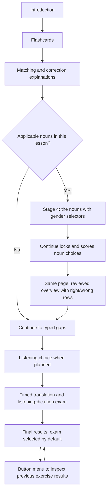

Audio is learner-triggered, except that a listening page offers an initial play control. Use the French speech language explicitly and a voice whose language matches it. An unavailable voice does not hide text or block progression: each Listen control is replaced by an **Install language** button that opens a modal dialog stating that no French voice (language pack) is installed, followed by the personalised installation steps below.

**Every vocabulary lesson has listening (P2-04, D47):** each word has a listening-choice page in practice and a dictation item in the exam, whatever the outline intent says. Audio speaks the target's teaching display form, so audio and accepted answer stay aligned (dictation accepts the exam forms, which include the teaching form); each listening-choice page holds one item, so the voice check and help page apply per page. Artifact previews show the target's pronunciation text (IPA) with the item.

**No suitable voice (D42):** a lesson that contains listening tasks (listening choice or dictation) cannot be started or resumed without a voice for the learning language: its start page shows the localized help (below) with a note to install a voice, restart the browser and reload, and no Start/Resume button (P2-04 review). Lessons without listening tasks start as usual. If the voice disappears during a running lesson, each listening page is replaced by a localized help page; other Listen controls become **Install language** buttons opening the same help in a modal dialog. The help explains that the prototype uses the browser's built-in speech synthesis and shows only the steps for the detected operating system and browser (from the user agent), ending with a browser restart:

- **Windows** (all browsers): Settings → Time & language → Language & region → Add a language → French (France) → tick Text-to-speech → Install; if French is already listed, … → Language options → Download next to Text-to-speech. Firefox reads these OneCore voices from version 106; Chrome and Edge additionally offer online French voices.
- **macOS** (all browsers use system voices): System Settings → Accessibility → Spoken Content → System voice → Manage Voices… → French → download a voice such as Thomas; the system voice stays unchanged.
- **Linux** (Firefox and Chromium speak through Speech Dispatcher): install `speech-dispatcher` with `espeak-ng` (per-distribution `apt`/`dnf`/`pacman` commands), test with `spd-say -l fr bonjour`; Snap/Flatpak browsers reach Speech Dispatcher only from version 0.11.4, otherwise install the browser from distribution packages.
- **Android, iOS, other**: short system-settings steps or a generic instruction.

A **Skip** button continues to the next exercise or exam page. The help page has no countdown; an exam page's countdown starts only when its listening item can be played. Skipped listening units are recorded in the session as `skipped_no_voice` only to support resume. They are left out of the attempt's scores, practice/exam denominators, progress and final results review. During gender answering, any audio must preserve the hidden article/gender clues; the complete audio controls return in reviewed overview.

## 7. Grammar learning flow

Run 2–4 explanation/practice blocks, a production-feedback placeholder, and a final exam. At least one block may focus on common errors or irregular forms where useful. The placeholder replaces the original personalized feedback requirement for this prototype, as agreed with the user; normal answer checking and practice corrections remain.

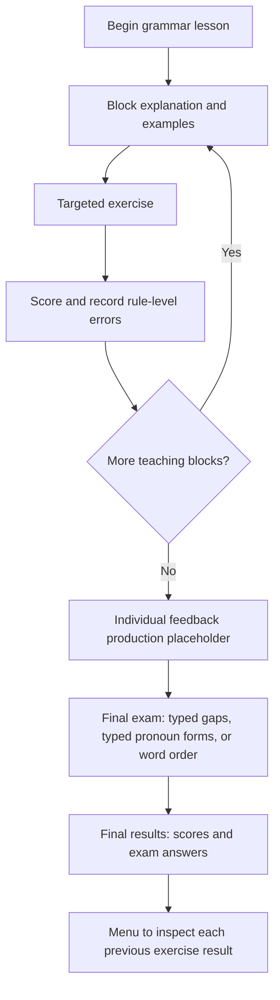

### Lesson length

Grammar lessons need enough practice (D49, P3-07). The first ten samples had 11–35 scored practice units and 6–12 exam units and could be clicked through in two minutes; a first rewrite with 50–68 practice and 24 exam units (24–27 minutes) proved too long, so the rules aim at about two thirds of it. Rules for briefs, content and generation:

| Rule | Value | Checked |
| --- | --- | --- |
| Exercises per teaching block | 2–4 (the schema allows 1–4) | length check |
| Items per exercise | 4–8 (a person matching board or pronoun item counts its rows; such exercises have 1–2 items) | prompt and review |
| Scored practice units per lesson | at least 22 (about 22–35; P6-02) | length check |
| Exam | 2–4 pages, at least 10 scored units in total (about 12), every rule covered | length check; rule coverage: validation |
| Page estimate per scored unit | 6–40 s; guide values: about 10 s per choice or matching unit, 15 s per typed unit, 25 s per word-order or error-spotter item | length check |
| Explanation page estimate | 45–240 s (guide 60–180 s) | length check |
| Exam time limit | about 1.5 times the page estimate | prompt and review |
| Resulting lesson length | at most 15 minutes (P6-02, feedback #1) | prompt; the ten lessons in `content/` take 15 minutes |

The **length check** is a quality gate, not a condition for playing a lesson: the generator applies its brief rules before saving a grammar brief (estimating at least three units per row item), and `make sample-lessons` and the authoring tool apply all rules to every grammar lesson in `content/`. Small test fixtures stay valid and playable.

**Hand authoring (P3-07):** grammar lessons written by Claude are compact definitions in `authoring/grammar/<id>.ts` (item helpers in `scripts/author-grammar-items.ts`); `node scripts/author-grammar.ts <id>` builds the brief and the lesson content from them, derives page estimates (guide values above), exam limits (1.5 times the estimate), minutes, rule coverage, unique exercise-step labels and input hashes, validates both files including the length check, and writes them. P2-07 uses the same tool.

Verb lessons have **one person matching board per verb** (a lesson on several verbs has one board for each); a pronoun lesson has one board. Variety comes from fresh sentences, not from repeating items: each item practises the rule in a new context, and the exam uses sentences that did not occur in practice.

**New verbs (P3-07):** a grammar brief lists in `newVerbs` every verb the lesson introduces that no earlier vocabulary lesson of the outline taught as a verb, with its infinitive and a translation for every mother tongue (`[]` when there is none; at most 12). The start page and the first explanation page show them as a **New verbs** table (French infinitive, mother-tongue translation).

### Exercise behavior

| Type | Required interaction |
| --- | --- |
| Person matching | **Added in the P3-02 review (D48).** The vocabulary matching board (section 6) for persons: the left column lists the persons in order, the three singular rows (1st, 2nd, 3rd person), an empty gap row, then the three plural rows; a board for a block that teaches one number has three rows and no gap. Mode `translation` pairs a mother-tongue pronoun with the French pronoun (he → il; ambiguous prompts are disambiguated, e.g. "you (several people)"); mode `forms` pairs a French pronoun with a verb form (je → suis). The French boxes on the right are shuffled across all rows and have speaker buttons. Selection, curves, Check, the slide of every French box level with a correct partner, red dashed curves for wrong pairs, and the green flash when all pairs are right behave exactly as in vocabulary matching; the gap stays between the singular and plural rows. A form shared by several persons (je parle, il parle) is right for each of them. Practice only; one board per page. |
| Pronoun/form drag-and-drop | Assign form tokens to generated pronoun rows; mouse/touch plus keyboard or click alternatives. Do not force all six person rows on topics that do not need them. **Implemented (P3-02):** the shuffled form tokens stand in a bank above one row per generated pronoun. A token is dragged onto a row with mouse, pen or touch (pointer events; a press without movement is a click), or selected and then placed with a click or the keyboard; a row can be selected first, too (Esc cancels). Each token is used at most once: a placed token leaves the bank, a token dragged to another row moves there, and a placed token goes back to the bank when clicked or dragged onto the bank. A placed form is plain text in its row, without a token frame, because each row takes one form; there is no fill counter. Duplicate texts are separate tokens; every token whose text is a valid form of the row counts. Check needs every row filled; each row is one point. An item with a single row is not shown as an assignment but as a multiple-choice gap after the pronoun ("je ____" with the tokens as radio options), checked in place like other single-answer pages (P3-02 review); new content uses `grammar_gap_choice` for a single pronoun. After Check the bank disappears, a summary ("1 of 3 rows correct.") replaces the hint, right rows turn green, wrong rows red with the placed form struck through, the correct form in green after the row and the row's explanation below it. |
| Pronoun/form typing | Type an accepted form in each pronoun row; handle multiple linguistically valid forms through answer keys. **Implemented (P3-02):** one labelled field per generated row; answers are normalized and classified by the shared scorer (surrounding spaces ignored; accent or case differences earn half a point). After Check in practice every field is marked in place (green, amber for half a point, red) and wrong or amber rows show the correct form in green and the row's explanation; exam pages show no marks until the results, and a blank row scores zero. |
| Multiple-choice gaps | Exactly four choices per gap; one accepted choice; shuffle without changing answer identity. An optional localized `hint` (P3-02 review) stands on its own line above the sentence ("Hint: plural, definite article"), like the typed-gap hint; cues never go into parentheses inside the sentence (validated). **Implemented (P3-03):** the shared `UnitsRenderer` shows the sentence with `____` and the four choices as radio cards in the session seed's order; scoring compares the choice ID, so the order never changes the answer. In practice choosing submits the page at once (section 5, rule 4). |
| Exact-typing phrase gaps | Type the missing text; optional brief-specified hint in practice, subject to exam policy. **Implemented (P3-03):** one field inside the sentence; every content-defined accepted answer counts in full, and the shared scorer gives half a point for accent or case errors, also on accent homographs such as `la` for `là` (D40). The hint stands above the sentence in practice; exam gaps have none (validated). Check needs an answer in practice; a blank exam gap scores zero. A checked practice field turns red or amber with the correct form after it; exam pages show no marks until the results. |
| Word order | Move tokens into a sentence; support moving back/reordering, repeated words, punctuation, and valid alternative sequences. Tokens can be dragged with mouse, pen or touch (all categories, P4-05 review): from the bank to any position on the line, and along the line to another position; dropped outside the line, or clicked, a placed token returns to the bank, and a click on a bank token puts it at the end of the line. The full stop that ends the sentence is not a token (P3-02 review): content omits it, and a final `.` token that ends every accepted order is left out by the application and never shown. Punctuation inside the sentence and a final `?` or `!` stay tokens. With the keyboard (P3-04), Enter or Space places a focused bank token or returns a placed one, the arrow keys move a placed token one position, and Home/End move it to either end; focus follows the moved token and stays nearby after placing or returning one. The line and the bank are labelled groups, and each placed token is announced with its position. |
| Error spotter | Select the faulty token, then type or select its correction as specified by the item. Give targeted practice feedback. The sentence is a labelled group of toggle buttons (P3-04). |

### Personalized feedback and exam

After the final teaching block and before the exam, display the fixed message for the selected interface language:

| Interface language | Fixed placeholder |
| --- | --- |
| en | Individual feedback would be here on production. |
| fr | Un retour personnalisé serait affiché ici en production. |
| de | Hier würde in der Produktivversion individuelles Feedback angezeigt. |

This screen is unscored and needs no answer; its **Continue** leads to the exam info page and then the final exam (P3-05: the plain Continue of every page, as in the mockup). It appears for every grammar session regardless of the learner's answers. The prototype performs no individual feedback analysis and makes no runtime Gemini request. Keep ordinary exercise results and answer-checking feedback; production feedback is future scope.

Every exam page uses its brief-defined countdown and defers answer feedback until the final results page. The final exam covers the taught rule IDs with fresh examples, selected during lesson generation: no exam sentence (gap with its answer, word order, error-spotter sentence) may repeat an explanation example or a practice sentence (validated, P3-05). It may mix `grammar_gap_typing`, `grammar_pronoun_form_typing`, and `grammar_word_order` across its pages; each page has one item type, one instruction and its own countdown, and every unit is graded by the one shared scorer. Use word order for syntax/structure. Do not force conjugation exercises onto article, adverb, or question lessons: `grammar_person_matching`, `grammar_pronoun_form_match` and `grammar_pronoun_form_typing` are allowed only for the topics `pronouns`, `verbs_morphology` and `verb_usage`, in practice and exam alike (validated, P3-01). Every lesson with the topic `pronouns` or `verbs_morphology` includes at least one `grammar_person_matching` exercise (D48), except the imperative lesson `fr-imperative-mood` (only tu, nous and vous); such a board may also review rules of earlier blocks, so a lesson that teaches the singular and the plural in separate blocks gets one six-row board. The practice bank has seven types; the exam uses the subset appropriate to the objective.

**Rule coverage (P3-01):** the brief teaches every rule in a block and examines every rule in the exam. In the content, the items of each exercise step and exam page assess exactly the rules the brief plans for that exercise or page, and together they assess all of them; explanation items cite only rules of their block. Every scored item (every row of the pronoun types) has its own answer explanation. See the [P3-01 review record](reviews/2026-10-08-p3-01-grammar-review.md).

**One answer per exam gap (P3-06 review):** exam gaps have no hint, so the sentence alone must allow only the accepted answers. A verb lesson names the verb in the sentence, as the exam rows name it after the pronoun (`travailler → Je ____ à la poste.`, like `je (chanter)`); a noun or adverb gap gets a context that fits one word (`J’ai une clé et tu as deux ____.`, `Bonne nuit et à ____ matin !`); where another answer is just as right, it is accepted too (`là` for `ici`, which block 1 of `fr-here-there-now-tomorrow` teaches). Multiple-choice distractors must be wrong in the sentence (`Il` is no distractor for `____ habite à Nice.`). This is a review criterion, not a validation.

When phase 3 is complete, all **48 grammar** entries must be generatable and playable. The first-ten sample approval alone is insufficient for that phase's exit. **Updated (P3-06):** P2-07 (#58), which was to write the other 38 lessons, was closed as not planned on 2026-10-13. P3-06 therefore validates the ten sample lessons only; how the remaining 38 are produced (generated or written by hand, as P4-06 decides for functions) is still open and blocks the phase 3 exit.

## 8. Functions learning flow

A function lesson teaches the **expressions** a learner needs to act in one everyday situation of the outline intent (greeting someone, ordering at a café, asking the way). Its basis is a small set of ready-to-use phrases and sentence starts, shown first as flashcards and in a model dialogue, then practised in matching, word-order and dialogue-gap exercises, and finally examined in new dialogues (D50). The brief holds the expressions and words with example sentences; dialogues, exercises and exam are generated in the lesson content (D51). Requirements agreed with the product owner on 2026-10-13 (P4-01).

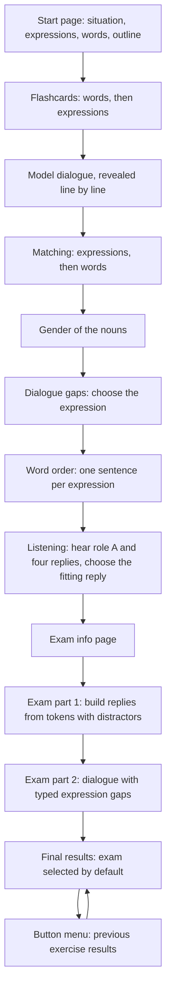

### Brief and lesson content

A function lesson has two artifacts, like grammar (D51): the **brief** holds the expressions and words with example sentences; the **lesson content** generated from it holds the dialogues and every exercise and exam item.

| Artifact | Part | Count | Content |
| --- | --- | --- | --- |
| Brief | Situation and roles | 1 situation, 2 roles | A localized one-sentence situation for the start page; two roles with a French label (`le serveur`, `la cliente`) used in every dialogue of the lesson. |
| Brief | Expressions | 6–10, about 8 on average | Phrases and sentence starts useful in the situation: `Je voudrais …`, `J'aimerais recevoir …`, `C'est combien ?`, `L'addition, s'il vous plaît.` Each has a stable ID, the French `text`, an `openEnd` flag for sentence starts (displayed with a trailing ` …`, never part of an answer), translations for every mother tongue, a short localized `explanation` (when and how it is used, register such as tu/vous) and an example sentence with translations. |
| Brief | Words | 0–6, about 4 on average | Additional vocabulary the dialogues need and no earlier vocabulary lesson taught (`un thé`, `un croissant`). Each word has the vocabulary target fields that apply: teaching form with the indefinite article where grammatical (D39), translations, word class, gender, a localized explanation and an example sentence with translations. |
| Lesson | Model dialogue | 8–14 lines | Alternating lines of the two roles; each line has its French text, translations for every mother tongue, a short localized note and the IDs of the expressions it uses. Every expression occurs at least once. |
| Lesson | Word-order sentences | one per expression | French sentences, each using its expression in a new context. The tokens admit exactly one order (P4-05 review): final punctuation stays on the last chunk, and swappable parts (`sur place | ou | à emporter`) or two independent sentences that could change places are avoided, so exam replies are unique as well. |
| Lesson | Dialogue gaps | one per expression | An exchange: role A's line, then role B's line with one gap that takes the expression. |
| Lesson | Exam word translation | one per word | The mother-tongue prompt and the accepted French forms (P4-05 review). |
| Lesson | Exam replies | 4–8 (one per expression) | Role A's line and role B's reply built from tokens, with 0–3 distractor tokens. |
| Lesson | Listening replies | one per expression | Role A's line and four replies of role B, one of which uses the expression and fits; the others do not fit the line (P4-05 review). |
| Lesson | Exam dialogue | 8–14 lines, 3–10 gaps | A new dialogue in the same situation; the gaps take expressions and may be in the lines of either role. Every line has its translation for every mother tongue, which tells the learner what to write into the gap (P4-05 review). |

Exam sentences occur neither in the brief's example sentences nor in practice; practice sentences may differ from the brief's examples and should.

All sentences are natural A1 French and use only the lesson's expressions and words, earlier vocabulary and grammar the learner can understand from context. The register (tu or vous) follows the situation and stays consistent within one dialogue. Every expression is assessed at least once in each exercise and at least once in the exam.

**Artifacts (D51):** `content/briefs/<id>.json` (brief) and `content/lessons/<id>.json` (lesson content), validated against each other like grammar. The lesson content stores the pages with `estimatedDurationS` and exam `timeLimitS`, following the page rules below; validation checks them against those rules and that `estimatedMinutes` equals the summed page estimates.

**Test lessons first (D51):** Claude writes the brief and lesson content of three test lessons by hand: `fr-greetings-and-goodbyes`, `fr-ordering-at-a-cafe` and `fr-asking-the-way`. After their review the product owner decides how the remaining eleven are produced (offline Gemini generation or hand authoring). Until then `make generate` keeps failing explicitly for functions.

### Page rules

| Stage | Pages | Estimate | Exam limit |
| --- | --- | --- | --- |
| 1 Flashcards | one page for the words (left out without words), then one for the expressions (P4-05 review) | 12 s per expression, 10 s per word | – |
| 2 Model dialogue | one page | 20 s + 12 s per line | – |
| 3 Matching | expressions in balanced pages of at most 6 pairs (8 → 4 + 4), then the words on their own page | 12 s per expression, 10 s per word | – |
| 3b Gender | one page with every noun (left out without nouns); each noun gets a masculine/feminine choice as in vocabulary stage 4 (P4-05 review); words without a gender are left out (P06-00) | 20 s + 5 s per noun | – |
| 4 Dialogue gaps | one exchange per page | 15 s per gap | – |
| 5 Word order | one sentence per page | 25 s per sentence | – |
| 5b Listening | one item per page (P4-05 review) | 30 s per item | – |
| Exam info | application page (section 6, stage 6), not stored in the lesson content | 20 s | – |
| 6a Exam word translation | one page with every word (left out without words), as in vocabulary (P4-05 review) | 15 s per word | 1.5 × estimate |
| 6 Exam part 1 | replies in balanced pages of at most 4 | 30 s per reply | 1.5 × estimate |
| 7 Exam part 2 | one page with the whole dialogue | 8 s per line + 20 s per gap | 1.5 × estimate |

With 4 expressions (P6-02, feedback #1), 4 nouns as words, a 10-line model dialogue, 4 exam replies and an exam dialogue of about 10 lines with 3–4 gaps, a lesson has 22–24 scored practice units, 11–12 exam units and takes 16–17 minutes; every exercise type stays, with one item per expression. (With the former 8 expressions a lesson took about 25 minutes.) The start page shows the outline in three colour-coded rows: Flashcards · Dialogue, Matching · Gender · Dialogue gaps · Word order · Listening, and the final exam ("Answer 16 items on 3 timed pages"), each with its minutes, plus the situation and the number of expressions and words.

### Exercise behavior

| Stage | Required interaction |
| --- | --- |
| Flashcards | The vocabulary flashcard page (section 6, stage 2) for both pages (P4-05 review): the mother-tongue translation on the front; the French word or expression with a speaker button, the gender (words) or the explanation (expressions) and the example sentence with its translation on the back. The words come first, because the example sentences often use them. Each card is turned once before Continue is enabled; turned cards are stored (`revealed`). Completion only. |
| Model dialogue | The lines appear one after another as cards, alternately left (role A) and right (role B), each with the role label, the French line (expressions highlighted), a speaker button and a flip button. A turned line shows the translation in the mother tongue and the note in the interface language, without changing its size. **Next line** shows the next line; earlier lines stay visible and can be turned and played again. After the last line the button becomes **Continue**. Turning lines is optional; revealed lines are stored for resume. Completion only. |
| Matching | The vocabulary matching board (section 6, stage 3) with curves, Check, the slide to the correct row and the green flash: mother-tongue translation on the left, French expression with speaker on the right. The words follow on their own board. One unit per pair. |
| Gender | The vocabulary gender page (section 6, stage 4) for the lesson's nouns (P4-05 review), with the same layout, options, marking, summary and results rows: every noun on one page with a masculine/feminine choice; words without a gender are left out (P06-00, feedback #9); checked in place, one unit per noun. A function lesson without nouns has no gender step, like a vocabulary lesson without nouns. |
| Dialogue gaps | Role A's line (with speaker) above role B's line with one gap, and four distinct choices taken from the lesson's expressions, one of which fits. Checked like a multiple-choice gap (section 5, rule 4): a correct choice lights up green; a wrong one turns red with the correct one green and the explanation. One unit per gap. |
| Word order | The grammar word-order interaction (section 7) for one sentence of the lesson content, with only the tokens as prompt (no translation). Every token is used once; tokens may be multiword chunks such as `s'il vous plaît`. The final full stop is not a token. One unit per sentence; feedback card with the correct sentence and the explanation. |
| Listening choice | Added in the P4-05 review. Role A's line is only heard (large Listen button); below it, four replies of role B named "Reply 1" to "Reply 4", each with a speaker symbol in place of the radio dot; clicking a reply selects it, plays it (on every click) and gives it a purple border. The learner chooses the reply that fits. Checked like a multiple-choice gap (section 5, rule 4); after Check, role A's line and every reply show their text, the chosen wrong reply red and the right one green. One unit per item. As a listening task it needs a French voice (D42): without one the lesson cannot start, and a page whose voice disappears is replaced by the help page with Skip. |
| Exam word translation | Added in the P4-05 review: the first exam page translates every word of the lesson, as the vocabulary translation exam (mother-tongue prompt, French with the indefinite article, article badge and missing-article info, gender choice after `des`; a word taught with `des` is a plurale tantum). One unit per word. |
| Exam part 1 | Each reply is a word-order task under role A's line (speaker allowed, it is not the answer): the bank holds the reply's tokens plus 0–3 distractors, shuffled from the session seed ("Not every word fits."). The reply is right only when its token sequence equals an accepted order; distractors must stay in the bank. Exactly one reply must be valid with the given tokens. One unit per reply, no feedback before the results. |
| Exam part 2 | The exam dialogue unrolls line by line on one timed page. Lines with a gap have a text field in place of the expression, and every line shows its mother-tongue translation below it (P4-05 review), so the learner translates the expression into the gap; a newly shown line puts the cursor into its field; the learner selects the field, types the expression and presses **Next line**. Earlier lines stay visible and their fields editable until the page is submitted. On the last line the button becomes **Continue**; it, or the countdown, submits the whole page. Gaps are graded by the shared free-text classifier (section 5: 1, 0.5 for accents or capitals, 0); blank gaps earn 0. Accepted answers list every lesson expression that fits the gap; the context must make one expression clearly expected. |

The exam info page lists the two exam parts with their number of tasks and countdowns. Exam pages keep the practice score in the header and show no correctness until the results (section 5).

### Scoring, audio and results

- Practice units: one per matching pair (expressions and words), noun on the gender page, dialogue gap, word-order sentence and listening reply; exam units: one per reply and per typed gap. Flashcards and the model dialogue are completion only. The shared 35 % practice / 65 % exam weighting applies.
- Every scored unit has a localized explanation, shown with practice corrections and in the results.
- Audio speaks French expressions, words and dialogue lines (browser speech, D9). Since the P4-05 review function lessons have a listening exercise, so they need a French voice to start, like vocabulary lessons (D42).
- Final results: the exam is selected by default, split into the accordions **Translation** (the words, when the lesson has words), **Replies** and **Dialogue**; the first is open. The menu then offers Matching (expressions and words in one entry, P4-05), Gender, Dialogue gaps, Word order and Listening in the order presented. Reply rows show role A's line as the task and the built reply; dialogue rows show the line with the gap as the task and the typed expression.

### Content review criteria

The three test lessons and every later function lesson are reviewed for: full coverage of the outline intent; 6–10 expressions and 0–6 words with natural, idiomatic A1 French; correct translations for every mother tongue and explanations in en/fr/de; a consistent register; every expression used in the model dialogue, the exercises and the exam; exam sentences that do not occur in practice; exactly one valid reply in each exam reply with its distractors (distractors are plausible but wrong: wrong person, wrong article, a piece of another expression); and dialogue gaps whose context makes the expected expression clear.

### Implementation plan

- **Schemas:** `src/schemas/functions.ts` with `FunctionsBriefSchema` (situation, roles, expressions and words with example sentences; bounds 6–10 / 0–6) and `FunctionsLessonContentSchema` (steps and pages with the item types `function_flashcards`, `function_dialogue`, `function_matching`, `function_word_order` with optional context line and distractors, `function_dialogue_gap_choice` and `function_dialogue_gap_typing`; bounds 8–14 lines / 6–8 replies / 6–10 gaps), registered in the artifact factory. Validation of IDs, brief/content references, coverage (every expression in the model dialogue, the exercises and the exam), choice uniqueness, token orders, that no distractor appears in an accepted order, and the page rules.
- **Session:** the plan builder reads function content like grammar content; the session host gains in-page line reveal (Next line) for the dialogue page and the exam dialogue, stored as presentation progress.
- **Implemented in P4-02:** both schemas in `src/schemas/functions.ts` (`FUNCTIONS_LIMITS`, `FUNCTIONS_PAGE_RULES`), the page rules in `src/domain/functionsLesson.ts`, validation in `src/validation/artifacts.ts` (also: exam sentences occur neither in the brief's examples nor in practice; gap `before`/`after` carry no surrounding spaces, as in grammar), plan units for the function items (an exam reply lists its `distractors`; a reply is answered once a token is placed), the Draft and Content views, and the fixture `tests/fixtures/content/*/fr-ordering-at-a-cafe.json`. The generator still rejects functions (`GENERATED_KINDS`); Start stays unavailable until P4-05 (`PLAYABLE_KINDS`).
- **Test lessons (P4-03):** `fr-greetings-and-goodbyes`, `fr-ordering-at-a-cafe` and `fr-asking-the-way`, each with 4 expressions (8 before P6-02), 4 words, 22–24 practice and 11–12 exam units, 16–17 minutes. Definitions in `authoring/functions/<id>.ts` (format in `scripts/author-functions-definition.ts`: tokens separated by ` | `, a practice gap written `___`, an exam gap `[answer / alternative]` whose first answer names the expression); `node scripts/author-functions.ts <id> [--dry-run]` finds the expressions each dialogue line uses, derives estimates, limits, minutes and hashes, validates and writes both files. `make sample-lessons` checks the three lessons with the twenty samples.
- **Presentation and matching (P4-04):** `src/session/functionsRenderers.tsx` renders the expression and word flashcards and the model dialogue; `function_matching` uses the shared matching board. The session requires every card turned and every dialogue line shown (`requiredReveals`); on a dialogue page the footer button reads **Next line** (`nextDialogueLine`) until the last line, then **Continue**. Line cards of role A stand left, of role B right, with the lesson's expressions marked; turning a line is not stored.
- **Practice, exam and results (P4-05):** `FunctionWordOrderRenderer` (tokens only in practice; exam replies under role A's line with the reply's role and the distractors in the bank), `DialogueGapChoiceRenderer`, `ExamDialogueRenderer` (lines unroll through the Next line footer button also on the timed exam page; every field stays editable until Continue or the countdown), the exam info rows "Build the replies" and "Dialogue with gaps", the results accordions Replies and Dialogue, and the start page (situation, counts, three-row outline). Function lessons are playable (`PLAYABLE_KINDS`).
- **Renderers:** reuse the flashcard, matching board and word-order controls; new dialogue line card, dialogue gap and exam dialogue renderers; results rows for replies and dialogue gaps.
- **Authoring:** `authoring/functions/<id>.ts` with `node scripts/author-functions.ts <id>` (like grammar, section 7), building brief and lesson content, deriving page estimates and exam limits from the page rules, validating both and writing them with current input hashes.
- **Makefile:** `make sample-lessons` and `make catalog` validate function briefs and lesson content; `make test` and `make test-e2e` cover the new renderers and a function journey; `make mockups-sync` / `make mockups-check` include `docs/mockups/05-function-lesson/`. `make generate` / `make generate-missing` stay disabled for functions until the generation decision.

## 9. Reading learning flow

A reading lesson follows the design **prepare, then read** (D54): it teaches a few key words, lets the learner skim a real-looking document, then read it for detail and structure, and ends with a short exam on a second document of the same kind. Each lesson is data shown by the shared session host: every document uses one layout, and every exercise reuses a control of vocabulary, grammar or functions. Reading adds two pieces of its own, the document view and the skim phase. Sources: the reading requirement in ft_transcendence [#115](https://github.com/VictorBro/ft_transcendence/issues/115) and its playable reference prototype in the repository `VYAntares/lessonProto` (branch `main`). The requirements were reviewed by the product owner in the P5-01 pull request (#95) on 2026-10-15; the points still open are listed at the end of this section with the issue that decides them.

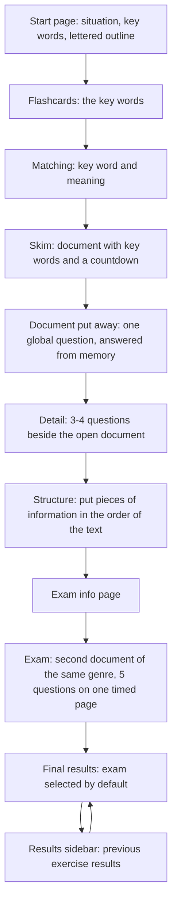

### Stages

Every reading lesson has the same five stages, from A1 to C2.

| # | Stage | Pages | What the learner does | Counts for |
| --- | --- | --- | --- | --- |
| 1 | Flashcards | 2 | 4–6 key words of the text on the vocabulary flashcards (mother-tongue meaning on the front; the word with its speaker button and a short explanation on the back), then the vocabulary matching board (key word ↔ meaning). | flashcards: completion only; matching: practice |
| 2 | Skim | 1 | The main document with its key words highlighted and a countdown. When the time is up, or earlier when the learner presses **I've finished reading**, the document is put away (no blur, nothing of it stays on screen) and one global question opens under the heading **Answer from memory**: what kind of document it is, who wrote it, or why. | practice |
| 3 | Detail | 1 | 3–4 questions (multiple choice or true / false) with the document open beside them (stacked on phones). | practice |
| 4 | Structure | 1 | 3–6 pieces of information to put in the order the text gives them, with the word-order control (phrases instead of words); the document stays open. | practice |
| 5 | Exam | 1 | The exam info page, then a **second, shorter document of the same genre** with 5 questions on one page and its countdown. No highlighting, no help, no feedback until the results. | exam |

The skim is **one page with two phases** (document, then question); it is one learner page for progress and navigation. The main document is stored once and shown on the skim, detail and structure pages; the exam document is shown on the exam page only.

### Fixed and varying parts

| Fixed in every lesson | Varies from lesson to lesson |
| --- | --- |
| The five stages, their order and roles | The genre (it steers the text the author or generator writes, not the layout) |
| 4–6 key words: flashcards, then matching | The key words |
| One skim question about the whole document | Its focus: `genre`, `author` or `purpose` |
| 3–4 detail questions | Their types (multiple choice, true / false) and order |
| One structure task: pieces of information in order | The pieces |
| 5 exam questions on one timed page, on a second document of the same genre | Their types |
| One final score from 0 to 100, practice 35 % / exam 65 % (D6) | Text lengths and skim time, which follow the level and the actual word count |

**Question types** (skim, detail and exam):

- **Multiple choice:** 3–4 options, exactly one right; options are shuffled from the session seed like every choice.
- **True / false:** a statement that the text confirms or contradicts; the options **Vrai** and **Faux** (in the course language, like every answer option) keep their order.

Short typed answers and a third answer *not stated* are left out: short answers need spelling and variant rules, and *not stated* needs statements that are plausible yet really absent from the text. Evidence marks (the sentences that prove an answer, marked after Check) are left out as well; explanations quote the words of the text instead. P5-05 decides whether to bring them back.

### Pages reused and new

| Page | Reused from | New for reading |
| --- | --- | --- |
| Start page | The shared start page with its lettered outline (section 6, "Lesson start page"); situation line as in functions | – |
| Flashcards | The vocabulary flashcard page (section 6, stage 2), its turn gate and stored `revealed` | – |
| Matching | The vocabulary matching board (section 6, stage 3), including Check, slide, green flash and rule 4 | – |
| Skim | The exam countdown box (section 5, label **Time to skim**), the choice cards of multiple-choice gaps | The document view; the skim phase (countdown on a practice page, document put away) |
| Detail | The choice cards (multiple-choice gaps, section 7), true / false as two choice cards in fixed order, the shared in-place feedback | The document view beside the questions |
| Structure | The word-order control (section 7) with pieces of information as tokens, its feedback card | The document view beside the task |
| Exam info | The shared exam info page (section 6, stage 6) with the row **Questions on the document** | – |
| Exam | The shared exam page: countdown box, numbered questions, delayed feedback | The document view (without highlights) |
| Results | The shared results page and results sidebar (section 5, D53) | – |
| Draft and Content views | The shared Outline, brief parts and page-by-page Content review (section 3) | `ReadingBriefView`; the two documents above the Content review |

### Page rules

The application derives every estimate from these rules; authoring and validation use the same functions. Words are whitespace-separated tokens that contain at least one letter or digit, over everything a document shows (title, meta lines, paragraphs): `l'heure` is one word, `15` is one, `€` and `?` are none.

| Level | Main document (words) | Exam document (words) | Skim speed (words per minute) |
| --- | --- | --- | --- |
| A1 | 40–80 | 20–40 | 75 |
| A2 | 80–150 | 40–75 | 90 |
| B1 | 150–250 | 75–125 | 110 |
| B2 | 250–400 | 125–200 | 130 |
| C1 | 400–550 | 200–275 | 150 |
| C2 | 550–700 | 275–350 | 170 |

| Stage | Pages | Estimate | Exam limit |
| --- | --- | --- | --- |
| 1 Flashcards | one page with every key word | 10 s per key word | – |
| 1 Matching | one board with every key word | 10 s per key word | – |
| 2 Skim | one page | `skimSeconds` + 20 s | – |
| 3 Detail | one page | 30 s per question | – |
| 4 Structure | one page | 15 s per piece | – |
| Exam info | application page, not stored in the lesson content | 20 s | – |
| 5 Exam | one page | reading time of the exam document at the skim speed + 20 s per question | 1.5 × estimate, rounded up to 5 s |

**Skim time (P5-01 review):** `skimSeconds` follows the actual word count of the main document at the skim speed of its level, rounded up to 5 s and at least 15 s (55 words at A1: 45 s). It is set in the lesson content when the lesson is written or generated and may be changed by hand in the file afterwards; validation only checks its bounds (15–300 s) and that the skim page estimate follows it. A document outside its word range is invalid. The ranges and speeds are starting values; P5-05 tunes them after play tests.

**Duration:** with these rules an A1 lesson takes about 8 minutes and a C2 lesson about 14, so every level stays within the 15-minute limit of P6-02 (feedback #1). Whether higher levels may take longer is decided in the team (P5-05).

### Brief and lesson content

A reading lesson has a brief and lesson content, like grammar and functions; both use the shared envelope (section 4) with `kind: "reading"` and a `theme`, never a `topic`.

**Brief** (`content/briefs/<id>.json`):

| Field | Rule |
| --- | --- |
| `genre` | `text_message`, `email`, `letter`, `postcard`, `invitation`, `sign`, `notice`, `menu`, `recipe`, `classified_ad`, `profile`, `programme`, `timetable`, `article`, `forum_post`, `review`, `dictionary_entry`, `contract`, `speech`, `poem` or `other`. It steers the text, not the layout: a memo or building rules are a `notice`, a press release or an editorial an `article`. |
| `situation`, `readerTask` | Localized: who writes to whom and why; what the learner must find (from the outline intent). |
| `keywords[4–6]` | `{ id, term, translations, explanation }`: `term` in the course language as it is taught; `translations` for every mother tongue (the front of the flashcard; the first one is the matching label and unique in the lesson per locale); `explanation` localized (the back of the flashcard and the correction text of the matching). |
| `documents.main`, `documents.exam` | `{ targetWords, contents }`: `targetWords` within the level range; `contents` (localized) says what the text contains, so the content step writes the planned text. The exam document has the same genre, about half the length, and facts the main document does not give. |
| `skim` | `{ focus }`: `genre`, `author` or `purpose`. |
| `detailQuestions[3–4]` | `{ id, type, focus }`: `type` is `reading_choice` or `reading_true_false`; `focus` (localized) names the fact the question checks. |
| `exam` | `{ types[1–2] }`: the question types of the five exam questions. |
| `scoring` | The shared policy (35 / 65, half credit 0.5), as in every brief. |
| `estimatedMinutes` | Equals the lesson content's minutes. |

**Lesson content** (`content/lessons/<id>.json`):

```text
genre                                                   // equals the brief
documents[2]: { documentId: "main" | "exam", title | null, meta[0–4],
                paragraphs[1–12]: text,                 // a line break inside starts a new line (menu line, verse, timetable row)
                highlights[]: { keywordId, text } }     // main document: every key word; exam document: none
steps[6]: flashcards, matching, skim, detail, structure, exam — { id, stage, role, label, pages[1]: { pageId,
          estimatedDurationS, timeLimitS | null, instructions, items[] } }   // stage 1 is two steps, so its two pages are two points (D53)
```

| Item | Payload essentials | Scored units |
| --- | --- | --- |
| `reading_flashcards` | Key-word IDs | Completion only |
| `reading_keyword_matching` | Key-word IDs; labels and explanations come from the brief | One per key word |
| `reading_document` | `documentId`, `view` (`skim`, `open`, `exam`), `skimSeconds` (skim view only) | None |
| `reading_skim_choice` | Focus, question, 3–4 options, answer ID, localized `answerExplanation` | One |
| `reading_choice` | Question, 3–4 options, answer ID, localized `answerExplanation` | One |
| `reading_true_false` | Statement, answer `true` / `false`, localized `answerExplanation` | One |
| `reading_order` | 3–6 pieces, 1–2 accepted orders, localized `answerExplanation` | One per task |

A paragraph is a paragraph of prose, a message bubble, a menu section, a sign, a stanza or a clause. A timetable or a programme writes one row per line, its columns separated by ` · `; there is no table layout. Each highlight `text` is copied word for word from the main document (it may be an inflected form) and is marked wherever it occurs; the exam document lists no highlights, although its text may use key words. A document has no headings of its own besides its title.

**Validation** (a failure makes the file invalid): the envelope and locale rules of section 4; 4–6 key words with unique IDs, terms and first translations per locale; both documents with the brief's genre and word counts in range; every highlight found in the main document, every key word highlighted, no highlight in the exam document; the five steps in order with their page rules and `estimatedMinutes`; the main document on the skim, detail and structure pages and the exam document on the exam page, first on its page, in the view of its stage; flashcards and matching covering every key word; the skim question with the brief's focus; the detail questions of the brief in its order and types; options unique with exactly one right; pieces unique and every accepted order using every piece once; the exam page with exactly 5 questions of the planned types and the derived limit; only the exam page has a countdown limit.

### Exercise behavior

| Stage | Required interaction |
| --- | --- |
| Flashcards | The vocabulary flashcard page: the mother-tongue meaning in front; the key word with a speaker button and its explanation behind. Continue needs every card turned once. |
| Matching | The vocabulary matching board, mother-tongue meaning on the left and the key word with its speaker on the right. Checked exactly like vocabulary matching (rule 4 applies: a fully correct board flashes green and moves on; no explanations). |
| Skim | The document under a countdown box **Time to skim** with an outlined **I've finished reading** button; the question is not shown yet. When the time is up or the button is pressed, the document is put away and the question opens as choice cards under **Answer from memory**. The choice is confirmed with **Check** (rule 4's submit-on-choice does not apply). After Check the document comes back with the correction card (Correct, or the right answer in green above the chosen one struck through in red, then the explanation), and the page waits for **Continue** even when the answer is right (P5-01 review). |
| Detail | The open document beside the questions (side by side when the task area is at least 700 px wide, stacked below; the document stays in view, see "Wide layout" below). Every question is answered before **Check**; each question then gets its correction card (as on the skim page), and the page waits for Continue even when every answer is right (P5-01 review: the learner wants to see which facts were right). |
| Structure | The document beside the word-order control: the pieces are shuffled from the session seed and placed by click, keyboard or drag as in grammar word order. Check marks the order; the feedback card shows the correct order (pieces joined by → ) and the explanation; the page waits for Continue. |
| Exam | The shared exam page: the countdown box, the exam document beside the five numbered questions, "n of 5 answered" next to Continue. Continue or the countdown submits the page; unanswered questions earn zero. |

On a page with a document the cursor is not put into a field and the page is not scrolled, so the document stays in view.

### Session, scoring, audio and results (exceptions to section 5)

- **Scoring:** the shared weights (D6): practice 35 % (matching, skim, detail and structure units), exam 65 %. Reading has no typed answers, so no half credit occurs.
- **Countdown in practice (P5-01 review):** the skim page is the only practice page with a countdown. It has no absolute deadline: a reload or resume before the time is up restarts it; a document that was put away stays away until the question is checked (stored in the session's `revealed`).
- **Correction view (P5-01 review):** document pages (skim, detail, structure) always keep their checked view and wait for Continue; rule 4 still applies to the matching board.
- **Exam limit (D18 exception):** the exam limit is derived (1.5 × the estimate) instead of set in the brief; the team re-evaluates the limits (P5-05).
- **Audio and autoplay (D52):** flashcards and matching speak the key word as in vocabulary (turning a card to the word, clicking a key-word box, connecting a pair). Documents, questions and answers are not read aloud, and Check speaks nothing. A reading lesson has no listening task, so it starts without a French voice (D42 does not apply); without a voice the speaker buttons become **Install language** buttons as everywhere.
- **Navigation (D53, no exception):** the points follow the shared rules: 1 Flashcards (theory), 2 Matching, 3 Skim, 4 Detail, 5 Structure, then the exam with its flag. The start page shows them under **A Key words** (Flashcards, Matching), **B The document** (Skim, Detail, Structure) and **C Final exam** ("Answer 5 questions on 1 timed page"), each with its minutes as a stopwatch chip.
- **Start page:** course label, the **Reading** badge, title, objective, minutes, the situation and the number of key words. The genre is not shown, since the skim question may ask for it.
- **Results:** the exam is selected by default; it has one page, so the **Final exam** entry has no nested parts. The sidebar then offers Matching, Skim, Detail and Structure in the order presented; flashcards are not offered. Rows show the question or statement as the task and the chosen option; the structure row shows the order placed and the correct order.
- **Saving:** as section 5 ("save after meaningful transitions"); the skim countdown is not saved.

### Language rules (P5-01 review)

The principles of the other categories apply:

| Text | Language |
| --- | --- |
| Key-word meanings on the flashcard fronts and matching labels | Translations by mother tongue |
| Instructions, stage labels, situation, objective, explanations, correction texts and every other interface text | Interface language (localized en/fr/de) |
| Documents, key words, questions, statements, options (including Vrai / Faux), pieces to order | Course language only; translating them would give the answers away |

### Content review criteria

The test lessons and every later reading lesson are reviewed for: full coverage of the outline intent; a document that looks authentic for its genre and natural French of the lesson's level; key words that occur in the main document and help understand it; questions answerable only from the text (not from general knowledge); distractors that are plausible but clearly wrong according to the text; true / false statements the text really confirms or contradicts; exam facts that are not in the main document; one unambiguous order of the pieces; explanations that quote the words of the text; correct translations for every mother tongue and explanations in en/fr/de.

### Test lessons

Claude writes the brief and lesson content of the **ten fr/A1 reading entries** by hand (P5-01 review: "generate 10 sample lessons"; the generation method is decided later, P5-07): `fr-reading-an-online-profile`, `fr-reading-public-signs`, `fr-reading-a-text-message`, `fr-reading-a-restaurant-menu`, `fr-reading-a-flat-ad`, `fr-reading-a-holiday-postcard`, `fr-reading-an-event-programme`, `fr-reading-a-party-invitation`, `fr-reading-a-train-timetable` and `fr-reading-written-directions`. Four of them reuse the texts of the reference prototype. The briefs and lessons are written directly as JSON (a new lesson may start as a short draft with only its documents and questions); `node scripts/author-reading.ts <id>` (or `--all`, `--dry-run`) derives the envelope, the six steps with their labels, page IDs and instructions, the flashcard, matching and document items, `skimSeconds` (kept when already set), the page estimates, the exam limit, the minutes, the brief's target words and exam types and the input hashes, validates both files and writes them. There are no separate definition files: the reference prototype's `authoring/reading/` definitions are not taken over.

### Open points and their issues

**Wide layout (P5-06).** The detail, structure and exam pages put the document on the left (sticky, scrolling on its own when it is taller than the window) and the questions or the pieces on the right when the **task area** is at least 700 px wide, and stack them below. The switch is a container query on the task area, not a window breakpoint, because the lesson sidebar takes 290 px above 960 px: measured with the menu fixture, the task area is 635 px at a 1024 px window (stacked), 711 px at 1100 px (columns of 320 / 290 px), 891 px at 1280 px and at most 931 px from 1366 px on (columns of 435 / 395 px, the 1320 px page limit). Without the sidebar (960 px and narrower) a tablet in landscape (900–960 px, task area 828–888 px) now also shows both columns; 768 px and phones stay stacked. Collapsing or narrowing the sidebar was rejected: the columns are wide enough with it, and the navigation (D53) stays the same on every page. The skim page itself is always one column (the document above its countdown). `tests/e2e/reading.spec.ts` checks the layout at 1440, 1100, 1024, 900, 700 and 375 px.

**Play tests (P5-05).** The values of this section are starting values until play tests confirm them. Measured with the page rules above, a reading lesson takes between 6 minutes (A1: 4 key words, 3 detail questions, 3 pieces, both documents at the bottom of their range) and 14 minutes (C2: 6 key words, 4 questions, 6 pieces, both documents at the top), so every level stays within 15 minutes; the ten fr/A1 test lessons take 8. The exam limit of the largest lessons goes from 200 s (A1) to 340 s (C2). Two rules make the exam a test of the second document: no exam question repeats a skim or detail question, and the exam document repeats no paragraph of the main document (validated).

To record a play test, open the app with `?playtest` (for example `…/lesson_prototype/?playtest#/lesson/fr-reading-a-text-message/play`). The session records the times of every page (`pageTimes`, section "Lesson session architecture"); the results page then shows **Play-test times**, a table of every page with its estimate, the actual seconds, the skim time stored and used, and the seconds to the first Check, plus **Download times (JSON)**. Without `?playtest` nothing is shown. Play-test checklist:

1. Each tester plays at least three of the ten fr/A1 lessons with `?playtest`, without help, in one sitting each, and sends the downloaded JSON files.
2. Record for each lesson: the tester's level of French, the mother tongue, desktop or phone, and whether the skim time ran out or **I've finished reading** was pressed.
3. Compare per page: actual against estimate (a page is off when it differs by more than a third), skim time used against stored (most testers press **I've finished reading** early → the skim speed is too slow; the time runs out → too fast), and whether the exam limit was reached.
4. Note every question a tester could not answer from the text, every answer that was ambiguous, and whether evidence marks, short typed answers or *not stated* were missed.
5. The team then decides the open points below and records the new values here, in `src/schemas/reading.ts` / `src/domain/readingLesson.ts`, and in the test lessons (`node scripts/author-reading.ts --all` recomputes estimates, skim times and limits).

| Point | Decision so far | Issue |
| --- | --- | --- |
| Lesson length per level | Every level within 15 minutes with the page rules above; longer lessons for B2–C2 discussed in the team | P5-05 |
| Word ranges, skim speed, exam limits | Starting values above; tuned after play tests (times recorded with `?playtest`, see "Play tests") | P5-05 |
| Evidence marks, short answers, *not stated* | Left out; brought back only if play tests show the need | P5-05 |
| Navigation points | D53 applied without exception (proposed by Endrit; Anaïs and Luca to confirm) | P5-04 review |
| Wide layout with the lesson sidebar | **Decided (P5-06):** the sidebar stays; document and questions stand side by side when the task area is at least 700 px wide (container query on the task area, not the window), stacked below | P5-06 |
| Genres | The list above, chosen by the reading owner to cover the outlines (P5-01 review: owner's decision) | – |
| Generation | Ten hand-written test lessons first; offline generation in the prototype decided after their review | P5-07 |

### Implementation plan

- **Schemas and validation (P5-02):** `src/schemas/reading.ts` (brief, content, limits, word ranges), the page rules and skim speeds in `src/domain/readingLesson.ts`, checks in `src/validation/reading.ts` called from `src/validation/artifacts.ts`, `reading` in the artifact factory, plan units in `src/domain/session/readingPlan.ts`, the Draft and Content views, the authoring tool `scripts/author-reading.ts`, and `fr-reading-a-text-message` as the contract fixture. Start stays unavailable.
- **Test lessons (P5-03):** the nine other fr/A1 lessons; `make sample-lessons` and the contract tests include all ten.
- **Renderers and session (P5-04):** the document view (`src/components/ReadingDocument.tsx`) and `src/session/readingRenderers.tsx` (document with the skim phase, questions); flashcards, matching, word order, exam info, countdown and results are the shared ones; the correction-view and countdown exceptions in the session; the start page and outline; `reading` in `PLAYABLE_KINDS`; component tests and an end-to-end journey.
- **Makefile:** no new target; `make sample-lessons`, `make catalog`, `make test` and `make test-e2e` cover reading; `make mockups-sync` / `make mockups-check` include `docs/mockups/06-reading-lesson/`. `make brief` / `make generate` keep failing explicitly for reading until P5-07.

## 10. UI design and PlantUML Salt mockups

### Visual direction and layout

The design references are the **user-supplied screenshots of the existing ft_transcendence application**, supplied on 2026-10-06. Use the five original screenshots embedded below, including the corrected Deutsch start screen. The previous website link is superseded. Repeated copies of the landing screen count as one reference.

#### Screenshot reference register

| Reference | Supplied screenshot | Apply to prototype |
| --- | --- | --- |
| R1 | [Landing page](design-references/01-landing.png): “Lerne eine Sprache mit einem Tutor, der sich dir anpasst!” | Dark page/header, strong heading hierarchy, spacious layout, indigo emphasis. |
| R2 | [Setup](design-references/02-setup.png): “Was möchtest du lernen?”, language and daily-goal button rows | Evenly spaced outlined controls, clear labels, narrow centered column, muted disabled action. Apply to category filters and lesson starts. |
| R3 | [Language start](design-references/03-language-start.png): “Deutsch”, “Tagesziel: 10 Min.”, placement-test action | Lesson title/metadata grouping, wide light primary action, restrained underlined secondary navigation. |
| R4 | [Exam](design-references/04-exam.png): “Ich muss noch einen Termin beim Zahnarzt ___.”, four choices, 42-second timer | Thin progress bar, circular countdown at the right, large prompt and full-width stacked slate answer cards. |
| R5 | [Results](design-references/05-results.png): “Dein Ergebnis”, A1 summary card, “Dein letztes Prüfungsergebnis – A1” | Large rounded summary surface, right-aligned header action, outlined result-menu buttons, flat feedback rows and thin dividers. |

**Original-image storage:** the supplied originals are preserved byte-for-byte under `docs/design-references/`, separate from the source-only `docs/mockups/` folder. The images below are embedded references, not generated mockup exports. All five distinct references are available locally and embedded below. Root source files are left in place.

<details>
<summary>R1 — Landing page: header, typography and indigo emphasis</summary>


</details>

<details>
<summary>R2 — Setup: outlined button rows, spacing and disabled action</summary>


</details>

<details>
<summary>R3 — Language start: title, metadata and wide primary action</summary>


</details>

<details>
<summary>R4 — Exam: progress, countdown and full-width answer cards</summary>


</details>

<details>
<summary>R5 — Results: summary card and flat answer review</summary>


</details>

#### Shared visual contract

Use these tokens throughout the index, artifact viewer, lesson starts, explanations, vocabulary/grammar practice, feedback placeholder, exams, and results:

| Role | Value | Usage |
| --- | --- | --- |
| Page background | `#020617` | Full viewport and shared header. |
| Surface | `#0f172a` | Answer cards, artifact cards, input/select controls, score summary. |
| Border / progress track | `#1e293b` | Thin dividers, card outlines, unfilled progress. |
| Strong control border | `#334155` | Outlined buttons and form fields. |
| Main text | `#e2e8f0` | Titles, prompts, body text. |
| Muted / subtle labels | `#94a3b8` / `#64748b` | Supporting metadata / compact uppercase labels. |
| Light primary action | `#f1f5f9` with `#020617` text | Start lesson and Continue, following R3/R5. |
| Indigo emphasis | `#4338ca` | Selected filter state and occasional emphasized actions, following R1. |
| Progress / countdown | `#635bff` | Filled progress segment and timer ring, following R4. |
| Focus | `#818cf8` | Visible keyboard focus outline. |
| Disabled action | `#92959e` with `#020617` text | Only unavailable controls that are displayed; unavailable index Start remains absent. |
| Correct / incorrect / half credit | `#00e676` / `#ff5252` / `#fbbf24` | Answer status, together with text and icons. |

Use system sans-serif type: headings around 30px/600, task prompts 24–26px, body 18px, secondary metadata 16px. Use a full-width header with a thin bottom border, brand/title left and page-specific navigation right. Center the content with a maximum width of 72rem for the index/artifact viewer, about 840px for exercises/results, and about 560px for lesson starts. Give pages 24–40px outer padding, cards 24–32px internal padding, and sections 32–48px separation. On narrow screens use 16–24px padding and stack actions without horizontal overflow.

Primary actions are 52–56px high with 8px corner radii; outline controls use transparent dark backgrounds and slate borders. Lesson starts use a wide Continue action below the plan. Multiple-choice answers are full-width slate cards, about 60–64px high, with 20px horizontal padding, 8px corner radii, and 12–16px gaps. Clicking a card selects it; **Continue** locks the answer under the agreed practice/exam rules. Show selected state with an indigo outline and text/icon cue. Inputs and selects use the same dark surfaces and visible labels.

Lesson headers show duration-weighted progress as a slim rounded track with an explicit percentage, alongside current weighted score out of 100. Exam headers additionally show the remaining seconds centered inside a roughly 64px circular ring at the right; the ring reflects remaining time relative to that page's brief-defined limit. Countdown numbers in the reference screenshots are examples, never default limits. Practice has no timer. Preserve the pending-exam score rule and do not show answer correctness during the exam.

Results have a header title and a right-aligned Lesson overview action, followed by a rounded slate summary card (about 20px radius). Make the total score prominent (around 44–56px), with practice points/percentage, exam points/percentage, and 35%/65% contributions beneath. Put the previous-exercise button menu below the summary; the final exam is selected by default. Keep answer rows flat on the page background with large prompts, aligned correctness icons, muted answer labels, red/green/amber values, short generated correction explanations, and slate separators. The summary and original attempt stay unchanged when switching result views.

Artifact views reuse the same header, readable spacing, and rounded surfaces for the shared Outline and category-specific Draft/Content cards, inventories, teaching blocks, and read-only previews. Index rows retain generous vertical padding, subtle separators, and the agreed highest-artifact and last-try score columns.

These references define **visual style only**. Keep the requested independent mother-tongue/interface controls and the initial French A1 course; generated support text and application UI have en/fr/de variants. Accounts, placement-language onboarding, daily goals, placement tests, inferred CEFR-level scales, marketing illustrations, and the reference application's cancel-test action are not added to the lesson workflow. The results summary shows lesson scores rather than an inferred course level.

Every typed answer field, on desktop and phone keyboards, has no autocompletion, autocapitalisation, autocorrection or spell-check marks (P6-02); every practice and exam page with a field puts the cursor into its first field, also after the voice check of a listening page, and the error-spotter correction field takes the cursor when it appears. The app has a flask favicon in the interface colours. Use semantic buttons/links, visible focus, labels, and live announcements for submitted answers and countdown expiry. Provide keyboard/touch alternatives for drag-and-drop. Feedback uses icons/text alongside color. Countdown digits do not animate. The learner interface contains no generation status or generation animation.

**Rendered screens (P06-00):** the vocabulary, grammar and function lesson screens below are not drawn: each is a picture of the running prototype. `make screens` (`scripts/screens.ts`) starts the app on `content/`, builds each screen's session state with the app's own plan and session reducer (lessons `fr-classroom-objects`, `fr-verb-avoir-present` and `fr-ordering-at-a-cafe`, fixed seed and clock, a test French voice), resumes it in headless Chromium at 1280 px and saves a full-page PNG and a self-contained HTML snapshot (the rendered DOM with the app's CSS inlined, no scripts) next to each other under `docs/mockups/`. SPEC shows the PNG inline, linked to the HTML snapshot, in a block bounded by `screen:begin` / `screen:end` comments that `make mockups-sync` writes from the screen list. Refresh the screens whenever these pages change; the phase-closing mockup issues (D30) do so for their category. The index, artifact-view and reading screens stay PlantUML Salt sources.

The **PlantUML Salt** wireframes below carry the reference layouts, wider controls, spacious sections, light primary labels, slate grouping, indigo progress, and shared feedback colors. Salt is a layout wireframe format: its native widget borders/fills and the ring-plus-number timer symbol do not reproduce CSS corner radii or a centered circular timer exactly. The visual contract above governs those details in the React prototype. Use the [official Salt documentation](https://plantuml.com/salt) for source syntax.

### Source-only mockups and Markdown synchronization

Keep only the editable `.puml` sources, the rendered screens of `scripts/screens.ts` (one PNG and one HTML snapshot each) and the root README in `docs/mockups/`; do not store PNG/SVG exports of Salt sources there. **Every mockup is embedded below in a `plantuml` code fence containing the exact contents of its `.puml` file. Whenever a `.puml` changes, update its corresponding Markdown code in the same change.** This applies to SPEC and any other Markdown copies, including published issue bodies. Each SPEC block is bounded by `mockup:begin` / `mockup:end` comments identifying its source path. The source files are the canonical editable inputs; their Markdown copies must stay identical, never edited independently.

Use PlantUML-enabled Markdown preview for automatic rendering. The [root mockup README](mockups/README.md) documents the **PlantUML by jebbs** extension, user settings for the server renderer, and auto-updating preview. Browse all 32 source files and embedded previews through that guide. After the Makefile is introduced in P1-01, run `make mockups-sync` to refresh embedded source and `make mockups-check` to reject missing, stale, or orphaned blocks. Include this consistency check in `make test-all` and CI. Exported previews, when needed for inspection, are temporary outputs outside `docs/mockups/`.

GitHub's native Markdown diagram support does not include PlantUML. Published issues show a rendered screen as its committed PNG with links to the PNG and the HTML snapshot. For Salt sources they include the applicable `plantuml` source fences and server-rendered image URLs derived from that source, plus committed source links; verify their rendering. No local PNG/SVG copies are required. See [GitHub diagram support](https://docs.github.com/en/get-started/writing-on-github/working-with-advanced-formatting/creating-diagrams) and the [extension documentation](https://github.com/qjebbs/vscode-plantuml).

### Index

Language and level are single-select groups discovered from the outline catalog; categories are the trailing multiselect group. The header has mother-tongue en/fr/de options and an independent interface-language combobox. This snapshot reflects the current catalog (fr/A1 only), not a fixed set of learning-language options. One Content button shows only the highest available artifact: Outline, Draft, or Content. The last-try score is blank until a lesson completes in the current loaded app; it clears on full reload. Actions has only Start lesson, and only for complete, valid, implemented lessons. Empty cells mean Start is unavailable; no generation controls are shown.

<a id="mockup-01-lesson-overview-index-lesson-index"></a>

[Salt source](mockups/01-lesson-overview/index/lesson-index.puml)

<!-- mockup:begin mockups/01-lesson-overview/index/lesson-index.puml -->
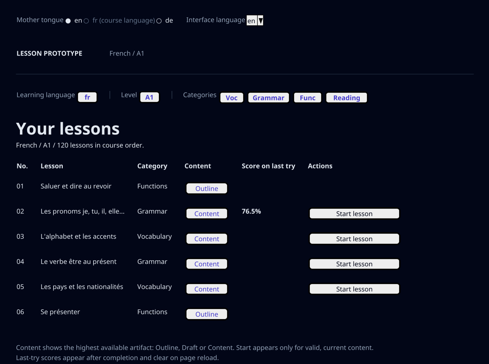
<!-- mockup:end mockups/01-lesson-overview/index/lesson-index.puml -->


### Combined artifact view: vocabulary

The ready-state header has Lesson overview, Raw JSON / Structured view and eligible Start lesson under the page title, with the shared language controls. A shared Outline card preserves the course entry; category-specific Draft and Content components show target inventory, stage plans, vocabulary cards, exercise previews, answers, and explanations. The header toggle opens the raw JSON tree; structured cards are the default. The mockup shows representative items; the application exposes the complete inventory and every stage. Outline-only and draft-only views omit Start and show short messages for missing sections.

<a id="mockup-02-artifact-view-vocabulary-lesson-detail"></a>

[Salt source](mockups/02-artifact-view/vocabulary/lesson-detail.puml)

<!-- mockup:begin mockups/02-artifact-view/vocabulary/lesson-detail.puml -->
```plantuml
@startsalt
skinparam backgroundColor #020617
skinparam defaultFontName SansSerif
skinparam defaultFontSize 15
skinparam defaultFontColor #E2E8F0
scale 1.3
{
.
{ <color:#020617>xxx</color> | {
{ <color:#020617>xxxxxxxxxxxxxxxxxxxxxxxxxxxxxxxxxxxx</color> | <color:#94A3B8>Mother tongue</color> | { <color:#E2E8F0>●  en</color> | <color:#64748B>○  fr (course language)</color> | <color:#E2E8F0>○  de</color> } | <color:#020617>xxx</color> | <color:#94A3B8>Interface language</color> | ^<color:#020617>en</color>^ }
.
<color:#E2E8F0><b>LESSON PROTOTYPE</b></color>
{ [ <color:#4338CA>Lesson overview</color> ] | <color:#020617>xxx</color> | [ <color:#4338CA>Raw JSON</color> ] | <color:#020617>xxx</color> | [ <color:#020617>   Start lesson   </color> ] | <color:#020617>xxxxxxxxxxxxxxxxxxxx</color> | [ <color:#4338CA>Outline</color> ] | <color:#020617>xxx</color> | [ <color:#4338CA>Draft</color> ] | <color:#020617>xxx</color> | [ <color:#4338CA>Content</color> ] }
.
<color:#1E293B>──────────────────────────────────────────────────────────────────────────────</color>
.
<color:#E2E8F0><size:30><b>Les objets de la classe</b></size></color>
.
{
.
{ <color:#020617>xxx</color> | {
<back:#020617><color:#94A3B8><b> OUTLINE </b></color></back>  <color:#E2E8F0><size:20><b>Lesson outline</b></size></color>
.
{
<color:#94A3B8>Lesson 11</color> | <color:#020617>xxx</color> | <color:#E2E8F0>( Vocabulary )</color> | <color:#020617>xxx</color> | <color:#E2E8F0>French / A1</color> | <color:#020617>xxx</color> | <color:#94A3B8>Theme</color>
. | <color:#020617>xxx</color> | . | <color:#020617>xxx</color> | . | <color:#020617>xxx</color> | <color:#E2E8F0>Education</color>
 }
.
<color:#94A3B8>ID</color>
<color:#64748B>fr-classroom-objects</color>
.
<color:#94A3B8>Outline intent</color>
<color:#E2E8F0>Nommer une douzaine d'objets de la classe avec leur article :</color>
<color:#E2E8F0>un livre, un cahier, un stylo, une table, une chaise, un tableau…</color>
.
 } | <color:#020617>xxx</color> }
.
 }
.
{
.
{ <color:#020617>xxx</color> | {
<back:#020617><color:#94A3B8><b> DRAFT </b></color></back>  <color:#E2E8F0><size:20><b>Lesson plan</b></size></color>
.
<color:#94A3B8>12 targets   /   About 13 minutes   /   Translations: English   /   Explanations: English</color>
.
<color:#E2E8F0><size:17><b>Learning objective</b></size></color>
<color:#E2E8F0>Learn to identify and name twelve common classroom objects in French with their indefinite articles.</color>
.
<color:#E2E8F0><size:17><b>Prerequisites</b></size></color>
<color:#E2E8F0>• Basic understanding of French singular indefinite articles (un, une).</color>
.
<color:#E2E8F0><size:17><b>Target inventory</b></size></color>
{
<back:#020617><color:#A5B4FC><b>1.</b></color> <color:#E2E8F0>Masculine objects</color>   <color:#94A3B8>6 targets</color></back> | <color:#020617>xxx</color> | <color:#67E8F9><b>2.</b></color> <color:#E2E8F0>Feminine objects</color>   <color:#94A3B8>6 targets</color>
}
<color:#A5B4FC>━━━━━━━━━━━━━━━━━━━━━━━━━━━━━━━━━━━━━━━━━━━━━━━━━━━━━━━━━━━━━━━━━━━━━━━━━━━━━━━━━━━━━━━━━━━━━━━━━━━━━━━━━━</color>
<color:#E2E8F0><b>Masculine objects (6)</b></color>
{
<color:#94A3B8><b>Target</b></color> | <color:#020617>xxx</color> | <color:#94A3B8><b>Translation (English)</b></color> | <color:#020617>xxx</color> | <color:#94A3B8><b>Word class</b></color> | <color:#020617>xxx</color> | <color:#94A3B8><b>Gender / number</b></color> | <color:#020617>xxx</color> | <color:#94A3B8><b>Difficulty</b></color> | <color:#020617>xxx</color> | <color:#94A3B8><b>Answers and context</b></color>
.
<color:#E2E8F0><b>un livre</b></color> | <color:#020617>xxx</color> | <color:#E2E8F0>a book</color> | <color:#020617>xxx</color> | <color:#E2E8F0>Noun</color> | <color:#020617>xxx</color> | <color:#E2E8F0>Masculine, singular</color> | <color:#020617>xxx</color> | <color:#E2E8F0>( Core )</color> | <color:#020617>xxx</color> | <color:#E2E8F0>Exam answer: </color><color:#00E676><b>un livre</b></color><color:#94A3B8>   /œ̃ livʁ/</color>
.
<color:#E2E8F0><b>un tableau</b></color> | <color:#020617>xxx</color> | <color:#E2E8F0>a board / a blackboard</color> | <color:#020617>xxx</color> | <color:#E2E8F0>Noun</color> | <color:#020617>xxx</color> | <color:#E2E8F0>Masculine, singular</color> | <color:#020617>xxx</color> | <color:#FBBF24>( More demanding )</color> | <color:#020617>xxx</color> | <color:#E2E8F0>Exam answer: </color><color:#00E676><b>un tableau</b></color><color:#94A3B8>   /œ̃ tablo/</color>
 }
<color:#94A3B8>Each row also shows its example sentence with translation. One group tab is shown at a time.</color>
.
{
<color:#E2E8F0><size:17><b>Target count</b></size></color> | <color:#020617>xxx</color> | <color:#E2E8F0><size:17><b>Difficulty balance</b></size></color>
<color:#E2E8F0>Twelve items provide a comprehensive initial</color> | <color:#020617>xxx</color> | <color:#94A3B8>8 core / 4 more demanding</color>
<color:#E2E8F0>classroom vocabulary without overwhelming A1 beginners.</color> | <color:#020617>xxx</color> | <color:#E2E8F0>4 slightly more demanding terms: spelling or accents.</color>
 }
.
<color:#E2E8F0><size:17><b>Lesson plan</b></size></color>
{
<color:#94A3B8><b>Stage</b></color> | <color:#020617>xxx</color> | <color:#94A3B8><b>What the learner does</b></color> | <color:#020617>xxx</color> | <color:#94A3B8><b>Duration</b></color> | <color:#020617>xxx</color> | <color:#94A3B8><b>Assessment</b></color>
.
<color:#E2E8F0><b>01 Introduction</b></color> | <color:#020617>xxx</color> | <color:#E2E8F0>Explore the topic and learning goal</color> | <color:#020617>xxx</color> | <color:#E2E8F0>1 min</color> | <color:#020617>xxx</color> | <color:#E2E8F0>Not scored</color>
.
<color:#E2E8F0><b>02 Flashcards</b></color> | <color:#020617>xxx</color> | <color:#E2E8F0>Recall 12 words with audio</color> | <color:#020617>xxx</color> | <color:#E2E8F0>2 min</color> | <color:#020617>xxx</color> | <color:#E2E8F0>Not scored</color>
.
<color:#E2E8F0><b>03 Matching</b></color> | <color:#020617>xxx</color> | <color:#E2E8F0>Pair translations in groups of 6</color> | <color:#020617>xxx</color> | <color:#E2E8F0>1 min 30 s</color> | <color:#020617>xxx</color> | <color:#E2E8F0>Practice score</color>
.
<color:#E2E8F0><b>04 Gender + overview</b></color> | <color:#020617>xxx</color> | <color:#E2E8F0>Choose noun genders, then review all words</color> | <color:#020617>xxx</color> | <color:#E2E8F0>1 min 30 s</color> | <color:#020617>xxx</color> | <color:#E2E8F0>Practice score</color>
.
<color:#E2E8F0><b>05 Typed gaps</b></color> | <color:#020617>xxx</color> | <color:#E2E8F0>Complete 12 contextual sentences</color> | <color:#020617>xxx</color> | <color:#E2E8F0>3 min</color> | <color:#020617>xxx</color> | <color:#E2E8F0>Practice score</color>
.
<color:#E2E8F0><b>06 Final exam</b></color> | <color:#020617>xxx</color> | <color:#E2E8F0>Answer 12 items on 2 timed pages</color> | <color:#020617>xxx</color> | <color:#E2E8F0>4 min</color> | <color:#020617>xxx</color> | <color:#E2E8F0>Exam score</color>
 }
.
<color:#E2E8F0><size:17><b>Exam pages</b></size></color>
<color:#94A3B8>Each page has its own time limit; the countdown starts when the page opens.</color>
{
<color:#94A3B8><b>Page</b></color> | <color:#020617>xxx</color> | <color:#94A3B8><b>Task</b></color> | <color:#020617>xxx</color> | <color:#94A3B8><b>Covers</b></color> | <color:#020617>xxx</color> | <color:#94A3B8><b>Duration</b></color> | <color:#020617>xxx</color> | <color:#94A3B8><b>Time limit</b></color>
.
<color:#E2E8F0><b>1</b></color> | <color:#020617>xxx</color> | <color:#E2E8F0>Translation</color> | <color:#020617>xxx</color> | <color:#E2E8F0>un livre, un cahier, un stylo, un tableau, un crayon, un sac</color> | <color:#020617>xxx</color> | <color:#E2E8F0>2 min</color> | <color:#020617>xxx</color> | <color:#E2E8F0>3 min</color>
.
<color:#E2E8F0><b>2</b></color> | <color:#020617>xxx</color> | <color:#E2E8F0>Translation</color> | <color:#020617>xxx</color> | <color:#E2E8F0>une table, une chaise, une trousse, une règle, une gomme, une carte</color> | <color:#020617>xxx</color> | <color:#E2E8F0>2 min</color> | <color:#020617>xxx</color> | <color:#E2E8F0>3 min</color>
 }
.
<color:#94A3B8>Scoring: practice 35%, exam 65%; answers wrong only in accents or capitals earn 50% credit.</color>
.
 } | <color:#020617>xxx</color> }
.
 }
.
{
.
{ <color:#020617>xxx</color> | {
<back:#020617><color:#94A3B8><b> CONTENT </b></color></back>  <color:#E2E8F0><size:20><b>Lesson content</b></size></color>
.
<color:#94A3B8>About 13 minutes   /   Translations: English   /   Explanations: English</color>
.
<color:#E2E8F0>Learn to identify and name twelve common classroom objects in French with their indefinite articles.</color>
<color:#94A3B8>Scoring: practice 35%, exam 65%; answers wrong only in accents or capitals earn 50% credit.</color>
.
<color:#E2E8F0><size:17><b>Lesson outline</b></size></color>
{
<color:#A5B4FC><b>1.</b></color> <color:#E2E8F0>Introduction</color>   <color:#94A3B8>Page 1–2</color> | <color:#020617>xxx</color> | <color:#67E8F9><b>2.</b></color> <color:#E2E8F0>Flashcards</color>   <color:#94A3B8>Page 3–4</color> | <color:#020617>xxx</color> | <color:#86EFAC><b>3.</b></color> <color:#E2E8F0>Matching</color>   <color:#94A3B8>Page 5–6</color> | <color:#020617>xxx</color> | <color:#FCD34D><b>4.</b></color> <color:#E2E8F0>Gender and overview</color>   <color:#94A3B8>Page 7</color>
<color:#FDA4AF><b>5.</b></color> <color:#E2E8F0>Practice</color>   <color:#94A3B8>Page 8–19</color> | <color:#020617>xxx</color> | <color:#D8B4FE><b>6.</b></color> <color:#E2E8F0>Final exam</color>   <color:#94A3B8>Page 20–21</color>
}
.
{
<color:#A5B4FC>1. Introduction</color> | <color:#020617>xxx</color> | <color:#67E8F9>2. Flashcards</color> | <color:#020617>xxx</color> | <color:#86EFAC>3. Matching</color> | <color:#020617>xxx</color> | <color:#FCD34D>4. Gender and overview</color>
{ [<b>Page 1</b>] | [Page 2] } | <color:#020617>xxx</color> | { [Page 3] | [Page 4] } | <color:#020617>xxx</color> | { [Page 5] | [Page 6] } | <color:#020617>xxx</color> | { [Page 7] }
}
{
<color:#FDA4AF>5. Practice</color>
{ [Page 8] | [Page 9] | [Page 10] | [Page 11] | [Page 12] | [Page 13] | [Page 14] | [Page 15] | [Page 16] | [Page 17] | [Page 18] | [Page 19] }
}
{
<color:#D8B4FE>6. Final exam</color>
{ [Page 20] | [Page 21] }
}
<color:#94A3B8>Outline cards and page groups wrap onto more lines when needed; no horizontal scrolling.</color>
.
<color:#A5B4FC><b>1. Introduction</b></color>
<color:#E2E8F0><b>Page 1</b></color><color:#94A3B8> (intro-group-masculine)</color>
<color:#94A3B8>30 s · No countdown · Point units: 0</color>
<color:#E2E8F0>Read the introduction and listen to the new words.</color>
<color:#94A3B8>Task type: vocabulary_introduction · intro-group-masculine</color>
<color:#E2E8F0>These six classroom objects are masculine: they take the indefinite article un. …</color>
{
<color:#94A3B8><b>Target</b></color> | <color:#020617>xxx</color> | <color:#94A3B8><b>Translation (English)</b></color> | <color:#020617>xxx</color> | <color:#94A3B8><b>Gender / number</b></color>
.
<color:#E2E8F0>un livre</color><color:#94A3B8>  /œ̃ livʁ/</color> | <color:#020617>xxx</color> | <color:#E2E8F0>a book</color> | <color:#020617>xxx</color> | <color:#E2E8F0>Masculine</color>
.
<color:#E2E8F0>un cahier</color><color:#94A3B8>  /œ̃ kaje/</color> | <color:#020617>xxx</color> | <color:#E2E8F0>a notebook</color> | <color:#020617>xxx</color> | <color:#E2E8F0>Masculine</color>
 }
<color:#94A3B8>Only the selected page appears. Every prompt, accepted answer, explanation and limit stays reachable through the tabs.</color>
.
 } | <color:#020617>xxx</color> }
.
 }
.
.
} | <color:#020617>xxx</color> }
.
}
@endsalt
```
<!-- mockup:end mockups/02-artifact-view/vocabulary/lesson-detail.puml -->


### Combined artifact view: grammar

The same header and Outline layout precede a grammar Draft with teaching blocks, rules, pitfalls, and an exam plan. Content renders form tables, examples, each exercise type, the fixed feedback placeholder, and mixed-exam previews. The displayed timing metadata does not run a countdown; no preview changes learner scores.

<a id="mockup-02-artifact-view-grammar-lesson-detail"></a>

[Salt source](mockups/02-artifact-view/grammar/lesson-detail.puml)

<!-- mockup:begin mockups/02-artifact-view/grammar/lesson-detail.puml -->
```plantuml
@startsalt
skinparam backgroundColor #020617
skinparam defaultFontName SansSerif
skinparam defaultFontSize 15
skinparam defaultFontColor #E2E8F0
scale 1.3
{
.
{ <color:#020617>xxx</color> | {
{ <color:#020617>xxxxxxxxxxxxxxxxxxxxxxxxxxxxxxxxxxxx</color> | <color:#94A3B8>Mother tongue</color> | { <color:#E2E8F0>●  en</color> | <color:#64748B>○  fr (course language)</color> | <color:#E2E8F0>○  de</color> } | <color:#020617>xxx</color> | <color:#94A3B8>Interface language</color> | ^<color:#020617>en</color>^ }
.
<color:#E2E8F0><b>LESSON PROTOTYPE</b></color>
{ [ <color:#4338CA>Lesson overview</color> ] | <color:#020617>xxx</color> | [ <color:#4338CA>Raw JSON</color> ] | <color:#020617>xxx</color> | [ <color:#020617>   Start lesson   </color> ] | <color:#020617>xxxxxxxxxxxxxxxxxxxx</color> | [ <color:#4338CA>Outline</color> ] | <color:#020617>xxx</color> | [ <color:#4338CA>Draft</color> ] | <color:#020617>xxx</color> | [ <color:#4338CA>Content</color> ] }
.
<color:#1E293B>──────────────────────────────────────────────────────────────────────────────</color>
.
<color:#E2E8F0><size:30><b>Le verbe être au présent</b></size></color>
.
{
.
{ <color:#020617>xxx</color> | {
<back:#020617><color:#94A3B8><b> OUTLINE </b></color></back>  <color:#E2E8F0><size:20><b>Lesson outline</b></size></color>
.
{
<color:#94A3B8>Lesson 4</color> | <color:#020617>xxx</color> | <color:#E2E8F0>( Grammar )</color> | <color:#020617>xxx</color> | <color:#E2E8F0>French / A1</color> | <color:#020617>xxx</color> | <color:#94A3B8>Topic</color>
. | <color:#020617>xxx</color> | . | <color:#020617>xxx</color> | . | <color:#020617>xxx</color> | <color:#E2E8F0>Verb forms</color>
 }
.
<color:#94A3B8>ID</color>
<color:#64748B>fr-verb-etre-present</color>
.
<color:#94A3B8>Outline intent</color>
<color:#E2E8F0>Conjuguer être au présent avec tous les pronoms pour dire sa nationalité,</color>
<color:#E2E8F0>sa profession ou son état : je suis, tu es, il est…</color>
.
 } | <color:#020617>xxx</color> }
.
 }
.
{
.
{ <color:#020617>xxx</color> | {
<back:#020617><color:#94A3B8><b> DRAFT </b></color></back>  <color:#E2E8F0><size:20><b>Lesson plan</b></size></color>
.
<color:#94A3B8>2 teaching blocks   /   About 12 minutes   /   Translations: English   /   Explanations: English</color>
.
<color:#E2E8F0><size:17><b>Learning objective</b></size></color>
<color:#E2E8F0>Conjugate the irregular verb être in the present tense with all subject pronouns to express nationality, profession, and state.</color>
.
{
<color:#E2E8F0><size:17><b>Scope boundaries</b></size></color> | <color:#020617>xxx</color> | <color:#E2E8F0><size:17><b>Prerequisites</b></size></color>
<color:#E2E8F0>Covers present indicative forms of être for all subject pronouns.</color> | <color:#020617>xxx</color> | <color:#E2E8F0>• Basic subject pronouns: je, tu, il, elle, on, nous, vous, ils, elles</color>
<color:#E2E8F0>Excludes past tenses, subjunctive, and complex agreement.</color> | <color:#020617>xxx</color> | .
 }
.
<color:#E2E8F0><size:17><b>Rules</b></size></color>
<color:#E2E8F0>1. Singular forms of être: je suis, tu es, il/elle/on est.</color>
<color:#E2E8F0>2. Plural forms of être: nous sommes, vous êtes, ils/elles sont.</color>
<color:#E2E8F0>3. Pronounce obligatory liaisons with vous êtes [vu zɛt] and ils sont vs ils ont.</color>
.
<color:#E2E8F0><size:17><b>Teaching blocks</b></size></color>
{
<back:#020617><color:#A5B4FC><b>1.</b></color> <color:#E2E8F0>Singular forms: je, tu, il, elle, on</color>   <color:#94A3B8>Rule 1</color></back> | <color:#020617>xxx</color> | <color:#67E8F9><b>2.</b></color> <color:#E2E8F0>Plural forms and liaisons: nous, vous, ils, elles</color>   <color:#94A3B8>Rule 2, Rule 3</color>
}
<color:#A5B4FC>━━━━━━━━━━━━━━━━━━━━━━━━━━━━━━━━━━━━━━━━━━━━━━━━━━━━━━━━━━━━━━━━━━━━━━━━━━━━━━━━━━━━━━━━━━━━━━━━━━━━━━━━━━</color>
<color:#94A3B8>01</color> <color:#E2E8F0><b>Singular forms: je, tu, il, elle, on</b></color>
<color:#94A3B8>Rule 1</color>
<color:#94A3B8><b>Explanation plan (2 min)</b></color>
<color:#E2E8F0>Introduce the irregular singular forms of être. Detail usage with professions, nationalities, and basic feelings.</color>
<color:#94A3B8><b>Examples</b></color>
<color:#E2E8F0>• <b>Je suis étudiant.</b></color><color:#94A3B8> – I am a student.</color>
<color:#E2E8F0>• <b>Elle est française.</b></color><color:#94A3B8> – She is French.</color>
<color:#94A3B8><b>Pitfalls</b></color>
<color:#E2E8F0>• Do not confuse 'tu es' with 'il est', despite identical pronunciation [ɛ].</color>
<color:#94A3B8><b>Exercises</b></color>
{
<color:#94A3B8><b>Exercise</b></color> | <color:#020617>xxx</color> | <color:#94A3B8><b>Items</b></color> | <color:#020617>xxx</color> | <color:#94A3B8><b>Rules</b></color> | <color:#020617>xxx</color> | <color:#94A3B8><b>Duration</b></color>
.
<color:#E2E8F0><b>Pronoun–form matching</b></color> | <color:#020617>xxx</color> | <color:#E2E8F0>4</color> | <color:#020617>xxx</color> | <color:#E2E8F0>Rule 1</color> | <color:#020617>xxx</color> | <color:#E2E8F0>1 min</color>
.
<color:#E2E8F0><b>Multiple-choice gaps</b></color> | <color:#020617>xxx</color> | <color:#E2E8F0>4</color> | <color:#020617>xxx</color> | <color:#E2E8F0>Rule 1</color> | <color:#020617>xxx</color> | <color:#E2E8F0>1 min</color>
 }
<color:#94A3B8>One teaching block is shown at a time.</color>
.
<color:#94A3B8>Personalised feedback placeholder: 30 s</color>
.
<color:#E2E8F0><size:17><b>Mixed final exam</b></size></color>
<color:#94A3B8>Each page has its own time limit; the countdown starts when the page opens.</color>
{
<color:#94A3B8><b>Page</b></color> | <color:#020617>xxx</color> | <color:#94A3B8><b>Task</b></color> | <color:#020617>xxx</color> | <color:#94A3B8><b>Items</b></color> | <color:#020617>xxx</color> | <color:#94A3B8><b>Rules</b></color> | <color:#020617>xxx</color> | <color:#94A3B8><b>Duration</b></color> | <color:#020617>xxx</color> | <color:#94A3B8><b>Time limit</b></color>
.
<color:#E2E8F0><b>1</b></color> | <color:#020617>xxx</color> | <color:#E2E8F0>Pronoun–form typing</color> | <color:#020617>xxx</color> | <color:#E2E8F0>6</color> | <color:#020617>xxx</color> | <color:#E2E8F0>Rule 1, Rule 2</color> | <color:#020617>xxx</color> | <color:#E2E8F0>1 min 30 s</color> | <color:#020617>xxx</color> | <color:#E2E8F0>2 min</color>
.
<color:#E2E8F0><b>2</b></color> | <color:#020617>xxx</color> | <color:#E2E8F0>Typed gaps</color> | <color:#020617>xxx</color> | <color:#E2E8F0>6</color> | <color:#020617>xxx</color> | <color:#E2E8F0>Rule 1, Rule 2, Rule 3</color> | <color:#020617>xxx</color> | <color:#E2E8F0>1 min 30 s</color> | <color:#020617>xxx</color> | <color:#E2E8F0>2 min</color>
 }
.
<color:#94A3B8>Scoring: practice 35%, exam 65%; answers wrong only in accents or capitals earn 50% credit.</color>
.
 } | <color:#020617>xxx</color> }
.
 }
.
{
.
{ <color:#020617>xxx</color> | {
<back:#020617><color:#94A3B8><b> CONTENT </b></color></back>  <color:#E2E8F0><size:20><b>Lesson content</b></size></color>
.
<color:#94A3B8>About 12 minutes   /   Translations: English   /   Explanations: English</color>
.
<color:#E2E8F0>Conjugate the irregular verb être in the present tense with all subject pronouns to express nationality, profession, and state.</color>
<color:#94A3B8>Scoring: practice 35%, exam 65%; answers wrong only in accents or capitals earn 50% credit.</color>
.
<color:#E2E8F0><size:17><b>Lesson outline</b></size></color>
{
<color:#A5B4FC><b>1.</b></color> <color:#E2E8F0>Singular forms: je, tu, il, elle, on</color>   <color:#94A3B8>Page 1</color> | <color:#020617>xxx</color> | <color:#67E8F9><b>2.</b></color> <color:#E2E8F0>Singular forms: je, tu, il, elle, on</color>   <color:#94A3B8>Page 2–5</color> | <color:#020617>xxx</color> | <color:#86EFAC><b>3.</b></color> <color:#E2E8F0>Singular forms: je, tu, il, elle, on</color>   <color:#94A3B8>Page 6–9</color> | <color:#020617>xxx</color> | <color:#FCD34D><b>4.</b></color> <color:#E2E8F0>Plural forms and liaisons: nous, vous, ils, elles</color>   <color:#94A3B8>Page 10</color>
<color:#FDA4AF><b>5.</b></color> <color:#E2E8F0>Plural forms and liaisons: nous, vous, ils, elles</color>   <color:#94A3B8>Page 11–14</color> | <color:#020617>xxx</color> | <color:#D8B4FE><b>6.</b></color> <color:#E2E8F0>Plural forms and liaisons: nous, vous, ils, elles</color>   <color:#94A3B8>Page 15–18</color> | <color:#020617>xxx</color> | <color:#A5B4FC><b>7.</b></color> <color:#E2E8F0>Your feedback</color>   <color:#94A3B8>Page 19</color> | <color:#020617>xxx</color> | <color:#67E8F9><b>8.</b></color> <color:#E2E8F0>Final exam</color>   <color:#94A3B8>Page 20–21</color>
}
.
{
<color:#A5B4FC>1. Singular forms: je, tu, il, elle, on</color> | <color:#020617>xxx</color> | <color:#67E8F9>2. Singular forms: je, tu, il, elle, on</color> | <color:#020617>xxx</color> | <color:#86EFAC>3. Singular forms: je, tu, il, elle, on</color>
{ [<b>Page 1</b>] } | <color:#020617>xxx</color> | { [Page 2] | [Page 3] | [Page 4] | [Page 5] } | <color:#020617>xxx</color> | { [Page 6] | [Page 7] | [Page 8] | [Page 9] }
}
{
<color:#FCD34D>4. Plural forms and liaisons: nous, vous, ils, elles</color> | <color:#020617>xxx</color> | <color:#FDA4AF>5. Plural forms and liaisons: nous, vous, ils, elles</color>
{ [Page 10] } | <color:#020617>xxx</color> | { [Page 11] | [Page 12] | [Page 13] | [Page 14] }
}
{
<color:#D8B4FE>6. Plural forms and liaisons: nous, vous, ils, elles</color> | <color:#020617>xxx</color> | <color:#A5B4FC>7. Your feedback</color> | <color:#020617>xxx</color> | <color:#67E8F9>8. Final exam</color>
{ [Page 15] | [Page 16] | [Page 17] | [Page 18] } | <color:#020617>xxx</color> | { [Page 19] } | <color:#020617>xxx</color> | { [Page 20] | [Page 21] }
}
<color:#94A3B8>Outline cards and page groups wrap onto more lines when needed; no horizontal scrolling.</color>
.
<color:#A5B4FC><b>1. Singular forms: je, tu, il, elle, on</b></color>
<color:#E2E8F0><b>Page 1</b></color><color:#94A3B8> (block-singular-explanation)</color>
<color:#94A3B8>2 min · No countdown · Point units: 0</color>
<color:#E2E8F0>Read the explanation and the examples.</color>
<color:#94A3B8>Task type: grammar_explanation · block-singular-explanation</color>
<color:#E2E8F0>Rules: rule-singular-forms</color>
<color:#E2E8F0><b>être in the singular</b></color>
<color:#E2E8F0>Être (to be) is irregular: its forms must be learned by heart. …</color>
{
<color:#94A3B8><b>Subject</b></color> | <color:#020617>xxx</color> | <color:#94A3B8><b>Form</b></color> | <color:#020617>xxx</color> | <color:#94A3B8><b>Example</b></color>
.
<color:#E2E8F0>je</color> | <color:#020617>xxx</color> | <color:#E2E8F0>suis</color> | <color:#020617>xxx</color> | <color:#E2E8F0>Je suis étudiant.</color>
.
<color:#E2E8F0>tu</color> | <color:#020617>xxx</color> | <color:#E2E8F0>es</color> | <color:#020617>xxx</color> | <color:#E2E8F0>Tu es fatigué ?</color>
.
<color:#E2E8F0>il / elle / on</color> | <color:#020617>xxx</color> | <color:#E2E8F0>est</color> | <color:#020617>xxx</color> | <color:#E2E8F0>Elle est française.</color>
 }
<color:#94A3B8>Only the selected page appears. Every prompt, accepted answer, explanation and limit stays reachable through the tabs.</color>
.
 } | <color:#020617>xxx</color> }
.
 }
.
.
} | <color:#020617>xxx</color> }
.
}
@endsalt
```
<!-- mockup:end mockups/02-artifact-view/grammar/lesson-detail.puml -->


### Lesson start

The duration shown here is the lesson estimate. Continue starts or resumes the session. There are no preparation or generating states. Content follows the start-page rule in section 6: category badge, minutes, word count and colour-coded word groups for vocabulary; no step list, scored-step count or weights.

<a id="mockup-03-vocabulary-lesson-01-startpage-lesson-start"></a>

<!-- screen:begin mockups/03-vocabulary-lesson/01-startpage/lesson-start -->
[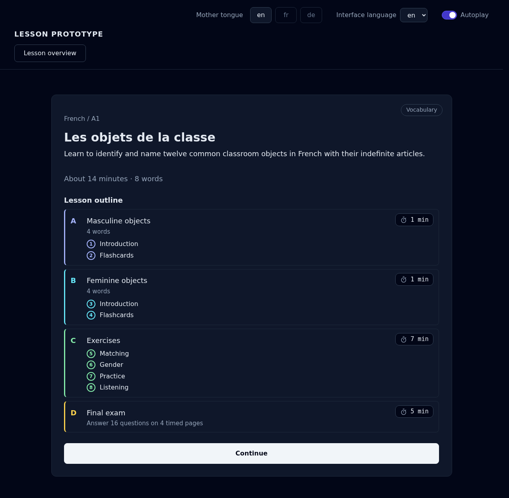](mockups/03-vocabulary-lesson/01-startpage/lesson-start.html)

Rendered by the prototype (lesson `fr-classroom-objects`): [HTML snapshot](mockups/03-vocabulary-lesson/01-startpage/lesson-start.html) · [PNG](mockups/03-vocabulary-lesson/01-startpage/lesson-start.png). Refresh with `make screens`.
<!-- screen:end mockups/03-vocabulary-lesson/01-startpage/lesson-start -->


### Practice: enter an answer

The shared header shows estimated-duration progress and accumulated weighted points against 100. Reference choices are plain text; Continue locks the response and reveals feedback on this page.

<a id="mockup-03-vocabulary-lesson-06-typed-gaps-answer"></a>

<!-- screen:begin mockups/03-vocabulary-lesson/06-typed-gaps/answer -->
[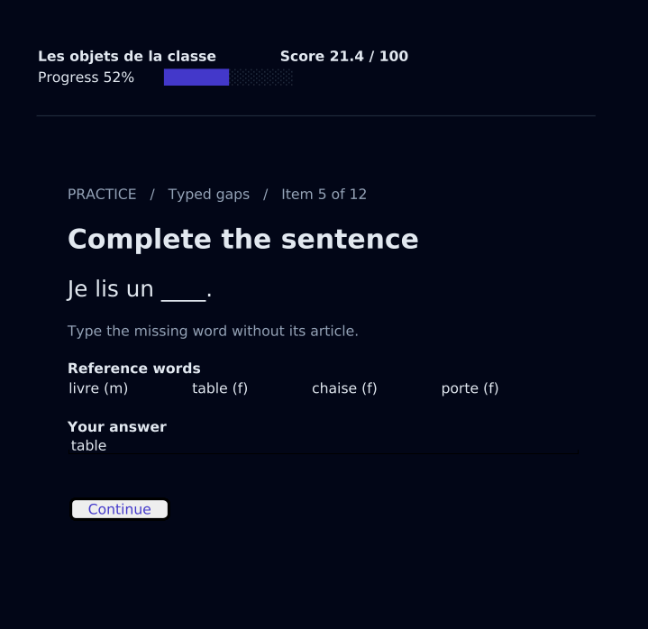](mockups/03-vocabulary-lesson/06-typed-gaps/answer.html)

Rendered by the prototype (lesson `fr-classroom-objects`): [HTML snapshot](mockups/03-vocabulary-lesson/06-typed-gaps/answer.html) · [PNG](mockups/03-vocabulary-lesson/06-typed-gaps/answer.png). Refresh with `make screens`.
<!-- screen:end mockups/03-vocabulary-lesson/06-typed-gaps/answer -->


### Practice: confirm feedback

An incorrect response displays the correct answer and a short pre-generated explanation of why it is right. Continue confirms and advances. Fully correct responses use success feedback; accent/case-only responses use distinct partial-correct feedback with 0.5 points and the exact accepted answer. There is no extra Check button.

<a id="mockup-03-vocabulary-lesson-06-typed-gaps-feedback"></a>

<!-- screen:begin mockups/03-vocabulary-lesson/06-typed-gaps/feedback -->
[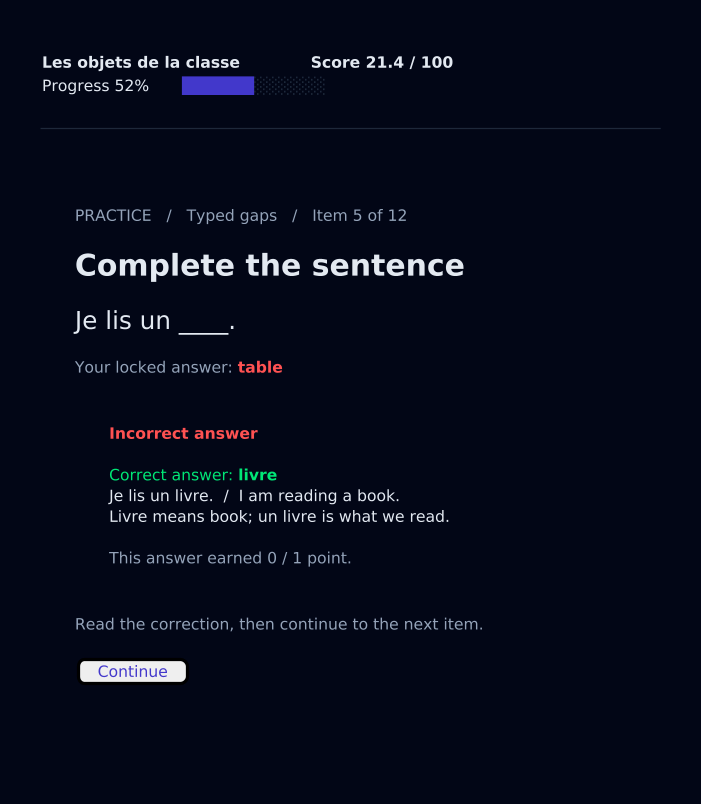](mockups/03-vocabulary-lesson/06-typed-gaps/feedback.html)

Rendered by the prototype (lesson `fr-classroom-objects`): [HTML snapshot](mockups/03-vocabulary-lesson/06-typed-gaps/feedback.html) · [PNG](mockups/03-vocabulary-lesson/06-typed-gaps/feedback.png). Refresh with `make screens`.
<!-- screen:end mockups/03-vocabulary-lesson/06-typed-gaps/feedback -->


### Exam page

The displayed countdown is illustrative; its initial limit comes from the brief. Continue advances without showing correctness. The score remains at the practice contribution until the exam finishes.

<a id="mockup-03-vocabulary-lesson-07-exam-exam-page"></a>

<!-- screen:begin mockups/03-vocabulary-lesson/07-exam/exam-page -->
[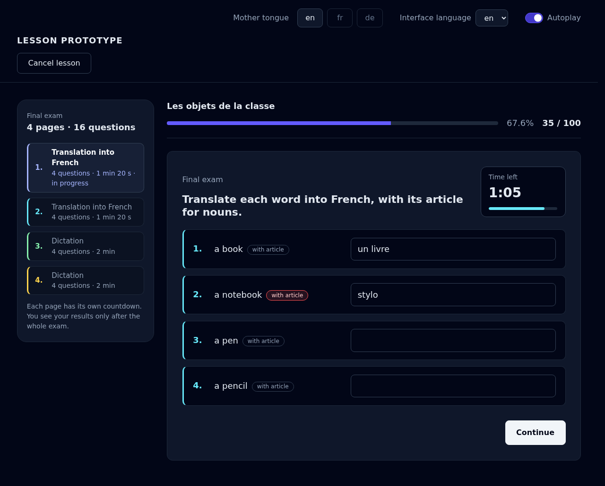](mockups/03-vocabulary-lesson/07-exam/exam-page.html)

Rendered by the prototype (lesson `fr-classroom-objects`): [HTML snapshot](mockups/03-vocabulary-lesson/07-exam/exam-page.html) · [PNG](mockups/03-vocabulary-lesson/07-exam/exam-page.png). Refresh with `make screens`.
<!-- screen:end mockups/03-vocabulary-lesson/07-exam/exam-page -->

#### Vocabulary: Exam info

<a id="mockup-03-vocabulary-lesson-07-exam-exam-info"></a>

<!-- screen:begin mockups/03-vocabulary-lesson/07-exam/exam-info -->
[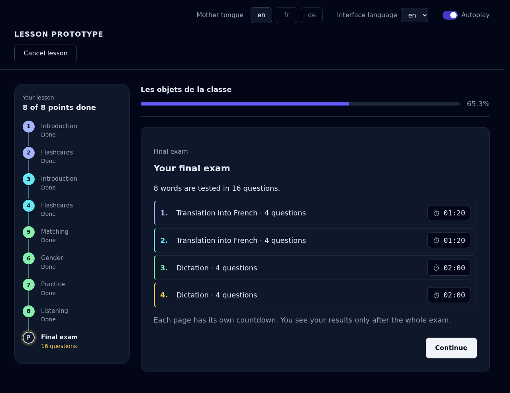](mockups/03-vocabulary-lesson/07-exam/exam-info.html)

Rendered by the prototype (lesson `fr-classroom-objects`): [HTML snapshot](mockups/03-vocabulary-lesson/07-exam/exam-info.html) · [PNG](mockups/03-vocabulary-lesson/07-exam/exam-info.png). Refresh with `make screens`.
<!-- screen:end mockups/03-vocabulary-lesson/07-exam/exam-info -->


### Final results: exam selected

Exam answers show by default as flat screenshot-style rows beneath the score aggregates. Incorrect answers and corrections appear on separate labeled lines; correct answers do not repeat an identical correction. The button menu selects previous exercise results without leaving this final page. This example includes a noun-gender exercise: Matching 10/12, Gender 9/12, and Typed gaps 8/12 yield 27/36 practice points (75%); exam 8/12 yields a weighted total of 69.6/100 after rounding.

<a id="mockup-03-vocabulary-lesson-08-results-exam-results"></a>

<!-- screen:begin mockups/03-vocabulary-lesson/08-results/exam-results -->
[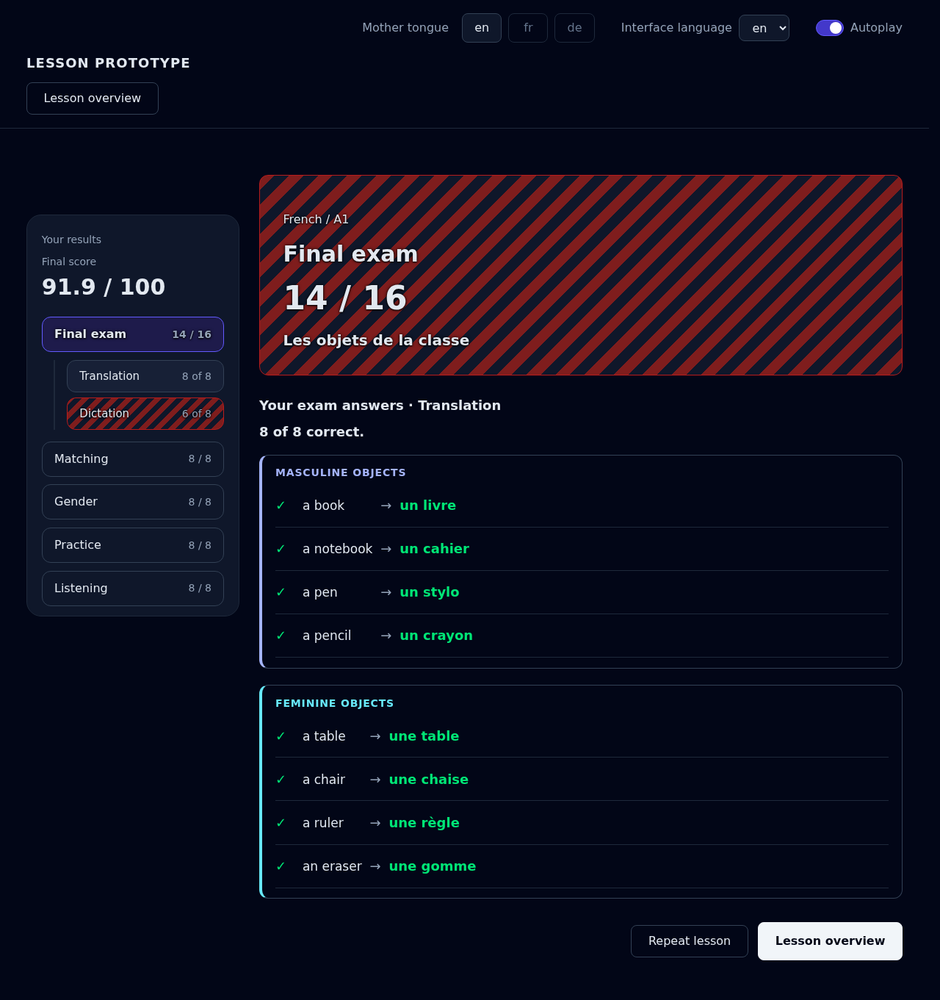](mockups/03-vocabulary-lesson/08-results/exam-results.html)

Rendered by the prototype (lesson `fr-classroom-objects`): [HTML snapshot](mockups/03-vocabulary-lesson/08-results/exam-results.html) · [PNG](mockups/03-vocabulary-lesson/08-results/exam-results.png). Refresh with `make screens`.
<!-- screen:end mockups/03-vocabulary-lesson/08-results/exam-results -->


### Final results: previous practice selected

Selecting a previous exercise keeps scores/menu visible and replaces the answer-review area with that exercise's locked responses, correct answers, and generated explanations. The example selects Gender; it does not repeat the exercise or change its score.

<a id="mockup-03-vocabulary-lesson-08-results-gender-results"></a>

<!-- screen:begin mockups/03-vocabulary-lesson/08-results/gender-results -->
[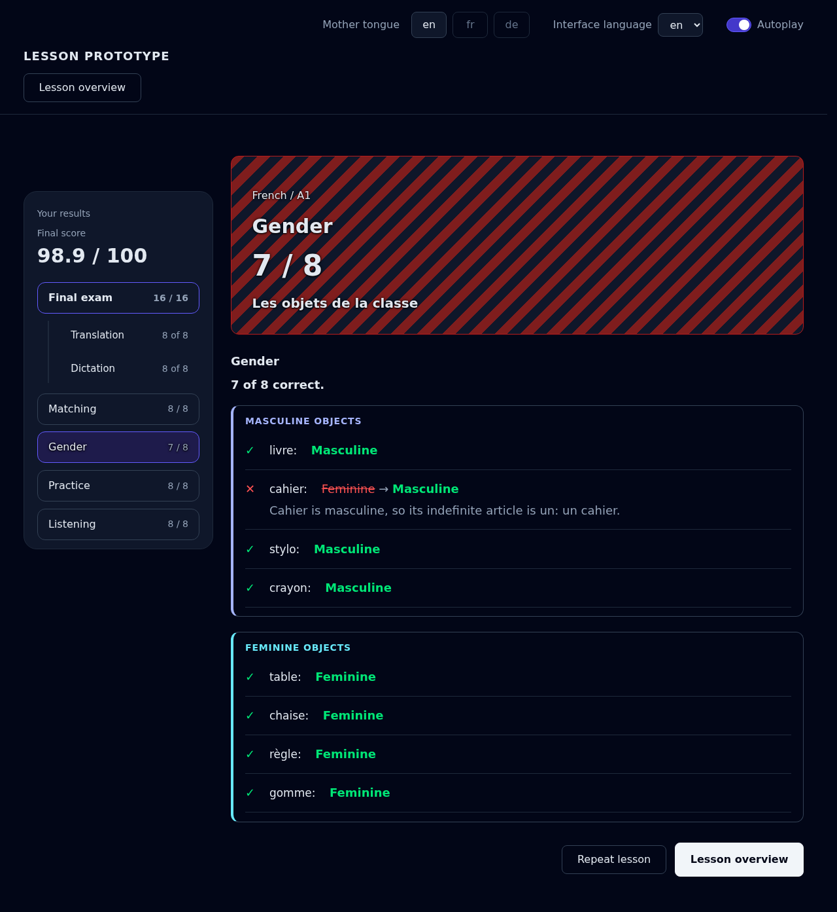](mockups/03-vocabulary-lesson/08-results/gender-results.html)

Rendered by the prototype (lesson `fr-classroom-objects`): [HTML snapshot](mockups/03-vocabulary-lesson/08-results/gender-results.html) · [PNG](mockups/03-vocabulary-lesson/08-results/gender-results.png). Refresh with `make screens`.
<!-- screen:end mockups/03-vocabulary-lesson/08-results/gender-results -->


### Gender exercise inside the overview

All twelve sample targets are on one page. Gender clues are hidden while answering. This initial state shows unanswered select boxes; Continue becomes available when all required choices are supplied. Continue locks the selections and transforms this page into the reviewed overview with correct forms, per-row right/wrong states, and correction explanations.

<a id="mockup-03-vocabulary-lesson-05-gender-overview-gender-select"></a>

<!-- screen:begin mockups/03-vocabulary-lesson/05-gender-overview/gender-select -->
[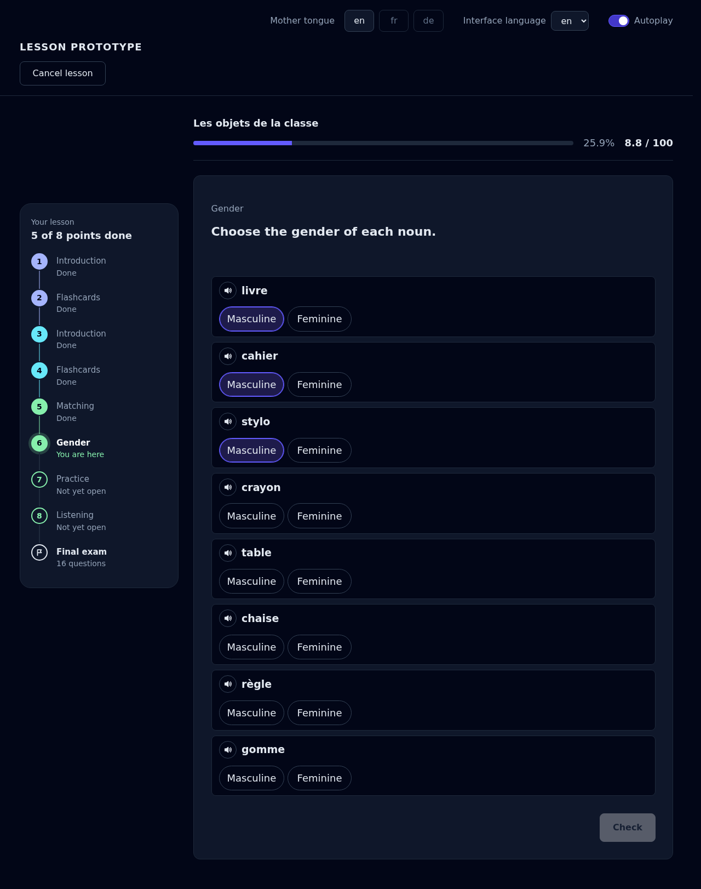](mockups/03-vocabulary-lesson/05-gender-overview/gender-select.html)

Rendered by the prototype (lesson `fr-classroom-objects`): [HTML snapshot](mockups/03-vocabulary-lesson/05-gender-overview/gender-select.html) · [PNG](mockups/03-vocabulary-lesson/05-gender-overview/gender-select.png). Refresh with `make screens`.
<!-- screen:end mockups/03-vocabulary-lesson/05-gender-overview/gender-select -->


<a id="mockup-03-vocabulary-lesson-05-gender-overview-reviewed-overview"></a>

<!-- screen:begin mockups/03-vocabulary-lesson/05-gender-overview/reviewed-overview -->
[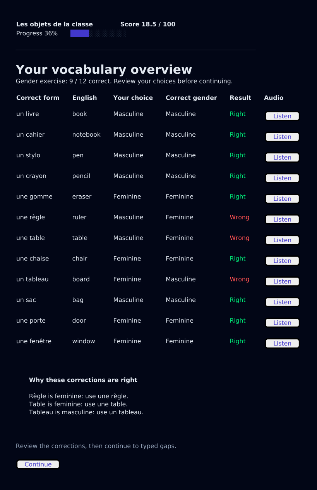](mockups/03-vocabulary-lesson/05-gender-overview/reviewed-overview.html)

Rendered by the prototype (lesson `fr-classroom-objects`): [HTML snapshot](mockups/03-vocabulary-lesson/05-gender-overview/reviewed-overview.html) · [PNG](mockups/03-vocabulary-lesson/05-gender-overview/reviewed-overview.png). Refresh with `make screens`.
<!-- screen:end mockups/03-vocabulary-lesson/05-gender-overview/reviewed-overview -->


### Browse the lesson stages and grammar exercises

The folder organization follows the lesson flow. Vocabulary uses `01-startpage/`, then `02-introduction/` through `07-exam/`, and `08-results/`; `06-listening/` sits beside `06-typed-gaps/` because both belong to practice stage 5, and `07-exam/` also holds the listening-dictation page. These folder numbers include the start page; the educational six-stage numbering remains unchanged. Grammar uses `01-startpage/`, `02-00-explanation/`, double-numbered exercise folders `02-01-exercise-pronoun-match/` through `02-06-exercise-error-spotter/`, then `03-feedback-placeholder/`, `04-exam/`, and `05-results/`. The exercise folders describe the available component types, not a requirement to use all six in one lesson. Functions use `01-startpage/` to `07-listening-choice/` in lesson order and `08-exam/` for both exam parts (P4-01, reordered in the P4-05 review). The single [root README](mockups/README.md) links every editable source and its embedded SPEC preview; there are no per-folder READMEs.

| Category | Folders and previews |
| --- | --- |
| [Lesson overview](mockups/README.md#lesson-overview) | Ordered lesson index. |
| [Artifact view](mockups/README.md#artifact-view) | Shared Outline layout, with category-specific vocabulary/grammar Draft and Content views. |
| [Vocabulary lesson](mockups/README.md#vocabulary-lesson) | Start; [01 introduction](mockups/03-vocabulary-lesson/02-introduction/introduction.png); [02 flashcards](mockups/03-vocabulary-lesson/03-flashcards/front.png) and [reveal](mockups/03-vocabulary-lesson/03-flashcards/revealed.png); [03 matching](mockups/03-vocabulary-lesson/04-matching/matching.png); 04 gender + reviewed overview; 05 typed gaps + feedback, [listening choice](mockups/03-vocabulary-lesson/06-listening/listening-choice.png) and [no-voice help](mockups/03-vocabulary-lesson/06-listening/no-voice-help.png); 06 exam and [listening dictation](mockups/03-vocabulary-lesson/07-exam/listening-dictation.png); results. |
| [Grammar lesson](mockups/README.md#grammar-lesson) | [Start](mockups/04-grammar-lesson/01-startpage/lesson-start.png); [explanation](mockups/04-grammar-lesson/02-00-explanation/explanation.png); [pronoun matching](mockups/04-grammar-lesson/02-01-exercise-pronoun-match/pronoun-match.png); [pronoun typing](mockups/04-grammar-lesson/02-02-exercise-pronoun-typing/pronoun-typing.png); [choice gap](mockups/04-grammar-lesson/02-03-exercise-gap-choice/gap-choice.png); [typed gap](mockups/04-grammar-lesson/02-04-exercise-gap-typing/gap-typing.png) and [feedback](mockups/04-grammar-lesson/02-04-exercise-gap-typing/feedback.png); [word order](mockups/04-grammar-lesson/02-05-exercise-word-order/word-order.png); [error spotter](mockups/04-grammar-lesson/02-06-exercise-error-spotter/error-spotter.png); [placeholder](mockups/04-grammar-lesson/03-feedback-placeholder/feedback-placeholder.png); [exam](mockups/04-grammar-lesson/04-exam/mixed-exam.png); [results](mockups/04-grammar-lesson/05-results/exam-results.png). |
| [Function lesson](mockups/README.md#function-lesson) | [lesson start](mockups/05-function-lesson/01-startpage/lesson-start.png); [expression flashcards](mockups/05-function-lesson/02-flashcards/expression-flashcards.png); [model dialogue](mockups/05-function-lesson/03-dialogue/dialogue.png); [expression matching](mockups/05-function-lesson/04-matching/expression-matching.png); [dialogue gaps](mockups/05-function-lesson/05-dialogue-gap-choice/dialogue-gap-choice.png); [word order](mockups/05-function-lesson/06-word-order/word-order.png); [listening choice](mockups/05-function-lesson/07-listening-choice/listening-choice.png); [exam replies](mockups/05-function-lesson/08-exam/reply-word-order.png); [exam dialogue](mockups/05-function-lesson/08-exam/dialogue-gap-typing.png); results use the shared results layout. |

### Additional lesson screens

The remaining stage and grammar-exercise mockups use the same source-only, synchronized representation.

#### Shared raw JSON view

The initial tree opens only its root and any visible small containers. The second mockup shows Content after the user expands it: the three-entry objective and locale containers expand automatically, while six-step content stays collapsed. Example payloads illustrate the tree rules and do not claim generated sample files exist.

<a id="mockup-02-artifact-view-raw-json-json-tree"></a>

[Salt source](mockups/02-artifact-view/raw-json/json-tree.puml)

<!-- mockup:begin mockups/02-artifact-view/raw-json/json-tree.puml -->
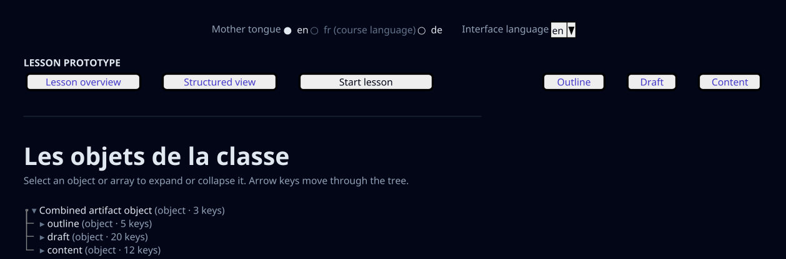
<!-- mockup:end mockups/02-artifact-view/raw-json/json-tree.puml -->

<a id="mockup-02-artifact-view-raw-json-json-tree-expanded"></a>

[Salt source](mockups/02-artifact-view/raw-json/json-tree-expanded.puml)

<!-- mockup:begin mockups/02-artifact-view/raw-json/json-tree-expanded.puml -->
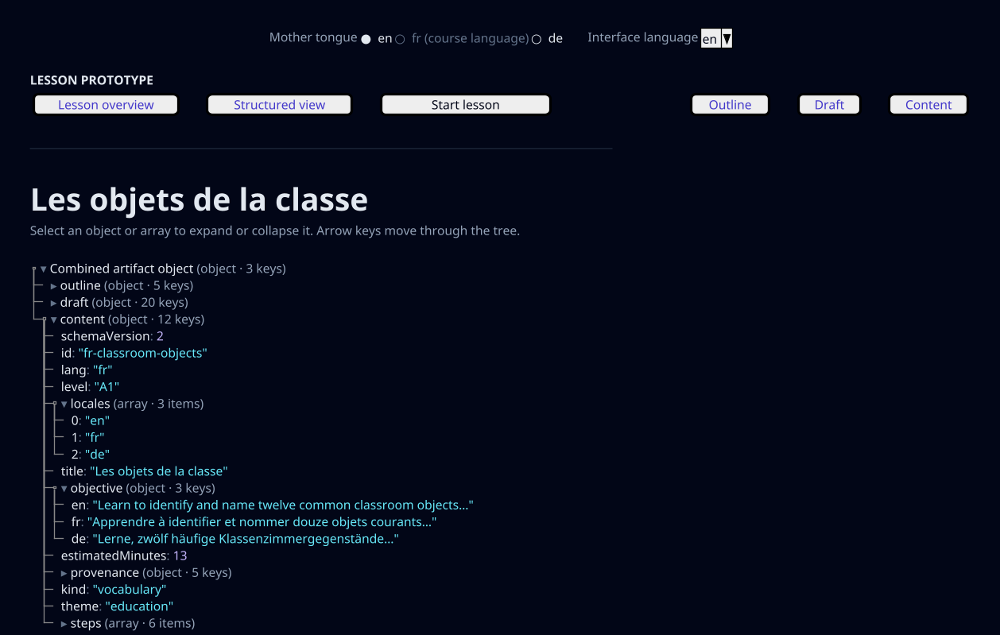
<!-- mockup:end mockups/02-artifact-view/raw-json/json-tree-expanded.puml -->

### Vocabulary: Introduction

<a id="mockup-03-vocabulary-lesson-02-introduction-introduction"></a>

<!-- screen:begin mockups/03-vocabulary-lesson/02-introduction/introduction -->
[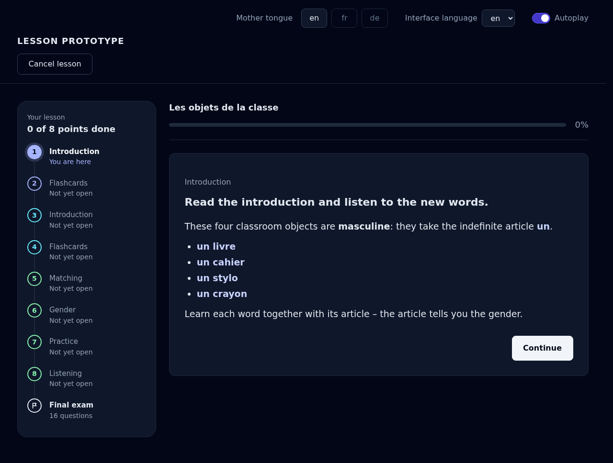](mockups/03-vocabulary-lesson/02-introduction/introduction.html)

Rendered by the prototype (lesson `fr-classroom-objects`): [HTML snapshot](mockups/03-vocabulary-lesson/02-introduction/introduction.html) · [PNG](mockups/03-vocabulary-lesson/02-introduction/introduction.png). Refresh with `make screens`.
<!-- screen:end mockups/03-vocabulary-lesson/02-introduction/introduction -->

#### Vocabulary: Front

<a id="mockup-03-vocabulary-lesson-03-flashcards-front"></a>

<!-- screen:begin mockups/03-vocabulary-lesson/03-flashcards/front -->
[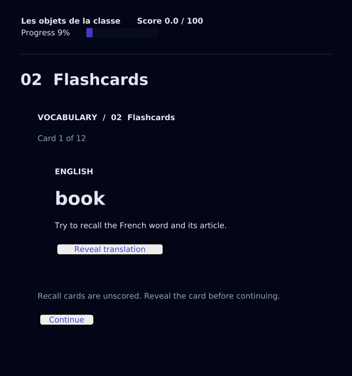](mockups/03-vocabulary-lesson/03-flashcards/front.html)

Rendered by the prototype (lesson `fr-classroom-objects`): [HTML snapshot](mockups/03-vocabulary-lesson/03-flashcards/front.html) · [PNG](mockups/03-vocabulary-lesson/03-flashcards/front.png). Refresh with `make screens`.
<!-- screen:end mockups/03-vocabulary-lesson/03-flashcards/front -->

#### Vocabulary: Revealed

<a id="mockup-03-vocabulary-lesson-03-flashcards-revealed"></a>

<!-- screen:begin mockups/03-vocabulary-lesson/03-flashcards/revealed -->
[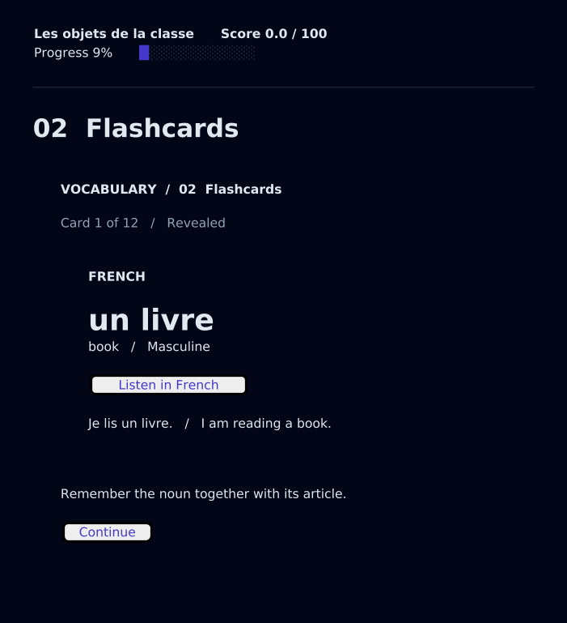](mockups/03-vocabulary-lesson/03-flashcards/revealed.html)

Rendered by the prototype (lesson `fr-classroom-objects`): [HTML snapshot](mockups/03-vocabulary-lesson/03-flashcards/revealed.html) · [PNG](mockups/03-vocabulary-lesson/03-flashcards/revealed.png). Refresh with `make screens`.
<!-- screen:end mockups/03-vocabulary-lesson/03-flashcards/revealed -->

#### Vocabulary: Matching

<a id="mockup-03-vocabulary-lesson-04-matching-matching"></a>

<!-- screen:begin mockups/03-vocabulary-lesson/04-matching/matching -->
[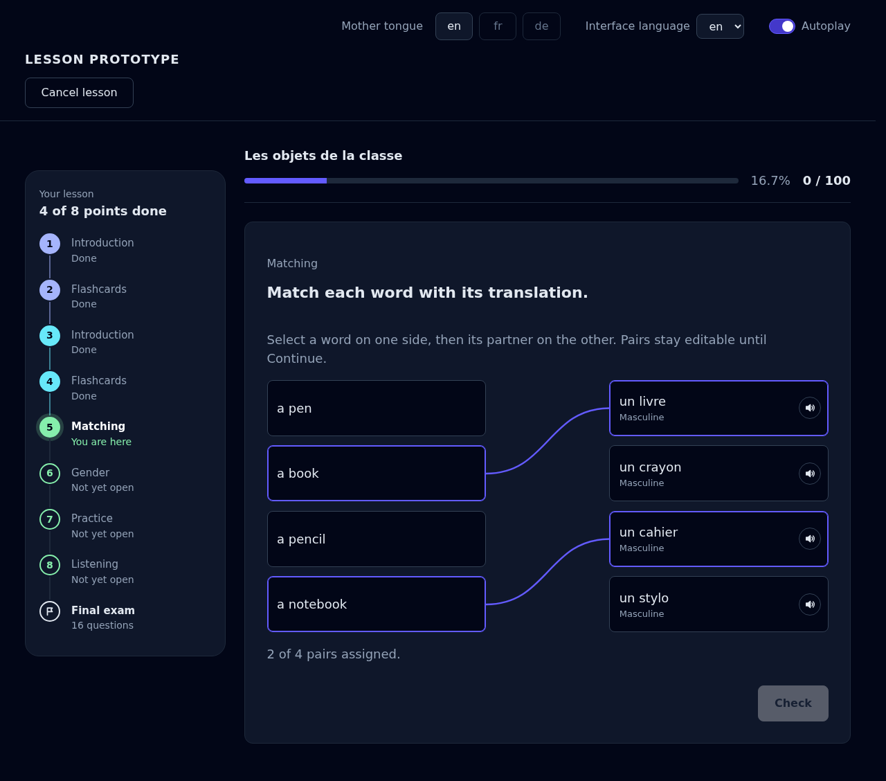](mockups/03-vocabulary-lesson/04-matching/matching.html)

Rendered by the prototype (lesson `fr-classroom-objects`): [HTML snapshot](mockups/03-vocabulary-lesson/04-matching/matching.html) · [PNG](mockups/03-vocabulary-lesson/04-matching/matching.png). Refresh with `make screens`.
<!-- screen:end mockups/03-vocabulary-lesson/04-matching/matching -->

#### Vocabulary: Listening choice

<a id="mockup-03-vocabulary-lesson-06-listening-listening-choice"></a>

<!-- screen:begin mockups/03-vocabulary-lesson/06-listening/listening-choice -->
[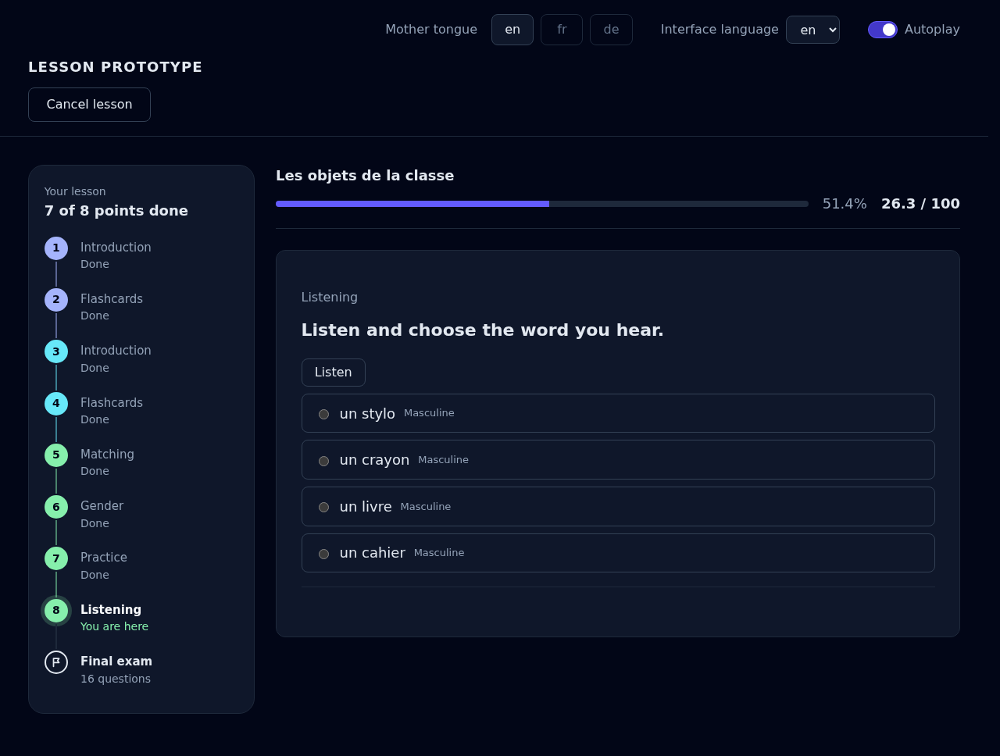](mockups/03-vocabulary-lesson/06-listening/listening-choice.html)

Rendered by the prototype (lesson `fr-classroom-objects`): [HTML snapshot](mockups/03-vocabulary-lesson/06-listening/listening-choice.html) · [PNG](mockups/03-vocabulary-lesson/06-listening/listening-choice.png). Refresh with `make screens`.
<!-- screen:end mockups/03-vocabulary-lesson/06-listening/listening-choice -->

When no French voice exists, the listening page is replaced by this help page; Skip continues with the next exercise (D42).

#### Vocabulary: No-voice help

<a id="mockup-03-vocabulary-lesson-06-listening-no-voice-help"></a>

<!-- screen:begin mockups/03-vocabulary-lesson/06-listening/no-voice-help -->
[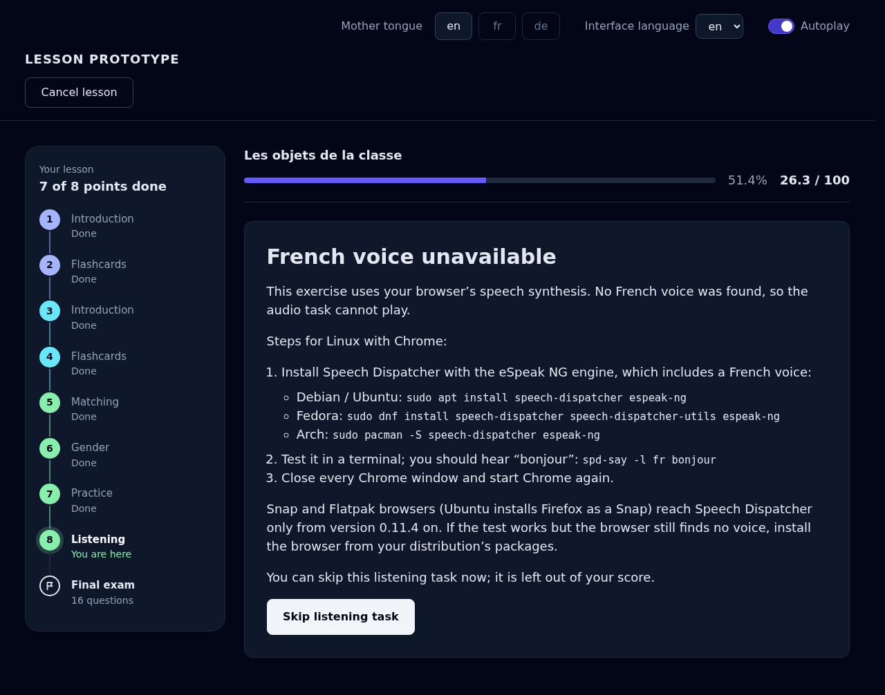](mockups/03-vocabulary-lesson/06-listening/no-voice-help.html)

Rendered by the prototype (lesson `fr-classroom-objects`): [HTML snapshot](mockups/03-vocabulary-lesson/06-listening/no-voice-help.html) · [PNG](mockups/03-vocabulary-lesson/06-listening/no-voice-help.png). Refresh with `make screens`.
<!-- screen:end mockups/03-vocabulary-lesson/06-listening/no-voice-help -->

#### Vocabulary: Listening dictation exam

<a id="mockup-03-vocabulary-lesson-07-exam-listening-dictation"></a>

<!-- screen:begin mockups/03-vocabulary-lesson/07-exam/listening-dictation -->
[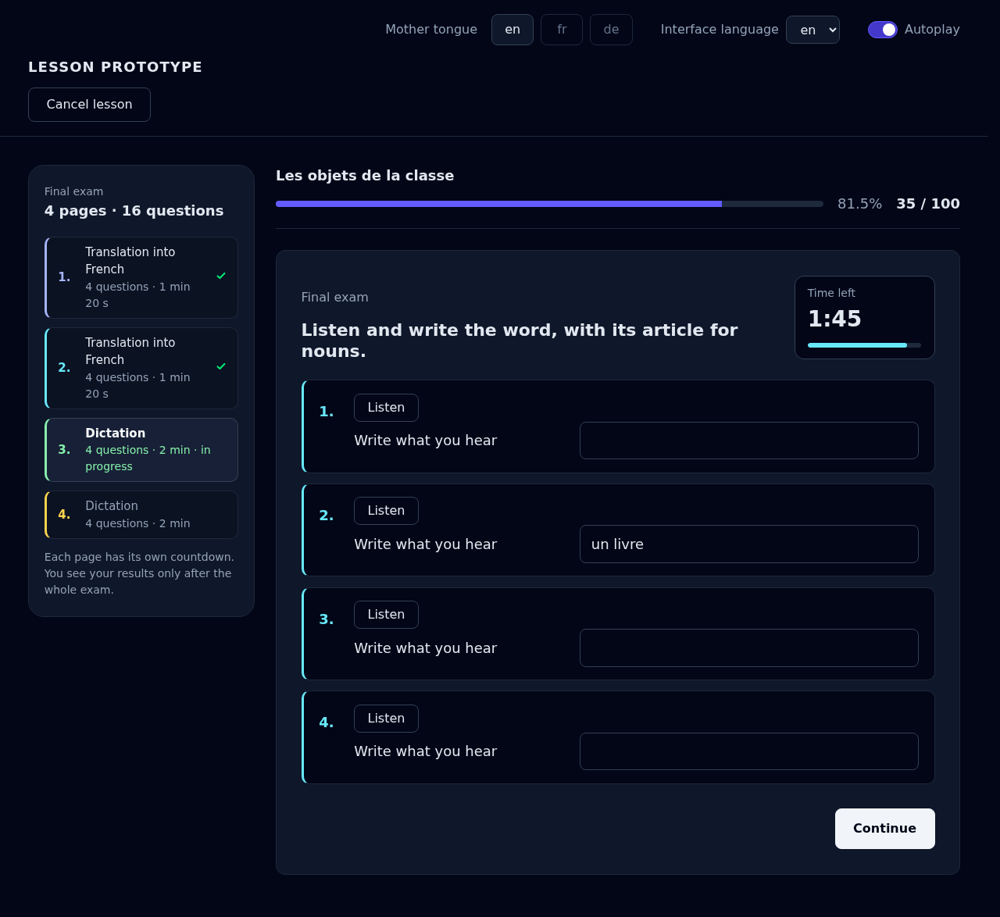](mockups/03-vocabulary-lesson/07-exam/listening-dictation.html)

Rendered by the prototype (lesson `fr-classroom-objects`): [HTML snapshot](mockups/03-vocabulary-lesson/07-exam/listening-dictation.html) · [PNG](mockups/03-vocabulary-lesson/07-exam/listening-dictation.png). Refresh with `make screens`.
<!-- screen:end mockups/03-vocabulary-lesson/07-exam/listening-dictation -->

#### Grammar: Lesson start

<a id="mockup-04-grammar-lesson-01-startpage-lesson-start"></a>

<!-- screen:begin mockups/04-grammar-lesson/01-startpage/lesson-start -->
[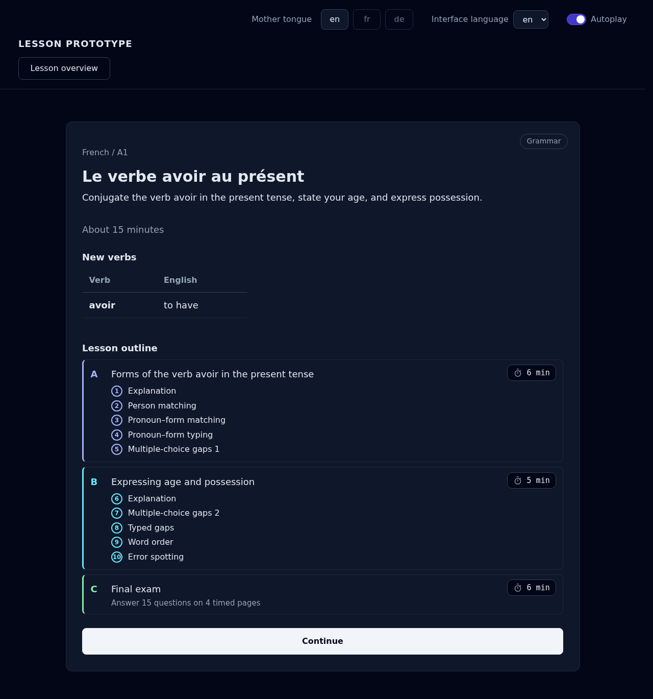](mockups/04-grammar-lesson/01-startpage/lesson-start.html)

Rendered by the prototype (lesson `fr-verb-avoir-present`): [HTML snapshot](mockups/04-grammar-lesson/01-startpage/lesson-start.html) · [PNG](mockups/04-grammar-lesson/01-startpage/lesson-start.png). Refresh with `make screens`.
<!-- screen:end mockups/04-grammar-lesson/01-startpage/lesson-start -->

#### Grammar: Singular forms

<a id="mockup-04-grammar-lesson-02-00-explanation-explanation"></a>

<!-- screen:begin mockups/04-grammar-lesson/02-00-explanation/explanation -->
[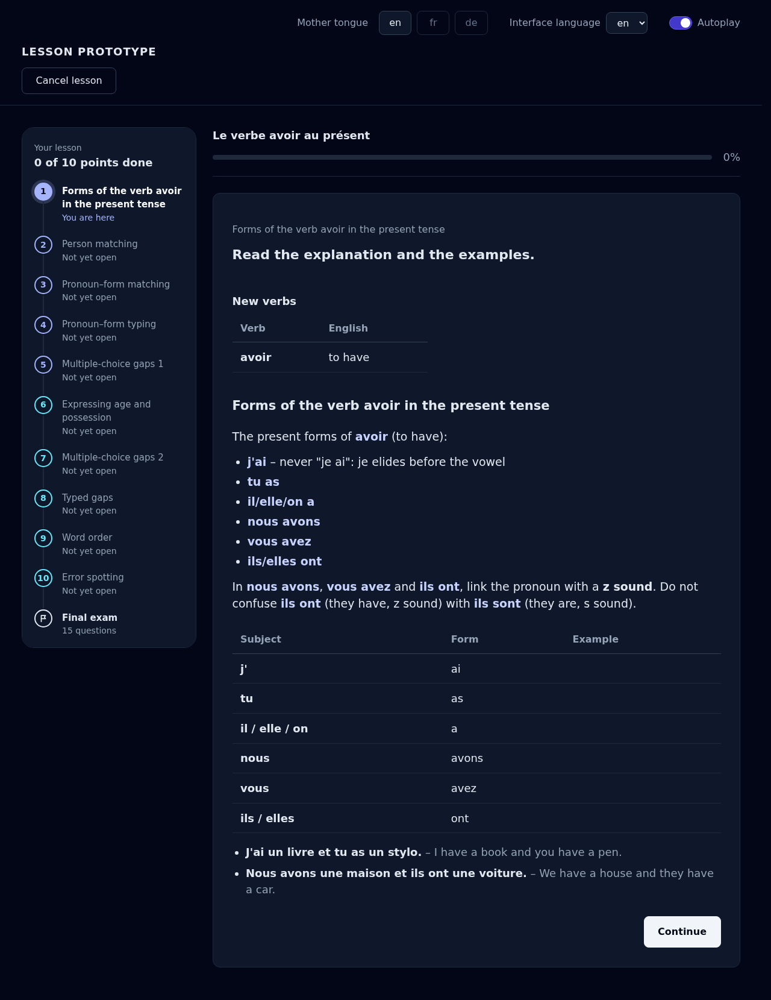](mockups/04-grammar-lesson/02-00-explanation/explanation.html)

Rendered by the prototype (lesson `fr-verb-avoir-present`): [HTML snapshot](mockups/04-grammar-lesson/02-00-explanation/explanation.html) · [PNG](mockups/04-grammar-lesson/02-00-explanation/explanation.png). Refresh with `make screens`.
<!-- screen:end mockups/04-grammar-lesson/02-00-explanation/explanation -->

#### Grammar: Person matching

<a id="mockup-04-grammar-lesson-02-07-exercise-person-matching-person-matching"></a>

<!-- screen:begin mockups/04-grammar-lesson/02-07-exercise-person-matching/person-matching -->
[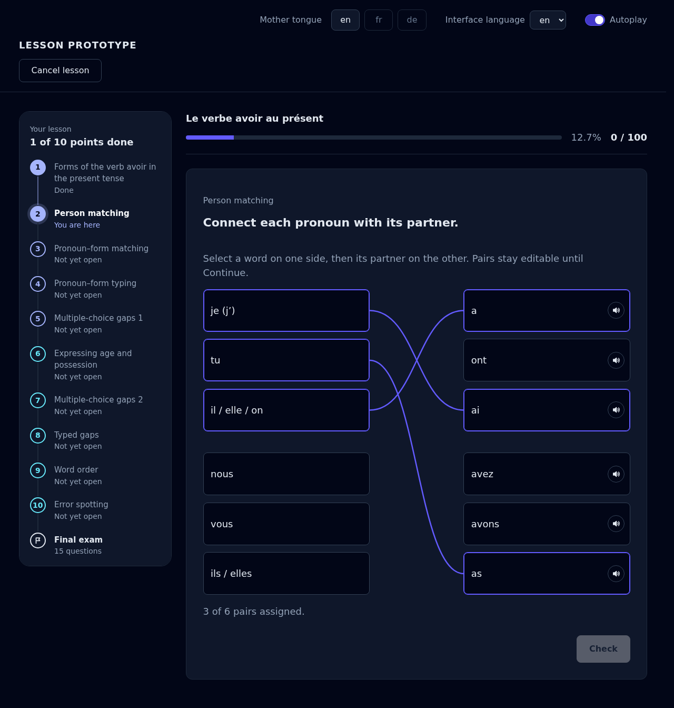](mockups/04-grammar-lesson/02-07-exercise-person-matching/person-matching.html)

Rendered by the prototype (lesson `fr-verb-avoir-present`): [HTML snapshot](mockups/04-grammar-lesson/02-07-exercise-person-matching/person-matching.html) · [PNG](mockups/04-grammar-lesson/02-07-exercise-person-matching/person-matching.png). Refresh with `make screens`.
<!-- screen:end mockups/04-grammar-lesson/02-07-exercise-person-matching/person-matching -->

#### Grammar: Pronoun match

<a id="mockup-04-grammar-lesson-02-01-exercise-pronoun-match-pronoun-match"></a>

<!-- screen:begin mockups/04-grammar-lesson/02-01-exercise-pronoun-match/pronoun-match -->
[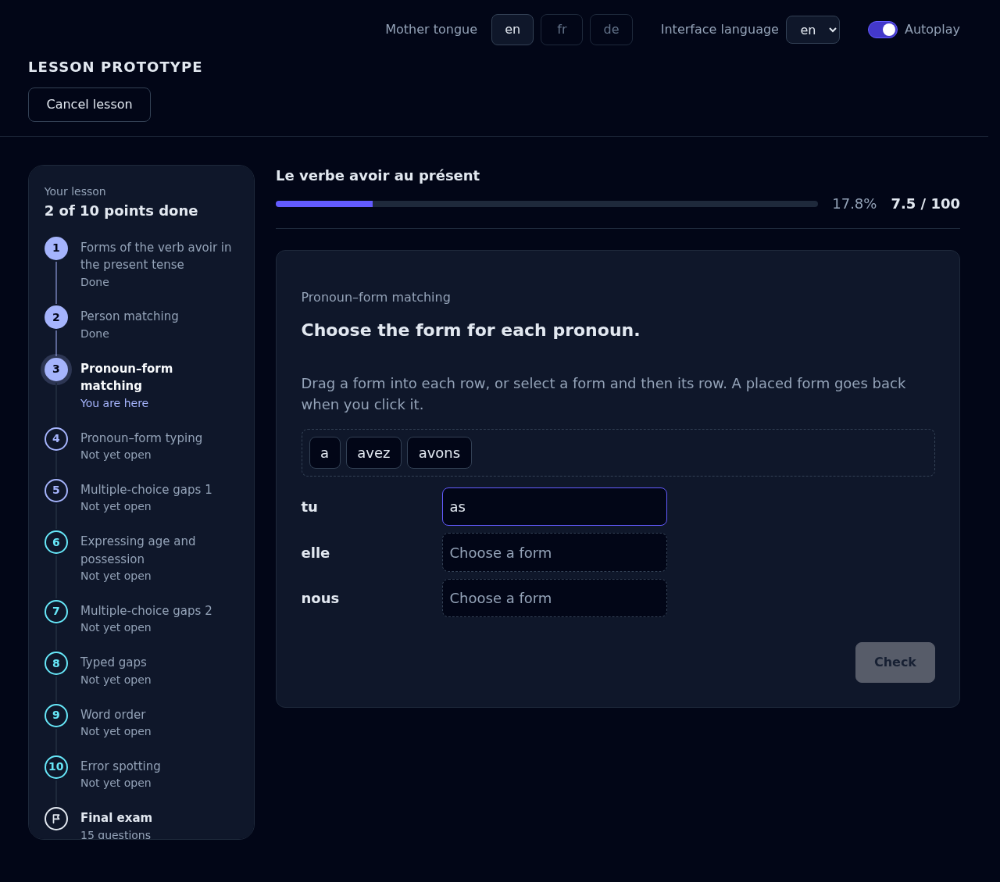](mockups/04-grammar-lesson/02-01-exercise-pronoun-match/pronoun-match.html)

Rendered by the prototype (lesson `fr-verb-avoir-present`): [HTML snapshot](mockups/04-grammar-lesson/02-01-exercise-pronoun-match/pronoun-match.html) · [PNG](mockups/04-grammar-lesson/02-01-exercise-pronoun-match/pronoun-match.png). Refresh with `make screens`.
<!-- screen:end mockups/04-grammar-lesson/02-01-exercise-pronoun-match/pronoun-match -->

#### Grammar: Pronoun typing

<a id="mockup-04-grammar-lesson-02-02-exercise-pronoun-typing-pronoun-typing"></a>

<!-- screen:begin mockups/04-grammar-lesson/02-02-exercise-pronoun-typing/pronoun-typing -->
[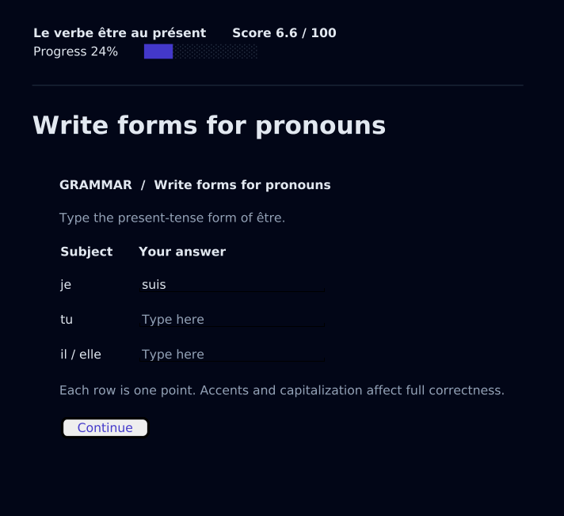](mockups/04-grammar-lesson/02-02-exercise-pronoun-typing/pronoun-typing.html)

Rendered by the prototype (lesson `fr-verb-avoir-present`): [HTML snapshot](mockups/04-grammar-lesson/02-02-exercise-pronoun-typing/pronoun-typing.html) · [PNG](mockups/04-grammar-lesson/02-02-exercise-pronoun-typing/pronoun-typing.png). Refresh with `make screens`.
<!-- screen:end mockups/04-grammar-lesson/02-02-exercise-pronoun-typing/pronoun-typing -->

#### Grammar: Gap choice

<a id="mockup-04-grammar-lesson-02-03-exercise-gap-choice-gap-choice"></a>

<!-- screen:begin mockups/04-grammar-lesson/02-03-exercise-gap-choice/gap-choice -->
[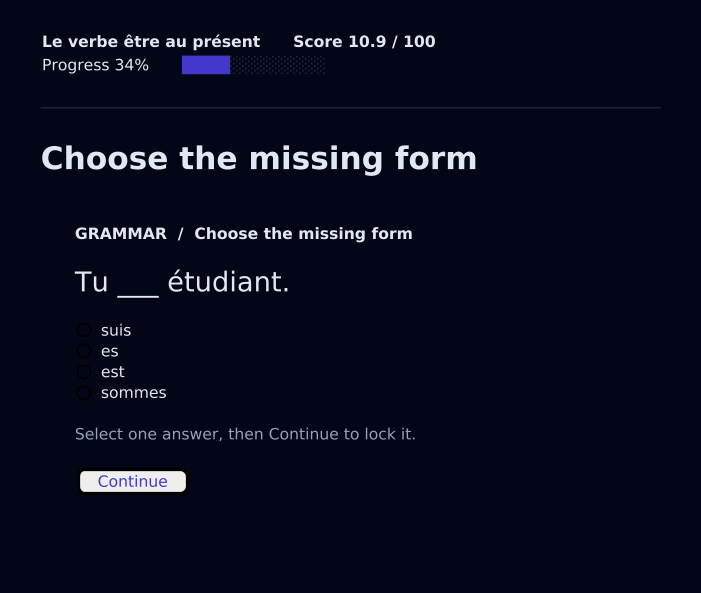](mockups/04-grammar-lesson/02-03-exercise-gap-choice/gap-choice.html)

Rendered by the prototype (lesson `fr-verb-avoir-present`): [HTML snapshot](mockups/04-grammar-lesson/02-03-exercise-gap-choice/gap-choice.html) · [PNG](mockups/04-grammar-lesson/02-03-exercise-gap-choice/gap-choice.png). Refresh with `make screens`.
<!-- screen:end mockups/04-grammar-lesson/02-03-exercise-gap-choice/gap-choice -->

#### Grammar: Feedback

<a id="mockup-04-grammar-lesson-02-04-exercise-gap-typing-feedback"></a>

<!-- screen:begin mockups/04-grammar-lesson/02-04-exercise-gap-typing/feedback -->
[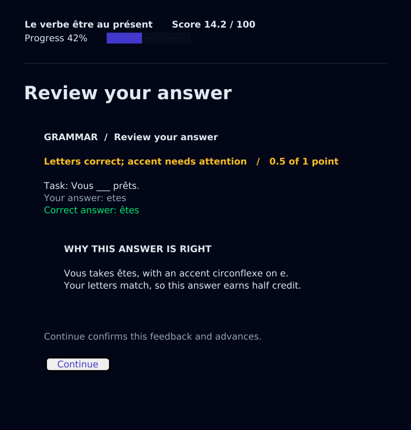](mockups/04-grammar-lesson/02-04-exercise-gap-typing/feedback.html)

Rendered by the prototype (lesson `fr-verb-avoir-present`): [HTML snapshot](mockups/04-grammar-lesson/02-04-exercise-gap-typing/feedback.html) · [PNG](mockups/04-grammar-lesson/02-04-exercise-gap-typing/feedback.png). Refresh with `make screens`.
<!-- screen:end mockups/04-grammar-lesson/02-04-exercise-gap-typing/feedback -->

#### Grammar: Gap typing

<a id="mockup-04-grammar-lesson-02-04-exercise-gap-typing-gap-typing"></a>

<!-- screen:begin mockups/04-grammar-lesson/02-04-exercise-gap-typing/gap-typing -->
[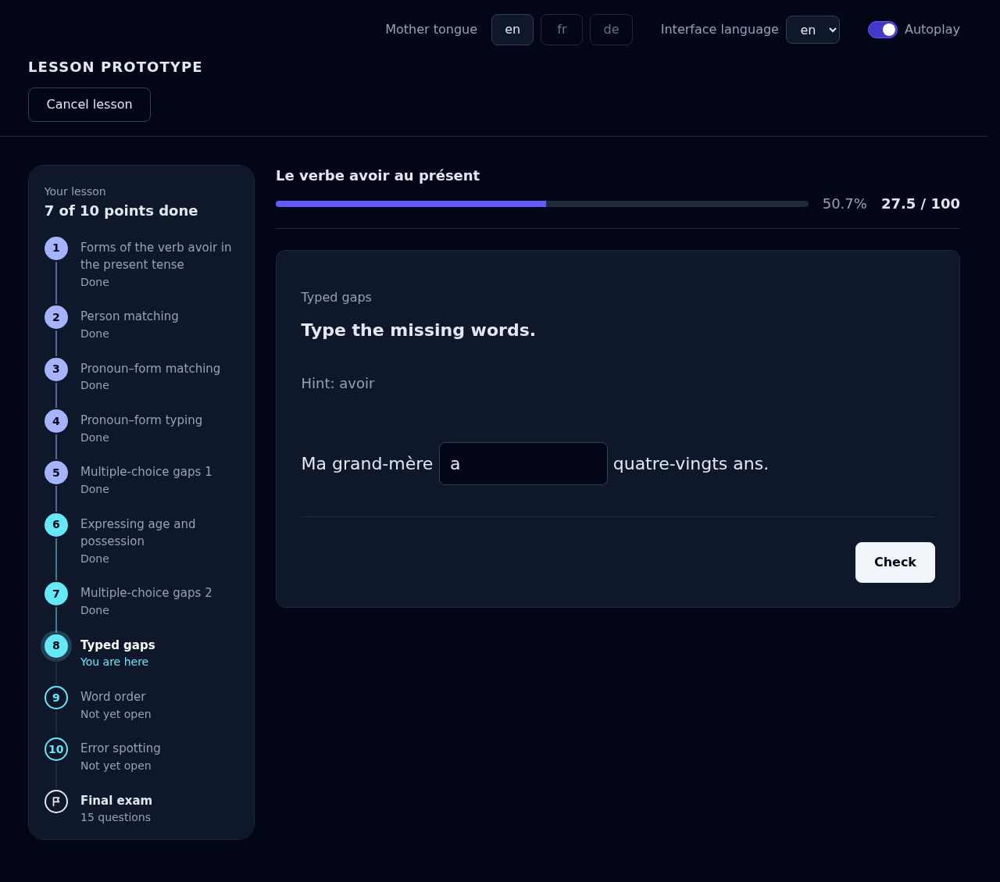](mockups/04-grammar-lesson/02-04-exercise-gap-typing/gap-typing.html)

Rendered by the prototype (lesson `fr-verb-avoir-present`): [HTML snapshot](mockups/04-grammar-lesson/02-04-exercise-gap-typing/gap-typing.html) · [PNG](mockups/04-grammar-lesson/02-04-exercise-gap-typing/gap-typing.png). Refresh with `make screens`.
<!-- screen:end mockups/04-grammar-lesson/02-04-exercise-gap-typing/gap-typing -->

#### Grammar: Word order

<a id="mockup-04-grammar-lesson-02-05-exercise-word-order-word-order"></a>

<!-- screen:begin mockups/04-grammar-lesson/02-05-exercise-word-order/word-order -->
[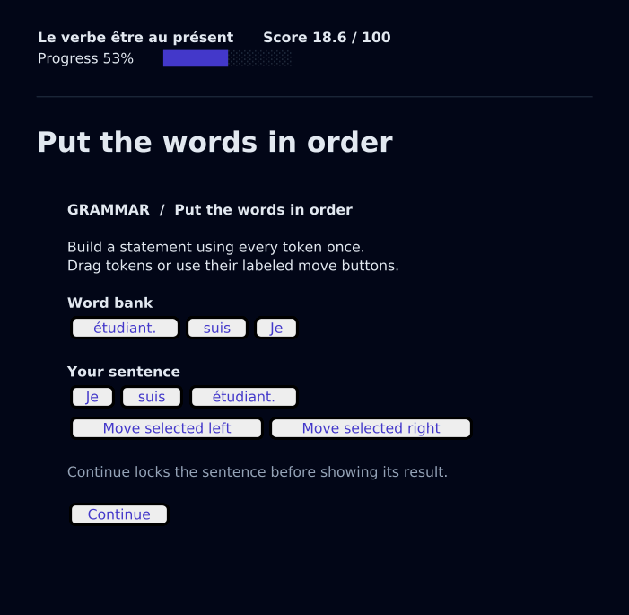](mockups/04-grammar-lesson/02-05-exercise-word-order/word-order.html)

Rendered by the prototype (lesson `fr-verb-avoir-present`): [HTML snapshot](mockups/04-grammar-lesson/02-05-exercise-word-order/word-order.html) · [PNG](mockups/04-grammar-lesson/02-05-exercise-word-order/word-order.png). Refresh with `make screens`.
<!-- screen:end mockups/04-grammar-lesson/02-05-exercise-word-order/word-order -->

#### Grammar: Error spotter

<a id="mockup-04-grammar-lesson-02-06-exercise-error-spotter-error-spotter"></a>

<!-- screen:begin mockups/04-grammar-lesson/02-06-exercise-error-spotter/error-spotter -->
[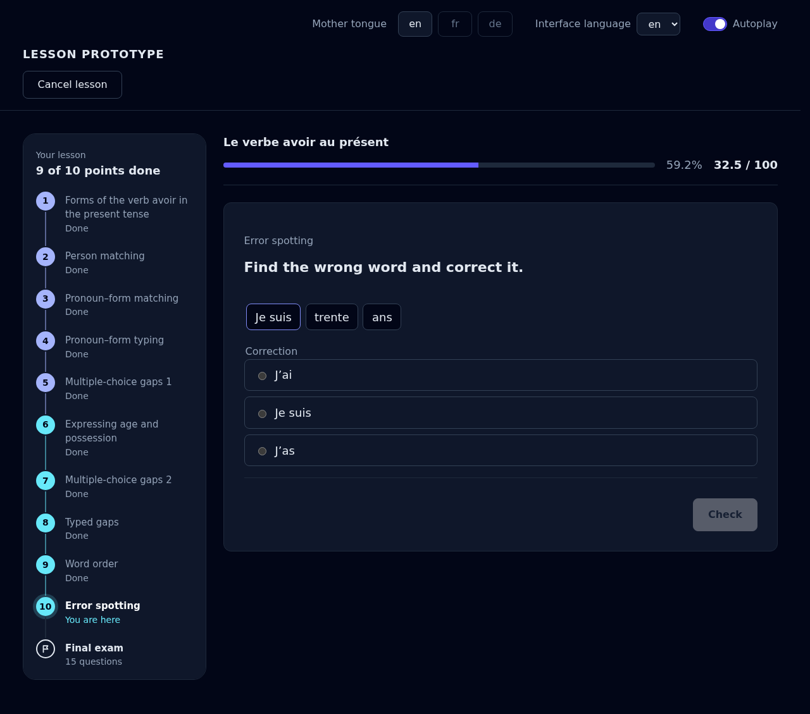](mockups/04-grammar-lesson/02-06-exercise-error-spotter/error-spotter.html)

Rendered by the prototype (lesson `fr-verb-avoir-present`): [HTML snapshot](mockups/04-grammar-lesson/02-06-exercise-error-spotter/error-spotter.html) · [PNG](mockups/04-grammar-lesson/02-06-exercise-error-spotter/error-spotter.png). Refresh with `make screens`.
<!-- screen:end mockups/04-grammar-lesson/02-06-exercise-error-spotter/error-spotter -->

#### Grammar: Feedback placeholder

<a id="mockup-04-grammar-lesson-03-feedback-placeholder-feedback-placeholder"></a>

<!-- screen:begin mockups/04-grammar-lesson/03-feedback-placeholder/feedback-placeholder -->
[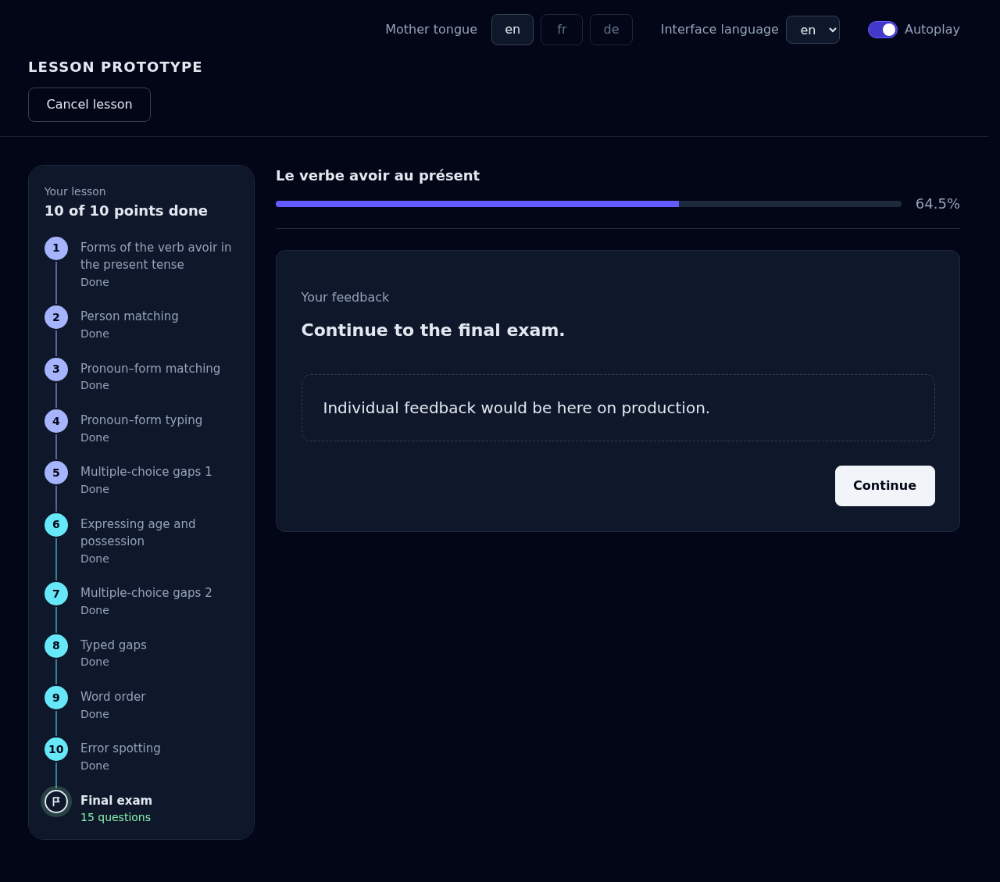](mockups/04-grammar-lesson/03-feedback-placeholder/feedback-placeholder.html)

Rendered by the prototype (lesson `fr-verb-avoir-present`): [HTML snapshot](mockups/04-grammar-lesson/03-feedback-placeholder/feedback-placeholder.html) · [PNG](mockups/04-grammar-lesson/03-feedback-placeholder/feedback-placeholder.png). Refresh with `make screens`.
<!-- screen:end mockups/04-grammar-lesson/03-feedback-placeholder/feedback-placeholder -->

#### Grammar: Mixed exam

<a id="mockup-04-grammar-lesson-04-exam-mixed-exam"></a>

<!-- screen:begin mockups/04-grammar-lesson/04-exam/mixed-exam -->
[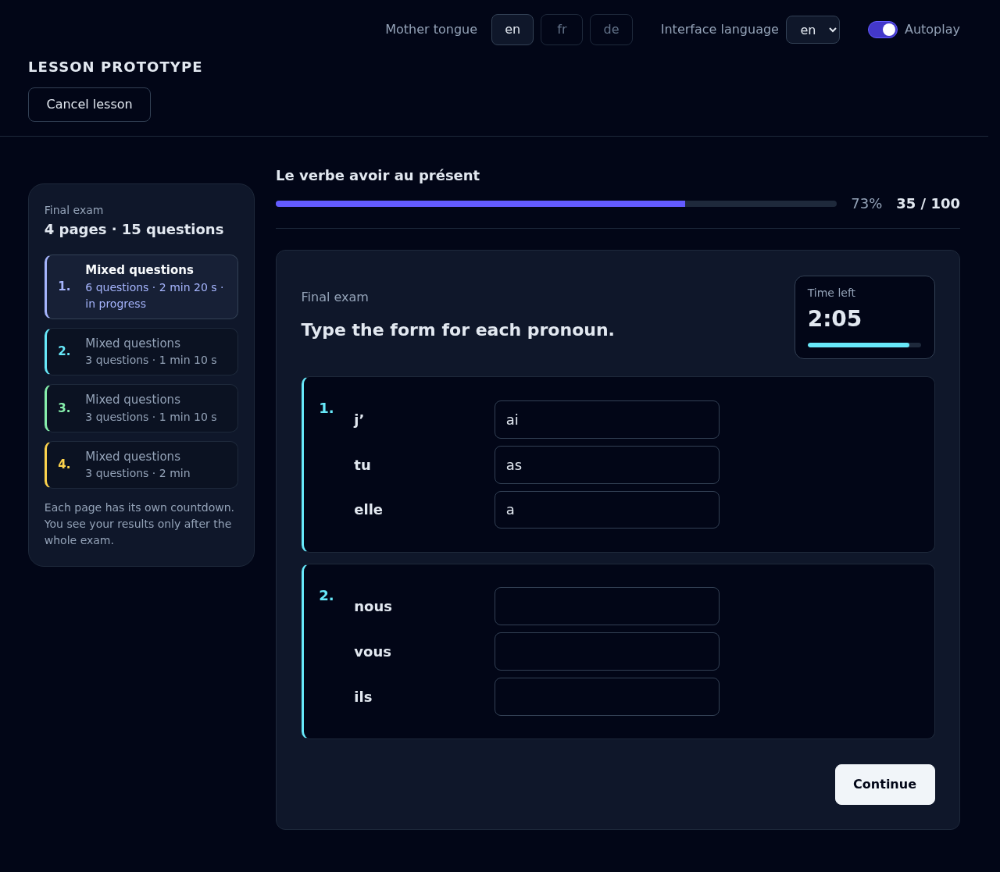](mockups/04-grammar-lesson/04-exam/mixed-exam.html)

Rendered by the prototype (lesson `fr-verb-avoir-present`): [HTML snapshot](mockups/04-grammar-lesson/04-exam/mixed-exam.html) · [PNG](mockups/04-grammar-lesson/04-exam/mixed-exam.png). Refresh with `make screens`.
<!-- screen:end mockups/04-grammar-lesson/04-exam/mixed-exam -->

#### Grammar: Exam info

<a id="mockup-04-grammar-lesson-04-exam-exam-info"></a>

<!-- screen:begin mockups/04-grammar-lesson/04-exam/exam-info -->
[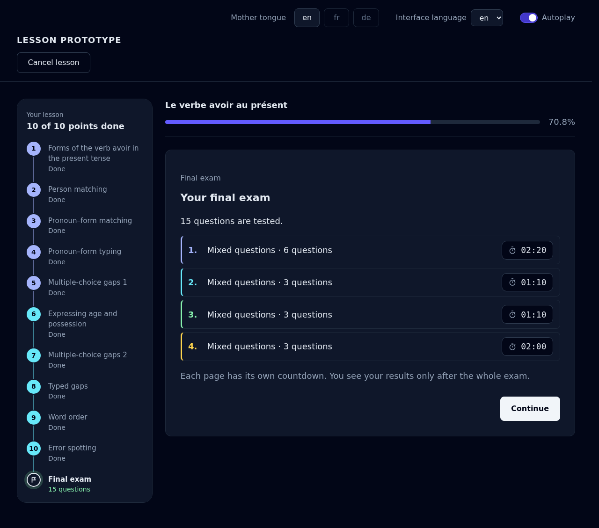](mockups/04-grammar-lesson/04-exam/exam-info.html)

Rendered by the prototype (lesson `fr-verb-avoir-present`): [HTML snapshot](mockups/04-grammar-lesson/04-exam/exam-info.html) · [PNG](mockups/04-grammar-lesson/04-exam/exam-info.png). Refresh with `make screens`.
<!-- screen:end mockups/04-grammar-lesson/04-exam/exam-info -->

#### Grammar: Exam results

<a id="mockup-04-grammar-lesson-05-results-exam-results"></a>

<!-- screen:begin mockups/04-grammar-lesson/05-results/exam-results -->
[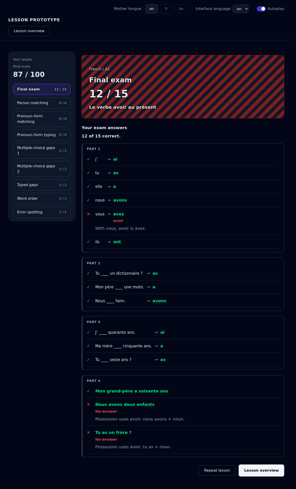](mockups/04-grammar-lesson/05-results/exam-results.html)

Rendered by the prototype (lesson `fr-verb-avoir-present`): [HTML snapshot](mockups/04-grammar-lesson/05-results/exam-results.html) · [PNG](mockups/04-grammar-lesson/05-results/exam-results.png). Refresh with `make screens`.
<!-- screen:end mockups/04-grammar-lesson/05-results/exam-results -->

#### Functions: Lesson start

<a id="mockup-05-function-lesson-01-startpage-lesson-start"></a>

<!-- screen:begin mockups/05-function-lesson/01-startpage/lesson-start -->
[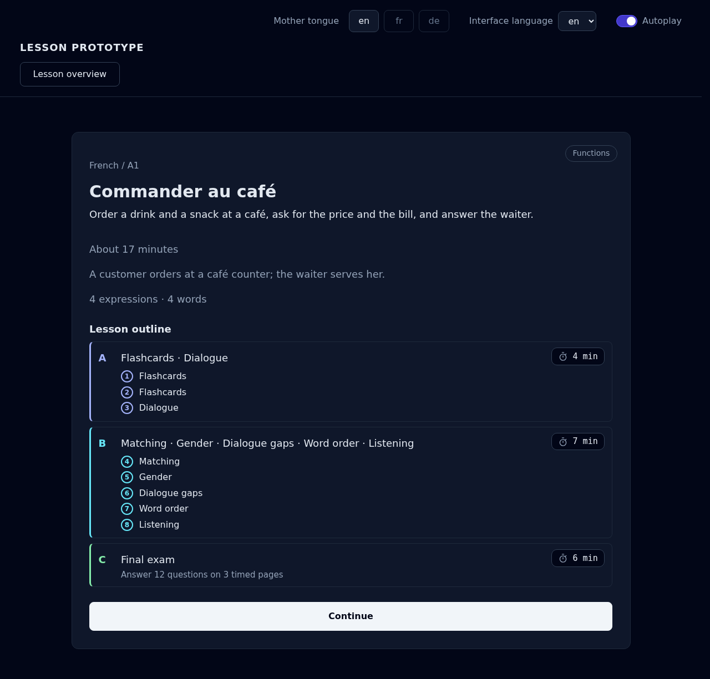](mockups/05-function-lesson/01-startpage/lesson-start.html)

Rendered by the prototype (lesson `fr-ordering-at-a-cafe`): [HTML snapshot](mockups/05-function-lesson/01-startpage/lesson-start.html) · [PNG](mockups/05-function-lesson/01-startpage/lesson-start.png). Refresh with `make screens`.
<!-- screen:end mockups/05-function-lesson/01-startpage/lesson-start -->

#### Functions: Expression flashcards

<a id="mockup-05-function-lesson-02-flashcards-expression-flashcards"></a>

<!-- screen:begin mockups/05-function-lesson/02-flashcards/expression-flashcards -->
[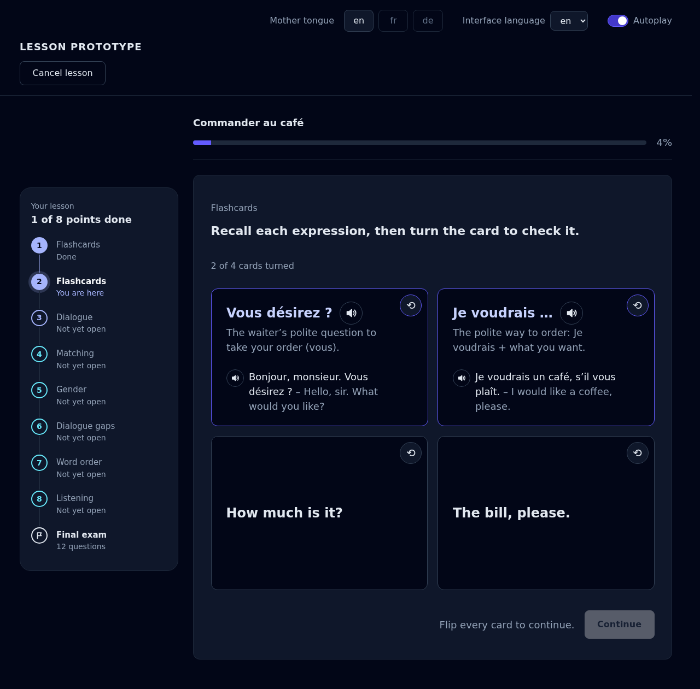](mockups/05-function-lesson/02-flashcards/expression-flashcards.html)

Rendered by the prototype (lesson `fr-ordering-at-a-cafe`): [HTML snapshot](mockups/05-function-lesson/02-flashcards/expression-flashcards.html) · [PNG](mockups/05-function-lesson/02-flashcards/expression-flashcards.png). Refresh with `make screens`.
<!-- screen:end mockups/05-function-lesson/02-flashcards/expression-flashcards -->

#### Functions: Model dialogue

<a id="mockup-05-function-lesson-03-dialogue-dialogue"></a>

<!-- screen:begin mockups/05-function-lesson/03-dialogue/dialogue -->
[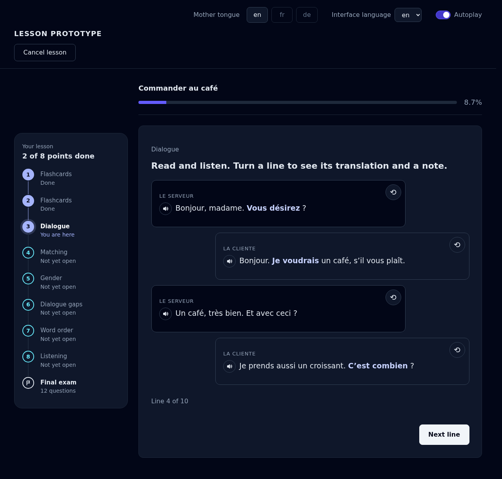](mockups/05-function-lesson/03-dialogue/dialogue.html)

Rendered by the prototype (lesson `fr-ordering-at-a-cafe`): [HTML snapshot](mockups/05-function-lesson/03-dialogue/dialogue.html) · [PNG](mockups/05-function-lesson/03-dialogue/dialogue.png). Refresh with `make screens`.
<!-- screen:end mockups/05-function-lesson/03-dialogue/dialogue -->

#### Functions: Expression matching

<a id="mockup-05-function-lesson-04-matching-expression-matching"></a>

<!-- screen:begin mockups/05-function-lesson/04-matching/expression-matching -->
[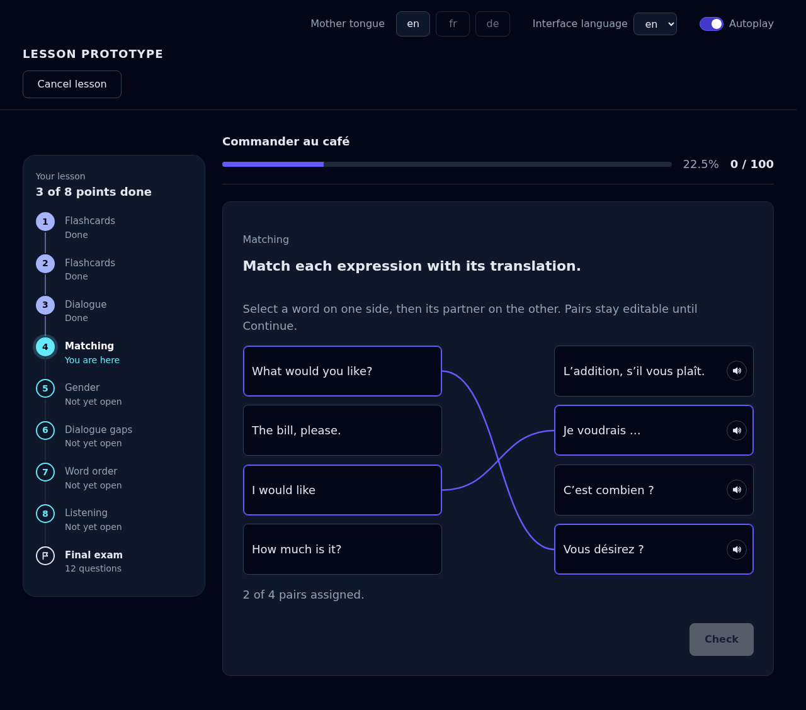](mockups/05-function-lesson/04-matching/expression-matching.html)

Rendered by the prototype (lesson `fr-ordering-at-a-cafe`): [HTML snapshot](mockups/05-function-lesson/04-matching/expression-matching.html) · [PNG](mockups/05-function-lesson/04-matching/expression-matching.png). Refresh with `make screens`.
<!-- screen:end mockups/05-function-lesson/04-matching/expression-matching -->

#### Functions: Gender

<a id="mockup-05-function-lesson-04-matching-gender"></a>

<!-- screen:begin mockups/05-function-lesson/04-matching/gender -->
[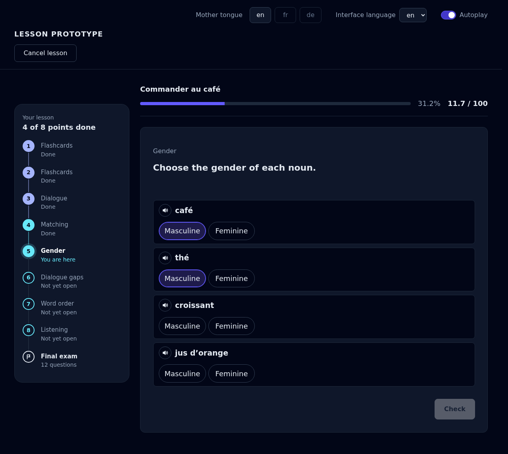](mockups/05-function-lesson/04-matching/gender.html)

Rendered by the prototype (lesson `fr-ordering-at-a-cafe`): [HTML snapshot](mockups/05-function-lesson/04-matching/gender.html) · [PNG](mockups/05-function-lesson/04-matching/gender.png). Refresh with `make screens`.
<!-- screen:end mockups/05-function-lesson/04-matching/gender -->

#### Functions: Dialogue gaps

<a id="mockup-05-function-lesson-05-dialogue-gap-choice-dialogue-gap-choice"></a>

<!-- screen:begin mockups/05-function-lesson/05-dialogue-gap-choice/dialogue-gap-choice -->
[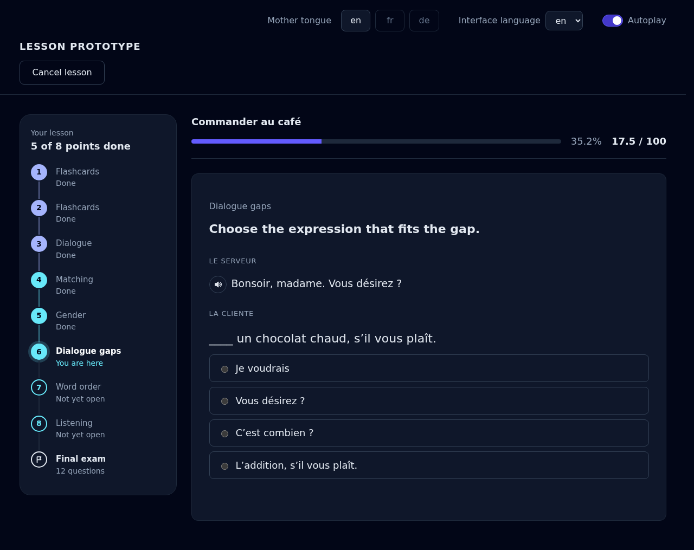](mockups/05-function-lesson/05-dialogue-gap-choice/dialogue-gap-choice.html)

Rendered by the prototype (lesson `fr-ordering-at-a-cafe`): [HTML snapshot](mockups/05-function-lesson/05-dialogue-gap-choice/dialogue-gap-choice.html) · [PNG](mockups/05-function-lesson/05-dialogue-gap-choice/dialogue-gap-choice.png). Refresh with `make screens`.
<!-- screen:end mockups/05-function-lesson/05-dialogue-gap-choice/dialogue-gap-choice -->

#### Functions: Word order

<a id="mockup-05-function-lesson-06-word-order-word-order"></a>

<!-- screen:begin mockups/05-function-lesson/06-word-order/word-order -->
[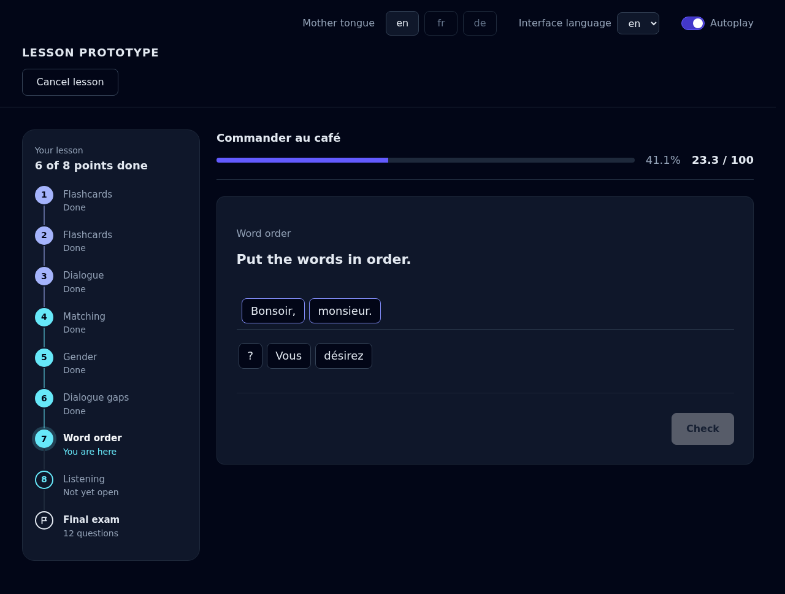](mockups/05-function-lesson/06-word-order/word-order.html)

Rendered by the prototype (lesson `fr-ordering-at-a-cafe`): [HTML snapshot](mockups/05-function-lesson/06-word-order/word-order.html) · [PNG](mockups/05-function-lesson/06-word-order/word-order.png). Refresh with `make screens`.
<!-- screen:end mockups/05-function-lesson/06-word-order/word-order -->

#### Functions: Listening choice

<a id="mockup-05-function-lesson-07-listening-choice-listening-choice"></a>

<!-- screen:begin mockups/05-function-lesson/07-listening-choice/listening-choice -->
[](mockups/05-function-lesson/07-listening-choice/listening-choice.html)

Rendered by the prototype (lesson `fr-ordering-at-a-cafe`): [HTML snapshot](mockups/05-function-lesson/07-listening-choice/listening-choice.html) · [PNG](mockups/05-function-lesson/07-listening-choice/listening-choice.png). Refresh with `make screens`.
<!-- screen:end mockups/05-function-lesson/07-listening-choice/listening-choice -->

#### Functions: Exam replies

<a id="mockup-05-function-lesson-08-exam-reply-word-order"></a>

<!-- screen:begin mockups/05-function-lesson/08-exam/reply-word-order -->
[](mockups/05-function-lesson/08-exam/reply-word-order.html)

Rendered by the prototype (lesson `fr-ordering-at-a-cafe`): [HTML snapshot](mockups/05-function-lesson/08-exam/reply-word-order.html) · [PNG](mockups/05-function-lesson/08-exam/reply-word-order.png). Refresh with `make screens`.
<!-- screen:end mockups/05-function-lesson/08-exam/reply-word-order -->

#### Functions: Translation exam

<a id="mockup-05-function-lesson-08-exam-translation-exam"></a>

<!-- screen:begin mockups/05-function-lesson/08-exam/translation-exam -->
[](mockups/05-function-lesson/08-exam/translation-exam.html)

Rendered by the prototype (lesson `fr-ordering-at-a-cafe`): [HTML snapshot](mockups/05-function-lesson/08-exam/translation-exam.html) · [PNG](mockups/05-function-lesson/08-exam/translation-exam.png). Refresh with `make screens`.
<!-- screen:end mockups/05-function-lesson/08-exam/translation-exam -->

#### Functions: Exam dialogue

<a id="mockup-05-function-lesson-08-exam-dialogue-gap-typing"></a>

<!-- screen:begin mockups/05-function-lesson/08-exam/dialogue-gap-typing -->
[](mockups/05-function-lesson/08-exam/dialogue-gap-typing.html)

Rendered by the prototype (lesson `fr-ordering-at-a-cafe`): [HTML snapshot](mockups/05-function-lesson/08-exam/dialogue-gap-typing.html) · [PNG](mockups/05-function-lesson/08-exam/dialogue-gap-typing.png). Refresh with `make screens`.
<!-- screen:end mockups/05-function-lesson/08-exam/dialogue-gap-typing -->

#### Functions: Results

<a id="mockup-05-function-lesson-09-results-exam-results"></a>

<!-- screen:begin mockups/05-function-lesson/09-results/exam-results -->
[](mockups/05-function-lesson/09-results/exam-results.html)

Rendered by the prototype (lesson `fr-ordering-at-a-cafe`): [HTML snapshot](mockups/05-function-lesson/09-results/exam-results.html) · [PNG](mockups/05-function-lesson/09-results/exam-results.png). Refresh with `make screens`.
<!-- screen:end mockups/05-function-lesson/09-results/exam-results -->

### Reading lesson screens

Every page of one reading lesson (section 9), drawn with the fr/A1 lesson `fr-reading-a-text-message`. Flashcards, matching, the exam info page, the countdown, the results and the lesson navigation are the shared screens of the other categories; the document view and the skim phase are reading's own. Salt limits: matching curves are `~~~`, and the document stands beside the questions from a 700 px task area only (1100 px with the sidebar, P5-06).

#### Reading: combined artifact view

<a id="mockup-02-artifact-view-reading-lesson-detail"></a>

[Salt source](mockups/02-artifact-view/reading/lesson-detail.puml)

<!-- mockup:begin mockups/02-artifact-view/reading/lesson-detail.puml -->

<!-- mockup:end mockups/02-artifact-view/reading/lesson-detail.puml -->

#### Reading: Lesson start

<a id="mockup-06-reading-lesson-01-startpage-lesson-start"></a>

[Salt source](mockups/06-reading-lesson/01-startpage/lesson-start.puml)

<!-- mockup:begin mockups/06-reading-lesson/01-startpage/lesson-start.puml -->

<!-- mockup:end mockups/06-reading-lesson/01-startpage/lesson-start.puml -->

#### Reading: Flashcards

<a id="mockup-06-reading-lesson-02-flashcards-flashcards"></a>

[Salt source](mockups/06-reading-lesson/02-flashcards/flashcards.puml)

<!-- mockup:begin mockups/06-reading-lesson/02-flashcards/flashcards.puml -->

<!-- mockup:end mockups/06-reading-lesson/02-flashcards/flashcards.puml -->

#### Reading: Matching

<a id="mockup-06-reading-lesson-02-flashcards-matching"></a>

[Salt source](mockups/06-reading-lesson/02-flashcards/matching.puml)

<!-- mockup:begin mockups/06-reading-lesson/02-flashcards/matching.puml -->

<!-- mockup:end mockups/06-reading-lesson/02-flashcards/matching.puml -->

#### Reading: Skim

<a id="mockup-06-reading-lesson-03-skim-skim"></a>

[Salt source](mockups/06-reading-lesson/03-skim/skim.puml)

<!-- mockup:begin mockups/06-reading-lesson/03-skim/skim.puml -->

<!-- mockup:end mockups/06-reading-lesson/03-skim/skim.puml -->

#### Reading: Skim question, answered from memory

<a id="mockup-06-reading-lesson-03-skim-skim-question"></a>

[Salt source](mockups/06-reading-lesson/03-skim/skim-question.puml)

<!-- mockup:begin mockups/06-reading-lesson/03-skim/skim-question.puml -->

<!-- mockup:end mockups/06-reading-lesson/03-skim/skim-question.puml -->

#### Reading: Skim result after Check

<a id="mockup-06-reading-lesson-03-skim-skim-feedback"></a>

[Salt source](mockups/06-reading-lesson/03-skim/skim-feedback.puml)

<!-- mockup:begin mockups/06-reading-lesson/03-skim/skim-feedback.puml -->

<!-- mockup:end mockups/06-reading-lesson/03-skim/skim-feedback.puml -->

#### Reading: Detail questions

<a id="mockup-06-reading-lesson-04-detail-detail"></a>

[Salt source](mockups/06-reading-lesson/04-detail/detail.puml)

<!-- mockup:begin mockups/06-reading-lesson/04-detail/detail.puml -->
```plantuml
@startsalt
skinparam backgroundColor #020617
skinparam defaultFontName SansSerif
skinparam defaultFontSize 15
skinparam defaultFontColor #E2E8F0
scale 1.3
{
.
{ <color:#020617>xx</color> | {
{ <color:#E2E8F0><b>Lire un SMS</b></color> | <color:#020617>xxx</color> | <color:#635BFF>████</color><color:#1E293B>░░░░░░░░</color> | <color:#94A3B8>35%</color> | <color:#E2E8F0><b>19.1 / 100</b></color> }
<color:#1E293B>──────────────────────────────────────────────────────────────────────────</color>
.
{ {
<color:#94A3B8>Your lesson</color>
<color:#E2E8F0><b>3 of 5 points done</b></color>
.
{ <color:#A5B4FC><b>1</b></color> | <color:#E2E8F0>Flashcards</color> | <color:#94A3B8>Done</color> }
{ <color:#A5B4FC><b>2</b></color> | <color:#E2E8F0>Matching</color> | <color:#94A3B8>Done</color> }
{ <color:#67E8F9><b>3</b></color> | <color:#E2E8F0>Skim</color> | <color:#94A3B8>Done</color> }
{ <color:#67E8F9><b>(4)</b></color> | <color:#E2E8F0><b>Detail</b></color> | <color:#67E8F9>You are here</color> }
{ <color:#64748B>5</color> | <color:#94A3B8>Structure</color> | <color:#64748B>Not yet open</color> }
.
{ <color:#FDA4AF><b>⚑</b></color> | <color:#E2E8F0>Final exam</color> | <color:#94A3B8>5 questions</color> }
} | <color:#020617>xxx</color> | {
<color:#94A3B8>Detail · point 4 of 5</color>
<size:24><color:#E2E8F0><b>Read the document carefully and answer the questions.</b></color></size>
.
{ {
<color:#E2E8F0><b>Léa</b></color>  <color:#94A3B8>Jeudi 18:42</color>
<color:#E2E8F0>Salut Tom ! Tu es libre <back:#312E81><u>samedi</u></back> après-midi ?</color>
<color:#E2E8F0>Samedi soir, on mange chez moi avec Paul. On fait des crêpes !</color>
<color:#E2E8F0>Mais <back:#312E81><u>avant</u></back>, <back:#312E81><u>on se voit</u></back> à 15 h au café de <back:#312E81><u>la gare</u></back> ?</color>
<color:#E2E8F0><back:#312E81><u>Après</u></back> le café, on va au cinéma à 17 h.</color>
<color:#E2E8F0>Si tu ne peux pas, dis-le-moi <back:#312E81><u>avant</u></back> vendredi. Bisous, Léa</color>
} | <color:#020617>xxx</color> | {
<color:#E2E8F0><b>Quel jour Léa propose-t-elle de se voir ?</b></color>
{ () <color:#E2E8F0>jeudi</color> | (X) <color:#E2E8F0>samedi</color> | () <color:#E2E8F0>dimanche</color> | () <color:#E2E8F0>vendredi</color> }
<color:#E2E8F0><b>À quelle heure est le rendez-vous au café ?</b></color>
{ () <color:#E2E8F0>17 h</color> | () <color:#E2E8F0>15 h</color> | () <color:#E2E8F0>12 h</color> | () <color:#E2E8F0>18 h 42</color> }
<color:#E2E8F0><b>Où Tom et Léa se retrouvent-ils à 15 h ?</b></color>
{ () <color:#E2E8F0>Au café de la gare</color> | () <color:#E2E8F0>Au cinéma</color> }
{ () <color:#E2E8F0>Chez Paul</color> | () <color:#E2E8F0>Chez Léa</color> }
<color:#E2E8F0><b>Samedi soir, Tom, Léa et Paul mangent au restaurant.</b></color>
{ () <color:#E2E8F0>Vrai</color> | () <color:#E2E8F0>Faux</color> }
} }
.
{ <color:#020617>xxxxxxxxxxxxxxxxxxxxxxxxxxxxxxxxxxxxxxxx</color> | [ <color:#64748B>  Check  </color> ] }
<color:#94A3B8>Side by side from a 700 px task area (1100 px with the sidebar), stacked below; Check opens once every question is answered.</color>
} }
} | <color:#020617>xx</color> }
.
}
@endsalt
```
<!-- mockup:end mockups/06-reading-lesson/04-detail/detail.puml -->

#### Reading: Detail after Check

<a id="mockup-06-reading-lesson-04-detail-detail-feedback"></a>

[Salt source](mockups/06-reading-lesson/04-detail/detail-feedback.puml)

<!-- mockup:begin mockups/06-reading-lesson/04-detail/detail-feedback.puml -->
```plantuml
@startsalt
skinparam backgroundColor #020617
skinparam defaultFontName SansSerif
skinparam defaultFontSize 15
skinparam defaultFontColor #E2E8F0
scale 1.3
{
.
{ <color:#020617>xx</color> | {
{ <color:#E2E8F0><b>Lire un SMS</b></color> | <color:#020617>xxx</color> | <color:#635BFF>████</color><color:#1E293B>░░░░░░░░</color> | <color:#94A3B8>35%</color> | <color:#E2E8F0><b>28.6 / 100</b></color> }
<color:#1E293B>──────────────────────────────────────────────────────────────────────────</color>
.
{ {
<color:#94A3B8>Your lesson</color>
<color:#E2E8F0><b>3 of 5 points done</b></color>
.
{ <color:#A5B4FC><b>1</b></color> | <color:#E2E8F0>Flashcards</color> | <color:#94A3B8>Done</color> }
{ <color:#A5B4FC><b>2</b></color> | <color:#E2E8F0>Matching</color> | <color:#94A3B8>Done</color> }
{ <color:#67E8F9><b>3</b></color> | <color:#E2E8F0>Skim</color> | <color:#94A3B8>Done</color> }
{ <color:#67E8F9><b>(4)</b></color> | <color:#E2E8F0><b>Detail</b></color> | <color:#67E8F9>You are here</color> }
{ <color:#64748B>5</color> | <color:#94A3B8>Structure</color> | <color:#64748B>Not yet open</color> }
.
{ <color:#FDA4AF><b>⚑</b></color> | <color:#E2E8F0>Final exam</color> | <color:#94A3B8>5 questions</color> }
} | <color:#020617>xxx</color> | {
<color:#94A3B8>Detail · point 4 of 5</color>
<size:24><color:#E2E8F0><b>Read the document carefully and answer the questions.</b></color></size>
.
{ {
<color:#E2E8F0><b>Léa</b></color>  <color:#94A3B8>Jeudi 18:42</color>
<color:#E2E8F0>Salut Tom ! Tu es libre <back:#312E81><u>samedi</u></back> après-midi ?</color>
<color:#E2E8F0>Samedi soir, on mange chez moi avec Paul. On fait des crêpes !</color>
<color:#E2E8F0>Mais <back:#312E81><u>avant</u></back>, <back:#312E81><u>on se voit</u></back> à 15 h au café de <back:#312E81><u>la gare</u></back> ?</color>
<color:#E2E8F0><back:#312E81><u>Après</u></back> le café, on va au cinéma à 17 h.</color>
<color:#E2E8F0>Si tu ne peux pas, dis-le-moi <back:#312E81><u>avant</u></back> vendredi. Bisous, Léa</color>
} | <color:#020617>xxx</color> | {
<color:#E2E8F0><b>Quel jour Léa propose-t-elle de se voir ?</b></color>
{ <color:#FF5252>✕ dimanche</color> | <color:#00E676>✓ samedi</color> }
<color:#94A3B8>Léa asks: Tu es libre samedi après-midi ? Jeudi is the day she writes.</color>
<color:#E2E8F0><b>À quelle heure est le rendez-vous au café ?</b></color>
{ <color:#00E676>✓ 15 h</color> }
<color:#E2E8F0><b>Où Tom et Léa se retrouvent-ils à 15 h ?</b></color>
{ <color:#00E676>✓ Au café de la gare</color> }
<color:#E2E8F0><b>Samedi soir, Tom, Léa et Paul mangent au restaurant.</b></color>
{ <color:#00E676>✓ Faux</color> }
} }
.
{ <color:#020617>xxxxxxxxxxxxxxxxxxxxxxxxxxxxxxxxxxxxxxxx</color> | [ <color:#020617>  Continue  </color> ] }
<color:#94A3B8>Marked in place; the page waits for Continue even when every answer is right.</color>
} }
} | <color:#020617>xx</color> }
.
}
@endsalt
```
<!-- mockup:end mockups/06-reading-lesson/04-detail/detail-feedback.puml -->

#### Reading: Structure, ordering

<a id="mockup-06-reading-lesson-05-structure-ordering"></a>

[Salt source](mockups/06-reading-lesson/05-structure/ordering.puml)

<!-- mockup:begin mockups/06-reading-lesson/05-structure/ordering.puml -->
```plantuml
@startsalt
skinparam backgroundColor #020617
skinparam defaultFontName SansSerif
skinparam defaultFontSize 15
skinparam defaultFontColor #E2E8F0
scale 1.3
{
.
{ <color:#020617>xx</color> | {
{ <color:#E2E8F0><b>Lire un SMS</b></color> | <color:#020617>xxx</color> | <color:#635BFF>███████</color><color:#1E293B>░░░░░</color> | <color:#94A3B8>60%</color> | <color:#E2E8F0><b>28.6 / 100</b></color> }
<color:#1E293B>──────────────────────────────────────────────────────────────────────────</color>
.
{ {
<color:#94A3B8>Your lesson</color>
<color:#E2E8F0><b>4 of 5 points done</b></color>
.
{ <color:#A5B4FC><b>1</b></color> | <color:#E2E8F0>Flashcards</color> | <color:#94A3B8>Done</color> }
{ <color:#A5B4FC><b>2</b></color> | <color:#E2E8F0>Matching</color> | <color:#94A3B8>Done</color> }
{ <color:#67E8F9><b>3</b></color> | <color:#E2E8F0>Skim</color> | <color:#94A3B8>Done</color> }
{ <color:#67E8F9><b>4</b></color> | <color:#E2E8F0>Detail</color> | <color:#94A3B8>Done</color> }
{ <color:#67E8F9><b>(5)</b></color> | <color:#E2E8F0><b>Structure</b></color> | <color:#67E8F9>You are here</color> }
.
{ <color:#FDA4AF><b>⚑</b></color> | <color:#E2E8F0>Final exam</color> | <color:#94A3B8>5 questions</color> }
} | <color:#020617>xxx</color> | {
<color:#94A3B8>Structure · point 5 of 5</color>
<size:24><color:#E2E8F0><b>What happens on Saturday? Put it in order, from first to last.</b></color></size>
.
{ {
<color:#E2E8F0><b>Léa</b></color>  <color:#94A3B8>Jeudi 18:42</color>
<color:#E2E8F0>Salut Tom ! Tu es libre <back:#312E81><u>samedi</u></back> après-midi ?</color>
<color:#E2E8F0>Samedi soir, on mange chez moi avec Paul. On fait des crêpes !</color>
<color:#E2E8F0>Mais <back:#312E81><u>avant</u></back>, <back:#312E81><u>on se voit</u></back> à 15 h au café de <back:#312E81><u>la gare</u></back> ?</color>
<color:#E2E8F0><back:#312E81><u>Après</u></back> le café, on va au cinéma à 17 h.</color>
<color:#E2E8F0>Si tu ne peux pas, dis-le-moi <back:#312E81><u>avant</u></back> vendredi. Bisous, Léa</color>
} | <color:#020617>xxx</color> | {
<color:#E2E8F0><b>Your order</b></color>
[ <color:#4338CA>Tom et Léa se voient au café de la gare.</color> ]
[ <color:#4338CA>Ils vont au cinéma.</color> ]
<color:#94A3B8>____</color>
.
<color:#E2E8F0><b>Pieces</b></color>
[ <color:#4338CA>Ils mangent des crêpes chez Léa avec Paul.</color> ]
} }
.
{ <color:#020617>xxxxxxxxxxxxxxxxxxxxxxxxxxxxxxxxxxxxxxxx</color> | [ <color:#64748B>  Check  </color> ] }
<color:#94A3B8>The word-order control of grammar and functions, with pieces of information instead of words.</color>
} }
} | <color:#020617>xx</color> }
.
}
@endsalt
```
<!-- mockup:end mockups/06-reading-lesson/05-structure/ordering.puml -->

#### Reading: Structure result after Check

<a id="mockup-06-reading-lesson-05-structure-ordering-feedback"></a>

[Salt source](mockups/06-reading-lesson/05-structure/ordering-feedback.puml)

<!-- mockup:begin mockups/06-reading-lesson/05-structure/ordering-feedback.puml -->
```plantuml
@startsalt
skinparam backgroundColor #020617
skinparam defaultFontName SansSerif
skinparam defaultFontSize 15
skinparam defaultFontColor #E2E8F0
scale 1.3
{
.
{ <color:#020617>xx</color> | {
{ <color:#E2E8F0><b>Lire un SMS</b></color> | <color:#020617>xxx</color> | <color:#635BFF>███████</color><color:#1E293B>░░░░░</color> | <color:#94A3B8>60%</color> | <color:#E2E8F0><b>28.6 / 100</b></color> }
<color:#1E293B>──────────────────────────────────────────────────────────────────────────</color>
.
{ {
<color:#94A3B8>Your lesson</color>
<color:#E2E8F0><b>4 of 5 points done</b></color>
.
{ <color:#A5B4FC><b>1</b></color> | <color:#E2E8F0>Flashcards</color> | <color:#94A3B8>Done</color> }
{ <color:#A5B4FC><b>2</b></color> | <color:#E2E8F0>Matching</color> | <color:#94A3B8>Done</color> }
{ <color:#67E8F9><b>3</b></color> | <color:#E2E8F0>Skim</color> | <color:#94A3B8>Done</color> }
{ <color:#67E8F9><b>4</b></color> | <color:#E2E8F0>Detail</color> | <color:#94A3B8>Done</color> }
{ <color:#67E8F9><b>(5)</b></color> | <color:#E2E8F0><b>Structure</b></color> | <color:#67E8F9>You are here</color> }
.
{ <color:#FDA4AF><b>⚑</b></color> | <color:#E2E8F0>Final exam</color> | <color:#94A3B8>5 questions</color> }
} | <color:#020617>xxx</color> | {
<color:#94A3B8>Structure · point 5 of 5</color>
<size:24><color:#E2E8F0><b>What happens on Saturday? Put it in order, from first to last.</b></color></size>
.
{ {
<color:#E2E8F0><b>Léa</b></color>  <color:#94A3B8>Jeudi 18:42</color>
<color:#E2E8F0>Salut Tom ! Tu es libre <back:#312E81><u>samedi</u></back> après-midi ?</color>
<color:#E2E8F0>Samedi soir, on mange chez moi avec Paul. On fait des crêpes !</color>
<color:#E2E8F0>Mais <back:#312E81><u>avant</u></back>, <back:#312E81><u>on se voit</u></back> à 15 h au café de <back:#312E81><u>la gare</u></back> ?</color>
<color:#E2E8F0><back:#312E81><u>Après</u></back> le café, on va au cinéma à 17 h.</color>
<color:#E2E8F0>Si tu ne peux pas, dis-le-moi <back:#312E81><u>avant</u></back> vendredi. Bisous, Léa</color>
} | <color:#020617>xxx</color> | {
<back:#7F1D1D><color:#E2E8F0> ✕  Incorrect                                        </color></back>
<color:#00E676>Tom et Léa se voient au café de la gare. → Ils vont au cinéma.</color>
<color:#00E676>→ Ils mangent des crêpes chez Léa avec Paul.</color>
<color:#FF5252><s>Ils mangent des crêpes chez Léa avec Paul. → Tom et Léa se voient</s></color>
<color:#FF5252><s>au café de la gare. → Ils vont au cinéma.</s></color>
<color:#94A3B8>Café at 15 h (Mais avant…), then cinema at 17 h (Après le café…), then dinner</color>
<color:#94A3B8>in the evening (Samedi soir). The message gives the evening first.</color>
} }
.
{ <color:#020617>xxxxxxxxxxxxxxxxxxxxxxxxxxxxxxxxxxxxxxxx</color> | [ <color:#020617>  Continue  </color> ] }
} }
} | <color:#020617>xx</color> }
.
}
@endsalt
```
<!-- mockup:end mockups/06-reading-lesson/05-structure/ordering-feedback.puml -->

#### Reading: Exam info page

<a id="mockup-06-reading-lesson-06-exam-exam-info"></a>

[Salt source](mockups/06-reading-lesson/06-exam/exam-info.puml)

<!-- mockup:begin mockups/06-reading-lesson/06-exam/exam-info.puml -->
```plantuml
@startsalt
skinparam backgroundColor #020617
skinparam defaultFontName SansSerif
skinparam defaultFontSize 15
skinparam defaultFontColor #E2E8F0
scale 1.3
{
.
{ <color:#020617>xx</color> | {
{ <color:#E2E8F0><b>Lire un SMS</b></color> | <color:#020617>xxx</color> | <color:#635BFF>████████</color><color:#1E293B>░░░░</color> | <color:#94A3B8>69%</color> | <color:#E2E8F0><b>28.6 / 100</b></color> }
<color:#1E293B>──────────────────────────────────────────────────────────────────────────</color>
.
{ {
<color:#94A3B8>Final exam</color>
<color:#E2E8F0><b>1 page · 5 questions</b></color>
.
{ <color:#FDA4AF><b>1</b></color> | <color:#E2E8F0>Questions on the document</color> | <color:#94A3B8>5 questions</color> }
.
<color:#94A3B8>Each page has its own countdown.</color>
<color:#94A3B8>You see your results only after the whole exam.</color>
} | <color:#020617>xxx</color> | {
<size:24><color:#E2E8F0><b>Your final exam</b></color></size>
<color:#94A3B8>A new document of the same kind, with 5 questions.</color>
.
{ <color:#94A3B8><b>PART</b></color> | <color:#020617>xxxxxxxxxxxxxxxxxxxx</color> | <color:#94A3B8><b>TIME</b></color>
<color:#E2E8F0>Questions on the document · 5 questions</color> | <color:#020617>xxxxxxxxxxxxxxxxxxxx</color> | <color:#E2E8F0>⏱ 03:10</color> }
.
<color:#94A3B8>The page has a countdown. You see your results only after the whole exam.</color>
.
{ <color:#020617>xxxxxxxxxxxxxxxxxxxxxxxxxxxxxxxxxxxxxxxx</color> | [ <color:#020617>  Continue  </color> ] }
} }
} | <color:#020617>xx</color> }
.
}
@endsalt
```
<!-- mockup:end mockups/06-reading-lesson/06-exam/exam-info.puml -->

#### Reading: Exam page

<a id="mockup-06-reading-lesson-06-exam-exam-page"></a>

[Salt source](mockups/06-reading-lesson/06-exam/exam-page.puml)

<!-- mockup:begin mockups/06-reading-lesson/06-exam/exam-page.puml -->
```plantuml
@startsalt
skinparam backgroundColor #020617
skinparam defaultFontName SansSerif
skinparam defaultFontSize 15
skinparam defaultFontColor #E2E8F0
scale 1.3
{
.
{ <color:#020617>xx</color> | {
{ <color:#E2E8F0><b>Lire un SMS</b></color> | <color:#020617>xxx</color> | <color:#635BFF>█████████</color><color:#1E293B>░░░</color> | <color:#94A3B8>74%</color> | <color:#E2E8F0><b>28.6 / 100</b></color> }
<color:#1E293B>──────────────────────────────────────────────────────────────────────────</color>
.
{ {
<color:#94A3B8>Final exam</color>
<color:#E2E8F0><b>1 page · 5 questions</b></color>
.
{ <color:#FDA4AF><b>1</b></color> | <color:#E2E8F0><b>Questions on the document</b></color> | <color:#67E8F9>in progress</color> }
.
<color:#94A3B8>Each page has its own countdown.</color>
<color:#94A3B8>You see your results only after the whole exam.</color>
} | <color:#020617>xxx</color> | {
{ <color:#94A3B8>Final exam · page 1 of 1</color> | <color:#020617>xxxxxxxxxxxxxxxx</color> | { <color:#94A3B8>Time left</color>
<size:24><color:#E2E8F0><b>2:41</b></color></size>
<color:#635BFF>████████</color><color:#1E293B>░░</color> } }
<size:24><color:#E2E8F0><b>Read the new document and answer the questions. No help this time.</b></color></size>
.
{ {
<color:#E2E8F0><b>Paul</b></color>  <color:#94A3B8>Vendredi 9:15</color>
<color:#E2E8F0>Salut Tom ! Dimanche matin, on joue au foot au parc Monceau ?</color>
<color:#E2E8F0>Rendez-vous à 10 h devant l’entrée.</color>
<color:#E2E8F0>Après le match, pique-nique ! Apporte de l’eau, j’ai les sandwichs. Paul</color>
} | <color:#020617>xxx</color> | {
{ <color:#FDA4AF><b>1</b></color> | <color:#E2E8F0><b>Quel jour est le match ?</b></color> }
{ <color:#020617>x</color> | () <color:#E2E8F0>samedi</color>  (X) <color:#E2E8F0>dimanche</color>  () <color:#E2E8F0>lundi</color>  () <color:#E2E8F0>vendredi</color> }
{ <color:#FDA4AF><b>2</b></color> | <color:#E2E8F0><b>À quelle heure est le rendez-vous ?</b></color> }
{ <color:#020617>x</color> | () <color:#E2E8F0>12 h</color>  () <color:#E2E8F0>10 h</color>  () <color:#E2E8F0>15 h</color>  () <color:#E2E8F0>9 h 15</color> }
{ <color:#FDA4AF><b>4</b></color> | <color:#E2E8F0><b>Tom apporte les sandwichs.</b></color> }
{ <color:#020617>x</color> | () <color:#E2E8F0>Vrai</color>  () <color:#E2E8F0>Faux</color> }
<color:#94A3B8>Questions 3 and 5 …</color>
} }
.
{ <color:#94A3B8>1 of 5 answered</color> | <color:#020617>xxxxxxxxxxxxxxxxxxxxxxxxxxxxxxxx</color> | [ <color:#020617>  Continue  </color> ] }
} }
} | <color:#020617>xx</color> }
.
}
@endsalt
```
<!-- mockup:end mockups/06-reading-lesson/06-exam/exam-page.puml -->

#### Reading: Exam results

<a id="mockup-06-reading-lesson-07-results-exam-results"></a>

[Salt source](mockups/06-reading-lesson/07-results/exam-results.puml)

<!-- mockup:begin mockups/06-reading-lesson/07-results/exam-results.puml -->
```plantuml
@startsalt
skinparam backgroundColor #020617
skinparam defaultFontName SansSerif
skinparam defaultFontSize 15
skinparam defaultFontColor #E2E8F0
scale 1.3
{
.
{ <color:#020617>xx</color> | {
{ <color:#E2E8F0><b>Lire un SMS</b></color> | <color:#020617>xxxxxxxxxxxxxxxxxxxx</color> | [ <color:#020617>Repeat lesson</color> ] | [ <color:#020617>Lesson overview</color> ] }
<color:#1E293B>──────────────────────────────────────────────────────────────────────────</color>
.
{ {
<color:#94A3B8>Your results</color>
<color:#E2E8F0><b>Final score 54.6 / 100</b></color>
.
{ <back:#1E1B4B><color:#E2E8F0><b> Final exam </b></color></back> | <color:#020617>xxxxxx</color> | <color:#A5B4FC><b>2 / 5</b></color> }
{ <color:#E2E8F0> Matching </color> | <color:#020617>xxxxxx</color> | <color:#E2E8F0>5 / 5</color> }
{ <color:#E2E8F0> Skim </color> | <color:#020617>xxxxxx</color> | <color:#E2E8F0>1 / 1</color> }
{ <back:#7F1D1D><color:#E2E8F0> Detail ⧄ </color></back> | <color:#020617>xxxxxx</color> | <color:#E2E8F0>3 / 4</color> }
{ <back:#7F1D1D><color:#E2E8F0> Structure </color></back> | <color:#020617>xxxxxx</color> | <color:#E2E8F0>0 / 1</color> }
} | <color:#020617>xxx</color> | {
<color:#94A3B8>FRENCH / A1</color>
<size:24><color:#E2E8F0><b>Final exam</b></color></size>
<size:30><color:#E2E8F0><b>2 / 5</b></color></size>
<color:#94A3B8>Lire un SMS</color>
<color:#94A3B8>2 of 5 correct.</color>
<color:#1E293B>──────────────────────────────────────────────────────────────────────────</color>
{ <color:#FF5252>✕</color> | <color:#E2E8F0>Quel jour est le match ?</color> | <color:#94A3B8>→</color> | <color:#00E676><b>dimanche</b></color> }
{ <color:#020617>x</color> | <color:#020617>x</color> | <color:#020617>x</color> | <color:#FF5252><s>samedi</s></color> }
{ <color:#020617>x</color> | <color:#94A3B8>Dimanche matin, on joue au foot. Vendredi is the day Paul writes.</color> }
<color:#1E293B>──────────────────────────────────────────────────────────────────────────</color>
{ <color:#00E676>✓</color> | <color:#E2E8F0>À quelle heure est le rendez-vous ?</color> | <color:#94A3B8>→</color> | <color:#00E676><b>10 h</b></color> }
<color:#1E293B>──────────────────────────────────────────────────────────────────────────</color>
{ <color:#FF5252>✕</color> | <color:#E2E8F0>Tom apporte les sandwichs.</color> | <color:#94A3B8>→</color> | <color:#00E676><b>Faux</b></color> }
{ <color:#020617>x</color> | <color:#020617>x</color> | <color:#020617>x</color> | <color:#FF5252><s>Vrai</s></color> }
{ <color:#020617>x</color> | <color:#94A3B8>False: Tom brings water (de l’eau); Paul has the sandwiches (j’ai les sandwichs).</color> }
} }
} | <color:#020617>xx</color> }
.
}
@endsalt
```
<!-- mockup:end mockups/06-reading-lesson/07-results/exam-results.puml -->

## 11. Sample generation and review gates

“First ten” refers specifically to `content/outlines/fr-a1.json`: filter that outline by kind, preserve its order, then take ten; it does not mean the first twenty overall entries.

| Original ordinal | Grammar ID | Original ordinal | Vocabulary ID |
| --- | --- | --- | --- |
| 2 | `fr-subject-pronouns` | 3 | `fr-alphabet-and-accents` |
| 4 | `fr-verb-etre-present` | 5 | `fr-countries-and-nationalities` |
| 8 | `fr-indefinite-articles-and-noun-gender` | 9 | `fr-numbers-zero-to-twenty` |
| 10 | `fr-here-there-now-tomorrow` | 11 | `fr-classroom-objects` |
| 12 | `fr-er-verbs-present` | 14 | `fr-jobs-and-professions` |
| 15 | `fr-definite-articles-and-elision` | 16 | `fr-family-members` |
| 17 | `fr-yes-no-questions` | 18 | `fr-numbers-twenty-one-to-one-hundred` |
| 19 | `fr-verb-avoir-present` | 20 | `fr-classroom-instructions` |
| 22 | `fr-negation-ne-pas` | 21 | `fr-personal-details-on-a-form` |
| 25 | `fr-regular-noun-plurals` | 23 | `fr-days-of-the-week` |

Phase 1 creates **20 brief files and 20 lesson files**. Briefs must be reviewed with the user before sample lesson generation; lesson files must be reviewed before bulk expansion. Make concrete viewer pages and sample artifacts available at each gate.

Review checks: correct language pair, appropriate A1 vocabulary, full outline-intent coverage, article/gender applicability, mixed target difficulty where the topic allows (not forced), the standard of 18 targets with explained exceptions (D14), manageable duration (allowing longer large-inventory lessons), correct examples/answer keys, sensible exercise selection (grammar), pitfalls, and exam coverage. Schema validity is necessary but does not replace this teaching-content review.

## 12. Phases and acceptance criteria

Detailed implementation issue bodies and dependencies are in [ISSUES.md](ISSUES.md). The backlog is published on GitHub; [ISSUES.md](ISSUES.md#published-issue-mapping) maps each logical ID to its issue.

| Phase | Deliverable | Exit criteria |
| --- | --- | --- |
| 0 | Specification and issues | Refine the spec, review it with Claude, retire the superseded requirements summary, then publish the dependency-linked backlog under Phase 0–Phase 6 milestones. |
| 1 | Skeleton and shared contracts | Catalog discovery of all outlines, listening exercise contract/renderers with no-voice help page, learning-language/level/category selection, independent en/fr/de mother-tongue/interface controls, multilingual brief/content contracts, structured artifact viewers and header-toggle JSON tree, `dist` deployment verified on Pages, category schemas, Makefile workflow with help/run/build/generation/test/mockup targets, offline generation, environment example, approved 20 briefs/20 lessons, start/session/exercise host, shared tests, vocabulary/grammar architecture review, retirement of legacy prompt/schema files after schema migration, and final index/artifact mockup update from the prototype. |
| 2 | Vocabulary | Introduction/audio, flashcards, matching, integrated noun-gender/reviewed overview, typed reference gaps, timed translation exam, immediate confirmed practice feedback, final results with exam/practice answer review menu, weighted progress/score header, listening choice/dictation with the no-voice help page, all 48 vocabulary lessons generatable/playable (D44), and complete journeys/tests. Close with vocabulary mockups updated from actual pages. |
| 3 | Grammar | Seven practice interactions, 2–4 block flow, production-feedback placeholder, timed mixed exams, final results with exam/practice answer review menu and scores, all 48 grammar lessons generatable/playable, end-to-end tests, and final grammar mockup updates from actual pages. |
| 4 | Functions | Requirements agreed in P4-01 (section 8). Brief and lesson content schemas, flashcard/dialogue/matching and word-order/dialogue-gap/exam renderers, three hand-written test lessons, the generation decision with the remaining eleven lessons, end-to-end validation, and function mockups refreshed from actual pages. |
| 5 | Reading | Requirements agreed in P5-01 (section 9). Brief and lesson content schemas with validation and artifact views, ten hand-written fr/A1 test lessons, the document view, skim phase and question renderers on the shared host, the decisions on lengths, layout and generation, and reading mockups refreshed from actual pages. |
| 6 | Lesson UX review | Implement the 2026-10-09 HTML lesson UX feedback: P6-01 sidebar with a separately specified and implemented mobile navigation solution; P6-02 every item still open on the feedback page `docs/feedback.html` (sections **Clarification needed** and **Not implemented yet**; delivered in several pull requests). Each issue includes implementation and integration into docs/SPEC.md. | Close Phase 6 with the separate P6-06 issue updating desktop/mobile mockups, embedded sources and the synchronized GitHub backlog. |

Phase 1 viewers can inspect grammar/vocabulary content before exercise renderers are complete. The session host is tested with fixtures and only starts lessons whose renderers are available; it must not pretend unimplemented exercises are playable.

### Required issue order and phase-closing tasks

Use the following review, cleanup, and mockup gates in the issue plan. Full issue bodies and all implementation dependencies remain in [ISSUES.md](ISSUES.md). Cleanup is carried out when its issue's prerequisites are met; source requirements and schema definitions must be preserved in their maintained replacements first.

| Issue | Task | Ordering |
| --- | --- | --- |
| [P0-01](https://github.com/bastian-schnitzler/lesson_prototype/issues/5) | Create and refine the specification | First phase 0 task. |
| [P0-02](https://github.com/bastian-schnitzler/lesson_prototype/issues/6) | Review the specification with Claude | After P0-01; record review findings and resolve agreed changes. |
| [P0-03](https://github.com/bastian-schnitzler/lesson_prototype/issues/7) | Remove the superseded requirements summary and all its SPEC references | After the Claude review; preserve its requirements in SPEC. |
| [P0-04](https://github.com/bastian-schnitzler/lesson_prototype/issues/8) | Publish the agreed GitHub backlog | After review/cleanup; apply title prefixes, milestones, dependencies, and diagrams/mockups. |
| [P1-01](https://github.com/bastian-schnitzler/lesson_prototype/issues/9) | Build the React skeleton and create the Makefile workflow | Add local run/browser configuration, help, tests, and mockup synchronization targets. |
| [P1-03](https://github.com/bastian-schnitzler/lesson_prototype/issues/11) | Define executable brief and content schemas | Migrate needed definitions before retiring draft files. |
| [P1-04](https://github.com/bastian-schnitzler/lesson_prototype/issues/12) | Remove the legacy prompt/schema directory, its files, and all its SPEC references | After P1-03 and P0-03; executable imports and applicable checks must pass. |
| [P1-11](https://github.com/bastian-schnitzler/lesson_prototype/issues/20) | Add the vocabulary listening exercise and no-voice help page | After P1-03 and P1-09; before the P1-10 contract review. |
| [P1-12](https://github.com/bastian-schnitzler/lesson_prototype/issues/19) | Improve index and artifact-view mockups from the running prototype | Final phase 1 issue, after sample reviews, listening support, and shared-contract review. |
| [P2-05](https://github.com/bastian-schnitzler/lesson_prototype/issues/52) | Deliver formatted introduction and explanation text from generation | After P2-04; brainstorm and record the format decision first, then migrate or regenerate existing briefs/lessons. Consider running it before the P2-04 bulk generation to avoid regenerating twice. |
| [P2-06](https://github.com/bastian-schnitzler/lesson_prototype/issues/57) | Author briefs and lessons for the remaining vocabulary lessons | Briefs (the whole vocabulary lesson, D47) with 18 words as the standard, written by Claude without the generator; batches of about five with review checkpoints (D44). |
| [P2-07](https://github.com/bastian-schnitzler/lesson_prototype/issues/58) | Author briefs and lessons for the remaining grammar lessons | Same procedure for the 38 grammar entries. Closed as not planned (2026-10-13); P3-06 validates the ten samples only (section 7). |
| [P2-08](https://github.com/bastian-schnitzler/lesson_prototype/issues/25) | Improve vocabulary lesson mockups from the running prototype | Final phase 2 issue, after complete-session validation and formatted text. |
| [P3-07](https://github.com/bastian-schnitzler/lesson_prototype/issues/67) | Lengthen grammar lessons: length rules, new verbs and the ten samples rewritten | Added 2026-10-08 at the product owner's request; P2-07 follows its rules. |
| [P3-08](https://github.com/bastian-schnitzler/lesson_prototype/issues/32) | Improve grammar lesson mockups from the running prototype | Final phase 3 issue, after complete grammar integration. |
| [P4-03](https://github.com/bastian-schnitzler/lesson_prototype/issues/76) | Write and review the three function test lessons | Directly after the P4-02 schemas, before the renderers; the P4-06 generation decision follows their review. |
| [P4-08](https://github.com/bastian-schnitzler/lesson_prototype/issues/34) | Improve function lesson mockups from the running prototype | Final phase 4 issue (renumbered from P4-02 in P4-01), after end-to-end validation. |
| P5-03 | Write and review the ten fr/A1 reading test lessons | Directly after the P5-02 schemas, before the renderers, like P4-03. |
| [P5-08](https://github.com/bastian-schnitzler/lesson_prototype/issues/36) | Improve reading lesson mockups from the running prototype | Final phase 5 issue (renumbered from P5-02 in P5-01), after every other phase 5 issue. |

Each phase-closing mockup issue is the **last issue of its milestone** (D30): it carries the highest logical ID in its phase (P1-12, P2-08, P3-08, P4-08, P5-08) and depends, directly or transitively, on every other issue of that phase. When work is added to a phase, the new issue takes the mockup issue's place in the numbering and the mockup issue moves to the end; existing GitHub issue numbers stay unchanged.

Phase-closing mockup work compares actual pages and representative states with their editable Salt sources, refreshes the matching embedded PlantUML fences and checks source/Markdown parity, and updates the single root mockup README, SPEC links, and applicable published issue assets. Record the prototype revision used for comparison and resolve/document discrepancies with the agreed specification. Phase completion includes this mockup refresh. Phase 0 produces the specification rather than application pages, so its closing task is backlog publication.

### GitHub issue titles and milestones

Published issue titles must start with `P<phase-number>-<two-digit-issue-number>:` followed by a concise description, for example **P0-01: Create spec**. This follows the user's concrete example; the prefix is a roadmap ID, distinct from the actual GitHub issue number used in branch names and URLs.

Create or reuse milestones named exactly **Phase 0**, **Phase 1**, **Phase 2**, **Phase 3**, **Phase 4**, and **Phase 5**, with descriptions reflecting each phase's deliverables and exit criteria. Assign every published issue, including reviews, cleanup tasks, future requirements tasks, and closing mockup tasks, to the corresponding milestone. Verify assignment during publication and keep milestones aligned when subsequent spec/issue changes are synchronized.

### Keep GitHub issues synchronized

After the initial backlog is published, **every change to `docs/SPEC.md` or `docs/ISSUES.md` must include the corresponding GitHub issue refresh in the same change workflow**. GitHub must reflect the latest specification; synchronization is ongoing work, not a one-time phase 0 export.

Update affected issue titles and bodies, scope, acceptance criteria, dependencies, and applicable Mermaid diagrams, embedded PlantUML source, and server-rendered mockup/source links. Keep issue title prefixes and phase milestone assignments current. Refresh specification version/commit references across the published backlog so they point to the latest specification. Preserve existing issue numbers and URLs; create issues for newly agreed work and record their mappings in `ISSUES.md`. Explicitly mark superseded scope and identify follow-up work when a change affects completed implementation.

Verify the updated issues on GitHub, including dependency links and rendered assets, before reporting the documentation change complete. If GitHub access prevents synchronization, report which updates remain pending and complete them when access is restored; do not describe the backlog as synchronized while remote changes remain unapplied. This requirement applies from the P0-04 publication onward.

### GitHub issue diagrams and mockups

When publishing the agreed backlog, include relevant Mermaid flows as fenced `mermaid` blocks and applicable Salt sources as fenced `plantuml` blocks. Include server-rendered mockup image URLs derived from the current source for GitHub display, since GitHub does not render PlantUML fences natively. Link each editable `.puml` at the specification commit and verify diagram/image rendering. Never commit PNG/SVG copies in the mockup folder. Keep each issue's examples focused on its scope and refresh its copied PlantUML source and image URL whenever the corresponding source changes. Include specification/dependency links as well. The backlog was published in P0-04; keep these assets current under the synchronization rule.

### Branch naming

Name branches after the logical issue ID used in ISSUES.md and in the GitHub title prefix:

```text
P<phase-number>-<two-digit-issue-number>-<short-description>
```

Keep the ID exactly as in ISSUES.md (uppercase `P`, two-digit issue number) and add a brief lowercase description separated by hyphens. For example, P0-02 uses `P0-02-claude-spec-review` and P1-01 could use `P1-01-build-lesson-index`. The ID stays the same before and after publication, so branch names do not depend on GitHub issue numbers; link the GitHub issue from the pull request instead. The already merged P0-01 branch `p0-01-create-spec` predates this rule and is not renamed. Record the branch name when work on each issue begins.

**Before starting work on any issue, check the current branch.** If it is not that issue's branch, switch to it when it exists (`git switch <branch>`), otherwise create it from the up-to-date main branch (`git switch main && git pull && git switch -c <branch>`). Never start an issue's work on `main` or on another issue's branch. Carry over uncommitted work only when it belongs to the new issue.

### Cross-cutting verification

- Contract tests: valid/invalid briefs and lessons, category sequences, immutable IDs, hashes, derived exam answers, per-page estimated durations, brief-defined exam time limits, required correction explanations, noun-gender applicability, and missing language imports.
- Generator integration tests with a fake Gemini adapter and temporary directory: reuse, missing-stage generation, invalid response repair, bounded failure, network errors, atomic writes, concurrent invocations for one ID, sectioned content assembly, and partial success.
- Shared unit tests: single-Continue lock/confirm transitions, accent/case classifications and half credit, ligature/umlaut digraph and accent-homograph half credit, immutable scores, multi-unit grading, mixed exam aggregation, duration-weighted progress, sealed exam score display, timeout/submit races, deadline persistence, content-change resume rejection, in-memory last-try reset/real-zero/latest-completion behavior, result-menu immutability, noun-gender scoring, and zero-denominator handling.
- Component checks: original order/ordinals under filters, one highest-artifact Content label, ephemeral last-try score column, and readiness-gated Start, shared Outline and typed vocabulary/grammar Draft/Content views, full arrays accessible in structured mode, raw JSON header toggle with exact recursive expansion rules, read-only previews without session mutations, combined detail header, no generation controls, typed-only reference choices, feedback confirmation, gender visibility, exam answer suppression, countdowns, keyboard operation, and error states.
- Vocabulary end-to-end journey: load deployed fixture files, complete all six stages, submit/confirm correct and incorrect practice responses, finish timed exam pages, review exam/practice answers through the results menu, test noun-gender overview and explanations, listening choice/dictation and the no-voice help/skip path, reload/resume, and verify scores and transient index values. P2-04 adds the multi-group noun lesson `fr-family-members` to the fixtures and `tests/e2e/vocabulary.spec.ts`, whose solver reads the fixture brief and lesson to answer every page: a perfect run with group-wise Introduction/Flashcards order, the exam info page, no French teaching form on exam pages and 100 / 100 points, the last-try index score cleared by a full reload; a fake-clock exam timeout (locked empty answers, "Time expired" notes, exact exam score); half credit for a capitalised exam answer followed by Repeat lesson; and a non-noun lesson without gender page, gender tags or clickable reference words. A contract test plays every sample vocabulary plan through six stages with one exam info page and totals of 100 (all correct) and 0 (all wrong). Whole-lesson e2e tests run with a 150 s timeout and wait for the green flash to end rather than a fixed delay.
- Grammar end-to-end journeys: conjugation, article/gap, and word-order lessons; timed mixed exam, correction explanations, and final results menu; production-feedback placeholder in the correct sequence; progress, hidden exam scores, and total correctness.
- Multi-course/localization checks: discover additional outline fixtures, fr/A1 defaults and missing-fr fallback, available-level filtering, duplicate course/ID rejection, fetch race handling, independent native/interface selection, disabled same-language mother tongue, complete en/fr/de maps, unchanged scoring/timers on interface switches, and raw-tree zero/null/empty/3-child/4-child/deep nesting cases.
- Build/deployment checks: no secret in generated output, base-path-safe assets/content, missing content behavior, Pages URL availability, and refreshed routes.

CI does not call Gemini. Live generation and pedagogical review are separate authoring checks using the configured `.env` credentials.

## 13. Revision log

| Version | Date | Change |
| --- | --- | --- |
| 0.1 | 2026-10-05 | Initial repository-grounded draft, architecture choices, flows, UI mockups, schema plan, score policy, sample IDs, and phased issue backlog. |
| 0.2 | 2026-10-05 | Confirmed local generation/static Pages demo, English native language, applicable gender/article rules, and separately weighted final exam; exact weight remains open. |
| 0.3 | 2026-10-05 | Confirmed 65% final exam / 35% practice, index.html as the Pages entry point with external JSON/module assets, and the original requirements as the source. Updated scoring examples and issue criteria. |
| 0.4 | 2026-10-05 | Confirmed browser speech. Replaced individualized grammar feedback analysis with the fixed production placeholder; updated schema scope, flow, phase criteria, and issues. Vocabulary target-count decision remains open. |
| 0.5 | 2026-10-05 | Confirmed full necessary vocabulary inventories, grouped stages, and longer duration where needed. Added a proposed ordinary target of 10 items (usually 8–12), without treating that recommendation as confirmed. |
| 0.6 | 2026-10-05 | Confirmed an ordinary vocabulary average near 12, around 8 for demanding lessons, and ideally mixed difficulty within each topic. Added count/difficulty rationale to briefs and review criteria; updated the A1 planning baseline to 576 taught targets before exceptions. |
| 0.7 | 2026-10-05 | Confirmed offline generation, combined state-linked detail pages, readiness-gated Start, one Continue lock/confirm flow, duration-weighted progress and score header, timed exam pages with brief-defined limits, final results with exam/practice answer review menu, and 50% accent/case-only credit. Replaced dense code mockups with rendered, spaced Salt layouts. |
| 0.8 | 2026-10-05 | Added final-results exam/practice menu, in-memory last-try index scores, highest-artifact labels, mandatory generated correction explanations, integrated noun-gender exercise/reviewed overview, and relevant Mermaid/Salt assets in future GitHub issue bodies. |
| 0.9 | 2026-10-05 | Replaced JSON-first artifact views with shared Outline and typed vocabulary/grammar Draft/Content components and read-only previews. Moved mockups to docs/mockups with category/stage/exercise folders; added missing vocabulary stages and all grammar exercise screens, exam, and results. Updated phase 1 scope and GitHub issue asset mapping. |
| 0.10 | 2026-10-05 | Confirmed phase/issue/description branch naming. Split artifact views into 02-artifact-view, renumbered vocabulary/grammar folders to 03/04, and aligned all mockup links and regeneration commands with docs/mockups. |
| 0.11 | 2026-10-06 | Restyled vocabulary and grammar final results to match the supplied screenshot while retaining scores, result menus, explanations, half credit, and timeout markers. Numbered every lesson subfolder, double-numbered grammar exercise types, and consolidated all mockup navigation into one root README. |
| 0.12 | 2026-10-06 | Required every post-publication SPEC.md/ISSUES.md change to refresh and verify GitHub issues, including specification references, scope, acceptance criteria, dependencies, and relevant diagrams/mockups. |
| 0.13 | 2026-10-06 | Applied the results-inspired dark design across all 27 page mockups, including explicit text/control colors and consistent success/error/half-credit colors. Aligned the shared application design tokens and phase 1 acceptance criteria. |
| 0.14 | 2026-10-06 | Required correction explanations to name French accents/diacritics and use “umlaut ä/ö/ü” for future German feedback. Updated result, practice, and artifact examples and content-generation acceptance criteria. |
| 0.15 | 2026-10-06 | Added Claude review and gated retirement of superseded requirements/schema sources, phase-ending mockup refresh issues, colon-prefixed GitHub titles, and mandatory phase milestones. Renumbered drafts and dependencies and corrected temporary legacy source paths to their current locations. |
| 0.16 | 2026-10-06 | Embedded all 27 Salt sources as synchronized plantuml code fences, removed exported mockup images, documented VS Code server preview setup, and required Makefile workflow targets starting in P1-01. Updated generation, test, build, mockup, and publication issue contracts. |
| 0.17 | 2026-10-06 | Replaced the website reference with a register of the supplied landing and corrected setup/start/exam/results screenshots; specified shared dark surfaces, light primary actions, wide choice cards, circular exam countdown, and prominent score summaries. Adjusted mockups and synchronized all 27 embedded sources. Preserved and embedded the four distinct locally supplied originals; the supplementary language-start image remains available only in the conversation. |
| 0.18 | 2026-10-06 | Preserved and embedded the corrected Deutsch start screenshot as R3, completing the five local design references. Updated issue acceptance criteria and removed the missing-image notice. |
| 0.19 | 2026-10-06 | Expanded outline discovery to a build-derived multi-course catalog and language/level/category controls. Added independent mother-tongue/interface preferences, required en/fr/de brief/content maps, localized runtime support, and the artifact header JSON tree toggle with recursive expansion rules. Refreshed all headers and added two shared JSON-view mockups; all 29 sources are synchronized. Confirmed starting-page-only mother-tongue selection and an immutable session mother tongue; interface language remains switchable. |
| 0.20 | 2026-10-06 | Applied the P0-02 Claude review ([record](reviews/2026-10-06-p0-02-claude-spec-review.md)). Confirmed D5/D11/D16 (no pending label in the exam header). Added D38–D45: same-language mother tongue disabled, indefinite exam article kept, accent-sensitive homographs and half-credit ligature/umlaut digraphs, vocabulary listening choice/dictation with a no-voice help page (new P1-12), answer keys during exams documented as a limitation, and all 48 vocabulary lessons required in phase 2. Clarified catalog scanner ownership, per-entry outline hashes, sectioned content generation, rounding, runtime shuffle seeds, label/prompt disambiguation, single-token error spotting, and whitespace normalization. Added three listening mockups; all 32 sources are synchronized. Preferences persist in browser storage across reloads (D45); skipped listening units are left out of scores, progress and results. Added the check-branch-before-work rule and changed branch names to `P<phase>-<two-digit-issue>-<description>` (D24). D13 remains open. |
| 0.21 | 2026-10-06 | P0-03: retired the superseded requirements file after the P0-02 traceability check confirmed every requirement is represented; removed its input-table rows and references. SPEC is now the maintained requirements document. |
| 0.22 | 2026-10-06 | P0-04: published the backlog as GitHub issues #5–#36 under milestones Phase 0–Phase 5 and linked the issue-order table to them. Updated `content/outlines/fr-a1.json` (same structure and 48/48/14/10 mix; 12 entries replaced, 13 intents reworded, order changed). Refreshed the first-ten sample IDs and ordinals in section 9 (`fr-regular-noun-plurals` replaces `fr-pronoun-on`; `fr-numbers-twenty-one-to-one-hundred` replaces `fr-rooms-of-the-home`) and the vocabulary artifact mockup ordinal (lesson 11). |
| 0.23 | 2026-10-06 | P1-01/P1-02: filter bar above the index heading, header action order, only-child JSON tree expansion; recorded the verified GitHub Pages settings and URL, the Pages workflow, and the `build`, `preview`, `check-dist` and `smoke` targets. |
| 0.24 | 2026-10-06 | Mockup-refresh issues are always the last issue of their milestone (D30). Swapped logical IDs so the listening issue is P1-11 (#20) and the phase 1 mockup refresh is P1-12 (#19), which now also depends on P1-04. The Outline card shows topic/theme only as its localized name. |
| 0.25 | 2026-10-06 | P1-03: executable multilingual brief/content schemas, cross-reference validation, free-text answer classifier and contract fixtures; the manifest records `valid`/`stale`/`invalid`/`malformed` per artifact and readiness requires valid, current files. |
| 0.26 | 2026-10-06 | P1-04: retired superseded prompt/schema definitions after confirming shared enums and contracts were preserved. Replaced obsolete input/migration references with maintained src/schemas and artifact-validation modules. |
| 0.27 | 2026-10-06 | P1-05: implemented offline multilingual brief generation, local Gemini configuration, structured-output prompts, validation and atomic writes. Documented explicit regeneration, bounded retries/repair, locks, batch failure reporting and public model provenance. |
| 0.28 | 2026-10-06 | P1-06: `make sample-briefs` and the twenty reviewed first-ten fr/A1 briefs; structured `VocabularyBriefView`/`GrammarBriefView`. Vocabulary target rule (D14): average about 12, at most 20 per lesson unless the lesson needs a larger inventory, mixed difficulty where the topic allows it without forcing it. Generator: comma-separated model chain with fallback, several keys tried three times per model, 500 s request timeout, staggered parallel batch workers (`GEMINI_CONCURRENCY`, `GEMINI_WORKER_STAGGER_S`), prompt version `brief-v2`. |
| 0.29 | 2026-10-06 | P1-09: session engine (plan, scoring, reducer, storage), start/resume page, session host with duration-weighted progress, live score header and per-page countdown, final results with exam/practice menu. Baseline renderers for every vocabulary and grammar item type make both categories playable in phase 1; phases 2/3 refine individual renderers. |
| 0.30 | 2026-10-07 | P1-11: listening choice/dictation audio speaks the teaching form (IPA pronunciation text is shown in previews, not spoken); dictation must accept the teaching form. Without a learning-language voice, listening pages show the help page with Skip, and other Listen controls become **Install language** buttons opening the help in a modal dialog. The help is personalised to the detected OS and browser with researched Windows (language feature Text-to-speech; Firefox 106+), macOS (Manage Voices) and Linux (Speech Dispatcher, Snap/Flatpak caveat) steps. |
| 0.31 | 2026-10-07 | P1-10: reviewed the shared plan/session/scoring/renderer contracts against all twenty samples ([record](reviews/2026-10-07-p1-10-contract-review.md)); every sample plays to 100 and 0 in a permanent contract test. Listening-choice pages must be homogeneous; unknown item types fail plan building; grammar units carry `ruleIds`; the session stores presentation progress (`revealed`). Ownership of shared matching, typing, token, audio and result controls is recorded for phases 2 and 3. |
| 0.32 | 2026-10-07 | P1-12: refreshed the index, vocabulary/grammar artifact-view and Raw JSON mockups from the prototype at `ac00dea` (comparison record in the [mockup README](mockups/README.md#phase-1-comparison)). Draft views show target groups and teaching blocks as numbered tabs like the Content view; grammar form tables are labelled Subject / Form / Example. Follow-ups recorded: repeated grammar step labels in content, rule IDs versus rule numbers. |
| 0.33 | 2026-10-07 | Added P2-05: generation delivers formatted (for example Markdown) vocabulary introductions and grammar explanations, which the app renders. The issue brainstorms the format, validation and migration/regeneration of existing briefs and lessons. The vocabulary mockup refresh moves to P2-06 (#25) and stays last in phase 2 (D30). |
| 0.34 | 2026-10-07 | P2-01: reviewed vocabulary renderer composition and answer policies ([record](reviews/2026-10-07-p2-01-vocabulary-review.md)). Split the renderer registry into shared unit controls, vocabulary and grammar renderers. Removed `acceptedVariants` from briefs and `extraAnswers` from content generation: exam answers derive only from exam forms (plus undisambiguated gender variants). Enforced article agreement, teaching form ∈ exam forms and genuine article exceptions; fixed three samples (alphabet, jobs, personal details) and the brief prompt (`brief-v3`). |
| 0.35 | 2026-10-07 | P2-05: D46 restricted Markdown for vocabulary introductions and grammar explanations, with a shared parser/renderer, locale-parity validation, updated content prompts, and hand-reformatted sample texts. |
| 0.36 | 2026-10-07 | P2-02: introduction text without word table; start page with a category badge, total word count and colour-coded word groups, without step list, scored-step count and weights (start mockups updated so the rule is not lost again); matching feedback lists only mistakes and a fully correct page skips it after a success animation; sentence audio on flashcards; flashcard groups on one page (two columns on wide screens) with a size-stable flip card, flip progress stored in the session and a turn-all gate; two-column, independently shuffled, keyboard-operable matching with Bézier pair curves on wide screens and numbers on phones, purple paired boxes; wider lesson content; start-page stages in one column. |
| 0.38 | 2026-10-07 | Added P2-06 and P2-07: the remaining 38 vocabulary and 38 grammar briefs and lessons are hand-authored by Claude (brief first, then lesson) in reviewed batches; P2-04 and P3-06 no longer generate them. The vocabulary mockup refresh moves to P2-08 (#25) and stays last (D30). |
| 0.39 | 2026-10-07 | P2-03 (incl. review rounds): gender page checked in place (Check/Continue, green/red/purple pills, speaker left of the word); typed gaps with centred reference cards above the field and green highlight of the correct one; exam info page before the final exam; results card with the selected part's name and score, lesson title and total, highlighted exam button first, Repeat lesson / Lesson overview at the bottom. gender page as a compact choice grid and a reviewed overview with mistakes struck through under the correct gender; noun `term` must not contain an article (country samples fixed); typed-gap reference chips with gender; practice feedback without point counts; exam prompts and fields side by side on wide screens. |
| 0.40 | 2026-10-07 | P2-04: complete vocabulary sessions verified end to end. New fixture `fr-family-members` (two word groups); vocabulary e2e journeys for a perfect multi-group run, exam timeout, half credit and Repeat lesson, and a non-noun lesson; contract test playing every sample vocabulary plan through six stages with totals of 100 and 0 (section 10). Review round: green-and-continue for every single-answer practice page with only the chosen answer lit green (section 5); purple "with article" badge while the article is missing and the info box only after Continue, kept until the next Continue (section 6); lessons with listening tasks blocked on the start page without a voice (D42); results menu without unscored parts; result groups framed once in their group colour. |
| 0.41 | 2026-10-07 | P2-04: a vocabulary lesson is its brief (D47). The brief holds group introductions and per-word exercise texts (explanation, gender explanation, matching label, exam prompt, typed gap, listening options) and no plan; the application derives the same six stages for every lesson with every word in every exercise, including listening choice and dictation, with fixed durations and exam limits (section 6, "Derived vocabulary lesson"). No vocabulary files in `content/lessons/`; the Draft view shows the derived lesson preview. Nouns are examined only as indefinite article + noun in translation and dictation; teaching form, exam forms and gender variants of nouns carry the indefinite article. Standard of 18 words per lesson (D14). Vocabulary generation: word inventory, then introduction/words/practice sections merged into one brief. The ten samples were converted; missing gaps and listening options were written by hand. Review round 2: single-answer pages mark wrong answers in place (red field or option, correct answer green) without a feedback card; only half-point answers explain themselves below the Continue button. Gender cards keep their size when checked. Red article badge and info box, translation only, naming the indefinite or definite article family. Gender results show "word: gender"; exam results in Translation/Dictation accordions; listening is its own step and results entry. Review round 3: matching is checked in place (French boxes slide level with their meanings, green/red, only wrong pairs keep a red curve; all correct: green, then next page); no explanations on the gender page; typed gaps no longer repeat the answer after the field. Review round 4: the matching slide is animated frame by frame with moving curves; all correct only turns the background green; wrong pairs keep a dashed red curve. Review round 5: the gender page no longer moves on Check (reserved summary line, stable scrollbar gutter). Review round 6: slower matching slide (1.2 s), then the earlier green card flash. The correct gender is marked green, not purple. Listening options show the gender. Review round 7: the matching slide eases in and out and also plays under reduced motion; when every pair is correct the purple curves are drawn thin. |
| 0.42 | 2026-10-08 | P3-01: reviewed grammar renderer composition and mixed exams ([record](reviews/2026-10-08-p3-01-grammar-review.md)). Pronoun/form exercises are validated to the topics pronouns, verbs_morphology and verb_usage. Content items must assess exactly the rules planned for their exercise or exam page and cover them. Exam pages may mix the three exam types across pages under one shared scorer. Brief prompt `brief-v5`. P3-01 no longer depends on P2-08; phase 3 starts while phase 2 stays open. |
| 0.43 | 2026-10-08 | P3-02 review: seventh grammar practice type `grammar_person_matching` (D48), required in pronoun and verb-form lessons and added to the four such samples and the être fixture; prompts `brief-v6` and `content-v3`. The grammar start page shows the lesson outline (teaching blocks with their exercises, then the exam) as colour-coded rows. Word order leaves out the final full stop; a one-row pronoun match is shown as a multiple-choice gap; the imperative lesson is exempt from person matching. Results lists align task parts, arrows and answers in columns. Multiple-choice gaps have an optional hint above the sentence; the samples' parenthetical cues moved there. P3-02: pronoun/form matching with a token bank, pointer drag and drop (mouse, pen, touch) and click/keyboard placement, tokens used once, placed forms shown as plain text without a frame, no fill counter, per-row checks in place with correct form and explanation; pronoun/form typing as labelled rows marked in place after Check. |
| 0.44 | 2026-10-08 | P3-07 (new issue; the grammar mockup refresh moves to P3-08): grammar lesson length rules (D49, section 7 "Lesson length"): 2–4 exercises of 4–8 items per block, at least 34 practice and 16 exam units, 2–4 exam pages, one person matching board per verb, realistic per-unit estimates (a first version with 50/24 units was shortened to about two thirds in the review); error spotters show the correction only after a word is selected; `newVerbs` in grammar briefs, shown on the start page and the first explanation page; prompts `brief-v7` and `content-v4`; the length rules are a quality gate (generator, `make sample-lessons`, authoring tool), not a playability condition; authoring tool `scripts/author-grammar.ts`; the ten grammar samples rewritten by hand; a comma or full stop follows a gap without a space. |
| 0.45 | 2026-10-13 | P4-01: function lesson requirements (D50, D51; new section 8 "Functions learning flow", later sections renumbered): 6–10 expressions and 0–6 words, flashcards, model dialogue, matching, word order, dialogue gaps, exam replies with distractors and a typed exam dialogue; brief (expressions and words with example sentences) and generated lesson content, page rules, scoring, results, review criteria and implementation plan; eight function mockups; three hand-written test lessons before the generation decision. Phase 4 backlog P4-02 to P4-07 added (the three test lessons are P4-03, directly after the schemas); the mockup refresh becomes P4-08. |
| 0.46 | 2026-10-13 | P4-02: executable function brief and lesson content schemas, validation (counts, coverage, roles, distractors, fresh exam sentences, page rules), plan units and scoring of exam replies with distractors, function Draft and Content views, and a contract fixture; the generator keeps rejecting functions. |
| 0.47 | 2026-10-13 | P4-03: authoring tool `scripts/author-functions.ts` and the three function test lessons (greetings, café, asking the way), written by hand; `make sample-lessons` and the contract tests include them. Approved by the product owner without changes. |
| 0.48 | 2026-10-13 | P4-04: function flashcards (expressions French first, words as in vocabulary), the model dialogue revealed line by line with a Next line footer button and turnable lines, and function matching on the shared board; reveal gating for cards and lines survives a resume. |
| 0.49 | 2026-10-13 | P4-05: function word order and exam replies with distractors, dialogue gaps, the exam dialogue unrolled line by line on its timed page, exam info, results accordions Replies/Dialogue and the function start page; function lessons can be started. One Matching entry in the results menu. Index Content buttons share one width. |
| 0.50 | 2026-10-13 | P4-05 review: flashcards as in vocabulary (mother tongue first), words before expressions; new gender and overview step `function_gender_select` after matching (stages now include `gender` when the lesson has words); exam-dialogue lines carry and show their mother-tongue translation (validated not to contain the answer); word-order tokens rewritten so exactly one order is valid (authoring rule). The three test lessons were rebuilt; the old test fixture is replaced by the café lesson. |
| 0.51 | 2026-10-13 | P4-05 review: exercise order dialogue gaps, word order, then the new listening choice `function_listening_choice` (role A and four replies only heard, text after Check; one per expression, 30 s per page); function lessons therefore need a French voice (D42). Mockup folders renumbered (`05-dialogue-gap-choice`, `06-word-order`, `07-listening-choice`, `08-exam`). The three test lessons got eight listening items each and take 24–25 minutes. |
| 0.52 | 2026-10-13 | P4-05 review: results menu of every category coloured by outcome (selected purple; otherwise red when all wrong, red stripes when at least one answer is not fully right, plain when all right; the final exam keeps its purple border then). |
| 0.53 | 2026-10-13 | P4-05 review: practice pages with one multiple-choice answer submit as soon as an option is chosen (all categories); right answers animate and move on, wrong ones wait for Continue. |
| 0.54 | 2026-10-13 | P4-05 review: autoplay mode (D52, section 5 "Autoplay") with a header switch, on by default; typed pronoun rows that are all right animate and move on without Continue; the final exam entry of the results menu keeps its purple border unless it is red or striped, without bold. |
| 0.55 | 2026-10-13 | P4-05 review: placed word-order tokens can be dragged along the line (off the line: back to the bank); listening choices are confirmed with Check again; the function listening choice autoplays only role A; a newly shown exam-dialogue line focuses its field. |
| 0.56 | 2026-10-13 | P4-05 review: in results, a wrong answer that differs only in accents or capitals shows just those letters in red, one that differs only in its article just the article. |
| 0.57 | 2026-10-13 | P4-05 review: in translation exams a noun may be answered as `des` + plural with the right gender (choice appears after `des` + word); function exams start with a word-translation page (lessons now 25–26 minutes, 19–20 exam units); word-order tokens can be dragged from the bank to a position; dialogue gaps play only role A's line on entry, not the answer. |
| 0.58 | 2026-10-13 | P4-05 review: plural answers count only for pluralia tantum, which then need the right gender; singular answers for pluralia tantum are wrong. The index shows learning language, level and categories on one line on wide screens (from 1340 px). Added outlines for de/en/fr A1–C2 and revised fr/A1 intents (sample input hashes refreshed, lesson content unchanged). |
| 0.59 | 2026-10-14 | P3-03: multiple-choice and typed grammar gaps confirmed against the acceptance criteria with tests. D40 changed: a wrong accent that makes another word (`la` for `là`, `a` for `à`) is a spelling mistake worth half a point; the `accentSensitive` field is removed from schemas, content, generator prompts (`brief-v8`, `content-v5`) and artifact views. Dictation pages show their words in a seeded random order. |
| 0.60 | 2026-10-14 | P6-01: lesson navigation (D53, section 5 "Lesson navigation"): a sidebar with the numbered learning points as a vertical timeline in their section colours, the exam pages during the exam and the result parts on the results page (replacing the button menu and the exam accordions); phones show the points as numbered markers combined with the progress bar, with tooltips; the start page lists the same points under lettered sections. Navigation never goes back. Phase 6 added to the backlog. |
| 0.61 | 2026-10-14 | P3-04: word order and error spotter confirmed against the acceptance criteria with tests. Word order can be operated with the keyboard alone (arrow keys, Home and End move a placed token, focus follows it); the sentence line, word bank and error-spotter sentence are labelled groups. |
| 0.62 | 2026-10-14 | P3-05: production-feedback placeholder, timed mixed grammar exam and final answer review confirmed against the acceptance criteria with tests. The placeholder keeps the plain Continue (it leads to the exam info page). Exam sentences must not repeat an explanation example or a practice sentence (validated); two repeated exam items of `fr-regular-noun-plurals` replaced (`un lieu`, `un rideau`). |
| 0.63 | 2026-10-14 | P06-00: the exam parts in the results sidebar take the outcome colours of the other entries (red when all wrong, red stripes when at least one answer is not fully right, plain when all right), and the results card takes the colour of the selected entry. |
| 0.64 | 2026-10-14 | P06-00: the session header shows no score on pages without answers (introduction, theory, flashcards, exam info, feedback placeholder). The vocabulary gender page (stage 4, now labelled **Gender**) lists only the nouns; D21 changed. `fr-countries-and-nationalities` is estimated at 23 instead of 24 minutes. |
| 0.65 | 2026-10-14 | P06-00: `docs/feedback.html` (UX feedback by item, with comments and implementation status) is deployed with the app; the index header has a **UX feedback** button and the page a **Back to the lessons** link. |
| 0.66 | 2026-10-14 | P06-00: Phase 6 backlog reduced to P6-01, P6-02 and P6-06. The former P6-02 to P6-05 (#70–#73) are replaced by one issue, P6-02 "Implement the feedback according to the feedback page", whose scope is the section **Not implemented yet** of `docs/feedback.html`. |
| 0.67 | 2026-10-14 | P06-00 (P6-02): a practice page with a vocabulary listening choice submits as soon as a written option is chosen, without a Check button (section 5, rule 4); dialogue listening choices, whose replies are only heard, keep Check. The feedback page gets a first section **Clarification needed**. Listening choices speak nothing when checked. Typed fields: no autocompletion, capitalisation, autocorrection or spell-check; the first field takes the cursor. The final score x / 100 moves from the results card to the top of the results sidebar. Exam countdown box with label and bar (#6); numbered task cards on exam pages with several typed answers (#26). Flask favicon. Start page outline: section minutes as stopwatch chips. Exam info page: time limits as stopwatch chips (#13); the learner copy says "questions" instead of "tasks". Shorter lessons (#1, D14, D49, D50): vocabulary 8–9 words (14–15 min), grammar at least 22 practice and 10 exam units (15 min), functions 4 expressions with every exercise type (16–17 min); outlines unchanged; generator prompts set to at most 15 minutes. |
| 0.68 | 2026-10-15 | P06-00 (feedback #9): the function gender page, now labelled **Gender**, lists only the nouns, as the vocabulary gender page since 0.64; words without a gender are left out and a lesson without nouns has no gender step (D50, section 8). The page estimate counts nouns only. Feedback items on `docs/feedback.html` are anchored as `#issue-<n>` by their sidebar number (section 2). Section 6, stage 4 no longer mentions words without a gender on the page or explanations in its overview. The three function test lessons are rewritten; only `fr-greetings-and-goodbyes` loses two words (`très bien`, `pas mal`) from its gender page. Vocabulary lessons without nouns also lose stage 4: the plain unscored overview (`vocabulary_overview`) is removed, so both categories skip the gender step the same way (D21, section 6). |
| 0.69 | 2026-10-15 | P5-01: reading requirements (D54), revised after the product-owner review of #95. The reading flow becomes section 9, directly after the functions flow; the later sections are renumbered (UI and mockups 10, samples and review gates 11, phases 12) and the misplaced subsection "GitHub issue diagrams and mockups" moves to section 12. The design follows the simplified version of ft_transcendence #115: flashcards and matching on the vocabulary pages (the stage formerly called key words), a skim without blur whose question is answered from memory, multiple choice and true / false only, one ordering task on the word-order control, one exam page of 5 questions, one document layout instead of genre skins, no evidence marks. Review answers: shared 35 / 65 weights; skim countdown and correction view as exceptions to section 5; D18 exception for the exam limit; D53 applied without exception; skim time from the actual word count at a skim speed per level, stored in the lesson content; non-overlapping C1/C2 word ranges; genres extended to cover the outlines; language rules of the other categories; reused and new pages, page rules, item rows, audio, start page, results, saving and content review criteria specified; the ten fr/A1 reading entries as hand-written test lessons without separate definition files. Fourteen reading Salt mockups (every page of a lesson). Phase 5 backlog P5-02 to P5-07 added; the mockup refresh becomes P5-08 (#36). |
| 0.70 | 2026-10-16 | P3-06: P2-07 was closed as not planned, so the course validation covers the ten fr/A1 grammar samples; producing the other 38 stays open and blocks the phase 3 exit (section 7). New review criterion: one answer per exam gap (section 7). Pedagogical review fixes: the -er verb exam gaps name their verb, ambiguous exam gaps in subject pronouns, noun plurals and here/there/now/tomorrow get a deciding context (or accept the other right answer), no right distractor in a subject-pronoun choice, `j’ai` without a space in the avoir explanations, full stops after two negation gaps. A course audit (`tests/unit/grammar-course.test.tsx`) and real-content journeys (`tests/e2e/grammar-course.spec.ts`, Playwright project `course`) check all ten lessons. |
| 0.71 | 2026-10-16 | P06-00: the vocabulary, grammar and function Salt mockups are replaced by screens rendered from the prototype itself (D30, section 10): `make screens` captures 42 screens (16 vocabulary, 14 grammar, 12 functions; new: vocabulary and grammar exam info, grammar person matching, function gender, translation exam and results) as a PNG shown inline in SPEC and a self-contained HTML snapshot; the 39 `.puml` sources are deleted; `make mockups-check` checks the screen files, SPEC blocks and README links; published issues show the committed PNG. |
| 0.72 | 2026-10-16 | P06-00: new front section **Lesson session architecture** (before section 1): the steps from Start lesson to the results, what the browser stores while a lesson runs (the saved attempt, the preferences) and what it only derives (plan, scores, progress, remaining time), and which layers all lesson categories share versus what each category implements. Main carried two 0.70 entries after the P3-06 and rendered-screens merges; the rendered-screens entry is now 0.71. |
| 0.73 | 2026-10-20 | P5-02 (rebased on 0.72): executable reading brief and lesson content schemas (`src/schemas/reading.ts`), page rules and skim speeds (`src/domain/readingLesson.ts`), the section 9 checks (`src/validation/reading.ts`), plan units on the shared 35 / 65 scoring, the reading Draft and Content views and the authoring tool `scripts/author-reading.ts`; `fr-reading-a-text-message` is the contract fixture. The content has six one-page steps (flashcards and matching are separate steps, so they are separate points under D53). Reading cannot start yet. |
| 0.74 | 2026-10-20 | P5-03 (rebased on main): the ten fr/A1 reading test lessons, written by hand as JSON and completed with `scripts/author-reading.ts`: online profile, public signs, text message, restaurant menu, flat ad, holiday postcard, cinema programme, party invitation, train timetable and written directions (5 key words, 4 detail questions, 8 minutes each). `make sample-lessons` and the contract tests include them. |
| 0.75 | 2026-10-20 | P5-04 (rebased on main): reading lessons are playable. The document view and the skim phase (countdown box "Time to skim", I've finished reading, the document put away and the question answered from memory, the document back with the correction); questions on the shared choice cards with Vrai / Faux in fixed order; key words on the vocabulary flashcards and matching board; the ordering task on the word-order control; document pages keep their checked view with a correction card per question; the start page shows the situation, the key words and the sections Key words, The document and Final exam; the exam info row "Questions on the document"; results without exam parts. The countdown box moved to the shared controls. The artifact page shows the pending-category note only for kinds that cannot be played. |
| 0.76 | 2026-10-20 | P5-06: reading pages keep the lesson sidebar; the document stands beside the questions when the task area is at least 700 px wide (a container query instead of the 1100 px window breakpoint), so tablets in landscape without the sidebar also get both columns (section 9 "Wide layout", section 5). Integration fixes found while rebasing the P5 stack on 0.72: key words are highlighted as whole words only ("Entrée" no longer inside "Entrées"; validation rejects a highlight found only inside a longer word), the ordering task names pieces of the text instead of words, and the session architecture section covers reading. |
| 0.77 | 2026-10-20 | P5-05: the session records play-test times per page (`pageTimes`: entered, first checked, skim document put away, left; `src/domain/session/pageTimes.ts`); with `?playtest` the results show them with a JSON download. Validation: no exam question repeats a skim or detail question, the exam document repeats no paragraph of the main document. Lesson length per level measured from the page rules (6–14 minutes); play-test checklist in section 9. The starting values stay until play tests confirm them. |
