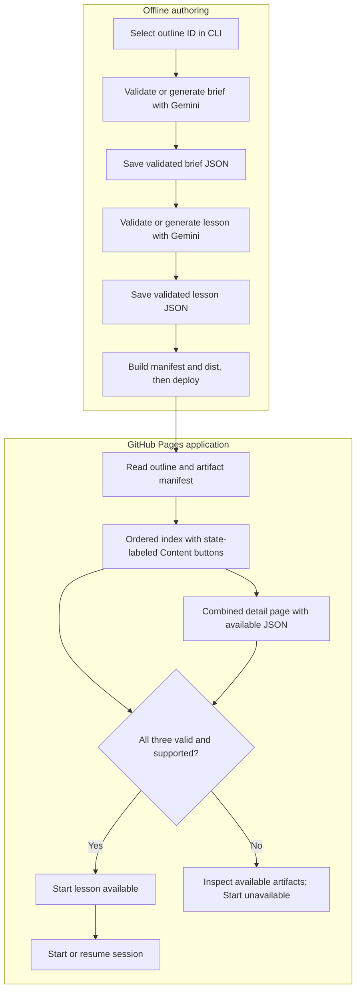
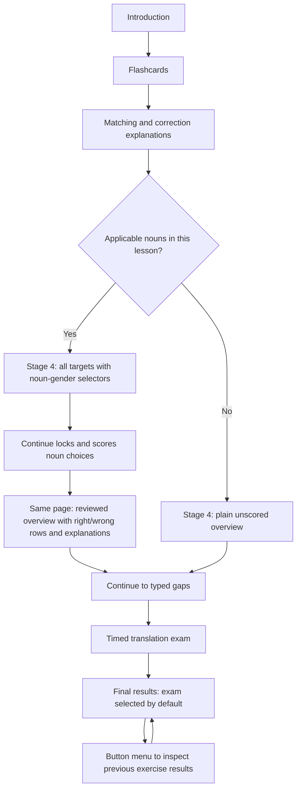
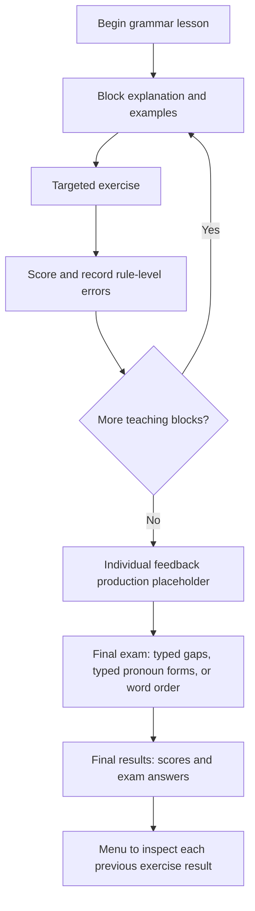

# Lesson exercise prototype specification

Status: **Draft 0.9 — structured artifact components and organized category mockups**. Date: 2026-10-05.

This document specifies the prototype and its phased implementation. It does not authorize starting implementation before the specification review. The issue-ready backlog is in [ISSUES.md](ISSUES.md); publish those issues to `bastian-schnitzler/lesson_prototype` after the specification has been refined with the user.

## 1. Goal, inputs, and scope

Build a React application with one `index.html` entry point that lists the French A1 outline, reads files prepared offline through Gemini, presents lesson steps sequentially, and shows exercise, exam, and total scores. Ordinary lessons should take approximately **10–15 minutes**. Vocabulary lessons requiring a larger inventory may take longer to cover their outline intent fully.

The requested roadmap names phases 0–5. This specification follows those six phases; the earlier phrase “two phases” is treated as superseded by the detailed roadmap.

### Repository inputs

| Input | Observed state | Treatment |
| --- | --- | --- |
| `lesson_requirements.md` | Filename typo in the request | Refers to the existing summary below; no separate requirements file is needed. |
| `doc/lesson_requirement_summary.md` | Present; vocabulary and grammar flows defined | Confirmed authoritative requirements source together with the user's request and subsequent decisions. |
| `content/outlines/fr-a1.json` | `lang: fr`, `level: A1`, 120 ordered entries | Authoritative IDs, classification, intent, titles, and order. |
| `doc/data_model_draft/lesson.ts` | Generic brief and older aggregate draft/API schemas | Reference for shared definitions; brief and content contracts need redesign. |
| `doc/data_model_draft/item.ts` | Placement-style multiple-choice question schemas | Reuse level/topic enums and applicable validation principles, not the placement item shape for every exercise. |
| `doc/data_model_draft/language.ts` | Imported by both draft modules, but absent | Supply a minimal shared language schema when implementing executable schemas. |

The outline has **48 grammar, 48 vocabulary, 14 functions, and 10 reading** entries. Display all 120 entries from the start. Functions and reading remain visible but cannot start until their requirements and renderers exist.

Prototype scope excludes accounts, placement tests, daily goals, streaks, inferred CEFR progression, live tutoring, and learner synchronization. Those features appear in the draft schemas but are not required here.

### Decisions and open points for review

Confirmed decisions are identified below. Other defaults make the draft concrete and remain subject to review.

| ID | Decision | Proposed default / clarification |
| --- | --- | --- |
| D1 | Authoritative requirements | **Confirmed:** use `doc/lesson_requirement_summary.md` and the user's instructions. The other requested filename was a typo. |
| D2 | Where generation runs | **Confirmed:** an offline local Node generator writes repository files; GitHub Pages serves pre-generated content. Lesson clicks never trigger generation. |
| D3 | Meaning of standalone | **Confirmed:** `index.html` is the entry point served on GitHub Pages. React reads the outline and generated brief/lesson JSON files; bundled module assets are allowed. |
| D4 | Mother tongue | **Confirmed: English.** English UI, explanations, and translations; French learning content. Store the language pair explicitly in generated artifacts. |
| D5 | Filters | Four independently toggled category buttons; all active initially. No selection shows an empty state with a reset link. Original ordinals do not change. |
| D6 | Scores and confirmation | **Confirmed:** final exam contributes **65%**, practice contributes **35%**. Continue locks practice answers, shows visual feedback and the correct answer when needed, then a second Continue confirms and advances. Flashcards/review screens are completion-only. |
| D7 | Answer matching | **Confirmed:** distinguish fully correct free text, correct letters with accent/capitalization errors, and incorrect answers. Normalize Unicode, spacing, and typographic apostrophes; full correctness preserves accents and case. Accent/case-only credit is 50% under D17. |
| D8 | Gender/articles | **Confirmed:** apply gender and noun article rules only where grammatically applicable. Non-nouns are not assigned invented gender or articles. |
| D9 | Audio | **Confirmed:** browser French speech synthesis for the prototype, with a visible unavailable state if no suitable voice exists. |
| D10 | Personalized grammar feedback | **Confirmed:** show the placeholder “Individual feedback would be here on production.” before the final exam. Individual feedback analysis is deferred to production. |
| D11 | Session persistence | Proposed: browser storage supports session reload/resume. **Confirmed:** the index last-try score is in memory only and clears on a full page reload; never restore it from stored attempts. |
| D12 | Broad vocabulary outlines | **Confirmed:** allow the number of targets necessary for the outline, with grouped presentation. Such lessons may exceed 10–15 minutes. Do not truncate an inventory at 15 or 32 or change its existing lesson ID. |
| D13 | Phase 4/5 allocation | Phase 4 functions, phase 5 reading, both blocked on their requirements review. |
| D14 | Average vocabulary target count | **Confirmed:** aim for approximately 12 targets per ordinary lesson on average; around 8 for more demanding lessons. Ideally mix easier and harder targets within each lesson's topic. Larger-inventory exceptions remain separate. |
| D15 | Index and detail navigation | **Confirmed:** one Content button labeled only Outline, Draft, or Content (highest available artifact) opens the combined detail page. Actions contains only Start lesson, available for complete, valid, supported lessons. Detail header has Lesson overview and Start lesson when available. |
| D16 | Lesson header and exams | **Confirmed:** duration-weighted progress percentage and current earned score against total possible; timed exam pages only, with results after the complete exam. Proposed: keep the practice contribution visible during exams to avoid leaking correctness. |
| D17 | Orthography-only points | **Confirmed:** 50% credit when letters are correct but accents or case differ. Full correctness earns 100%; other incorrect answers earn zero. |
| D18 | Exam countdown limits | **Confirmed:** each lesson brief specifies a time limit for every exam page, based on its task. Content generation preserves those limits. |
| D19 | Final results | **Confirmed:** final results show exam answers by default; a button menu selects any previous exercise result, with score aggregates always visible. |
| D20 | Correction explanations | **Confirmed:** whenever practice shows the right answer after an error, also show a short pre-generated explanation from lesson content. |
| D21 | Vocabulary noun gender | **Confirmed:** stage 4 integrates a scored gender select-box exercise for nouns and then shows the reviewed overview with right/wrong indicators. All vocabulary is on one page; non-nouns have no gender input. |
| D22 | Structured artifact viewer | **Confirmed:** render artifact objects as React/HTML cards, tables, and exercise previews. Outline rendering is shared across categories; Draft and Content rendering are category-specific. Raw JSON is optional supplementary inspection. |
| D23 | Mockup organization | **Confirmed:** keep Salt sources and rendered images under `doc/mockups/`, grouped by overview, vocabulary, and grammar, then by start page, numbered vocabulary stage, grammar exercise type, exam, and results. |

## 2. Runtime and delivery architecture

### Agreed generation and delivery architecture

Use React and TypeScript source modules, a small build tool such as Vite, shared Zod schemas, and an offline Node generation CLI. `npm run build` produces `dist/index.html`, module assets, and public content files. Runtime content stays as separate JSON so the combined detail page can inspect the actual artifacts.

There are two operating modes:

| Capability | Local authoring mode | GitHub Pages demo |
| --- | --- | --- |
| List/filter lessons | Yes | Yes |
| View existing brief/content | Yes | Yes |
| Play implemented lessons | Yes | Yes, if artifacts are deployed |
| Prepare missing brief/content | Offline CLI calls Gemini and writes files; then rebuild | No generation UI; deploy the prepared files. |
| Store API key | Local `.env`, read by Node | No key in HTML, JavaScript, deployed files, or browser storage. |
| Persist attempts | Browser storage | Browser storage |

GitHub Pages publishes static files and provides no application backend; offline generation follows that hosting constraint. See [GitHub Pages documentation](https://docs.github.com/en/pages/getting-started-with-github-pages/what-is-github-pages).

The browser reads the manifest and JSON files over HTTP in both modes. The generator resolves requested IDs through the outline and runs separately from the UI. No browser preparation endpoint, generating state, spinner, or generation animation is required.

### Proposed repository structure

```text
index.html
src/
  app/                 # routes, course list, combined detail page, session host
  components/          # common UI, exercise shell, audio control
  artifacts/           # shared Outline and category-specific Draft/Content views
  exercises/           # typed exercise renderers and shared interaction controls
  schemas/             # executable outline, brief, lesson, session schemas
  domain/              # preparation client, transitions, scoring
generator/
  cli.ts               # single-lesson and ordered batch generation
  prompts/             # brief/content prompts, versioned separately
content/
  outlines/fr-a1.json
  briefs/<id>.json
  lessons/<id>.json
docs/SPEC.md
docs/ISSUES.md
doc/mockups/
  README.md
  01-lesson-overview/   # index and category-specific artifact views
  02-vocabulary-lesson/ # startpage, numbered stages 01–06, results
  03-grammar-lesson/    # startpage, explanation, exercise folders, exam, results
.env.example
.gitignore
dist/                  # generated deployment output
.github/workflows/    # validation, build, Pages deployment
```

Use **`content/lessons/`**, plural, throughout. The singular `content/lesson/` in the request is treated as a typo. Do not keep a second competing storage location. Generated briefs and lessons are individual files keyed by the existing outline IDs, replacing the older aggregate lesson-file convention for this prototype.

The implementation issue must decide how draft definitions become executable modules. Keep shared enums in one place, update imports, and mark the old draft contracts as superseded. Do not leave two competing active `LessonBriefSchema` definitions.

### Environment example to implement in phase 1

```dotenv
# Local generator only; copy this file to .env and fill both values.
GEMINI_API_KEY=
GEMINI_MODEL=
```

Require a configured model rather than guessing one. `.env` is ignored by Git, excluded from build output, and never exposed with a client-side environment prefix. Generation errors must not log API keys. CI uses fixture content and does not require paid generation calls.

### Build and hosting

The build copies the outline and valid generated artifacts into `dist/content/` and creates a content availability manifest. The manifest is derived from files; it is not a second authored catalogue. Each entry records brief/lesson availability, schema version, and source hashes. Rebuild after generating content to update a static deployment.

Use hash routes for Pages, for example `#/lesson/<id>` for details and `#/lesson/<id>/play` for the session, so a refreshed route still loads `index.html`. All asset and content URLs respect the repository base path. Prefer deployment of the generated `dist` artifact via GitHub Actions over committing build output.

Phase 1 must verify the actual Pages settings and published URL for `bastian-schnitzler/lesson_prototype`; Pages availability is not currently verified. Hosting acceptance requires an HTTP smoke check of the deployed index, outline, content, assets, and a refreshed hash route.

## 3. Lesson discovery and offline preparation

### Lesson index and combined detail page

Each outline entry has one row with its original 1-based ordinal, `workingTitle`, category, **Content**, **Score on last try**, and **Actions** columns. Keep titles and ordinals stable under filters.

The Content column contains exactly one button linking to `#/lesson/<id>`. Its label communicates the artifact state:

| Button label | Artifacts available on the detail page | Start lesson |
| --- | --- | --- |
| Outline | Shared Outline view only | Unavailable |
| Draft | Outline and category-specific Draft view | Unavailable |
| Content | Outline, category-specific Draft and Content views | Available when validated and supported |

“Draft” is the UI name for the brief file in `content/briefs/<id>.json`; it does not introduce a fourth file or a new storage directory. Every row already has an outline entry. A content file without its required brief is an incomplete state, not ready. The button label reflects the highest artifact present, even if it needs review; a separate warning/accessible description and the detail page explain validity or missing dependencies. Short labels do not change what the combined page shows.

**Score on last try** shows the weighted total of the latest completed attempt during the current loaded app instance. It starts blank; an unfinished first attempt leaves it blank. Starting a later attempt keeps the previous completed score until the new attempt finishes. Display a real 0% result as 0%, not as blank. Returning to the overview through app navigation retains the value; a full reload of index.html or any app route clears the in-memory map. Do not store it in localStorage/sessionStorage or derive it from persisted attempt history. It is the latest result, not the best score. Reviewing an old completed session after reload does not repopulate it. Completing a resumed active attempt during the current load does.

Actions contains only **Start lesson**, rendered only when all three artifacts exist, are valid/current, and their category/renderers are implemented. Incomplete and pending-category rows have an empty Actions cell. The title and Content button do not start a lesson. Functions/reading still have readable outline/detail pages while their implementation is pending.

The detail page stacks the available **Outline**, **Draft**, and **Content** sections on one page, using structured React components and semantic HTML. Cards, tables, lists, and read-only exercise previews are the primary presentation; the user can understand all artifacts without opening raw JSON. The header contains **Lesson overview** (back to the lesson list) and **Start lesson** when available. No separate brief/content navigation buttons, generation controls, or answer-key shortcuts inside active sessions. Missing sections have a short explanatory label; malformed/stale artifacts are inspectable with their validation errors, while Start remains unavailable.

Four independently toggled category buttons remain at the index top; all are active initially. The label “Voc” maps to `vocabulary`, “Function” to canonical `functions`. Filters preserve `entries` order and original ordinals. No selected categories shows an empty state with a reset link.

### Structured artifact components

Use one `LessonArtifactPage` for all lesson categories. Its only header navigation is **Lesson overview** and **Start lesson**, the latter subject to the same readiness rules as the index. The page stacks the sections present for that lesson; it never substitutes a JSON text area for the structured view. Each section has a heading and clear spacing. Missing artifacts have a brief message. Invalid artifacts retain a diagnostic raw-data view and validation errors; they cannot start a session.

`OutlineSummary` is shared across vocabulary, grammar, functions, and reading. It renders the original ordinal, `workingTitle`, `intent`, French/level metadata, category badge, and the applicable topic/theme. Preserve the original French intent; any English paraphrase is additional. IDs and canonical topic/theme values can appear as secondary metadata. Outline-only views for pending categories already work in phase 1.

Resolve Draft and Content components through a registry keyed by the artifact's validated `kind`, keeping category payloads typed rather than reading arbitrary object properties into a generic JSON viewer:

| Component | Structured presentation |
| --- | --- |
| `VocabularyBriefView` | Objective and duration cards; target inventory with French form, English translation, word class, applicable gender/articles, and difficulty; target-count/difficulty rationale; six-stage plan and scoring policy; per-exam-page coverage and time limits. |
| `GrammarBriefView` | Objective/duration and coverage; 2–4 block cards with rules, worked examples, common pitfalls, and proposed exercise types; mixed-exam coverage, answer-unit plan, and each page's time limit. |
| `VocabularyContentView` | Ordered stage cards with introduction text, front/reveal flashcard previews, matching pairs, noun-gender/overview table, contextual typed gaps and reference words, and translation-exam pages. Show the actual prompts, teaching forms, accepted answers, point units, generated explanations, durations, and timers where applicable. |
| `GrammarContentView` | Ordered explanation/block cards with form tables and examples; read-only previews for each defined exercise type, including pronoun rows, choice/typed gaps, word tokens, and error spotting. Include the production-feedback placeholder and mixed exam pages, accepted answers, point units, explanations, durations, and countdown limits. |

Shared presentation helpers can render section cards, metadata, target rows, form tables, answer keys, and timing badges. Categories compose those helpers around their own schemas. Render generated strings as text within React components; layout comes from the application. Speech controls may play supported French examples. Native disclosure/expansion controls can shorten long arrays, but **every** target, block, exercise item, answer variant, and explanation must remain accessible. Raw JSON may be available in a collapsed `details` element for diagnostics, with readable formatting; it is supplementary, not the default content area or a required navigation step.

Artifact exercise previews are **read-only content inspection**: they show answer keys for review, create no attempt, award no score, start no countdown, and do not reuse an active learner session. A displayed exam time limit is metadata. Provide these previews in phase 1 for sample review without waiting for phase 2/3 playable interactions; reuse presentational components where appropriate once the interactive renderers exist. Function/reading Draft/Content renderers are deferred until their schemas are agreed in phases 4/5, while their common Outline view remains available.

### Offline generation and static playback flow

This replaces the original click-triggered generation cascade. Authors prepare files offline; the browser loads published files and validates readiness. There is no “Generating” state or generation animation in the application.



On Start lesson, read and validate the outline, brief, content, hashes, step plan, and renderer support. A missing file, network error, malformed JSON, or stale manifest discovered after clicking produces an actionable readiness error and a return to overview. It never triggers generation. Successful checks open the start/resume page with objective and estimated duration; its Continue action enters the session.

### Generator behavior

The CLI reuses shared preparation functions for single lessons and ordered batches:

1. Resolve immutable metadata from the selected outline entry and course metadata.
2. Choose the category-specific schema and prompt. Brief generation receives the outline; content generation receives the outline and validated brief.
3. Request structured JSON with a JSON Schema derived from the Zod structural contract and supported by the configured Gemini model. Zod refinements remain local validation rules.
4. Parse and validate the response with the full Zod schema, then perform cross-reference and pedagogical checks. Model-constrained JSON alone does not prove correct teaching content.
5. Assemble trusted metadata locally and atomically save the validated object at the canonical path. Reject IDs/classifications that contradict the selected outline.

Gemini supports structured JSON output and a subset of JSON Schema. Keep local validation, including checks that cannot be represented in the generation schema. See [Gemini structured output documentation](https://ai.google.dev/gemini-api/docs/structured-output).

Use a bounded policy: at most three model calls per stage including transient retries or schema repair, with capped backoff. Supply field-level validation errors on a repair attempt. Content failure preserves a valid saved brief; the next CLI run resumes the missing stage. Existing valid artifacts are reused without Gemini calls. Invalid/stale files require an explicit CLI regeneration option. Write a temporary file and rename only after validation; failed replacement retains any valid prior artifact. Deduplicate preparation for an ID and serialize batches by default. Diagnostic generation status belongs in CLI output, not the learner UI.

Record schema version, generation timestamp/model/prompt version, and canonical input hashes. A brief stores its outline hash; a lesson stores its outline and brief hashes. Changed inputs or incompatible schemas mark dependent content stale. Rebuild and redeploy after generation; the manifest and runtime use the same hash rules.

## 4. Schema design

### Shared envelope

Briefs and lesson files use an envelope with:

| Field | Purpose |
| --- | --- |
| `schemaVersion` | Explicit compatibility version. |
| `id`, `kind`, `lang`, `level` | Must equal the outline/course metadata. |
| `nativeLanguage` | `en` for this prototype; French learning language is `fr`. |
| `topic` or `theme` | Grammar requires topic only; other kinds require theme only. |
| `title`, `objective`, `estimatedMinutes` | Learner-facing purpose and duration. |
| `provenance` | Generator/model/prompt details and applicable input hashes. |

Use strict objects, bounded nonempty strings and arrays, unique stable nested IDs, and category discriminators. The current generic `objective/points/examples/pitfalls/optional vocabulary` brief cannot express the needed plan. `VocabularyEntrySchema.term/gloss` currently forbids translations; replace that assumption for the prototype.

Separate **brief planning** from **renderable lesson content**. Content generation must use `VocabularyLessonContentSchema` or `GrammarLessonContentSchema`, not a brief schema again. An exercise prompt/answer set belongs in the lesson content; the brief specifies what those exercises must teach and cover.

### Vocabulary brief

`VocabularyBriefSchema` defines:

- Learning objective, outline coverage notes, explicit target count, count rationale, difficulty-balance notes, duration estimate, and prerequisites if any. The target array must match the planned count; larger inventories require grouping and an appropriate longer duration estimate.
- Target entries: `id`, French base term, native translation(s), word class, gender where applicable, grammatical number, teaching display form, required exam form(s), accepted variants, and pronunciation text for audio.
- Noun article policy: indefinite article where applicable, plural form where needed, and explicit exceptions for phrases, verbs, letters, numerals, proper names, or other unsuitable forms. A required article belongs in the full accepted exam answer, not in a heuristic added by the UI.
- One planned context for each target, and contextual ambiguity notes where a translation has several valid answers.
- Coverage/count/time plans for six stages: introduction, flashcards, matching, gender exercise/reviewed overview where applicable, typed gaps, translation exam. Specify a duration estimate for each planned learner page and a positive countdown limit for every exam page.
- Gender practice plan for nouns: display lemmas without articles/gender clues while answering, accepted gender(s) per noun, and a short explanation of the correct choice. All targets appear on one page; non-nouns have no selector. Lessons without applicable nouns keep an unscored overview.
- Matching group sizes and gap-answer expectations. Typed gaps require four distinct reference choices with exactly one accepted target for the context.

Aim for **approximately 12 new targets per ordinary vocabulary lesson on average**, with **around 8** for lessons with a more demanding overall learning load. Ideally mix straightforward and harder targets within each lesson's outline topic, rather than concentrating difficult items in dedicated difficult-only lessons. Consider spelling, pronunciation, phrase length, gender/article exceptions, and required written forms when assessing the load. The brief explains its target count and difficulty balance so the content generator can follow that plan.

Straightforward lessons may include somewhat more relevant targets to keep the ordinary-course average near 12. Treat this average as a planning guide and validate it against the generated briefs and sample completion times. Larger-inventory exceptions are excluded from the ordinary average. Repeated retrieval improves retention, with a time-on-task tradeoff, so leave enough time to practice the targets. See [Nakata's within-session retrieval study](https://doi.org/10.1017/S0272263116000280).

Across the 48 vocabulary lesson slots, an average of 12 gives a baseline of **576 taught targets** before exception adjustments. This is a planning estimate, not a guaranteed distinct-word count; repeated targets, multiword expressions, alphabet letters, and numerals must be distinguished when reporting vocabulary coverage.

Count one taught word or phrase as one target: `un livre` is one target, and a multiword expression is one target, not one per token. Repeated appearances of a target in the six stages do not increase the target count.

The schema must also accept the necessary larger count for exceptional outlines: numbers 0–20 require 21 targets; the alphabet and five named signs can require 31. Keep smaller groups within the existing lesson stages and increase `estimatedMinutes` when needed. Do not enforce a universal 15- or 32-target cutoff, narrow the outline, or split existing IDs merely to fit a limit. Validate target-count consistency and pedagogical coverage instead. Examples and translations must support the intended A1 lesson without unrelated prerequisite grammar.

### Grammar brief

`GrammarBriefSchema` defines:

- Topic, objective, prerequisites, scope boundaries, and duration budget.
- **2–4 teaching blocks**, each with stable ID, rule IDs, bite-sized explanation plan, French examples with translations, pitfalls/irregularities, and a targeted exercise plan.
- Exercise plan entries with allowed type, item count, and assessed rule IDs. Choose pronoun-form exercises only for topics where they fit.
- Common pitfalls and irregularities for teaching explanations and item-level corrections. A personalized diagnosis/error catalogue is not required for the prototype.
- A fixed feedback-placeholder stage and final exam blueprint covering the taught rules. The exam uses typed sentence gaps, typed pronoun forms, and word order when sentence structure is assessed. Plan learner pages, their duration estimates, and a positive countdown limit for every exam page.

Keep the pedagogy explicit enough that the lesson generator fills a defined plan rather than independently inventing its sequence.

### Renderable lesson content

`LessonContentSchema` is a discriminated union by kind. Each supported kind has ordered steps and typed exercise items. Supported step roles include introduction, explanation, exercise, overview, feedback, and exam; the schema validates the category-specific sequence.

Each step has `id`, role, label, relevant brief/rule/target references, and a typed payload. Each concrete learner page has a unique `pageId` and positive `estimatedDurationS`; every exam page additionally has positive `timeLimitS` copied from its brief plan. A page may contain one item or a group of answer units. Validate that the generated page inventory and timer limits match the brief. Each scored exercise has `type`, stable `itemId`s, instructions, prompts, full answer keys, accepted variants, and item-level feedback/rule references. Every scored answer unit also has a required short English `answerExplanation`, pre-generated with the correct answer and shown whenever a correction is revealed. Variant-specific explanations may be provided when answers differ. Validate that explanations are present and nonempty; they describe the relevant meaning, spelling, gender/article, or grammar rule, rather than merely repeating the answer. For noun gender, explain the lexical gender and appropriate article without inventing a universal spelling-based rule. The grammar feedback step uses the application's fixed production-placeholder text; the model does not generate individualized feedback. Rendering and scoring use the discriminator; the model does not return executable JavaScript, arbitrary components, or arbitrary HTML.

| Exercise discriminator | Payload essentials | Scored units |
| --- | --- | --- |
| `vocabulary_flashcards` | Target IDs; front native / back French display and pronunciation | Completion only |
| `vocabulary_matching` | Unique left/right entry IDs, pair keys, shuffled display order | One per pair |
| `vocabulary_gender_select` | All target IDs, noun lemmas, accepted genders, select options, answer explanations; reviewed overview uses locked row results | One per applicable noun |
| `vocabulary_typed_gap` | Sentence segments, one gap, four noninteractive reference choices, accepted article-free answers | One per gap |
| `vocabulary_translation_exam` | Native prompt and accepted full French answers | One per target |
| `grammar_pronoun_form_match` | Pronoun rows, form token IDs, valid assignments | One per row |
| `grammar_pronoun_form_typing` | Pronoun rows and accepted forms | One per row |
| `grammar_gap_choice` | Sentence gap and four distinct choices with answer ID | One per gap |
| `grammar_gap_typing` | Sentence segments, gap answer(s), optional hint | One per gap |
| `grammar_word_order` | Stable token IDs, accepted token sequences | One per sentence |
| `grammar_error_spotter` | Tokenized sentence, faulty token ID, correction mode and answers | One per sentence; detection and correction must both be right |

Introduction, grammar explanations, and plain vocabulary review use unscored payloads. Stage 4 is scored when noun-gender selectors are present, followed by an unscored reviewed display on the same page; count its noun answers once, with no extra score for acknowledging review. The exam is a **container of scored items**, potentially mixing supported types; it is not a seventh universal exercise interaction. Phase 1 must model this before phase 2 begins.

Reference validation rejects missing targets/rules, duplicate nested IDs, unknown exercise types, empty exams, incomplete brief coverage, invalid answer keys, and incorrect category sequences. Duplicate displayed form text is allowed when distinct tokens/forms are needed; score assignments by grammatical validity, not arbitrary token identity.

Store word-order punctuation and repeated tokens explicitly. Do not split sentences with a simplistic space-only parser. Allow multiple correct sequences/answers when linguistically valid, while ensuring prompts make the intended answer assessable.

## 5. Session, scoring, progress, and exam timing

### Shared session contract

Use React composition: a shared `ExerciseShell`, a typed renderer registry, reusable matching/typing/token-order controls, pure scorers, and a session reducer. Avoid making every interaction inherit from a large component class.

`LessonSessionSchema` stores:

- Session ID, lesson ID, content/schema hash, timestamps, and status (`active`, `completed`, `abandoned`).
- Current step/page/item and phase (`answering`, `practice_feedback`, `exam`, `results`), plus completed pages and their estimated durations.
- Draft and locked responses, correctness class, accent/case differences, earned/possible points, confirmation state, and item/rule references.
- Exam page start times, absolute deadlines, time limits, timeout flags, and answers; no public item correctness during the exam.
- Final-results selection (exam by default or an earlier exercise), linked to immutable response records; reviewing results never runs the exercise again.
- Scoring policy version, 35% practice / 65% exam weights, and 50% orthography-only credit.
- Final results computed from responses and policy, never supplied by the model.

Separately, application state holds the in-memory last-completed-score map for the index. This map is never serialized with session records and resets on full reload.

Save after meaningful transitions. Resume only when the content hash is compatible; changed content starts a new attempt with an explanation. Restart creates a fresh session. Locks, confirmations, timeout events, and repeated clicks are idempotent. Storage failure keeps the in-memory session and shows a persistence notice.

### One Continue action

Practice pages have one primary footer button labeled **Continue**. There is no Check or Submit button. Answer controls (choices, input fields, draggable tokens), audio, and card-flipping remain available as required by their interaction type.

1. While answering, Continue locks the current page's response(s), records first-submission points, and shows immediate visual feedback **on that page**, without navigating away.
2. Fully correct answers receive a clear success state. Orthography-only errors receive a distinct partial-correct state and the correctly accented/capitalized answer. Incorrect answers receive an error state and the correct answer. Both correction states also show the short pre-generated explanation of why that answer is right, including row-level corrections in grouped tasks. Include text/icons so color is not the only signal.
3. Inputs become read-only. Continue remains the only primary action; pressing it again acknowledges the feedback and advances. It does not rescore or require retyping the correction.

Unscored presentation/review pages use Continue once to advance when their review requirements are met. Empty required answers disable Continue in practice. An exam page may submit a blank answer, recorded as unanswered for zero credit.

Exam Continue locks the current answers and immediately advances, showing no correctness, corrections, earned points for that page, or answer-revealing style. After the final exam page is submitted or times out, open the **final results page** with the exam selected by default, all score aggregates, and a button menu for earlier exercise results. Record the final weighted score in the current app instance’s last-try map once.


### Duration-weighted progress and live score header

All active lesson pages use a consistent header: lesson title, a progress bar with percentage, and **current score / total possible lesson score**. Exam pages add their countdown in the task area. Keep the header visually separate from the centered task card.

Progress follows the **estimated length of completed learner pages**, not their count, answer correctness, or elapsed wall time:

```text
progress = 100 × sum(estimatedDurationS of completed learner pages)
                 / sum(estimatedDurationS of all learner pages)
```

Flatten the plan to actual presentation pages, matching groups, typed pages, and exam pages. Credit each page once on completion/advance; do not count both a parent step and its children. Include unscored teaching/review and the grammar production placeholder. The final results page and its selected exercise reviews are post-lesson review, excluded from the progress denominator and displaying 100%. A practice page awaiting feedback confirmation is not yet complete. The generated start-page duration estimate should agree with the summed page estimates.

Use **100 weighted lesson points** as the common header denominator:

```text
visible practice contribution = 35 × earned practice units / all possible practice units
final exam contribution       = 65 × earned exam units / all possible exam units
```

During practice, show earned practice contribution out of 100. Pending units have earned no points; the denominator includes the full lesson's possible points from the start. This is accumulated credit, not accuracy on attempted answers. After the exam, add its contribution and show the final score out of 100.

To preserve delayed exam feedback, keep the header's earned score at the practice contribution throughout the exam, labeled “Exam results pending”. Do not update the header after individual exam answers: changes would reveal correctness. Progress and countdown may update normally. Publish the complete exam contribution on the final results page, which also shows exercise scores and raw points in its menu/review.

### Per-page exam countdown

**Practice has no countdown. Every exam page has one**, with its `timeLimitS` specified by the lesson brief for that task and copied into the lesson content. There is no universal hardcoded duration.

Start the countdown when the exam page becomes active. Display remaining minutes/seconds. Continue submits before expiry; expiry automatically locks the page's current draft answers and advances through the same transition. Valid drafted answers are graded normally; unanswered units earn zero. Mark timed-out pages in the feedback review.

Use an absolute deadline and recompute remaining time from it, so tab throttling, a page reload, or resume cannot reset or extend the allotted time. Persist the deadline. An expired current page is finalized on resume. Resolve a simultaneous Continue/timeout once; input after the deadline cannot alter the locked result. Tests use a fake clock. A new exam page gets its own brief-defined limit on activation. Exam answer feedback, audio of the target answer, hints, gender badges, and backward answer editing stay unavailable until the complete exam finishes.

### Free-text correctness and points

All free-text responses have three assessable outcomes, plus unanswered:

| Result | Comparison | Credit per answer unit |
| --- | --- | --- |
| `fully_correct` | Matches an accepted answer including accents and upper/lowercase | 1 point |
| `orthography_only` | Same letters/word sequence; differences are only accents and/or upper/lowercase | 0.5 points |
| `incorrect` | Wrong letters, words, word order, article, or other unaccepted content | 0 points |
| `unanswered` | No answer supplied | 0 points |

First normalize Unicode NFC, trim/collapse whitespace, and normalize typographic apostrophes **without removing case or accents**. Compare against full accepted answers. If none matches, compare copies with case folded and combining accent marks removed to detect `orthography_only`. Preserve the original submitted text and the expected answer for feedback. Do not use the draft's `foldText`: it also changes distinct letters/ligatures. Required articles stay part of the comparison.

Examples: expected `un café`, answer `un café` earns 1; `un cafe` or `Un café` earns 0.5; `une café` earns 0. Explicit valid variants can earn full credit if the content declares them accepted. Both practice and exams use the same classification; exam classifications remain hidden until final results.

Non-text tasks earn 1 or 0 per atomic unit. Multi-row tasks earn credit per row; word-order/error-spotter sentences are whole units. Where a text correction is involved, an otherwise correct error-spotter answer may receive the text's 0.5 orthography credit. The detection must also be right. Continue locks first-submission points; acknowledging feedback cannot improve them.

### Weighted totals and final results menu

```text
exercise score = 100 × earned exercise points / possible exercise points
practice score = 100 × all earned practice points / all possible practice points
exam score     = 100 × earned exam points / possible exam points
total score    = 0.35 × practice score + 0.65 × exam score
```

Store raw points, including halves, and round only displayed percentages to one decimal place. Exclude unscored screens from score denominators. Mixed exam sections contribute within the 65% exam share according to their possible points, counted once. For example, 80% practice and 60% exam produce 67% total.

The final results page shows the weighted total, practice/exam aggregates and weights, and scores for each scored exercise. **Exam results are selected by default**: show every task, the original locked learner answer, a correct accepted answer, correctness/points, timeout markers, and the pre-generated explanation where an answer needs correction. Include sub-answers on grouped pages. This is answer review, separate from the pre-exam production-feedback placeholder.

A button menu selects **Final exam** or any earlier exercise result by step/block label. For vocabulary with nouns this includes Matching, Gender, and Typed gaps. Repeated grammar exercise types have unique block labels. Completion-only exercises such as flashcards can show their completion record instead of an invented correctness score. Keep aggregate scores visible while the selected result changes. Non-noun lessons have no Gender menu entry. Each review uses stored locked responses and explanations, with the original accent/case visible; changing menu selection does not rescore, alter progress, restart timers, or edit answers. There is no separate mandatory exam-feedback-to-summary transition. Lesson overview and Restart lesson are the final page's navigation actions.

No pass/fail gate is required. A pass label and threshold remain optional future decisions.

## 6. Vocabulary learning flow

Keep six stages, integrating noun-gender practice into the overview stage:

1. **Introduction:** targets with native translation, French teaching form, audio, and applicable gender badge.
2. **Flashcards:** native-language front; French, applicable gender, and audio on the back. Track completion.
3. **Matching:** connect native/French targets in manageable groups. Applicable French forms show gender. Continue locks answers and shows corrections with their generated explanations before confirmation.
4. **Gender exercise and reviewed overview:** show **all vocabulary on one page**. Nouns have a select box with an initially unanswered state and appropriate gender options; other word classes have no gender input. While answering, show noun lemmas without articles, gender tags, or audio that supplies an article. This temporarily overrides the earlier stages' gender-display rule so the answer is not exposed. Preserve explicit gender/context policies for nouns that accept more than one gender. Continue locks all noun choices and scores one unit per noun. The same page then becomes the overview, showing the learner's selected gender, correct gender and teaching form, right/wrong indicators, translations, audio, and pre-generated explanations for mistakes. Continue acknowledges the overview and proceeds to gaps. Retain the locked row results for final-results review. Lessons without applicable nouns use a plain, unscored overview and skip the gender exercise.
5. **Typed context gaps:** four visible, noninteractive reference choices; type the missing word without article. Show applicable gender alongside reference forms. Continue shows correctness, correction, and the generated explanation, then confirms/advances.
6. **Timed translation exam:** native prompt, French answer including indefinite article where applicable; no gender/audio/answer hints. Each page uses its brief-defined countdown. Answer feedback is deferred until the full exam is complete.

After the exam, the final results page defaults to exam answers and offers a button menu for prior exercise results. Introduction/flashcards/plain review remain completion-only. Matching, applicable noun-gender answers, typed gaps, and the exam are scored. All three scored practice types share the existing 35% practice contribution by possible units; the exam remains 65%. The gender overview answers and confirmation are one learner page for progress, using an estimate that includes both answering and review.



Audio is learner-triggered. Use the French speech language explicitly. An unavailable voice does not hide text or block progression; show its limitation. During gender answering, any audio must preserve the hidden article/gender clues; the complete audio controls return in reviewed overview.

## 7. Grammar learning flow

Run 2–4 explanation/practice blocks, a production-feedback placeholder, and a final exam. At least one block may focus on common errors or irregular forms where useful. The placeholder replaces the summary's personalized feedback requirement for this prototype, as agreed with the user; normal answer checking and practice corrections remain.



### Exercise behavior

| Type | Required interaction |
| --- | --- |
| Pronoun/form drag-and-drop | Assign form tokens to generated pronoun rows; mouse/touch plus keyboard or click alternatives. Do not force all six person rows on topics that do not need them. |
| Pronoun/form typing | Type an accepted form in each pronoun row; handle multiple linguistically valid forms through answer keys. |
| Multiple-choice gaps | Exactly four choices per gap; one accepted choice; shuffle without changing answer identity. |
| Exact-typing phrase gaps | Type the missing text; optional brief-specified hint in practice, subject to exam policy. |
| Word order | Move tokens into a sentence; support moving back/reordering, repeated words, punctuation, and valid alternative sequences. |
| Error spotter | Select the faulty token, then type or select its correction as specified by the item. Give targeted practice feedback. |

### Personalized feedback and exam

After the final teaching block and before the exam, display exactly:

> Individual feedback would be here on production.

This screen is unscored and has a Continue to final exam action. It appears for every grammar session regardless of the learner's answers. The prototype performs no individual feedback analysis and makes no runtime Gemini request. Keep ordinary exercise results and answer-checking feedback; production feedback is future scope.

Every exam page uses its brief-defined countdown and defers answer feedback until the final results page. The final exam covers the taught rule IDs with fresh examples, selected during lesson generation. It may mix `grammar_gap_typing`, `grammar_pronoun_form_typing`, and `grammar_word_order`. Use word order for syntax/structure. Do not force conjugation exercises onto article, adverb, or question lessons. The practice bank has six types; the exam uses the subset appropriate to the objective.

When phase 3 is complete, all **48 grammar** entries must be generatable and playable. The first-ten sample approval alone is insufficient for that phase's exit.

## 8. UI design and rendered Salt mockups

### Visual direction and layout

Reference: [ft_transcendence English page](https://transcendence.dpdns.org/en), retrieved on 2026-10-05. Its rendered HTML identifies a dark slate background, light slate text, muted borders, indigo primary actions, and a centered responsive layout. The lesson views extend that direction.

Application tokens: background `#020617`, surface `#0f172a`, border `#1e293b`, text `#f1f5f9`, muted `#cbd5e1`, primary `#4338ca`, focus `#6366f1`. Use a system sans-serif font and a centered maximum width around 72rem. Give the outer page 24–32px padding, cards 24–32px internal padding, section gaps 24px, and controls at least 44px high. Keep text tasks centered in a readable 44–48rem column. Index rows have generous vertical padding and subtle horizontal separators; detail sections are stacked cards with category-specific inventories, teaching blocks, and exercise previews. Keep headers, task content, feedback, and the footer action visually distinct.

Use semantic buttons/links, visible focus, labels, and live announcements for submitted answers and countdown expiry. Provide keyboard/touch alternatives for drag-and-drop. Narrow layouts stack row actions and preserve one entry per row/card. Feedback uses icons/text alongside color. Countdown digits do not animate. The learner interface contains no generation status or generation animation.

These are rendered **PlantUML Salt** wireframes with explicit whitespace, type hierarchy, grouped cards, and a single primary task action. They show layout rather than the application's final dark styling. Each image links to editable `.puml` source. Salt notation follows the [official wireframe documentation](https://plantuml.com/salt). Regenerate SVGs/PNGs from those sources when changing mockups. Browse all 27 screens in the [mockup directory guide](../doc/mockups/README.md). Sources, SVGs, and PNGs live together in each screen folder; no flat duplicate mockup directory is maintained.

### Index

One Content button shows only the highest available artifact: Outline, Draft, or Content. The last-try score is blank until a lesson completes in the current loaded app; it clears on full reload. Actions has only Start lesson, and only for complete, valid, implemented lessons. Empty cells mean Start is unavailable; no generation controls are shown.


[Salt source](../doc/mockups/01-lesson-overview/index/lesson-index.puml)

### Combined artifact view: vocabulary

The ready-state header has Lesson overview and Start lesson. A shared Outline card preserves the course entry; category-specific Draft and Content components show target inventory, stage plans, vocabulary cards, exercise previews, answers, and explanations. Raw JSON is collapsed. The mockup shows representative items; the application exposes the complete inventory and every stage. Outline-only and draft-only views omit Start and show short messages for missing sections.


[Salt source](../doc/mockups/01-lesson-overview/artifact-view/vocabulary/lesson-detail.puml)

### Combined artifact view: grammar

The same header and Outline layout precede a grammar Draft with teaching blocks, rules, pitfalls, and an exam plan. Content renders form tables, examples, each exercise type, the fixed feedback placeholder, and mixed-exam previews. The displayed timing metadata does not run a countdown; no preview changes learner scores.


[Salt source](../doc/mockups/01-lesson-overview/artifact-view/grammar/lesson-detail.puml)

### Lesson start

The duration shown here is the lesson estimate. Continue starts or resumes the session. There are no preparation or generating states.


[Salt source](../doc/mockups/02-vocabulary-lesson/startpage/lesson-start.puml)

### Practice: enter an answer

The shared header shows estimated-duration progress and accumulated weighted points against 100. Reference choices are plain text; Continue locks the response and reveals feedback on this page.


[Salt source](../doc/mockups/02-vocabulary-lesson/05-typed-gaps/answer.puml)

### Practice: confirm feedback

An incorrect response displays the correct answer and a short pre-generated explanation of why it is right. Continue confirms and advances. Fully correct responses use success feedback; accent/case-only responses use distinct partial-correct feedback with 0.5 points and the exact accepted answer. There is no extra Check button.


[Salt source](../doc/mockups/02-vocabulary-lesson/05-typed-gaps/feedback.puml)

### Exam page

The displayed countdown is illustrative; its initial limit comes from the brief. Continue advances without showing correctness. The score remains at the practice contribution until the exam finishes.


[Salt source](../doc/mockups/02-vocabulary-lesson/06-exam/exam-page.puml)

### Final results: exam selected

Exam answers show by default beneath the score aggregates. The button menu selects previous exercise results without leaving this final page. This example includes a noun-gender exercise: Matching 10/12, Gender 9/12, and Typed gaps 8/12 yield 27/36 practice points (75%); exam 8/12 yields a weighted total of 69.6/100 after rounding.


[Salt source](../doc/mockups/02-vocabulary-lesson/results/exam-results.puml)

### Final results: previous practice selected

Selecting a previous exercise keeps scores/menu visible and replaces the answer-review area with that exercise's locked responses, correct answers, and generated explanations. The example selects Gender; it does not repeat the exercise or change its score.


[Salt source](../doc/mockups/02-vocabulary-lesson/results/gender-results.puml)

### Gender exercise inside the overview

All twelve sample targets are on one page. Gender clues are hidden while answering. This initial state shows unanswered select boxes; Continue becomes available when all required choices are supplied. Continue locks the selections and transforms this page into the reviewed overview with correct forms, per-row right/wrong states, and correction explanations.


[Salt source](../doc/mockups/02-vocabulary-lesson/04-gender-overview/gender-select.puml)


[Salt source](../doc/mockups/02-vocabulary-lesson/04-gender-overview/reviewed-overview.puml)

### Browse the lesson stages and grammar exercises

The folder organization follows the lesson flow. Vocabulary has a separate `startpage/` and numbered stage folders, including `06-exam/`. Grammar has `startpage/`, one folder for each exercise type, and `exam/`. Results live alongside each category's lesson folders. The category guides link every SVG, PNG, and editable source.

| Category | Folders and previews |
| --- | --- |
| [Lesson overview](../doc/mockups/01-lesson-overview/README.md) | Index; structured artifact views for vocabulary and grammar. |
| [Vocabulary lesson](../doc/mockups/02-vocabulary-lesson/README.md) | Start; [01 introduction](../doc/mockups/02-vocabulary-lesson/01-introduction/introduction.svg); [02 flashcards](../doc/mockups/02-vocabulary-lesson/02-flashcards/front.svg) and [reveal](../doc/mockups/02-vocabulary-lesson/02-flashcards/revealed.svg); [03 matching](../doc/mockups/02-vocabulary-lesson/03-matching/matching.svg); 04 gender + reviewed overview; 05 typed gaps + feedback; 06 exam; results. |
| [Grammar lesson](../doc/mockups/03-grammar-lesson/README.md) | [Start](../doc/mockups/03-grammar-lesson/startpage/lesson-start.svg); [explanation](../doc/mockups/03-grammar-lesson/explanation/singular-forms.svg); [pronoun matching](../doc/mockups/03-grammar-lesson/exercise-pronoun-match/pronoun-match.svg); [pronoun typing](../doc/mockups/03-grammar-lesson/exercise-pronoun-typing/pronoun-typing.svg); [choice gap](../doc/mockups/03-grammar-lesson/exercise-gap-choice/gap-choice.svg); [typed gap](../doc/mockups/03-grammar-lesson/exercise-gap-typing/gap-typing.svg) and [feedback](../doc/mockups/03-grammar-lesson/exercise-gap-typing/feedback.svg); [word order](../doc/mockups/03-grammar-lesson/exercise-word-order/word-order.svg); [error spotter](../doc/mockups/03-grammar-lesson/exercise-error-spotter/error-spotter.svg); [placeholder](../doc/mockups/03-grammar-lesson/feedback-placeholder/feedback-placeholder.svg); [exam](../doc/mockups/03-grammar-lesson/exam/mixed-exam.svg); [results](../doc/mockups/03-grammar-lesson/results/exam-results.svg). |

## 9. Sample generation and review gates

“First ten” means filter the existing outline by kind, preserve its order, then take ten; it does not mean the first twenty overall entries.

| Original ordinal | Grammar ID | Original ordinal | Vocabulary ID |
| --- | --- | --- | --- |
| 2 | `fr-subject-pronouns` | 3 | `fr-alphabet-and-accents` |
| 4 | `fr-verb-etre-present` | 5 | `fr-countries-and-nationalities` |
| 7 | `fr-indefinite-articles-and-noun-gender` | 8 | `fr-numbers-zero-to-twenty` |
| 9 | `fr-here-there-now-tomorrow` | 10 | `fr-classroom-objects` |
| 11 | `fr-er-verbs-present` | 14 | `fr-jobs-and-professions` |
| 12 | `fr-pronoun-on` | 16 | `fr-family-members` |
| 15 | `fr-definite-articles-and-elision` | 19 | `fr-classroom-instructions` |
| 17 | `fr-yes-no-questions` | 20 | `fr-personal-details-on-a-form` |
| 18 | `fr-verb-avoir-present` | 22 | `fr-days-of-the-week` |
| 21 | `fr-negation-ne-pas` | 26 | `fr-rooms-of-the-home` |

Phase 1 creates **20 brief files and 20 lesson files**. Briefs must be reviewed with the user before sample lesson generation; lesson files must be reviewed before bulk expansion. Make concrete viewer pages and sample artifacts available at each gate.

Review checks: correct language pair, appropriate A1 vocabulary, full outline-intent coverage, article/gender applicability, mixed target difficulty where the topic allows, ordinary target average near 12 with around 8 for demanding lessons, manageable duration (allowing longer large-inventory lessons), correct examples/answer keys, sensible exercise selection, pitfalls, and exam coverage. Schema validity is necessary but does not replace this teaching-content review.

## 10. Phases and acceptance criteria

Detailed implementation issue bodies and dependencies are in [ISSUES.md](ISSUES.md).

| Phase | Deliverable | Exit criteria |
| --- | --- | --- |
| 0 | Specification and issues | Review this draft in several iterations, resolve architecture/language/scoring decisions, then publish the dependency-linked issue backlog to GitHub. |
| 1 | Skeleton and shared contracts | Ordered/filterable index, artifact viewers, `dist` deployment verified on Pages, category schemas, offline generation, environment example, approved 20 briefs/20 lessons, start/session/exercise host, shared tests, vocabulary/grammar architecture review. |
| 2 | Vocabulary | Introduction/audio, flashcards, matching, integrated noun-gender/reviewed overview, typed reference gaps, timed translation exam, immediate confirmed practice feedback, final results with exam/practice answer review menu, weighted progress/score header, and complete sample journeys/tests. Remaining vocabulary outlines can use the same pipeline; all 48 generated artifacts are optional unless added to scope. |
| 3 | Grammar | Six practice interactions, 2–4 block flow, production-feedback placeholder, timed mixed exams, final results with exam/practice answer review menu and scores, all 48 grammar lessons generatable/playable, and end-to-end tests. |
| 4 | Functions | Requirements and schema review first; then define generation, interaction, scoring, content, and acceptance issues. |
| 5 | Reading | Requirements and schema review first; then define generation, interaction, scoring, content, and acceptance issues. |

Phase 1 viewers can inspect grammar/vocabulary content before exercise renderers are complete. The session host is tested with fixtures and only starts lessons whose renderers are available; it must not pretend unimplemented exercises are playable.

### Cross-cutting verification

- Contract tests: valid/invalid briefs and lessons, category sequences, immutable IDs, hashes, accepted variants, per-page estimated durations, brief-defined exam time limits, required correction explanations, noun-gender applicability, and missing language imports.
- Generator integration tests with a fake Gemini adapter and temporary directory: reuse, missing-stage generation, invalid response repair, bounded failure, network errors, atomic writes, duplicate clicks, and partial success.
- Shared unit tests: single-Continue lock/confirm transitions, accent/case classifications and half credit, immutable scores, multi-unit grading, mixed exam aggregation, duration-weighted progress, sealed exam score display, timeout/submit races, deadline persistence, content-change resume rejection, in-memory last-try reset/real-zero/latest-completion behavior, result-menu immutability, noun-gender scoring, and zero-denominator handling.
- Component checks: original order/ordinals under filters, one highest-artifact Content label, ephemeral last-try score column, and readiness-gated Start, shared Outline and typed vocabulary/grammar Draft/Content views, full arrays accessible with JSON collapsed, read-only previews without session mutations, combined detail header, no generation controls, typed-only reference choices, feedback confirmation, gender visibility, exam answer suppression, countdowns, keyboard operation, and error states.
- Vocabulary end-to-end journey: load deployed fixture files, complete all six stages, submit/confirm correct and incorrect practice responses, finish timed exam pages, review exam/practice answers through the results menu, test noun-gender overview and explanations, reload/resume, and verify scores and transient index values.
- Grammar end-to-end journeys: conjugation, article/gap, and word-order lessons; timed mixed exam, correction explanations, and final results menu; production-feedback placeholder in the correct sequence; progress, hidden exam scores, and total correctness.
- Build/deployment checks: no secret in generated output, base-path-safe assets/content, missing content behavior, Pages URL availability, and refreshed routes.

CI does not call Gemini. Live generation and pedagogical review are separate authoring checks using the configured `.env` credentials.

## 11. Requirements still needed for functions and reading

Do not invent their lesson sequences now. Each requirements review must define introduction/text/dialogue presentation, interaction types, target-language/native-language balance, item counts, duration, audio needs, retries/hints, exact answer or rubric rules, final exam, scoring, feedback, and content review criteria.

The outline already supplies 14 functions and 10 reading intents. Use those as the future generation inputs once their schema and runtime contracts are agreed. Reuse the shared preparation/session/scoring host where it fits; introduce new typed payloads and renderers explicitly.

### GitHub issue diagrams and mockups

When publishing the agreed backlog, include relevant Mermaid flows directly in issue bodies as fenced `mermaid` blocks. Embed the relevant rendered Salt mockup images and link their editable sources. Use committed assets with repository URLs pinned to the specification commit (or accessible attachments), and verify the images render in the GitHub issue; local filesystem paths cannot be used. Keep each issue focused: index/detail images for discovery issues, offline-authoring flow for generation, session flow and exercise/results images for the host, and gender overview images for vocabulary work. Include the spec link and dependency links as well. Publication remains deferred until specification review finishes.

## 12. Revision log

| Version | Date | Change |
| --- | --- | --- |
| 0.1 | 2026-10-05 | Initial repository-grounded draft, architecture choices, flows, UI mockups, schema plan, score policy, sample IDs, and phased issue backlog. |
| 0.2 | 2026-10-05 | Confirmed local generation/static Pages demo, English native language, applicable gender/article rules, and separately weighted final exam; exact weight remains open. |
| 0.3 | 2026-10-05 | Confirmed 65% final exam / 35% practice, index.html as the Pages entry point with external JSON/module assets, and the existing summary as the requirements source. Updated scoring examples and issue criteria. |
| 0.4 | 2026-10-05 | Confirmed browser speech. Replaced individualized grammar feedback analysis with the fixed production placeholder; updated schema scope, flow, phase criteria, and issues. Vocabulary target-count decision remains open. |
| 0.5 | 2026-10-05 | Confirmed full necessary vocabulary inventories, grouped stages, and longer duration where needed. Added a proposed ordinary target of 10 items (usually 8–12), without treating that recommendation as confirmed. |
| 0.6 | 2026-10-05 | Confirmed an ordinary vocabulary average near 12, around 8 for demanding lessons, and ideally mixed difficulty within each topic. Added count/difficulty rationale to briefs and review criteria; updated the A1 planning baseline to 576 taught targets before exceptions. |
| 0.7 | 2026-10-05 | Confirmed offline generation, combined state-linked detail pages, readiness-gated Start, one Continue lock/confirm flow, duration-weighted progress and score header, timed exam pages with brief-defined limits, final results with exam/practice answer review menu, and 50% accent/case-only credit. Replaced dense code mockups with rendered, spaced Salt layouts. |
| 0.8 | 2026-10-05 | Added final-results exam/practice menu, in-memory last-try index scores, highest-artifact labels, mandatory generated correction explanations, integrated noun-gender exercise/reviewed overview, and relevant Mermaid/Salt assets in future GitHub issue bodies. |
| 0.9 | 2026-10-05 | Replaced JSON-first artifact views with shared Outline and typed vocabulary/grammar Draft/Content components and read-only previews. Moved mockups to doc/mockups with category/stage/exercise folders; added missing vocabulary stages and all grammar exercise screens, exam, and results. Updated phase 1 scope and GitHub issue asset mapping. |
