# Lesson exercise prototype specification

Status: **Draft 0.38 — hand-authored remaining vocabulary and grammar lessons (P2-06, P2-07)**. Date: 2026-10-07.

This document specifies the prototype and its phased implementation. It is the maintained requirements document: no separate requirements file exists. It does not authorize starting implementation before the specification review. The backlog is in [ISSUES.md](ISSUES.md) and published as GitHub issues in `bastian-schnitzler/lesson_prototype`.

## 1. Goal, inputs, and scope

Build a React application with one `index.html` entry point that discovers every outline JSON in `content/outlines/`, lists the selected learning-language/level course, reads files prepared offline through Gemini, presents lesson steps sequentially, and shows exercise, exam, and total scores. Ordinary lessons should take approximately **10–15 minutes**. Vocabulary lessons requiring a larger inventory may take longer to cover their outline intent fully.

The requested roadmap names phases 0–5. This specification follows those six phases; the earlier phrase “two phases” is treated as superseded by the detailed roadmap.

### Repository inputs

| Input | Observed state | Treatment |
| --- | --- | --- |
| `content/outlines/*.json` | Discover all files; currently only fr/A1 is present | Build-derived course catalog, selected-course ordering, globally unique lesson IDs. |
| `content/outlines/fr-a1.json` | `lang: fr`, `level: A1`, 120 ordered entries | Authoritative IDs, classification, intent, titles, and order. |
| [src/schemas/common.ts](../src/schemas/common.ts) and [outline.ts](../src/schemas/outline.ts) | Maintained language, level, kind, topic/theme and outline contracts | Shared definitions used by the catalog, app and artifact schemas. |
| [src/schemas/artifacts.ts](../src/schemas/artifacts.ts), [vocabulary.ts](../src/schemas/vocabulary.ts), [grammar.ts](../src/schemas/grammar.ts), [artifactCommon.ts](../src/schemas/artifactCommon.ts) | Executable multilingual brief/content schemas from P1-03 | Category factories and shared payload validation; these are the active schema contracts. |
| [src/validation/artifacts.ts](../src/validation/artifacts.ts) | Current artifact and cross-reference validation | Checks metadata, locale coverage, IDs, hashes, coverage and brief/content consistency. |

The existing French A1 outline has **48 grammar, 48 vocabulary, 14 functions, and 10 reading** entries. Display all 120 entries when fr/A1 is selected; discover additional courses from all outline files without hard-coded filenames. Functions and reading remain visible but cannot start until their requirements and renderers exist.

Prototype scope excludes accounts, placement tests, daily goals, streaks, inferred CEFR progression, live tutoring, and learner synchronization. Those features are outside the prototype requirements.

### Decisions and open points for review

Confirmed decisions are identified below. Other defaults make the draft concrete and remain subject to review.

| ID | Decision | Proposed default / clarification |
| --- | --- | --- |
| D1 | Authoritative requirements | **Confirmed:** SPEC is the maintained requirements document. It incorporates the original vocabulary/grammar requirements and the user's later decisions; where a decision refines an original requirement, the decision applies. |
| D2 | Where generation runs | **Confirmed:** an offline local Node generator writes repository files; GitHub Pages serves pre-generated content. Lesson clicks never trigger generation. |
| D3 | Meaning of standalone | **Confirmed:** `index.html` is the entry point served on GitHub Pages. React reads the outline and generated brief/lesson JSON files; bundled module assets are allowed. |
| D4 | Language preferences | **Confirmed:** mother tongue has single-select en/fr/de options; interface language is an independent fr/en/de combobox. Generate learner support text in all three languages and native translations for every mother tongue other than the learning language. Defaults remain en/en; learning language comes from the selected outline. This supersedes the English-only requirement. A mother tongue equal to the learning language is disabled (D38). |
| D5 | Filters | **Confirmed:** four independently toggled category buttons; all active initially. No selection shows an empty state with a reset link. Original ordinals do not change. |
| D6 | Scores and confirmation | **Confirmed:** final exam contributes **65%**, practice contributes **35%**. Continue locks practice answers, shows visual feedback and the correct answer when needed, then a second Continue confirms and advances. Flashcards/review screens are completion-only. |
| D7 | Answer matching | **Confirmed:** distinguish fully correct free text, correct letters with accent/capitalization errors, and incorrect answers. Normalize Unicode, spacing, and typographic apostrophes; full correctness preserves accents and case. Accent/case-only credit is 50% under D17. |
| D8 | Gender/articles | **Confirmed:** apply gender and noun article rules only where grammatically applicable. Non-nouns are not assigned invented gender or articles. |
| D9 | Audio | **Confirmed:** browser speech synthesis in the selected learning language (French for the initial course). Audio speaks the target's written teaching form; the IPA pronunciation text is shown, not spoken. Without a suitable voice, every Listen control becomes an **Install language** button that opens the voice-installation help (D42). |
| D10 | Personalized grammar feedback | **Confirmed:** show the fixed localized production-feedback placeholder before the final exam; its en text is “Individual feedback would be here on production.” Individual feedback analysis is deferred to production. |
| D11 | Session persistence | **Confirmed:** browser storage supports session reload/resume. **Confirmed:** the index last-try score is in memory only and clears on a full page reload; never restore it from stored attempts. |
| D12 | Broad vocabulary outlines | **Confirmed:** allow the number of targets necessary for the outline, with grouped presentation. Such lessons may exceed 10–15 minutes. Do not truncate an inventory at 15 or 32 or change its existing lesson ID. |
| D13 | Phase 4/5 allocation | Phase 4 functions, phase 5 reading, both blocked on their requirements review. |
| D14 | Average vocabulary target count | **Confirmed:** aim for approximately 12 targets per ordinary lesson on average; around 8 for more demanding lessons. Up to 20 targets are acceptable; more only when the specific lesson needs them (larger-inventory exceptions such as numbers). Mix easier and harder targets where the topic allows it, without forcing a mix. |
| D15 | Index and detail navigation | **Confirmed:** one Content button labeled only Outline, Draft, or Content (highest available artifact) opens the combined detail page. Actions contains only Start lesson, available for complete, valid, supported lessons. Detail header has Lesson overview, Raw JSON / Structured view, and Start lesson when available, in that order directly under the page title, plus shared language preferences. On the same row, right-aligned, **Outline**, **Draft** and **Content** buttons scroll to the matching section. |
| D16 | Lesson header and exams | **Confirmed:** duration-weighted progress percentage and current earned score against total possible; timed exam pages only, with results after the complete exam. **Confirmed (P0-02):** keep the practice contribution visible and unchanged during exams to avoid leaking correctness, with no pending label. |
| D17 | Orthography-only points | **Confirmed:** 50% credit when letters are correct but accents or case differ. Full correctness earns 100%; other incorrect answers earn zero. |
| D18 | Exam countdown limits | **Confirmed:** each lesson brief specifies a time limit for every exam page, based on its task. Content generation preserves those limits. |
| D19 | Final results | **Confirmed:** final results show exam answers by default; a button menu selects any previous exercise result, with score aggregates always visible. |
| D20 | Correction explanations | **Confirmed:** whenever practice shows the right answer after an error, also show a short pre-generated explanation from lesson content. |
| D21 | Vocabulary noun gender | **Confirmed:** stage 4 integrates a scored gender select-box exercise for nouns and then shows the reviewed overview with right/wrong indicators. All vocabulary is on one page; non-nouns have no gender input. |
| D22 | Structured artifact viewer | **Confirmed:** render artifact objects as React/HTML cards, tables, and exercise previews. Outline rendering is shared across categories; Draft and Content rendering are category-specific. Raw JSON is a header-toggle tree view with the root expanded and small containers expanded by default. |
| D23 | Mockup organization | **Confirmed:** keep only Salt sources under `docs/mockups/`, grouped by lesson overview, artifact view, vocabulary lesson, and grammar lesson, then by numbered lesson folders, with double-numbered grammar exercises. Keep one README in the root mockup folder. Mirror every source in synchronized plantuml code fences in Markdown; no PNG/SVG files are stored in the mockup folder. |
| D24 | Branch names | **Confirmed (revised in P0-02):** use the logical issue ID from ISSUES.md followed by a short description: `P<phase>-<two-digit-issue>-<short-description>`, for example `P0-02-claude-spec-review`. Keep the ID uppercase and use lowercase words separated by hyphens for the description. Before starting an issue, switch to its branch or create it from up-to-date main. |
| D25 | Results presentation | **Confirmed:** follow the supplied screenshot with flat separated rows on a dark background, correctness icons, muted labels, red incorrect answers, green correct answers, and amber accent/case-only credit. Keep the score summary and prior-exercise menu. |
| D26 | GitHub issue synchronization | **Confirmed:** after initial issue creation, every change to `docs/SPEC.md` or `docs/ISSUES.md` must refresh the published GitHub issues accordingly, keeping the backlog aligned with the latest specification. |
| D27 | Shared page design | **Confirmed:** apply the results page's dark design consistently to the lesson index, artifact views, start pages, explanations, all exercises, exams, feedback, and results. |
| D28 | Accent correction wording | **Confirmed:** correction explanations name the accent or diacritic. French feedback uses terms such as accent aigu, accent grave, and accent circonflexe; German feedback says “written with umlaut ä/ö/ü” as applicable. |
| D29 | Review and retirement gates | **Confirmed:** after initial spec refinement, review with Claude, then retire the superseded requirements source (done in P0-03). Executable brief/content schemas are maintained in src/schemas; P1-04 retires superseded definitions after schema/import/build checks. |
| D30 | Mockups from implementation | **Confirmed:** each implementation phase ends with a dedicated issue to improve its mockups from the actual prototype pages; phases 4/5 remain requirements-dependent. **Confirmed:** that issue is always the last issue of its milestone, with the highest logical ID in the phase and dependencies covering every other issue of the phase; adding an issue to a phase renumbers it so the mockup issue stays last. |
| D31 | GitHub issue titles/milestones | **Confirmed:** titles follow `P<phase>-<two-digit-issue>: <description>`, matching `P0-01: Create spec`. Group every issue under milestones named Phase 0–Phase 5. |
| D32 | Workflow commands | **Confirmed:** create the Makefile in P1-01. Use Make targets for workflow tasks, extending it in subsequent issues. Generation, local browser run, build, tests, help, and mockup synchronization have documented targets. |
| D33 | Screenshot references | **Confirmed:** use the supplied landing and corrected setup/start/exam/results screenshots as the design reference; supersede the English website link. Carry visual patterns across all prototype pages without adding the reference app's features. |
| D34 | Multi-course index | **Confirmed:** discover all content/outlines JSON; single-select learning language (fr initially) and available level, followed by independent Voc/Grammar/Func/Reading options. |
| D35 | Multilingual artifacts | **Confirmed:** briefs and content carry required native translations for every available mother tongue and en/fr/de interface-language support text, with stable shared target/item IDs and answer keys. Switching preferences does not call Gemini. |
| D36 | Raw JSON tree | **Confirmed:** header button toggles Raw JSON / Structured view. Expand the root initially; show primitive leaves and expand objects/arrays with at most three immediate children, collapsing larger containers. An only child (the single entry of its parent) is always expanded, whatever its size. |
| D37 | Session language controls | **Confirmed:** mother tongue can be applied only on the starting/index page and is immutable during a session; other pages show its group read-only. Interface language remains switchable during sessions. |
| D38 | Mother tongue equal to learning language | **Confirmed (P0-02):** the mother-tongue option equal to the selected course's learning language is shown disabled on the starting page, with an accessible explanation; otherwise flashcards, matching and the translation exam become copy tasks. This reverses the earlier “do not hide fr” rule. If a course change makes the current choice equal to the learning language, select the first other option in en, fr, de order and announce the change. Artifacts omit native translations in the learning language. |
| D39 | Exam article policy | **Confirmed (P0-02):** keep the original rule. Nouns are taught and examined with the indefinite article wherever it is grammatical, even where an outline intent quotes definite forms (`le père`, `la cuisine` become `un père`, `une cuisine`). Elided `l'` would hide gender. Only forms with no grammatical indefinite article use explicit exceptions (proper names such as countries, verbs, numerals, letters, set phrases, `je suis étudiant`). |
| D40 | Accent homographs, ligatures and umlaut digraphs | **Confirmed (P0-02):** content marks accent-distinguished words (`a/à`, `ou/où`, `la/là`, `du/dû`, `sur/sûr`) as accent-sensitive, so a wrong or missing accent on them is `incorrect`. Ligature and umlaut substitutes are `orthography_only` (0.5): `oe` for `œ`, `ae` for `æ`, and for German `a`/`ae` for `ä`, `o`/`oe` for `ö`, `u`/`ue` for `ü`. |
| D41 | Listening exercise | **Confirmed (P0-02):** vocabulary gains a listening exercise: in practice the learner hears a target and chooses it from four options; in the exam the learner hears a target and writes it. A dedicated phase 1 issue (P1-11) adds it. |
| D42 | No speech voice | **Confirmed (P0-02):** when no suitable learning-language voice exists, a listening page is replaced by a help page explaining browser speech synthesis and how to install a voice, personalised to the detected operating system and browser, with a Skip button to continue to the next exercise. Skipped listening units are recorded in the session only; they are left out of scores, denominators, progress and results review. |
| D43 | Answer keys during an active exam | **Confirmed (P0-02):** known prototype limitation. Generated content is public static JSON, so the artifact page is not locked during an active exam; no UI change. |
| D44 | Vocabulary completion | **Confirmed (P0-02):** phase 2 requires all 48 fr/A1 vocabulary lessons to be generated, reviewed by sampling, and playable, matching the grammar requirement for phase 3. **Updated (P2-06):** the remaining 38 briefs and lessons are written directly by Claude (brief first, then lesson) instead of with the offline generator; the same validation, provenance and review rules apply. |
| D45 | Preference persistence | **Confirmed (P0-02):** mother tongue and interface language persist in browser storage across full reloads; en/en apply only on first visit or when storage is unavailable. |
| D46 | Formatted teaching text | **Confirmed (P2-05):** vocabulary introduction text and grammar explanation text are restricted Markdown, one string per locale. Allowed: paragraphs separated by a blank line, bulleted (`- `) and numbered (`1. `) lists, `**bold**`, and `` `learning-language form` `` for forms in the course language. Not allowed: headings, quotes, tables, code fences, links, images, HTML, italics or nesting. The app parses it into semantic elements (no `innerHTML`, no Markdown library); learning-language forms render highlighted with `lang` set. Validation rejects other syntax and requires the same block structure and the same learning-language forms in every locale. Other prose (headings, brief plans, answer explanations) stays plain. The twenty samples were reformatted by hand rather than regenerated. |

## 2. Runtime and delivery architecture

### Agreed generation and delivery architecture

Use React and TypeScript source modules, a small build tool such as Vite, shared Zod schemas, and an offline Node generation CLI. `make build` produces `dist/index.html`, module assets, and public content files. Runtime content stays as separate JSON so the combined detail page can inspect the actual artifacts.

There are two operating modes:

| Capability | Local authoring mode | GitHub Pages demo |
| --- | --- | --- |
| List/filter lessons | Yes | Yes |
| View existing brief/content | Yes | Yes |
| Play implemented lessons | Yes | Yes, if artifacts are deployed |
| Prepare missing brief/content | Offline CLI calls Gemini and writes files; then rebuild | No generation UI; deploy the prepared files. |
| Store API key | Local `.env`, read by Node | No key in HTML, JavaScript, deployed files, or browser storage. |
| Persist attempts | Browser storage | Browser storage |

GitHub Pages publishes static files and provides no application backend; offline generation follows that hosting constraint. See [GitHub Pages documentation](https://docs.github.com/en/pages/getting-started-with-github-pages/what-is-github-pages).

The browser reads the manifest and JSON files over HTTP in both modes. The generator resolves requested IDs across the discovered outline catalog and runs separately from the UI. No browser preparation endpoint, generating state, spinner, or generation animation is required.

### Proposed repository structure

```text
index.html
src/
  app/                 # routes, course list, combined detail page, session host
  components/          # common UI, exercise shell, audio control
  artifacts/           # shared Outline and category-specific Draft/Content views
  exercises/           # typed exercise renderers and shared interaction controls
  schemas/             # executable outline, brief, lesson, session schemas
  domain/              # preparation client, transitions, scoring
generator/
  cli.ts               # single-lesson and ordered batch generation
  briefs.ts            # validated preparation, reuse, retries, atomic writes and batches
  gemini.ts            # local configuration and structured-output REST adapter
  prompts.ts           # category prompts and model-compatible structural schemas
  units.ts             # shared call budget, repairs and locked atomic saves
  content.ts           # sectioned lesson content generation and local assembly
  contentPrompts.ts    # content section schemas and prompts
content/
  outlines/<lang>-<level>.json  # all outline files; fr-a1.json is the initial course
  briefs/<id>.json
  lessons/<id>.json
Makefile               # workflow entry point, introduced in P1-01
docs/SPEC.md
docs/ISSUES.md
docs/mockups/
  README.md
  01-lesson-overview/    # lesson index
  02-artifact-view/      # vocabulary/, grammar/, and shared raw-json/ tree views
  03-vocabulary-lesson/  # 01-startpage, stages in folders 02–07, 08-results
  04-grammar-lesson/     # 01-startpage, 02-00 explanation, 02-01…06 exercises
                         # 03-feedback-placeholder, 04-exam, 05-results
.env.example
.gitignore
dist/                  # generated deployment output
.github/workflows/    # validation, build, Pages deployment
```

Use **`content/lessons/`**, plural, throughout. The singular `content/lesson/` in the request is treated as a typo. Do not keep a second competing storage location. Generated briefs and lessons are individual files keyed by the existing outline IDs, replacing the older aggregate lesson-file convention for this prototype.

P1-03 established executable schema modules and shared definitions. After P1-04 retirement, `src/schemas/common.ts` owns the shared enums and language/level validators; the category-specific factories in `src/schemas/artifacts.ts` resolve the maintained brief/content contracts. Application, catalog, build and future generator code must import these maintained modules.

### Makefile workflow

Create the root **Makefile in P1-01**, together with the React skeleton. From that bootstrap onward, all workflow tasks use Make targets: setup, local run, generation, build, checks, and tests. Documentation and CI invoke `make`; recipes may call Node/package-manager/test tools internally. Every subsequent issue adds or extends the targets applicable to its work, updates `make help`, and documents required arguments. Before a target is implemented, it must fail clearly rather than report a successful no-op.

Define user configuration at the top of the Makefile, including:

```makefile
BROWSER_CMD ?= xdg-open
PORT ?= 5173
```

P1-01 owns the shared catalog scanner (outline validation, duplicate course/ID rejection, deterministic ordering, and manifest derivation); P1-02's `make build` and the P1-05/P1-07 generators reuse it rather than reimplementing discovery. `make run` refreshes the derived course catalog from current outline files using the shared catalog scanner, starts the local HTTP development server, waits for it to be ready, and opens the app's `index.html` URL using `BROWSER_CMD`. Resolve the configured base path correctly. Serve over HTTP so React modules and JSON fetches work. Show the URL, report browser-launch errors, and stop the server cleanly on interruption. Users can edit the top variable or override it, for example `make run BROWSER_CMD=firefox`.

| Target | Behavior | Introduced / extended |
| --- | --- | --- |
| `make help` | Default target; overview of implemented targets, arguments, prerequisites, and configuration. | P1-01; every issue adding workflow tasks. |
| `make install` | Install the project's locked dependencies and required development tools. | P1-01. |
| `make run` | Serve the local index over HTTP and open it in the configured browser. | P1-01. |
| `make build` | Build `dist/index.html`, module assets, static JSON, and the derived content manifest. | P1-02 and subsequent build/content changes. |
| `make brief ID=<lesson-id>` | Validate the outline ID/category and generate a missing brief; reuse valid existing briefs. Add `REGENERATE=1` to explicitly replace one file. | P1-05. |
| `make briefs-missing` | Generate missing supported-category briefs across catalog courses serially, preserving each outline order. | P1-05. |
| `make sample-briefs` | Prepare the first ten fr/A1 grammar and first ten fr/A1 vocabulary briefs for user review. | P1-06. |
| `make generate ID=<lesson-id>` | Generate the missing brief first, then missing lesson content; validate before save and reuse valid existing files. | P1-07; new category support in phases 4/5. |
| `make generate-missing` | Prepare missing briefs/content serially, one lesson after another across catalog courses, preserving each outline order. | P1-07; new category support in phases 4/5. |
| `make sample-lessons` | Prepare the twenty approved-brief sample lessons for user review. | P1-08. |
| `make test` | Run unit, component, schema, and fake-adapter integration checks appropriate to implemented features. | P1-01 test setup; extend across later issues. |
| `make test-e2e` | Run browser end-to-end checks against fixture-backed local pages. | Test setup in P1-01; session coverage in P1-09; category journeys in phases 2/3. |
| `make test-all` | Run mockup consistency checks, `make test`, and `make test-e2e`; fail if any required suite fails. | P1-01 test setup; extend across later issues. |
| `make preview` | Build, then serve `dist/` under `/lesson_prototype/` exactly like Pages. | P1-02. |
| `make check-dist` | Build, then check `dist/` under the Pages path with HTTP requests and a headless browser. | P1-02; CI. |
| `make smoke` | HTTP smoke check of the published site (`SITE_URL`). | P1-02; CI deploy job. |
| `make issues-sync` | Refresh the published backlog from SPEC/ISSUES, including milestone assignments, copied diagrams, and source-derived preview URLs; requires GitHub access and existing issue mappings. | P1-01 workflow interface after publication. |
| `make mockups-sync` | Update embedded Markdown PlantUML source from the canonical `.puml` files. | P1-01. |
| `make mockups-check` | Reject stale, missing, or orphaned source/Markdown copies; check the source-only folder policy. | P1-01; CI and phase-closing mockup issues. |

The generator scans the same outline catalog as the build; language and level come from the matching entry. Catalog ordering is deterministic by language code then CEFR level, retaining each file's entries order. Single-ID generation requires `ID`; missing or unknown IDs produce clear nonzero errors. Until function/reading generation is implemented, a request for either category fails explicitly. Batch generation skips those categories and reports the skipped entries. Enable them only after their reviewed schemas and generators are implemented in phases 4/5; then the same targets include them without new command conventions.

Batch generation is serial by default and reports each lesson's outcome. `GEMINI_CONCURRENCY` (1–8) lets that many workers take lessons in outline order at once; worker n starts n × `GEMINI_WORKER_STAGGER_S` seconds after the first, and outcomes are still listed in outline order. It preserves successful artifacts, continues to other supported lessons after a per-lesson failure, and exits nonzero if any supported lesson failed. Validate/reuse existing files; handle stale/invalid artifacts through the existing explicit regeneration policy. Read Gemini credentials/model only in the offline generator. These commands do not bypass sample review gates: phase 1 prepares the named sample batches for approval before course expansion.

### Offline generator environment

```dotenv
# Local generator only; copy this file to .env and fill GEMINI_API_KEY and GEMINI_MODEL.
# One or more keys separated by commas; later keys are used in order when a key's quota is exhausted.
GEMINI_API_KEY=
# Gemini models with structured JSON output, best first, separated by commas.
GEMINI_MODEL=
# Batch targets: briefs generated at once (1–8, default 1) and seconds between worker starts (default 30).
GEMINI_CONCURRENCY=1
GEMINI_WORKER_STAGGER_S=30
```

Require a configured model rather than guessing one. Each request starts with the first configured model and tries every key of the comma-separated `GEMINI_API_KEY` list up to three times, pausing 5 s and then 15 s between attempts; only after every key of a model has failed does it move on to the next model. Transient failures (HTTP 429, server errors, network errors) are retried; other errors stop the request. A model/key pair that answers all three attempts with HTTP 429 has exhausted its quota and is skipped for the rest of the run. The CLI rereads `.env` before every request, so keys or models added while a batch runs are used right away; an unreadable file keeps the previous configuration. Requests time out after 500 s. Each attempt is reported with its lesson ID, and provenance records the model that produced the saved response. `.env` is ignored by Git, excluded from build output, and never exposed with a client-side environment prefix. Generation errors must not log API keys. CI uses fixture content and does not require paid generation calls.

P1-05 implements `.env.example` and reads local `.env` only when a model call is needed. Valid-file reuse and rejected unknown/unsupported IDs need no credentials. The configured model must support structured JSON output. Model names are public provenance metadata, excluded from the build's secret-value scan; API keys remain subject to leak checks.

### Build and hosting

The build scans every `content/outlines/*.json`, validates each outline, copies all outlines and valid generated artifacts into `dist/content/`, and creates `dist/content/manifest.json`. Its `courses` catalog records course key, `lang`, `level`, relative outline URL, source hash, and ordered lesson IDs; artifact entries record availability, source hashes, and a validity status: `valid` (schema and cross-reference checks pass and the recorded input hashes match the current outline entry and brief), `stale` (valid but generated from older inputs), `invalid`, or `malformed` (not JSON). Start lesson requires both files to be `valid`. This manifest is derived from files, never hand-maintained. Pages does not expose a directory listing: the browser discovers courses through this catalog, then fetches the selected outline. Adding an outline requires a rebuild/redeploy, with no app source changes. Invalid outlines, duplicate language/level pairs, or globally duplicated lesson IDs fail the catalog build and generation preflight; do not silently overwrite per-ID artifacts or merge ambiguous courses. Rebuild after generating content to update a static deployment.

Use hash routes for Pages, for example `#/lesson/<id>` for details and `#/lesson/<id>/play` for the session, so a refreshed route still loads `index.html`. All asset and content URLs respect the repository base path. Prefer deployment of the generated `dist` artifact via GitHub Actions over committing build output.

Pages settings verified in P1-02 (2026-10-06): source **GitHub Actions** (`build_type: workflow`), HTTPS enforced, deployments limited to `main` through the `github-pages` environment, published URL **https://bastian-schnitzler.github.io/lesson_prototype/**. The repository is private; GitHub Pro provides Pages and Actions minutes for it, and the published site itself is public. `.github/workflows/pages.yml` runs `make test-all` and `make check-dist` on every push and pull request, then deploys `dist/` from `main` and runs `make smoke` against the published URL. `make check-dist` serves the build under `/lesson_prototype/` locally and checks it with HTTP requests and a headless browser; `make smoke SITE_URL=…` checks the deployed index, outlines, content, assets, a refreshed hash route, and that `.env` is not served.

## 3. Lesson discovery and offline preparation

### Lesson index and combined detail page

The index can display every course discovered in `content/outlines/`. At the top of the page, above the “Your lessons” heading, place one grouped filter bar with **Learning language**, **Level**, then **Categories** in that order; each group's label stands in front of its options on the same line, and the groups are visually separated. Learning language and level are single-select segmented/radio groups; categories are independent checkbox/toggle options in the order **Voc / Grammar / Func / Reading**. Learning-language options come from catalog `lang` values; level options come only from courses for that language. Select `fr` on initial load when available, otherwise the first catalog language. Initially select A1 when available, otherwise the lowest available CEFR level; preserve the current level on a language change only if it exists for the new language. Sort levels A1, A2, B1, B2, C1, C2 (the shared CEFR level enum); never invent unavailable options. The current repository therefore shows fr and A1 only. Additional-language/level fixtures verify the controls without adding authored courses to the scope.

A selected language/level displays that outline's rows in `entries` order. Ordinals are local to that file and remain stable under category filtering. Keep category selection when switching courses. Returning from a lesson restores its course context; concurrent fetches must not display a late response from a previous selection. Show clear no-courses, no-levels, loading, invalid-manifest and failed-outline states. Store the last-try map by globally unique lesson ID so switching courses cannot show another lesson's result.

### Shared language preferences and locale behavior

The shared page header shows **Mother tongue** as a single-select option group with `en`, `fr`, `de`, and **Interface language** as a combobox with values `fr`, `en`, `de`. Keep them independent from the learning-language and level filters. Defaults remain mother tongue en and interface language en. **Mother tongue is editable/applied only on the starting page (the index/lesson overview).** On artifact pages, lesson-start confirmation, active practice/exams and results, its header option group is disabled/read-only and shows the selected value. Return to the starting page to choose the mother tongue for a new attempt. Interface language remains editable on every page, including an active session. Preferences survive in-app navigation and full reloads: **confirmed (P0-02, D45)**, the selected mother tongue and interface language are stored in browser storage and restored on reload. The en/en defaults apply only when nothing is stored or storage is unavailable; a restored mother tongue equal to the selected course language falls back under D38. This does not change D11: the last-try score map is still never stored. Session resume restores the recorded mother tongue without changing it; interface language can be changed immediately after resume. Leaving an active exam to return to the starting page does not pause or extend its saved deadline.

Mother tongue chooses stored translations, flashcard recall text, matching native labels, overview translations, and translation-exam source prompts. Interface language chooses application labels, buttons, empty/error states, instructions, objectives, explanations, correction feedback, result labels, and the production placeholder. Learning-language examples, sentence gaps, pronouns, teaching forms, required answers, accents, canonical IDs and JSON property names remain unchanged. Outline `workingTitle` and original `intent` remain in the source language; generated support text may be localized in addition. A mother tongue equal to the learning language is disabled (D38): for French courses the fr option is visible but unavailable, with an accessible reason. If a learning-language change makes the current mother tongue equal to the new course language, select the first other option in en, fr, de order and announce the change.

Changing mother tongue on the starting page or interface language on any page updates the appropriate presentation immediately without generation, refetching artifacts solely for locale changes, or changing readiness. Interface changes during a lesson redraw instructions/explanations and chrome without resetting response drafts, locks, progress, scores, deadlines, or the selected results view. **Confirmed:** capture mother tongue when starting an attempt and keep it immutable for that session. There is no mother-tongue switch inside an active session. A new choice on the starting page applies only to a new attempt; resumed/completed attempts retain their recorded mother tongue. Artifact translations use the starting-page choice, while result source prompts retain the attempt choice. Preserve the displayed source prompt and submission language context in result records. Neither locale switch may expose suppressed exam feedback.

Keep application UI strings in a local en/fr/de message catalog, including accessible names, validation messages and the fixed production-feedback placeholder. Generated support copy comes from the selected interface-language entry in the artifacts. No runtime translation API or silent fallback to another language: missing required locale keys make generated artifacts invalid/stale until regenerated and validated. Locale presence can be checked automatically; translation accuracy and equivalent meaning across all three languages require the sample review gate. Browser pronunciation follows the outline's learning language; French remains the initial course and uses French speech. Without a learning-language voice, Listen controls become **Install language** buttons that open the voice-installation help (D42).

### Selected-course rows and artifact navigation

Each outline entry has one row with its original 1-based ordinal, `workingTitle`, category, **Content**, **Score on last try**, and **Actions** columns. Keep titles and ordinals stable under filters.

The Content column contains exactly one button linking to `#/lesson/<id>`. Its label communicates the artifact state:

| Button label | Artifacts available on the detail page | Start lesson |
| --- | --- | --- |
| Outline | Shared Outline view only | Unavailable |
| Draft | Outline and category-specific Draft view | Unavailable |
| Content | Outline, category-specific Draft and Content views | Available when validated and supported |

“Draft” is the UI name for the brief file in `content/briefs/<id>.json`; it does not introduce a fourth file or a new storage directory. Every row already has an outline entry. A content file without its required brief is an incomplete state, not ready. The button label reflects the highest artifact present, even if it needs review; a separate warning/accessible description and the detail page explain validity or missing dependencies. Short labels do not change what the combined page shows.

**Score on last try** shows the weighted total of the latest completed attempt during the current loaded app instance. It starts blank; an unfinished first attempt leaves it blank. Starting a later attempt keeps the previous completed score until the new attempt finishes. Display a real 0% result as 0%, not as blank. Returning to the overview through app navigation retains the value; a full reload of index.html or any app route clears the in-memory map. Do not store it in localStorage/sessionStorage or derive it from persisted attempt history. It is the latest result, not the best score. Reviewing an old completed session after reload does not repopulate it. Completing a resumed active attempt during the current load does.

Actions contains only **Start lesson**, rendered only when all three artifacts exist, are valid/current, and their category/renderers are implemented. Incomplete and pending-category rows have an empty Actions cell. The title and Content button do not start a lesson. Functions/reading still have readable outline/detail pages while their implementation is pending.

The detail page stacks the available **Outline**, **Draft**, and **Content** sections on one page, using structured React components and semantic HTML. Cards, tables, lists, and read-only exercise previews are the primary presentation; the user can understand all artifacts without opening raw JSON. The header contains, directly under the page title and in this order, **Lesson overview** (back to the selected course), **Raw JSON** (a view toggle), and **Start lesson** when available, alongside shared language preferences. On the same row, right-aligned, **Outline**, **Draft** and **Content** buttons scroll to the matching section (from Raw JSON they first restore the structured view). No generation controls or answer-key shortcuts inside active sessions. Missing sections have a short explanatory label; malformed/stale artifacts are inspectable with their validation errors, while Start remains unavailable.

Four independently toggled category options follow learning language and level at the index top; all are active initially. The label “Voc” maps to `vocabulary`, “Func” to canonical `functions`. Filters preserve `entries` order and original ordinals. No selected categories shows an empty state with a reset link.

### Structured artifact components

Use one `LessonArtifactPage` for all lesson categories. Its header offers **Lesson overview**, **Raw JSON** / **Structured view**, and **Start lesson**, the latter subject to the same readiness rules as the index, plus shared language preferences and the right-aligned **Outline** / **Draft** / **Content** section jump buttons. The page stacks the sections present for that lesson; it never substitutes a JSON text area for the structured view. Each section has a heading and clear spacing. Missing artifacts have a brief message. Invalid artifacts retain a diagnostic raw-data view and validation errors; they cannot start a session.

`OutlineSummary` is shared across vocabulary, grammar, functions, and reading. It renders the original ordinal, `workingTitle`, `intent`, the selected outline's learning-language/level metadata, category badge, and the applicable topic/theme. Preserve the original source-language intent; localized support text is additional. The lesson ID can appear as secondary metadata; topic/theme show only their localized name, not the canonical value as a second tag. Outline-only views for pending categories already work in phase 1.

Resolve Draft and Content components through a registry keyed by the artifact's validated `kind`, keeping category payloads typed rather than reading arbitrary object properties into a generic JSON viewer:

| Component | Structured presentation |
| --- | --- |
| `VocabularyBriefView` | Objective and duration cards; target inventory as numbered group tabs (one target group shown at a time) with learning-language form and selected-mother-tongue translation, word class, applicable gender/articles, and difficulty; target-count/difficulty rationale; six-stage plan and scoring policy; per-exam-page coverage and time limits. |
| `GrammarBriefView` | Objective/duration and coverage; 2–4 teaching blocks as numbered tabs (one block card shown at a time) with rules, worked examples, common pitfalls, and proposed exercise types; mixed-exam coverage, answer-unit plan, and each page's time limit. |
| `VocabularyContentView` | Numbered stage outline and grouped page tabs; selected-page cards with introduction text, front/reveal flashcard previews, matching pairs, noun-gender/overview table, contextual typed gaps and reference words, and translation-exam pages. Show the actual prompts, teaching forms, accepted answers, point units, generated explanations, durations, and timers where applicable. |
| `GrammarContentView` | Numbered step outline and grouped page tabs; selected explanation/block cards with form tables and examples; read-only previews for each defined exercise type, including pronoun rows, choice/typed gaps, word tokens, and error spotting. Include the production-feedback placeholder and mixed exam pages, accepted answers, point units, explanations, durations, and countdown limits. |

Shared presentation helpers can render section cards, metadata, target rows, form tables, answer keys, and timing badges. Categories compose those helpers around their own schemas. Render generated strings as text within React components; layout comes from the application. Speech controls play supported learning-language examples (French in these samples). Native disclosure/expansion controls can shorten long arrays, but **every** target, block, exercise item, answer variant, and explanation must remain accessible. Raw JSON is available through the header mode toggle described below; structured presentation remains the default.

Structured Content begins with a numbered outline of the lesson steps, including each step’s page range. Below it, provide a wrapping bar of page tabs (`Page 1`, `Page 2`, …), with numbered step headings grouped directly above their corresponding tabs. Use consistent color accents across outline entries, group headings and the selected page; numbers and labels must identify groups without relying on color. When the available width is exceeded, wrap step groups onto additional lines; page buttons within an oversized group also wrap. The bar must not scroll horizontally or make the document overflow. Clicking an outline entry opens that step’s first page; clicking a page tab shows only that page’s content below the tabs, with its numbered step heading. All pages and their complete content remain accessible. Support tablist/tabpanel semantics, visible selection, and arrow-key/Home/End navigation. Language changes preserve the selected page. These controls navigate inspection pages without creating or changing a learner attempt.

The artifact header’s Start lesson action uses the same height, font size and padding as Lesson overview and Raw JSON / Structured view. It may retain its primary color treatment, but must not use the taller primary-button sizing.

Artifact exercise previews are **read-only content inspection**: they show answer keys for review, create no attempt, award no score, start no countdown, and do not reuse an active learner session. A displayed exam time limit is metadata. Provide these previews in phase 1 for sample review without waiting for phase 2/3 playable interactions; reuse presentational components where appropriate once the interactive renderers exist. Function/reading Draft/Content renderers are deferred until their schemas are agreed in phases 4/5, while their common Outline view remains available.

### Raw JSON tree view

On the artifact page, **Raw JSON** switches the main content from category-specific cards to a read-only JSON tree. Change that same button's caption to **Structured view** to return to the cards; translate both captions through the interface catalog. Keep Lesson overview, conditional Start lesson, the selected artifact, and language preferences intact. Do not add extra raw-data buttons inside sections. Toggling creates no session, runs no timer, and preserves fetched objects and the structured view's expansion/scroll state.

The tree root is a view wrapper `{ outline, draft?, content? }` containing the selected original outline entry and each available parsed file, without rewriting values or adding missing-artifact null placeholders. Explicitly label it as the combined artifact object. Raw mode exposes **all** stored en/fr/de keys rather than selecting one locale. When an artifact parses but fails Zod validation, display its unchanged object with its validation message. Malformed JSON cannot form a tree: show its parse error and unchanged raw text for that file as an exceptional diagnostic fallback.

Initialize expansion by each node's own immediate children: the root is expanded; primitive values (including null, booleans and zero) are visible leaves with no toggle; arrays/objects with **0–3 children** are expanded (empty containers show `[]` / `{}` inline); arrays/objects with **more than three children** are collapsed, **unless the node is the only child of its parent**: an only child is always expanded, so a single-entry wrapper never hides its content behind an extra click. Apply this rule recursively whenever a parent is first expanded, rather than counting descendants. The root exception applies even when its size exceeds three. User toggles override the defaults for the current lesson/view; preserve that state across mode or locale changes and reset it on a different lesson.

Show object keys, array indices, value types and child counts clearly. Keep canonical JSON keys/values unchanged when interface language changes. Escape strings as text, expose every node on expansion, and allow wrapping/scrolling without overflowing the page. Use accessible tree semantics and keyboard expansion/collapse; the same generic tree supports every category. Verify scalar roots and deeply nested diagnostic JSON as well as normal artifact objects.

### Offline generation and static playback flow

This replaces the original click-triggered generation cascade. Authors prepare files offline; the browser loads published files and validates readiness. There is no “Generating” state or generation animation in the application.

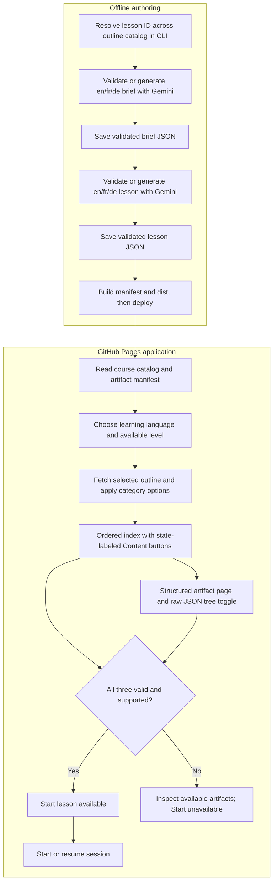

On Start lesson, read and validate the outline, brief, content, hashes, step plan, and renderer support. A missing file, network error, malformed JSON, or stale manifest discovered after clicking produces an actionable readiness error and a return to overview. It never triggers generation. Successful checks open the start/resume page with objective and estimated duration; its Continue action enters the session.

### Generator behavior

The CLI reuses shared preparation functions for single lessons and ordered batches:

1. Resolve immutable metadata from the selected outline entry and course metadata.
2. Choose the category-specific schema and prompt. Brief generation receives the outline; content generation receives the outline and validated brief.
3. Request structured JSON with a JSON Schema derived from the Zod structural contract and supported by the configured Gemini model. Zod refinements remain local validation rules.
4. Parse and validate the response with the full Zod schema, then perform cross-reference and pedagogical checks. Model-constrained JSON alone does not prove correct teaching content.
5. Assemble trusted metadata locally and atomically save the validated object at the canonical path. Reject IDs/classifications that contradict the selected outline.

Gemini supports structured JSON output and a subset of JSON Schema. Keep local validation, including checks that cannot be represented in the generation schema. See [Gemini structured output documentation](https://ai.google.dev/gemini-api/docs/structured-output).

A single structured-output response may not fit a complete multilingual lesson: a 21–31-target vocabulary lesson with en/fr/de explanations for every answer unit can exceed the model's output limit. Content generation may therefore request separately validated sections (for example per stage or per teaching block) and assemble them locally into the one canonical lesson file. Parts fully determined by the validated brief, such as flashcard sides, matching pairs, and noun-gender rows, should be assembled locally rather than regenerated. The saved file remains a single atomic write after the assembled object passes full validation.

Use a bounded policy: at most three model calls per generation unit (a brief, or one content section) including transient retries or schema repair, with capped backoff. Supply field-level validation errors on a repair attempt. Content failure preserves a valid saved brief; the next CLI run resumes the missing stage. Existing valid artifacts are reused without Gemini calls. Invalid/stale files require an explicit CLI regeneration option. Write a temporary file and rename only after validation; failed replacement retains any valid prior artifact. Deduplicate preparation for an ID and serialize batches by default. Diagnostic generation status belongs in CLI output, not the learner UI.

The P1-05 brief implementation uses `make brief ID=<id> REGENERATE=1` for explicit replacement, including a valid file when the author requests it. `make briefs-missing` never forces replacement: it reports stale/invalid/malformed files as failures requiring individual review and continues with other IDs. Retries for HTTP 429, server errors and network/timeouts share the three-call budget with JSON/Zod/semantic repairs; backoff between generation calls is capped at four seconds, while each call first works through the configured models and keys as described under the environment below. Permanent API errors stop immediately. Raw API errors and credentials are never printed. Repair requests include the previous payload and field-level errors.

P1-07 implements content generation with `make generate ID=<id>` (brief first when missing, then content; `REGENERATE=1` replaces the content only) and `make generate-missing`. Vocabulary content is requested in four sections: `introduction` (one text per target group), `words` (matching explanations, optional disambiguated matching labels and noun-gender explanations), `practice` (typed gaps and listening choices) and `exam` (translation prompts, extra accepted answers and dictation explanations). Grammar content is requested per teaching block (explanation plus the planned exercise items) and for the exam. The generator assembles step order, page IDs, flashcards, matching groups, gender rows, accepted exam answers from the brief's exam forms and variants, page durations split from the brief plan, exam time limits, step labels, page instructions and the production placeholder locally. The assembled lesson passes full validation before one atomic save; issues on `steps.N` are attributed to the section that produced that step, and only that section is repaired within its three-call budget. Provenance lists every model used and the input hashes of the outline entry and brief.

In-process calls for the same canonical path share one pending operation. An exclusive `<id>.json.lock/` rejects a concurrent second process rather than paying for duplicate generation. Normal completion/failure removes the lock and temporary file. After a crash, the author may remove the lock only after confirming no generator is running. Temporary files and lock directories are ignored by Git and excluded from manifest/build copying. Recheck the per-entry outline hash before saving so an edit during generation cannot silently save an out-of-date response. Envelopes and provenance are assembled locally; the model supplies a strict category payload and cannot override trusted IDs or metadata. Full local validation retains constraints omitted from Gemini's supported JSON Schema subset.

Record schema version, generation timestamp/model/prompt version, and canonical input hashes. Hash canonical JSON (sorted keys, no insignificant whitespace). The outline hash covers only the lesson's own outline entry plus its course `lang`/`level`, so editing one outline entry does not mark every lesson in that course stale. A brief stores its outline hash; a lesson stores its outline and brief hashes. Changed inputs or incompatible schemas mark dependent content stale. Rebuild and redeploy after generation; the manifest and runtime use the same hash rules.

## 4. Schema design

### Shared envelope

Briefs and lesson files use an envelope with:

| Field | Purpose |
| --- | --- |
| `schemaVersion` | Explicit compatibility version. |
| `id`, `kind`, `lang`, `level` | Must equal the outline/course metadata. |
| `locales` | Required supported locale set en/fr/de; files serve every mother-tongue/interface combination. No single nativeLanguage in an artifact. |
| `topic` or `theme` | Grammar requires topic only; other kinds require theme only. |
| `title`, `objective`, `estimatedMinutes` | Learning-language title, localized en/fr/de objective, shared numeric duration. |
| `provenance` | Generator/model/prompt details and applicable input hashes. |

Use strict objects, bounded nonempty strings and arrays, unique stable nested IDs, and category discriminators. The maintained vocabulary/grammar briefs express the category-specific plan, translated targets and localized support text; content schemas express renderable payloads rather than a competing generic brief.

Separate **brief planning** from **renderable lesson content**. Content generation must use `VocabularyLessonContentSchema` or `GrammarLessonContentSchema`, not a brief schema again. An exercise prompt/answer set belongs in the lesson content; the brief specifies what those exercises must teach and cover.

### Multilingual brief/draft and content contract

P1-03 implemented **both** category-specific brief schemas and lesson-content schemas; the brief is called Draft in the UI. The maintained contracts require multilingual support. Require complete locale maps on every localized field rather than three parallel lesson files. Keep canonical artifact paths `content/briefs/<id>.json` and `content/lessons/<id>.json`, stable item/target/rule IDs, one ordered page plan, one set of learning-language accepted answers, and shared scoring/timing values.

The structural Zod building blocks are illustrated below; the maintained executable definitions and bounds are in `src/schemas/artifactCommon.ts`:

```ts
const LocaleSchema = z.enum(['en', 'fr', 'de']);
const SupportTextSchema = z.string().trim().min(1); // Add shared field-specific bounds.
const LocalizedTextSchema = z.strictObject({
  en: SupportTextSchema,
  fr: SupportTextSchema,
  de: SupportTextSchema,
});
const TranslationVariantsSchema = z.array(SupportTextSchema).min(1);
// Built per course: every locale except the course's learning language.
const nativeTranslationsSchema = (lang: Locale) =>
  z.strictObject(
    Object.fromEntries(
      LocaleSchema.options.filter((l) => l !== lang).map((l) => [l, TranslationVariantsSchema]),
    ),
  );
```

`Locale` is `z.infer<typeof LocaleSchema>`. Non-locale learning languages (none at present) keep all three keys.

Use `LocalizedTextSchema` for generated objectives, introduction copy (restricted Markdown, D46), learner-facing step labels/instructions, rule explanations, teaching notes, pitfalls, and every scored answer unit's `answerExplanation`. Use the course's native-translations schema for vocabulary meanings and worked-example translations; translation-source prompts use corresponding localized native-language text, selected by mother tongue. If an exercise uses longer native prompts, its prompt map has required entries for every mother tongue other than the learning language under the same item ID. Canonical learning-language terms, example sentences, gaps, tokens, answer keys and pronunciation text remain single fields in `lang`; do not translate the assessed answer to the interface or mother tongue.

Vocabulary briefs include translation variants for every available mother tongue (en/de for French courses) for every target and native prompt, plus all three support-language objective/context/explanation plans. Grammar briefs include all three objective/rule-plan/pitfall variants and worked-example translations for every available mother tongue. Content generation receives the outline, full multilingual brief, category schema and explicit locale requirements; it fills the same IDs and shared plan with all three support-language realizations. Validate identical assessed meaning and answer-key applicability across translated prompts during pedagogical review; locale-specific examples must not silently change the expected answer or item difficulty.

Require all three keys with nonempty values throughout nested payloads; do not accept partial localization as a valid lesson, duplicate per-locale target inventories, or a single nativeLanguage artifact. Record the locale contract in provenance/versioning, bump the schema version for this incompatible change, and treat prior English-only artifacts as stale under the existing explicit regeneration policy. Readiness and generation reuse require the complete current locale contract. Zod catches missing/empty/wrong-shape maps; human review checks actual language/translation quality and translated accent explanations. Numeric durations, points, limits and enum/reference keys are not localized.

The initial reviewed sample set remains the first ten fr/A1 vocabulary and first ten fr/A1 grammar lessons, but **each** brief/content file now includes en/fr/de. These are twenty lesson IDs, not sixty separate lessons. Additional outline courses are discoverable from phase 1; their teaching/content support follows the same shared contract without inventing missing function/reading requirements.

### Vocabulary brief

`VocabularyBriefSchema` defines:

- Learning objective, outline coverage notes, explicit target count, count rationale, difficulty-balance notes, duration estimate, and prerequisites if any. The target array must match the planned count; larger inventories require grouping and an appropriate longer duration estimate.
- Target entries: `id`, learning-language base term, required native translations for every available mother tongue, word class, gender where applicable, grammatical number, teaching display form, exam form(s), and pronunciation text (IPA, shown to learners and reviewers; audio speaks the teaching display form, because speech synthesis would read IPA symbols literally).
- Noun article policy: indefinite article where applicable, plural form where needed, and explicit exceptions for phrases, verbs, letters, numerals, proper names, or other unsuitable forms. A required article belongs in the full accepted exam answer, not in a heuristic added by the UI. Use the indefinite article wherever it is grammatical, even when the outline intent quotes definite forms (D39): `le père` and `la cuisine` are taught and examined as `un père` and `une cuisine`, and plural-only nouns use `des`. Only targets with no grammatical indefinite form (countries and other proper names, verbs, numerals, letters, set phrases, or predicative professions such as `je suis étudiant`) use explicit exception forms. The validator enforces agreement: `un`/`une` follow the noun's accepted genders in the singular and `des` the plural, and a singular target never accepts a plural form. There are no per-target accepted variants: the exam forms are the only fully correct answers (plus gender variants such as `espagnole` when a translation prompt does not say which is meant), derived by one shared rule. Genuine alternative spellings belong among the exam forms; accent, capital and ligature differences are graded by the shared classifier (50 %), and definite or bare noun forms are wrong because the exam always asks for the indefinite article. The teaching form is one of the exam forms (adjectives may show their gender pair, `espagnol, espagnole`), and `articleException` is set only when no exam form uses an indefinite article.
- One planned context for each target, and contextual ambiguity notes where a translation has several valid answers.
- Coverage/count/time plans for six stages: introduction, flashcards, matching, gender exercise/reviewed overview where applicable, typed gaps, translation exam. Specify a duration estimate for each planned learner page and a positive countdown limit for every exam page.
- Gender practice plan for nouns: display lemmas without articles/gender clues while answering, accepted gender(s) per noun, and a short explanation of the correct choice. All targets appear on one page; non-nouns have no selector. Lessons without applicable nouns keep an unscored overview.
- Matching group sizes and gap-answer expectations. Typed gaps require four distinct reference choices with exactly one accepted target for the context.

Aim for **approximately 12 new targets per ordinary vocabulary lesson on average**, with **around 8** for lessons with a more demanding overall learning load. A single lesson may have **up to 20** targets; more are acceptable only when that lesson needs them, such as a complete finite inventory (numbers, the alphabet). Mix straightforward and harder targets within each lesson's outline topic where the topic allows it, rather than concentrating difficult items in dedicated difficult-only lessons; do not force a mix or mark targets as harder only to create one. Consider spelling, pronunciation, phrase length, gender/article exceptions, and required written forms when assessing the load. The brief explains its target count and difficulty balance so the content generator can follow that plan.

Straightforward lessons may include somewhat more relevant targets to keep the ordinary-course average near 12. Treat this average as a planning guide and validate it against the generated briefs and sample completion times. Larger-inventory exceptions are excluded from the ordinary average. Repeated retrieval improves retention, with a time-on-task tradeoff, so leave enough time to practice the targets. See [Nakata's within-session retrieval study](https://doi.org/10.1017/S0272263116000280).

Across the 48 vocabulary lesson slots, an average of 12 gives a baseline of **576 taught targets** before exception adjustments. This is a planning estimate, not a guaranteed distinct-word count; repeated targets, multiword expressions, alphabet letters, and numerals must be distinguished when reporting vocabulary coverage.

Count one taught word or phrase as one target: `un livre` is one target, and a multiword expression is one target, not one per token. Repeated appearances of a target in the six stages do not increase the target count.

The schema must also accept the necessary larger count for exceptional outlines: numbers 0–20 require 21 targets; the alphabet and five named signs can require 31. Keep smaller groups within the existing lesson stages and increase `estimatedMinutes` when needed. Do not enforce a universal 15- or 32-target cutoff, narrow the outline, or split existing IDs merely to fit a limit. Validate target-count consistency and pedagogical coverage instead. Examples and translations must support the intended A1 lesson without unrelated prerequisite grammar.

### Grammar brief

`GrammarBriefSchema` defines:

- Topic, objective, prerequisites, scope boundaries, and duration budget.
- **2–4 teaching blocks**, each with stable ID, rule IDs, bite-sized explanation plan, learning-language examples with translations for every available mother tongue, pitfalls/irregularities, and a targeted exercise plan.
- Exercise plan entries with allowed type, item count, and assessed rule IDs. Choose pronoun-form exercises only for topics where they fit.
- Common pitfalls and irregularities for teaching explanations and item-level corrections. A personalized diagnosis/error catalogue is not required for the prototype.
- A fixed feedback-placeholder stage and final exam blueprint covering the taught rules. The exam uses typed sentence gaps, typed pronoun forms, and word order when sentence structure is assessed. Plan learner pages, their duration estimates, and a positive countdown limit for every exam page.

Keep the pedagogy explicit enough that the lesson generator fills a defined plan rather than independently inventing its sequence.

### Renderable lesson content

`LessonContentSchema` is a discriminated union by kind. Each supported kind has ordered steps and typed exercise items. Supported step roles include introduction, explanation, exercise, overview, feedback, and exam; the schema validates the category-specific sequence.

Each step has `id`, role, label, relevant brief/rule/target references, and a typed payload. Each concrete learner page has a unique `pageId` and positive `estimatedDurationS`; every exam page additionally has positive `timeLimitS` copied from its brief plan. Validate that the envelope's `estimatedMinutes` equals the summed page estimates rounded to the nearest minute, rather than trusting two independently generated figures. A page may contain one item or a group of answer units. Validate that the generated page inventory and timer limits match the brief. Each scored exercise has `type`, stable `itemId`s, instructions, prompts, full answer keys (vocabulary exam answers derive from the brief's exam forms), and item-level feedback/rule references. Every scored answer unit also has a required short localized en/fr/de `answerExplanation`, pre-generated with the correct answer and shown whenever a correction is revealed. Variant-specific explanations may be provided when answers differ. Validate that explanations are present and nonempty; they describe the relevant meaning, spelling, gender/article, or grammar rule, rather than merely repeating the answer. For noun gender, explain the lexical gender and appropriate article without inventing a universal spelling-based rule. The grammar feedback step uses the application's fixed production-placeholder text; the model does not generate individualized feedback. Rendering and scoring use the discriminator; the model does not return executable JavaScript, arbitrary components, or arbitrary HTML.

| Exercise discriminator | Payload essentials | Scored units |
| --- | --- | --- |
| `vocabulary_flashcards` | Target IDs; front native / back French display and pronunciation | Completion only |
| `vocabulary_matching` | Unique left/right entry IDs, pair keys, shuffled display order | One per pair |
| `vocabulary_gender_select` | All target IDs, noun lemmas, accepted genders, select options, answer explanations; reviewed overview uses locked row results | One per applicable noun |
| `vocabulary_typed_gap` | Sentence segments, one gap, four noninteractive reference choices, accepted article-free answers | One per gap |
| `vocabulary_translation_exam` | Native prompt and accepted full French answers | One per target |
| `vocabulary_listening_choice` | Target ID (audio speaks its teaching form), four distinct written learning-language options with one answer ID | One per item (practice) |
| `vocabulary_listening_dictation` | Target ID (audio speaks its teaching form), accepted written answers including the spoken teaching form with its required article, accent-sensitive flags | One per item (exam) |
| `grammar_pronoun_form_match` | Pronoun rows, form token IDs, valid assignments | One per row |
| `grammar_pronoun_form_typing` | Pronoun rows and accepted forms | One per row |
| `grammar_gap_choice` | Sentence gap and four distinct choices with answer ID | One per gap |
| `grammar_gap_typing` | Sentence segments, gap answer(s), optional hint | One per gap |
| `grammar_word_order` | Stable token IDs, accepted token sequences | One per sentence |
| `grammar_error_spotter` | Tokenized sentence, faulty token ID, correction mode and answers | One per sentence; detection and correction must both be right |

Introduction, grammar explanations, and plain vocabulary review use unscored payloads. Stage 4 is scored when noun-gender selectors are present, followed by an unscored reviewed display on the same page; count its noun answers once, with no extra score for acknowledging review. The exam is a **container of scored items**, potentially mixing supported types; it is not a seventh universal exercise interaction. Phase 1 must model this before phase 2 begins.

Reference validation rejects missing targets/rules, duplicate nested IDs, unknown exercise types, empty exams, incomplete brief coverage, invalid answer keys, and incorrect category sequences. Duplicate displayed form text is allowed when distinct tokens/forms are needed; score assignments by grammatical validity, not arbitrary token identity.

Native-language labels shown together in one matching group or on the stage-4 overview must be unique within that group for **each** locale; where two targets share a translation in some locale, the content adds a short disambiguating note for that locale. Translation-exam prompts must disambiguate gender/number when a mother tongue does not mark it (for example English “French (woman)” or “student (female)”), or the item must accept every valid form. Error-spotter items contain exactly one faulty token replaced by a correction; omissions or insertions (such as a missing `ne`) are not error-spotter items.

Content stores canonical item and choice order. Matching sides, gap choices, and word-order banks are shuffled at runtime with a seed stored in the session, so resume and results review show the same order without changing answer identity.

P1-03 implements these contracts in `src/schemas/artifactCommon.ts`, `vocabulary.ts`, `grammar.ts` and `artifacts.ts` (structural Zod schemas that convert to JSON Schema), with cross-reference, coverage, timing and wording checks in `src/validation/artifacts.ts` and the shared free-text classifier in `src/domain/answers.ts`. Contract fixtures for noun vocabulary, non-noun vocabulary with listening, conjugation grammar and non-conjugation grammar live in `tests/fixtures/content/`.

Store word-order punctuation and repeated tokens explicitly. Do not split sentences with a simplistic space-only parser. Allow multiple correct sequences/answers when linguistically valid, while ensuring prompts make the intended answer assessable.

### Formatted teaching text (D46)

Vocabulary `vocabulary_introduction.text` and grammar `grammar_explanation.text` are generated as **restricted Markdown**, one string per interface locale. One parser (`src/domain/richText.ts`) serves the validator and the renderer (`RichText`). Any other prose field stays plain text.

**Syntax**

| Element | Write | Renders as |
| --- | --- | --- |
| Paragraph | text; a blank line separates paragraphs (a single line break becomes a space) | `<p>` |
| Bulleted list | every line of the block starts with `- ` | `<ul>` |
| Numbered list | every line of the block starts with `1. `, `2. `, … | `<ol>` |
| Key idea | `**bold**`, plain text inside | `<strong>` |
| Learning-language form | `` `un livre` ``, `` `je suis` ``, `` `Il est médecin.` `` | highlighted span with `lang` set to the course language |

Not allowed: headings, block quotes, tables, code fences, `*`/`+` bullets, `*italics*`, links, images, HTML, literal `\n`, markup inside bold or inside backticks, and a list without a blank line before and after it.

**How to write it (generation guidance)**

- **Introduction (one per target group):**
  1. A short lead paragraph names the topic or pattern, with one `**bold**` key idea.
  2. A list gives the group's targets, one per line, as `` `teaching form` `` followed by "– meaning" and an optional short example sentence.
  3. A closing paragraph adds one useful observation (gender, pronunciation, spelling) or a study tip.

  Do not quiz the learner.
- **Grammar explanation (one per teaching block):**
  1. A rule paragraph states the rule, with one `**bold**` key idea.
  2. A list gives the forms or cases, one per line, each with a backticked example.
  3. A final paragraph or list names the typical pitfall.

  The separate form table and examples are rendered after the text, so the text should not repeat them in full.
- **Backticks** go around every learning-language word, form or sentence quoted in the text, in every locale, including the French locale. Do not use them for interface-language words, IPA or endings such as -er.
- **Parity:** en, fr and de have the same paragraphs and lists in the same order, and exactly the same backticked forms. Only the surrounding prose is translated.
- **Length and tone:** keep paragraphs to one to three sentences and lists to at most about eight items. The text stays within the long-text limit of 1,200 characters per locale. The tone addresses the learner directly.
- **Answer policy:** the text must not contradict the answer policy. It shows nouns with the indefinite article that the exam asks for, and it does not promise alternative spellings that are not exam forms.

Example (en and de of one introduction; fr has the same structure and forms):

```text
These six classroom objects are **masculine**: they take `un`.

- `un livre` – book
- `un cahier` – exercise book

Learn each word together with its article – the article tells you the gender.
```

```text
Diese sechs Gegenstände sind **maskulin**: Sie haben `un`.

- `un livre` – Buch
- `un cahier` – Heft

Lerne jedes Wort mit seinem Artikel – der Artikel zeigt das Genus.
```

**Validation and rendering**

- Content validation reports every syntax error with its locale and block.
- It requires the same block structure (for example `p|ul:6|p`) and the same multiset of backticked forms in every locale.
- Plain text without markup is still valid, as one paragraph.
- The renderer produces only `p`, `ul`, `ol`, `li`, `strong` and `span` elements and never interprets HTML.
- The content prompt (`content-v2`) carries these rules, so regenerated lessons follow them. The twenty samples were reformatted by hand.

## 5. Session, scoring, progress, and exam timing

### Shared session contract

Use React composition: a shared `ExerciseShell`, a typed renderer registry, reusable matching/typing/token-order controls, pure scorers, and a session reducer. Avoid making every interaction inherit from a large component class.

`LessonSessionSchema` stores:

- Session ID, lesson ID, content/schema hash, timestamps, and status (`active`, `completed`, `abandoned`).
- Current step/page/item and phase (`answering`, `practice_feedback`, `exam`, `results`), plus completed pages and their estimated durations.
- Draft and locked responses, correctness class, accent/case differences, earned/possible points, confirmation state, and item/rule references (plan units carry the assessed grammar `ruleIds`).
- Presentation progress that must survive resume, such as revealed flashcards, keyed by page and item (`revealed`), and listening pages skipped without a voice (`skipped_no_voice`).
- Exam page start times, absolute deadlines, time limits, timeout flags, and answers; no public item correctness during the exam.
- Final-results selection (exam by default or an earlier exercise), linked to immutable response records; reviewing results never runs the exercise again.
- Scoring policy version, 35% practice / 65% exam weights, and 50% orthography-only credit.
- Final results computed from responses and policy, never supplied by the model.

Separately, application state holds the in-memory last-completed-score map for the index. This map is never serialized with session records and resets on full reload.

Store learning language/level, attempt mother tongue, interface language at submission, and the original displayed native prompt with response records. Save after meaningful transitions. Session/result headers show the saved attempt mother tongue, even if the starting-page preference now differs; artifact headers show the current starting-page preference. Resume only when the content hash is compatible; changed content starts a new attempt with an explanation. Restart creates a fresh session. Locks, confirmations, timeout events, and repeated clicks are idempotent. Storage failure keeps the in-memory session and shows a persistence notice.

### One Continue action

Practice pages have one primary footer button labeled **Continue**. There is no Check or Submit button. Answer controls (choices, input fields, draggable tokens), audio, and card-flipping remain available as required by their interaction type.

1. While answering, Continue locks the current page's response(s), records first-submission points, and shows immediate visual feedback **on that page**, without navigating away.
2. Fully correct answers receive a clear success state. Orthography-only errors receive a distinct partial-correct state and the correctly accented/capitalized answer. Incorrect answers receive an error state and the correct answer. Both correction states also show the short pre-generated explanation of why that answer is right, including row-level corrections in grouped tasks. Include text/icons so color is not the only signal.
3. Inputs become read-only. Continue remains the only primary action; pressing it again acknowledges the feedback and advances. It does not rescore or require retyping the correction.

Unscored presentation/review pages use Continue once to advance when their review requirements are met. Empty required answers disable Continue in practice. An exam page may submit a blank answer, recorded as unanswered for zero credit.

Exam Continue locks the current answers and immediately advances, showing no correctness, corrections, earned points for that page, or answer-revealing style. After the final exam page is submitted or times out, open the **final results page** with the exam selected by default, all score aggregates, and a button menu for earlier exercise results. Record the final weighted score in the current app instance’s last-try map once.


### Duration-weighted progress and live score header

All active lesson pages use a consistent header: lesson title, a progress bar with percentage, and **current score / total possible lesson score**. Exam pages add their countdown in the task area. Keep the header visually separate from the centered task card.

Progress follows the **estimated length of completed learner pages**, not their count, answer correctness, or elapsed wall time:

```text
progress = 100 × sum(estimatedDurationS of completed learner pages)
                 / sum(estimatedDurationS of all learner pages)
```

Flatten the plan to actual presentation pages, matching groups, typed pages, and exam pages. Credit each page once on completion/advance; do not count both a parent step and its children. Include unscored teaching/review and the grammar production placeholder. The final results page and its selected exercise reviews are post-lesson review, excluded from the progress denominator and displaying 100%. A practice page awaiting feedback confirmation is not yet complete. The generated start-page duration estimate should agree with the summed page estimates.

Use **100 weighted lesson points** as the common header denominator:

```text
visible practice contribution = 35 × earned practice units / all possible practice units
final exam contribution       = 65 × earned exam units / all possible exam units
```

During practice, show earned practice contribution out of 100. Pending units have earned no points; the denominator includes the full lesson's possible points from the start. This is accumulated credit, not accuracy on attempted answers. After the exam, add its contribution and show the final score out of 100.

To preserve delayed exam feedback, keep the header's earned score at the practice contribution throughout the exam, with no “pending” label or other exam-score indicator (D16). Do not update the header after individual exam answers: changes would reveal correctness. Progress and countdown may update normally. Publish the complete exam contribution on the final results page, which also shows exercise scores and raw points in its menu/review.

### Per-page exam countdown

**Practice has no countdown. Every exam page has one**, with its `timeLimitS` specified by the lesson brief for that task and copied into the lesson content. There is no universal hardcoded duration.

Start the countdown when the exam page becomes active. Display remaining minutes/seconds. Continue submits before expiry; expiry automatically locks the page's current draft answers and advances through the same transition. Valid drafted answers are graded normally; unanswered units earn zero. Mark timed-out pages in the feedback review.

Use an absolute deadline and recompute remaining time from it, so tab throttling, a page reload, or resume cannot reset or extend the allotted time. Persist the deadline. An expired current page is finalized on resume. Resolve a simultaneous Continue/timeout once; input after the deadline cannot alter the locked result. Tests use a fake clock. A new exam page gets its own brief-defined limit on activation. Exam answer feedback, audio of the target answer, hints, gender badges, and backward answer editing stay unavailable until the complete exam finishes. The only exception is a listening-dictation page, whose prompt **is** the target audio; it may be replayed until the page locks.

Known prototype limitation (D43): during an active exam the learner can return to the overview and open the lesson's artifact page, whose Content previews show answer keys. Generated content is public static JSON on Pages, so the prototype does not lock the artifact page.

### Free-text correctness and points

Orthography feedback must **name the mark**, rather than saying only “is written with é” or another accented character. Apply this wording to result pages and their pre-generated explanations, as well as the same corrections shown during practice and artifact inspection. For French, use the appropriate name:

| Mark | Example feedback wording |
| --- | --- |
| é | “Use an accent aigu on e.” |
| è | “Use an accent grave on e.” |
| ê | “Use an accent circonflexe on e.” |
| ç | “Use a cédille on c.” |
| ë | “Use a tréma on e.” |
| œ / æ | “Write the ligature œ (o and e joined).” / “Write the ligature æ.” |

For German umlauts, use “The word is written with umlaut ä” (or ö/ü as applicable), also when the learner typed the digraph `ae`/`oe`/`ue`. This is a wording convention for future German content, not an expansion of the French A1 prototype. Keep the full correct answer visible separately. Generated explanations must use the mark appropriate to the actual target spelling; generation prompts and content review enforce this wording. Credit remains unchanged.

All free-text responses have three assessable outcomes, plus unanswered:

| Result | Comparison | Credit per answer unit |
| --- | --- | --- |
| `fully_correct` | Matches an accepted answer including accents and upper/lowercase | 1 point |
| `orthography_only` | Same letters/word sequence; differences are only accents and/or upper/lowercase | 0.5 points |
| `incorrect` | Wrong letters, words, word order, article, or other unaccepted content | 0 points |
| `unanswered` | No answer supplied | 0 points |

First normalize Unicode NFC, trim/collapse whitespace (including no-break and narrow no-break spaces used before French `? ! : ;`), and normalize typographic apostrophes **without removing case or accents**. Compare against full accepted answers. If none matches, compare copies with case folded and combining accent marks removed to detect `orthography_only`. A second orthography comparison also expands `œ`→`oe`, `æ`→`ae`, `ä`→`ae`, `ö`→`oe`, `ü`→`ue` on both sides before removing marks, so `soeur` for `sœur` and `Maedchen` or `Madchen` for `Mädchen` earn 0.5 (D40). **Exception:** an accepted answer may mark accent-distinguished words as accent-sensitive (for example `à`, `où`, `là`, `dû`, `sûr`); a response that differs from it only by those accents is `incorrect`, because the accent changes the word, not just its spelling. Preserve the original submitted text and the expected answer for feedback. Do not use the draft's `foldText`: it also changes distinct letters/ligatures. Required articles stay part of the comparison.

Examples: expected `un café`, answer `un café` earns 1; `un cafe` or `Un café` earns 0.5; `une café` earns 0; expected `la sœur`, answer `la soeur` earns 0.5; expected `Il va à Paris.` with `à` accent-sensitive, answer `Il va a Paris.` earns 0. Explicit valid variants can earn full credit if the content declares them accepted. Both practice and exams use the same classification; exam classifications remain hidden until final results.

Non-text tasks earn 1 or 0 per atomic unit. Multi-row tasks earn credit per row; word-order/error-spotter sentences are whole units. Where a text correction is involved, an otherwise correct error-spotter answer may receive the text's 0.5 orthography credit. The detection must also be right. Continue locks first-submission points; acknowledging feedback cannot improve them.

### Weighted totals and final results menu

```text
exercise score = 100 × earned exercise points / possible exercise points
practice score = 100 × all earned practice points / all possible practice points
exam score     = 100 × earned exam points / possible exam points
total score    = 0.35 × practice score + 0.65 × exam score
```

Store raw points, including halves, and round only displayed percentages and weighted scores to one decimal place, half up, from the unrounded value (78.25 displays as 78.3). Exclude unscored screens from score denominators. Mixed exam sections contribute within the 65% exam share according to their possible points, counted once. For example, 80% practice and 60% exam produce 67% total.

The final results page shows the weighted total, practice/exam aggregates and weights, and scores for each scored exercise. **Exam results are selected by default**: show every task, the original locked learner answer, a correct accepted answer, correctness/points, timeout markers, and the pre-generated explanation where an answer needs correction. Include sub-answers on grouped pages. This is answer review, separate from the pre-exam production-feedback placeholder.

Use the supplied results screenshot as the layout reference: a dark page with flat answer rows, a correctness icon aligned to each prompt, muted “Your answer” / “Correct answer” labels, and thin slate dividers. Incorrect answers use red; accepted correct answers use green. Accent/case-only answers use an amber icon/text, explicitly show 0.5 credit, and show the fully correct spelling in green. Always include text classification and points so color is supplementary. A fully correct answer identical to the accepted answer can appear once in green; do not repeat an identical correction line. When an accepted variant differs from the displayed teaching answer, show both. Show short pre-generated explanations for corrections, plus timeout/unanswered markers when applicable. Keep the weighted score summary and exercise-result menu above the answer list; use the same row component for exam and previous practice results. This layout does not change grading or release exam feedback early.

A button menu selects **Final exam** or any earlier exercise result by step/block label. For vocabulary with nouns this includes Matching, Gender, and Typed gaps. Repeated grammar exercise types have unique block labels. Completion-only exercises such as flashcards can show their completion record instead of an invented correctness score. Keep aggregate scores visible while the selected result changes. Non-noun lessons have no Gender menu entry. Each review uses stored locked responses and explanations, with the original accent/case visible; changing menu selection does not rescore, alter progress, restart timers, or edit answers. There is no separate mandatory exam-feedback-to-summary transition. Lesson overview and Restart lesson are the final page's navigation actions.

No pass/fail gate is required. A pass label and threshold remain optional future decisions.

### Phase 1 implementation (P1-09)

`src/domain/session/` holds the pure session engine: `plan.ts` flattens content and brief into concrete pages (presentation, practice, exam) with scorable answer units (text, choice, token order, error spot); `session.ts` contains the record, scoring, the reducer for draft/Continue/expiry/results selection, duration-weighted progress, the header score and final results; `storage.ts` saves one attempt per lesson in browser storage. `src/session/` provides the start/resume page, the session host with header and countdown, the results page, and a renderer registry keyed by item type.

The registry starts with **baseline renderers** for every vocabulary and grammar item type, so both categories are playable from phase 1: text fields for typed units, radio choices for gaps and listening, selects for matching, gender and pronoun/form assignment, token buttons for word order and error spotting, tables for introduction/overview, and disclosure cards for flashcards. Phases 2/3 replace individual registry entries with the full interactions (drag and drop, card flipping, audio-first listening and the no-voice help page) without changing the session host or scoring. Speech uses the browser's speech synthesis with the course language.

## 6. Vocabulary learning flow

Keep six stages, integrating noun-gender practice into the overview stage and listening into the practice and exam stages (D41):

1. **Introduction:** the formatted group text (D46) only, without a word table. In the learner session each group's introduction page is followed directly by that group's flashcards (introduction 1, flashcards 1, introduction 2, …); artifact previews keep the step order.
2. **Flashcards:** all cards of a group on one page, in two columns on wide screens and one below the other on phones. The front shows only the native-language meaning; a flip button in the top-right corner turns the card to the French side only (teaching form with a large speaker button that reads it aloud, applicable gender, and the context sentence with a small speaker button that reads the whole sentence) and back, without changing the card's size. The first flip of each card is stored in the session (`revealed`), so progress survives a resume, and Continue is enabled once every card of the page was turned.
3. **Matching:** connect native/French targets in manageable groups. The two columns are shuffled independently from the session seed; the learner selects an item on either side and then its partner on the other (pointer, touch or keyboard: every item is a button). Each French form has a small speaker button inside its box. On wide screens (from 720 px) the columns stand apart and a Bézier curve starts at the inner middle of the selected box and follows the pointer; over a box of the other column it stops at that box's inner border, and a click docks it onto the partner; every pair stays joined by its curve. On phones pairs are numbered instead. Paired boxes have a purple border; pairs stay editable until Continue, and choosing a taken partner moves it. Applicable French forms show gender. Continue (enabled once every pair is assigned) locks one unit per French form. Continue stays greyed out (no extra hint) until every pair is assigned. The following view starts with a summary ("4 of 6 pairs correct") and lists only the mistakes, without point counts: the correct meaning in green with an arrow to the French word (speaker, gender) on the first line, the learner's choice struck through in red directly below the correct meaning, then the generated explanation. When every pair is correct, Continue briefly turns the content area green and skips that view.
4. **Gender exercise and reviewed overview:** show **all vocabulary on one page**. Nouns have a select box with an initially unanswered state and appropriate gender options; other word classes have no gender input. While answering, show noun lemmas without articles, gender tags, or audio that supplies an article. This temporarily overrides the earlier stages' gender-display rule so the answer is not exposed. Preserve explicit gender/context policies for nouns that accept more than one gender. Continue locks all noun choices and scores one unit per noun. The same page then becomes the overview, showing the learner's selected gender, correct gender and teaching form, right/wrong indicators, translations, audio, and pre-generated explanations for mistakes. Continue acknowledges the overview and proceeds to gaps. Retain the locked row results for final-results review. Lessons without applicable nouns use a plain, unscored overview and skip the gender exercise.
5. **Typed context gaps and listening choice:** typed gaps show four visible, noninteractive reference choices; type the missing word without article. Show applicable gender alongside reference forms. Listening-choice pages play a target with browser speech and the learner selects it from four written learning-language options (choices are interactive here). Continue shows correctness, correction, and the generated explanation, then confirms/advances.
6. **Timed translation and listening exam:** translation pages show a native prompt and require the French answer including the indefinite article where applicable; no gender/audio/answer hints. Listening-dictation pages play a target (replayable until lock) and the learner writes it in the teaching form, article included where applicable, scored by the shared free-text classifier. Each page uses its brief-defined countdown. Answer feedback is deferred until the full exam is complete.

**Lesson start page (P2-02):** course label, the lesson category as a badge in the card's top-right corner (Vocabulary, Grammar), title, objective and estimated minutes. Vocabulary lessons add the total number of words and the brief's word groups as numbered, colour-coded rows with each group's word count on the right. The start page does **not** list the lesson steps, the number of scored steps or the scoring weights and exam time limits; the weights appear on the results page.

After the exam, the final results page defaults to exam answers and offers a button menu for prior exercise results. Introduction/flashcards/plain review remain completion-only. Matching, applicable noun-gender answers, typed gaps, listening choice, and the exam are scored. All scored practice types share the existing 35% practice contribution by possible units; the exam remains 65%. The gender overview answers and confirmation are one learner page for progress, using an estimate that includes both answering and review.

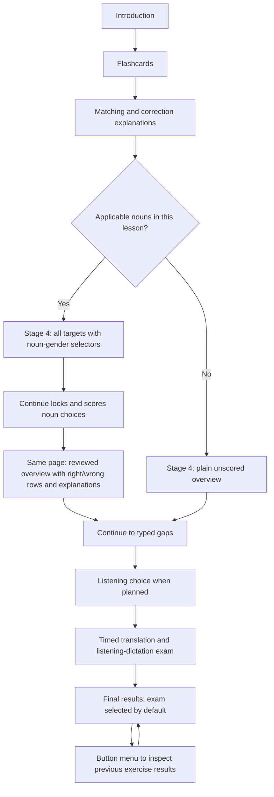

Audio is learner-triggered, except that a listening page offers an initial play control. Use the French speech language explicitly and a voice whose language matches it. An unavailable voice does not hide text or block progression: each Listen control is replaced by an **Install language** button that opens a modal dialog stating that no French voice (language pack) is installed, followed by the personalised installation steps below.

The vocabulary brief plans listening items (which targets, how many practice and exam pages, and their durations/limits). Listening coverage is required where the outline intent names oral recognition or pronunciation (for example `fr-numbers-zero-to-twenty`, `fr-alphabet-and-accents`, `fr-classroom-instructions`); other lessons may include a smaller planned subset. Audio speaks the target's teaching display form, so audio and accepted answer stay aligned; content validation requires every dictation's accepted answers to include that form, and listening-choice practice pages to contain only listening-choice items, so the voice check and help page apply per page. Artifact previews show the target's pronunciation text (IPA) with the item.

**No suitable voice (D42):** when the browser offers no voice for the learning language, each listening page is replaced by a localized help page; other Listen controls become **Install language** buttons opening the same help in a modal dialog. The help explains that the prototype uses the browser's built-in speech synthesis and shows only the steps for the detected operating system and browser (from the user agent), ending with a browser restart:

- **Windows** (all browsers): Settings → Time & language → Language & region → Add a language → French (France) → tick Text-to-speech → Install; if French is already listed, … → Language options → Download next to Text-to-speech. Firefox reads these OneCore voices from version 106; Chrome and Edge additionally offer online French voices.
- **macOS** (all browsers use system voices): System Settings → Accessibility → Spoken Content → System voice → Manage Voices… → French → download a voice such as Thomas; the system voice stays unchanged.
- **Linux** (Firefox and Chromium speak through Speech Dispatcher): install `speech-dispatcher` with `espeak-ng` (per-distribution `apt`/`dnf`/`pacman` commands), test with `spd-say -l fr bonjour`; Snap/Flatpak browsers reach Speech Dispatcher only from version 0.11.4, otherwise install the browser from distribution packages.
- **Android, iOS, other**: short system-settings steps or a generic instruction.

A **Skip** button continues to the next exercise or exam page. The help page has no countdown; an exam page's countdown starts only when its listening item can be played. Skipped listening units are recorded in the session as `skipped_no_voice` only to support resume. They are left out of the attempt's scores, practice/exam denominators, progress and final results review. During gender answering, any audio must preserve the hidden article/gender clues; the complete audio controls return in reviewed overview.

## 7. Grammar learning flow

Run 2–4 explanation/practice blocks, a production-feedback placeholder, and a final exam. At least one block may focus on common errors or irregular forms where useful. The placeholder replaces the original personalized feedback requirement for this prototype, as agreed with the user; normal answer checking and practice corrections remain.

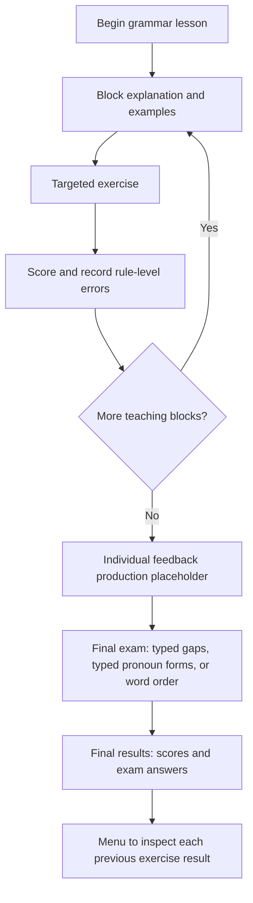

### Exercise behavior

| Type | Required interaction |
| --- | --- |
| Pronoun/form drag-and-drop | Assign form tokens to generated pronoun rows; mouse/touch plus keyboard or click alternatives. Do not force all six person rows on topics that do not need them. |
| Pronoun/form typing | Type an accepted form in each pronoun row; handle multiple linguistically valid forms through answer keys. |
| Multiple-choice gaps | Exactly four choices per gap; one accepted choice; shuffle without changing answer identity. |
| Exact-typing phrase gaps | Type the missing text; optional brief-specified hint in practice, subject to exam policy. |
| Word order | Move tokens into a sentence; support moving back/reordering, repeated words, punctuation, and valid alternative sequences. |
| Error spotter | Select the faulty token, then type or select its correction as specified by the item. Give targeted practice feedback. |

### Personalized feedback and exam

After the final teaching block and before the exam, display the fixed message for the selected interface language:

| Interface language | Fixed placeholder |
| --- | --- |
| en | Individual feedback would be here on production. |
| fr | Un retour personnalisé serait affiché ici en production. |
| de | Hier würde in der Produktivversion individuelles Feedback angezeigt. |

This screen is unscored and has a Continue to final exam action. It appears for every grammar session regardless of the learner's answers. The prototype performs no individual feedback analysis and makes no runtime Gemini request. Keep ordinary exercise results and answer-checking feedback; production feedback is future scope.

Every exam page uses its brief-defined countdown and defers answer feedback until the final results page. The final exam covers the taught rule IDs with fresh examples, selected during lesson generation. It may mix `grammar_gap_typing`, `grammar_pronoun_form_typing`, and `grammar_word_order`. Use word order for syntax/structure. Do not force conjugation exercises onto article, adverb, or question lessons. The practice bank has six types; the exam uses the subset appropriate to the objective.

When phase 3 is complete, all **48 grammar** entries must be generatable and playable. The first-ten sample approval alone is insufficient for that phase's exit.

## 8. UI design and PlantUML Salt mockups

### Visual direction and layout

The design references are the **user-supplied screenshots of the existing ft_transcendence application**, supplied on 2026-10-06. Use the five original screenshots embedded below, including the corrected Deutsch start screen. The previous website link is superseded. Repeated copies of the landing screen count as one reference.

#### Screenshot reference register

| Reference | Supplied screenshot | Apply to prototype |
| --- | --- | --- |
| R1 | [Landing page](design-references/01-landing.png): “Lerne eine Sprache mit einem Tutor, der sich dir anpasst!” | Dark page/header, strong heading hierarchy, spacious layout, indigo emphasis. |
| R2 | [Setup](design-references/02-setup.png): “Was möchtest du lernen?”, language and daily-goal button rows | Evenly spaced outlined controls, clear labels, narrow centered column, muted disabled action. Apply to category filters and lesson starts. |
| R3 | [Language start](design-references/03-language-start.png): “Deutsch”, “Tagesziel: 10 Min.”, placement-test action | Lesson title/metadata grouping, wide light primary action, restrained underlined secondary navigation. |
| R4 | [Exam](design-references/04-exam.png): “Ich muss noch einen Termin beim Zahnarzt ___.”, four choices, 42-second timer | Thin progress bar, circular countdown at the right, large prompt and full-width stacked slate answer cards. |
| R5 | [Results](design-references/05-results.png): “Dein Ergebnis”, A1 summary card, “Dein letztes Prüfungsergebnis – A1” | Large rounded summary surface, right-aligned header action, outlined result-menu buttons, flat feedback rows and thin dividers. |

**Original-image storage:** the supplied originals are preserved byte-for-byte under `docs/design-references/`, separate from the source-only `docs/mockups/` folder. The images below are embedded references, not generated mockup exports. All five distinct references are available locally and embedded below. Root source files are left in place.

<details>
<summary>R1 — Landing page: header, typography and indigo emphasis</summary>

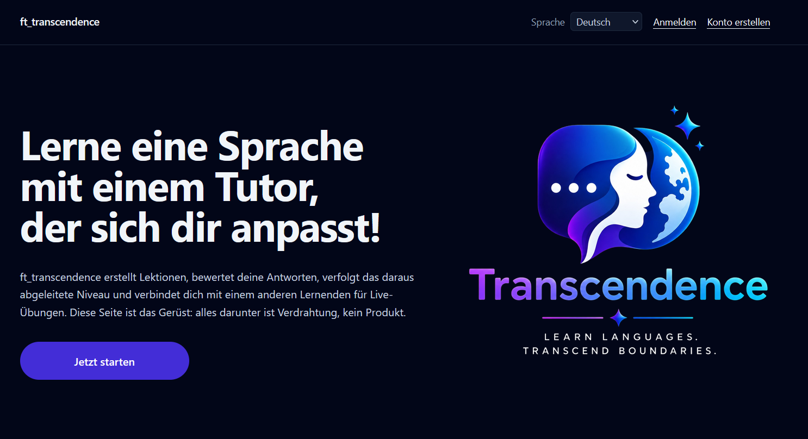

</details>

<details>
<summary>R2 — Setup: outlined button rows, spacing and disabled action</summary>

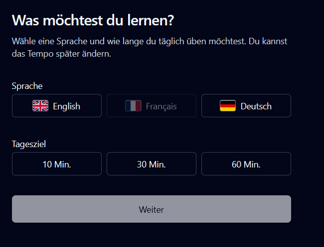

</details>

<details>
<summary>R3 — Language start: title, metadata and wide primary action</summary>

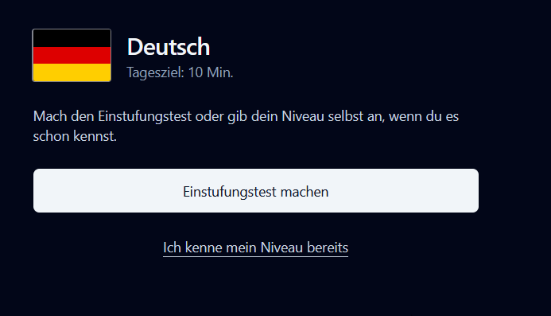

</details>

<details>
<summary>R4 — Exam: progress, countdown and full-width answer cards</summary>

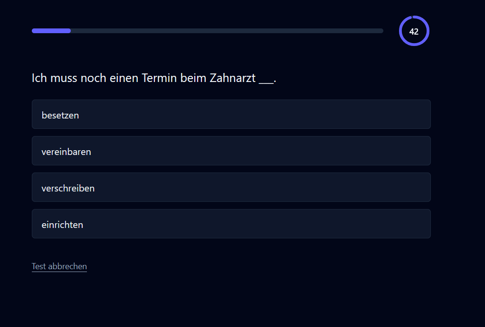

</details>

<details>
<summary>R5 — Results: summary card and flat answer review</summary>

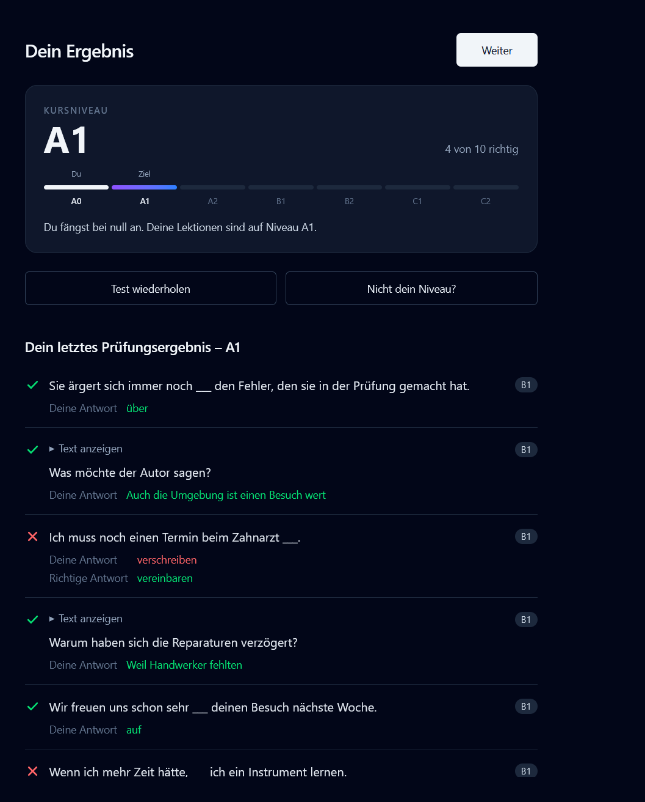

</details>

#### Shared visual contract

Use these tokens throughout the index, artifact viewer, lesson starts, explanations, vocabulary/grammar practice, feedback placeholder, exams, and results:

| Role | Value | Usage |
| --- | --- | --- |
| Page background | `#020617` | Full viewport and shared header. |
| Surface | `#0f172a` | Answer cards, artifact cards, input/select controls, score summary. |
| Border / progress track | `#1e293b` | Thin dividers, card outlines, unfilled progress. |
| Strong control border | `#334155` | Outlined buttons and form fields. |
| Main text | `#e2e8f0` | Titles, prompts, body text. |
| Muted / subtle labels | `#94a3b8` / `#64748b` | Supporting metadata / compact uppercase labels. |
| Light primary action | `#f1f5f9` with `#020617` text | Start lesson and Continue, following R3/R5. |
| Indigo emphasis | `#4338ca` | Selected filter state and occasional emphasized actions, following R1. |
| Progress / countdown | `#635bff` | Filled progress segment and timer ring, following R4. |
| Focus | `#818cf8` | Visible keyboard focus outline. |
| Disabled action | `#92959e` with `#020617` text | Only unavailable controls that are displayed; unavailable index Start remains absent. |
| Correct / incorrect / half credit | `#00e676` / `#ff5252` / `#fbbf24` | Answer status, together with text and icons. |

Use system sans-serif type: headings around 30px/600, task prompts 24–26px, body 18px, secondary metadata 16px. Use a full-width header with a thin bottom border, brand/title left and page-specific navigation right. Center the content with a maximum width of 72rem for the index/artifact viewer, about 840px for exercises/results, and about 560px for lesson starts. Give pages 24–40px outer padding, cards 24–32px internal padding, and sections 32–48px separation. On narrow screens use 16–24px padding and stack actions without horizontal overflow.

Primary actions are 52–56px high with 8px corner radii; outline controls use transparent dark backgrounds and slate borders. Lesson starts use a wide Continue action below the plan. Multiple-choice answers are full-width slate cards, about 60–64px high, with 20px horizontal padding, 8px corner radii, and 12–16px gaps. Clicking a card selects it; **Continue** locks the answer under the agreed practice/exam rules. Show selected state with an indigo outline and text/icon cue. Inputs and selects use the same dark surfaces and visible labels.

Lesson headers show duration-weighted progress as a slim rounded track with an explicit percentage, alongside current weighted score out of 100. Exam headers additionally show the remaining seconds centered inside a roughly 64px circular ring at the right; the ring reflects remaining time relative to that page's brief-defined limit. Countdown numbers in the reference screenshots are examples, never default limits. Practice has no timer. Preserve the pending-exam score rule and do not show answer correctness during the exam.

Results have a header title and a right-aligned Lesson overview action, followed by a rounded slate summary card (about 20px radius). Make the total score prominent (around 44–56px), with practice points/percentage, exam points/percentage, and 35%/65% contributions beneath. Put the previous-exercise button menu below the summary; the final exam is selected by default. Keep answer rows flat on the page background with large prompts, aligned correctness icons, muted answer labels, red/green/amber values, short generated correction explanations, and slate separators. The summary and original attempt stay unchanged when switching result views.

Artifact views reuse the same header, readable spacing, and rounded surfaces for the shared Outline and category-specific Draft/Content cards, inventories, teaching blocks, and read-only previews. Index rows retain generous vertical padding, subtle separators, and the agreed highest-artifact and last-try score columns.

These references define **visual style only**. Keep the requested independent mother-tongue/interface controls and the initial French A1 course; generated support text and application UI have en/fr/de variants. Accounts, placement-language onboarding, daily goals, placement tests, inferred CEFR-level scales, marketing illustrations, and the reference application's cancel-test action are not added to the lesson workflow. The results summary shows lesson scores rather than an inferred course level.

Use semantic buttons/links, visible focus, labels, and live announcements for submitted answers and countdown expiry. Provide keyboard/touch alternatives for drag-and-drop. Feedback uses icons/text alongside color. Countdown digits do not animate. The learner interface contains no generation status or generation animation.

The **PlantUML Salt** wireframes below carry the reference layouts, wider controls, spacious sections, light primary labels, slate grouping, indigo progress, and shared feedback colors. Salt is a layout wireframe format: its native widget borders/fills and the ring-plus-number timer symbol do not reproduce CSS corner radii or a centered circular timer exactly. The visual contract above governs those details in the React prototype. Use the [official Salt documentation](https://plantuml.com/salt) for source syntax.

### Source-only mockups and Markdown synchronization

Keep only the editable `.puml` sources and the root README in `docs/mockups/`; do not store PNG/SVG exports there. **Every mockup is embedded below in a `plantuml` code fence containing the exact contents of its `.puml` file. Whenever a `.puml` changes, update its corresponding Markdown code in the same change.** This applies to SPEC and any other Markdown copies, including published issue bodies. Each SPEC block is bounded by `mockup:begin` / `mockup:end` comments identifying its source path. The source files are the canonical editable inputs; their Markdown copies must stay identical, never edited independently.

Use PlantUML-enabled Markdown preview for automatic rendering. The [root mockup README](mockups/README.md) documents the **PlantUML by jebbs** extension, user settings for the server renderer, and auto-updating preview. Browse all 32 source files and embedded previews through that guide. After the Makefile is introduced in P1-01, run `make mockups-sync` to refresh embedded source and `make mockups-check` to reject missing, stale, or orphaned blocks. Include this consistency check in `make test-all` and CI. Exported previews, when needed for inspection, are temporary outputs outside `docs/mockups/`.

GitHub's native Markdown diagram support does not include PlantUML. Published issues therefore include the applicable `plantuml` source fences and server-rendered image URLs derived from that source, plus committed source links; verify their rendering. No local PNG/SVG copies are required. See [GitHub diagram support](https://docs.github.com/en/get-started/writing-on-github/working-with-advanced-formatting/creating-diagrams) and the [extension documentation](https://github.com/qjebbs/vscode-plantuml).

### Index

Language and level are single-select groups discovered from the outline catalog; categories are the trailing multiselect group. The header has mother-tongue en/fr/de options and an independent interface-language combobox. This snapshot reflects the current catalog (fr/A1 only), not a fixed set of learning-language options. One Content button shows only the highest available artifact: Outline, Draft, or Content. The last-try score is blank until a lesson completes in the current loaded app; it clears on full reload. Actions has only Start lesson, and only for complete, valid, implemented lessons. Empty cells mean Start is unavailable; no generation controls are shown.

<a id="mockup-01-lesson-overview-index-lesson-index"></a>

[Salt source](mockups/01-lesson-overview/index/lesson-index.puml)

<!-- mockup:begin mockups/01-lesson-overview/index/lesson-index.puml -->
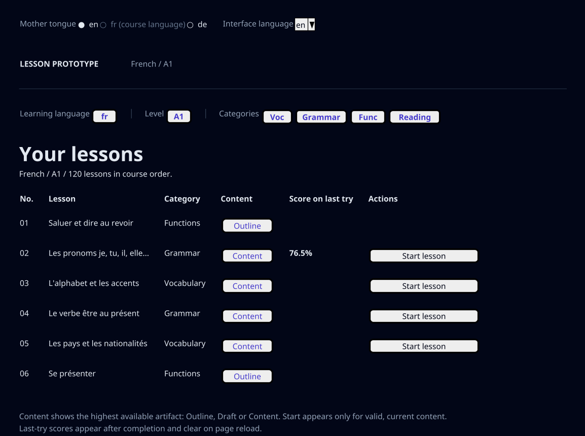
<!-- mockup:end mockups/01-lesson-overview/index/lesson-index.puml -->


### Combined artifact view: vocabulary

The ready-state header has Lesson overview, Raw JSON / Structured view and eligible Start lesson under the page title, with the shared language controls. A shared Outline card preserves the course entry; category-specific Draft and Content components show target inventory, stage plans, vocabulary cards, exercise previews, answers, and explanations. The header toggle opens the raw JSON tree; structured cards are the default. The mockup shows representative items; the application exposes the complete inventory and every stage. Outline-only and draft-only views omit Start and show short messages for missing sections.

<a id="mockup-02-artifact-view-vocabulary-lesson-detail"></a>

[Salt source](mockups/02-artifact-view/vocabulary/lesson-detail.puml)

<!-- mockup:begin mockups/02-artifact-view/vocabulary/lesson-detail.puml -->
```plantuml
@startsalt
skinparam backgroundColor #020617
skinparam defaultFontName SansSerif
skinparam defaultFontSize 15
skinparam defaultFontColor #E2E8F0
scale 1.3
{
.
{ <color:#020617>xxx</color> | {
{ <color:#020617>xxxxxxxxxxxxxxxxxxxxxxxxxxxxxxxxxxxx</color> | <color:#94A3B8>Mother tongue</color> | { <color:#E2E8F0>●  en</color> | <color:#64748B>○  fr (course language)</color> | <color:#E2E8F0>○  de</color> } | <color:#020617>xxx</color> | <color:#94A3B8>Interface language</color> | ^<color:#020617>en</color>^ }
.
<color:#E2E8F0><b>LESSON PROTOTYPE</b></color>
{ [ <color:#4338CA>Lesson overview</color> ] | <color:#020617>xxx</color> | [ <color:#4338CA>Raw JSON</color> ] | <color:#020617>xxx</color> | [ <color:#020617>   Start lesson   </color> ] | <color:#020617>xxxxxxxxxxxxxxxxxxxx</color> | [ <color:#4338CA>Outline</color> ] | <color:#020617>xxx</color> | [ <color:#4338CA>Draft</color> ] | <color:#020617>xxx</color> | [ <color:#4338CA>Content</color> ] }
.
<color:#1E293B>──────────────────────────────────────────────────────────────────────────────</color>
.
<color:#E2E8F0><size:30><b>Les objets de la classe</b></size></color>
.
{
.
{ <color:#020617>xxx</color> | {
<back:#020617><color:#94A3B8><b> OUTLINE </b></color></back>  <color:#E2E8F0><size:20><b>Lesson outline</b></size></color>
.
{
<color:#94A3B8>Lesson 11</color> | <color:#020617>xxx</color> | <color:#E2E8F0>( Vocabulary )</color> | <color:#020617>xxx</color> | <color:#E2E8F0>French / A1</color> | <color:#020617>xxx</color> | <color:#94A3B8>Theme</color>
. | <color:#020617>xxx</color> | . | <color:#020617>xxx</color> | . | <color:#020617>xxx</color> | <color:#E2E8F0>Education</color>
 }
.
<color:#94A3B8>ID</color>
<color:#64748B>fr-classroom-objects</color>
.
<color:#94A3B8>Outline intent</color>
<color:#E2E8F0>Nommer une douzaine d'objets de la classe avec leur article :</color>
<color:#E2E8F0>un livre, un cahier, un stylo, une table, une chaise, un tableau…</color>
.
 } | <color:#020617>xxx</color> }
.
 }
.
{
.
{ <color:#020617>xxx</color> | {
<back:#020617><color:#94A3B8><b> DRAFT </b></color></back>  <color:#E2E8F0><size:20><b>Lesson plan</b></size></color>
.
<color:#94A3B8>12 targets   /   About 13 minutes   /   Translations: English   /   Explanations: English</color>
.
<color:#E2E8F0><size:17><b>Learning objective</b></size></color>
<color:#E2E8F0>Learn to identify and name twelve common classroom objects in French with their indefinite articles.</color>
.
<color:#E2E8F0><size:17><b>Prerequisites</b></size></color>
<color:#E2E8F0>• Basic understanding of French singular indefinite articles (un, une).</color>
.
<color:#E2E8F0><size:17><b>Target inventory</b></size></color>
{
<back:#020617><color:#A5B4FC><b>1.</b></color> <color:#E2E8F0>Masculine objects</color>   <color:#94A3B8>6 targets</color></back> | <color:#020617>xxx</color> | <color:#67E8F9><b>2.</b></color> <color:#E2E8F0>Feminine objects</color>   <color:#94A3B8>6 targets</color>
}
<color:#A5B4FC>━━━━━━━━━━━━━━━━━━━━━━━━━━━━━━━━━━━━━━━━━━━━━━━━━━━━━━━━━━━━━━━━━━━━━━━━━━━━━━━━━━━━━━━━━━━━━━━━━━━━━━━━━━</color>
<color:#E2E8F0><b>Masculine objects (6)</b></color>
{
<color:#94A3B8><b>Target</b></color> | <color:#020617>xxx</color> | <color:#94A3B8><b>Translation (English)</b></color> | <color:#020617>xxx</color> | <color:#94A3B8><b>Word class</b></color> | <color:#020617>xxx</color> | <color:#94A3B8><b>Gender / number</b></color> | <color:#020617>xxx</color> | <color:#94A3B8><b>Difficulty</b></color> | <color:#020617>xxx</color> | <color:#94A3B8><b>Answers and context</b></color>
.
<color:#E2E8F0><b>un livre</b></color> | <color:#020617>xxx</color> | <color:#E2E8F0>a book</color> | <color:#020617>xxx</color> | <color:#E2E8F0>Noun</color> | <color:#020617>xxx</color> | <color:#E2E8F0>Masculine, singular</color> | <color:#020617>xxx</color> | <color:#E2E8F0>( Core )</color> | <color:#020617>xxx</color> | <color:#E2E8F0>Exam answer: </color><color:#00E676><b>un livre</b></color><color:#94A3B8>   /œ̃ livʁ/</color>
.
<color:#E2E8F0><b>un tableau</b></color> | <color:#020617>xxx</color> | <color:#E2E8F0>a board / a blackboard</color> | <color:#020617>xxx</color> | <color:#E2E8F0>Noun</color> | <color:#020617>xxx</color> | <color:#E2E8F0>Masculine, singular</color> | <color:#020617>xxx</color> | <color:#FBBF24>( More demanding )</color> | <color:#020617>xxx</color> | <color:#E2E8F0>Exam answer: </color><color:#00E676><b>un tableau</b></color><color:#94A3B8>   /œ̃ tablo/</color>
 }
<color:#94A3B8>Each row also shows its example sentence with translation. One group tab is shown at a time.</color>
.
{
<color:#E2E8F0><size:17><b>Target count</b></size></color> | <color:#020617>xxx</color> | <color:#E2E8F0><size:17><b>Difficulty balance</b></size></color>
<color:#E2E8F0>Twelve items provide a comprehensive initial</color> | <color:#020617>xxx</color> | <color:#94A3B8>8 core / 4 more demanding</color>
<color:#E2E8F0>classroom vocabulary without overwhelming A1 beginners.</color> | <color:#020617>xxx</color> | <color:#E2E8F0>4 slightly more demanding terms: spelling or accents.</color>
 }
.
<color:#E2E8F0><size:17><b>Lesson plan</b></size></color>
{
<color:#94A3B8><b>Stage</b></color> | <color:#020617>xxx</color> | <color:#94A3B8><b>What the learner does</b></color> | <color:#020617>xxx</color> | <color:#94A3B8><b>Duration</b></color> | <color:#020617>xxx</color> | <color:#94A3B8><b>Assessment</b></color>
.
<color:#E2E8F0><b>01 Introduction</b></color> | <color:#020617>xxx</color> | <color:#E2E8F0>Explore the topic and learning goal</color> | <color:#020617>xxx</color> | <color:#E2E8F0>1 min</color> | <color:#020617>xxx</color> | <color:#E2E8F0>Not scored</color>
.
<color:#E2E8F0><b>02 Flashcards</b></color> | <color:#020617>xxx</color> | <color:#E2E8F0>Recall 12 words with audio</color> | <color:#020617>xxx</color> | <color:#E2E8F0>2 min</color> | <color:#020617>xxx</color> | <color:#E2E8F0>Not scored</color>
.
<color:#E2E8F0><b>03 Matching</b></color> | <color:#020617>xxx</color> | <color:#E2E8F0>Pair translations in groups of 6</color> | <color:#020617>xxx</color> | <color:#E2E8F0>1 min 30 s</color> | <color:#020617>xxx</color> | <color:#E2E8F0>Practice score</color>
.
<color:#E2E8F0><b>04 Gender + overview</b></color> | <color:#020617>xxx</color> | <color:#E2E8F0>Choose noun genders, then review all words</color> | <color:#020617>xxx</color> | <color:#E2E8F0>1 min 30 s</color> | <color:#020617>xxx</color> | <color:#E2E8F0>Practice score</color>
.
<color:#E2E8F0><b>05 Typed gaps</b></color> | <color:#020617>xxx</color> | <color:#E2E8F0>Complete 12 contextual sentences</color> | <color:#020617>xxx</color> | <color:#E2E8F0>3 min</color> | <color:#020617>xxx</color> | <color:#E2E8F0>Practice score</color>
.
<color:#E2E8F0><b>06 Final exam</b></color> | <color:#020617>xxx</color> | <color:#E2E8F0>Answer 12 items on 2 timed pages</color> | <color:#020617>xxx</color> | <color:#E2E8F0>4 min</color> | <color:#020617>xxx</color> | <color:#E2E8F0>Exam score</color>
 }
.
<color:#E2E8F0><size:17><b>Exam pages</b></size></color>
<color:#94A3B8>Each page has its own time limit; the countdown starts when the page opens.</color>
{
<color:#94A3B8><b>Page</b></color> | <color:#020617>xxx</color> | <color:#94A3B8><b>Task</b></color> | <color:#020617>xxx</color> | <color:#94A3B8><b>Covers</b></color> | <color:#020617>xxx</color> | <color:#94A3B8><b>Duration</b></color> | <color:#020617>xxx</color> | <color:#94A3B8><b>Time limit</b></color>
.
<color:#E2E8F0><b>1</b></color> | <color:#020617>xxx</color> | <color:#E2E8F0>Translation</color> | <color:#020617>xxx</color> | <color:#E2E8F0>un livre, un cahier, un stylo, un tableau, un crayon, un sac</color> | <color:#020617>xxx</color> | <color:#E2E8F0>2 min</color> | <color:#020617>xxx</color> | <color:#E2E8F0>3 min</color>
.
<color:#E2E8F0><b>2</b></color> | <color:#020617>xxx</color> | <color:#E2E8F0>Translation</color> | <color:#020617>xxx</color> | <color:#E2E8F0>une table, une chaise, une trousse, une règle, une gomme, une carte</color> | <color:#020617>xxx</color> | <color:#E2E8F0>2 min</color> | <color:#020617>xxx</color> | <color:#E2E8F0>3 min</color>
 }
.
<color:#94A3B8>Scoring: practice 35%, exam 65%; answers wrong only in accents or capitals earn 50% credit.</color>
.
 } | <color:#020617>xxx</color> }
.
 }
.
{
.
{ <color:#020617>xxx</color> | {
<back:#020617><color:#94A3B8><b> CONTENT </b></color></back>  <color:#E2E8F0><size:20><b>Lesson content</b></size></color>
.
<color:#94A3B8>About 13 minutes   /   Translations: English   /   Explanations: English</color>
.
<color:#E2E8F0>Learn to identify and name twelve common classroom objects in French with their indefinite articles.</color>
<color:#94A3B8>Scoring: practice 35%, exam 65%; answers wrong only in accents or capitals earn 50% credit.</color>
.
<color:#E2E8F0><size:17><b>Lesson outline</b></size></color>
{
<color:#A5B4FC><b>1.</b></color> <color:#E2E8F0>Introduction</color>   <color:#94A3B8>Page 1–2</color> | <color:#020617>xxx</color> | <color:#67E8F9><b>2.</b></color> <color:#E2E8F0>Flashcards</color>   <color:#94A3B8>Page 3–4</color> | <color:#020617>xxx</color> | <color:#86EFAC><b>3.</b></color> <color:#E2E8F0>Matching</color>   <color:#94A3B8>Page 5–6</color> | <color:#020617>xxx</color> | <color:#FCD34D><b>4.</b></color> <color:#E2E8F0>Gender and overview</color>   <color:#94A3B8>Page 7</color>
<color:#FDA4AF><b>5.</b></color> <color:#E2E8F0>Practice</color>   <color:#94A3B8>Page 8–19</color> | <color:#020617>xxx</color> | <color:#D8B4FE><b>6.</b></color> <color:#E2E8F0>Final exam</color>   <color:#94A3B8>Page 20–21</color>
}
.
{
<color:#A5B4FC>1. Introduction</color> | <color:#020617>xxx</color> | <color:#67E8F9>2. Flashcards</color> | <color:#020617>xxx</color> | <color:#86EFAC>3. Matching</color> | <color:#020617>xxx</color> | <color:#FCD34D>4. Gender and overview</color>
{ [<b>Page 1</b>] | [Page 2] } | <color:#020617>xxx</color> | { [Page 3] | [Page 4] } | <color:#020617>xxx</color> | { [Page 5] | [Page 6] } | <color:#020617>xxx</color> | { [Page 7] }
}
{
<color:#FDA4AF>5. Practice</color>
{ [Page 8] | [Page 9] | [Page 10] | [Page 11] | [Page 12] | [Page 13] | [Page 14] | [Page 15] | [Page 16] | [Page 17] | [Page 18] | [Page 19] }
}
{
<color:#D8B4FE>6. Final exam</color>
{ [Page 20] | [Page 21] }
}
<color:#94A3B8>Outline cards and page groups wrap onto more lines when needed; no horizontal scrolling.</color>
.
<color:#A5B4FC><b>1. Introduction</b></color>
<color:#E2E8F0><b>Page 1</b></color><color:#94A3B8> (intro-group-masculine)</color>
<color:#94A3B8>30 s · No countdown · Point units: 0</color>
<color:#E2E8F0>Read the introduction and listen to the new words.</color>
<color:#94A3B8>Task type: vocabulary_introduction · intro-group-masculine</color>
<color:#E2E8F0>These six classroom objects are masculine: they take the indefinite article un. …</color>
{
<color:#94A3B8><b>Target</b></color> | <color:#020617>xxx</color> | <color:#94A3B8><b>Translation (English)</b></color> | <color:#020617>xxx</color> | <color:#94A3B8><b>Gender / number</b></color>
.
<color:#E2E8F0>un livre</color><color:#94A3B8>  /œ̃ livʁ/</color> | <color:#020617>xxx</color> | <color:#E2E8F0>a book</color> | <color:#020617>xxx</color> | <color:#E2E8F0>Masculine</color>
.
<color:#E2E8F0>un cahier</color><color:#94A3B8>  /œ̃ kaje/</color> | <color:#020617>xxx</color> | <color:#E2E8F0>a notebook</color> | <color:#020617>xxx</color> | <color:#E2E8F0>Masculine</color>
 }
<color:#94A3B8>Only the selected page appears. Every prompt, accepted answer, explanation and limit stays reachable through the tabs.</color>
.
 } | <color:#020617>xxx</color> }
.
 }
.
.
} | <color:#020617>xxx</color> }
.
}
@endsalt
```
<!-- mockup:end mockups/02-artifact-view/vocabulary/lesson-detail.puml -->


### Combined artifact view: grammar

The same header and Outline layout precede a grammar Draft with teaching blocks, rules, pitfalls, and an exam plan. Content renders form tables, examples, each exercise type, the fixed feedback placeholder, and mixed-exam previews. The displayed timing metadata does not run a countdown; no preview changes learner scores.

<a id="mockup-02-artifact-view-grammar-lesson-detail"></a>

[Salt source](mockups/02-artifact-view/grammar/lesson-detail.puml)

<!-- mockup:begin mockups/02-artifact-view/grammar/lesson-detail.puml -->
```plantuml
@startsalt
skinparam backgroundColor #020617
skinparam defaultFontName SansSerif
skinparam defaultFontSize 15
skinparam defaultFontColor #E2E8F0
scale 1.3
{
.
{ <color:#020617>xxx</color> | {
{ <color:#020617>xxxxxxxxxxxxxxxxxxxxxxxxxxxxxxxxxxxx</color> | <color:#94A3B8>Mother tongue</color> | { <color:#E2E8F0>●  en</color> | <color:#64748B>○  fr (course language)</color> | <color:#E2E8F0>○  de</color> } | <color:#020617>xxx</color> | <color:#94A3B8>Interface language</color> | ^<color:#020617>en</color>^ }
.
<color:#E2E8F0><b>LESSON PROTOTYPE</b></color>
{ [ <color:#4338CA>Lesson overview</color> ] | <color:#020617>xxx</color> | [ <color:#4338CA>Raw JSON</color> ] | <color:#020617>xxx</color> | [ <color:#020617>   Start lesson   </color> ] | <color:#020617>xxxxxxxxxxxxxxxxxxxx</color> | [ <color:#4338CA>Outline</color> ] | <color:#020617>xxx</color> | [ <color:#4338CA>Draft</color> ] | <color:#020617>xxx</color> | [ <color:#4338CA>Content</color> ] }
.
<color:#1E293B>──────────────────────────────────────────────────────────────────────────────</color>
.
<color:#E2E8F0><size:30><b>Le verbe être au présent</b></size></color>
.
{
.
{ <color:#020617>xxx</color> | {
<back:#020617><color:#94A3B8><b> OUTLINE </b></color></back>  <color:#E2E8F0><size:20><b>Lesson outline</b></size></color>
.
{
<color:#94A3B8>Lesson 4</color> | <color:#020617>xxx</color> | <color:#E2E8F0>( Grammar )</color> | <color:#020617>xxx</color> | <color:#E2E8F0>French / A1</color> | <color:#020617>xxx</color> | <color:#94A3B8>Topic</color>
. | <color:#020617>xxx</color> | . | <color:#020617>xxx</color> | . | <color:#020617>xxx</color> | <color:#E2E8F0>Verb forms</color>
 }
.
<color:#94A3B8>ID</color>
<color:#64748B>fr-verb-etre-present</color>
.
<color:#94A3B8>Outline intent</color>
<color:#E2E8F0>Conjuguer être au présent avec tous les pronoms pour dire sa nationalité,</color>
<color:#E2E8F0>sa profession ou son état : je suis, tu es, il est…</color>
.
 } | <color:#020617>xxx</color> }
.
 }
.
{
.
{ <color:#020617>xxx</color> | {
<back:#020617><color:#94A3B8><b> DRAFT </b></color></back>  <color:#E2E8F0><size:20><b>Lesson plan</b></size></color>
.
<color:#94A3B8>2 teaching blocks   /   About 12 minutes   /   Translations: English   /   Explanations: English</color>
.
<color:#E2E8F0><size:17><b>Learning objective</b></size></color>
<color:#E2E8F0>Conjugate the irregular verb être in the present tense with all subject pronouns to express nationality, profession, and state.</color>
.
{
<color:#E2E8F0><size:17><b>Scope boundaries</b></size></color> | <color:#020617>xxx</color> | <color:#E2E8F0><size:17><b>Prerequisites</b></size></color>
<color:#E2E8F0>Covers present indicative forms of être for all subject pronouns.</color> | <color:#020617>xxx</color> | <color:#E2E8F0>• Basic subject pronouns: je, tu, il, elle, on, nous, vous, ils, elles</color>
<color:#E2E8F0>Excludes past tenses, subjunctive, and complex agreement.</color> | <color:#020617>xxx</color> | .
 }
.
<color:#E2E8F0><size:17><b>Rules</b></size></color>
<color:#E2E8F0>1. Singular forms of être: je suis, tu es, il/elle/on est.</color>
<color:#E2E8F0>2. Plural forms of être: nous sommes, vous êtes, ils/elles sont.</color>
<color:#E2E8F0>3. Pronounce obligatory liaisons with vous êtes [vu zɛt] and ils sont vs ils ont.</color>
.
<color:#E2E8F0><size:17><b>Teaching blocks</b></size></color>
{
<back:#020617><color:#A5B4FC><b>1.</b></color> <color:#E2E8F0>Singular forms: je, tu, il, elle, on</color>   <color:#94A3B8>Rule 1</color></back> | <color:#020617>xxx</color> | <color:#67E8F9><b>2.</b></color> <color:#E2E8F0>Plural forms and liaisons: nous, vous, ils, elles</color>   <color:#94A3B8>Rule 2, Rule 3</color>
}
<color:#A5B4FC>━━━━━━━━━━━━━━━━━━━━━━━━━━━━━━━━━━━━━━━━━━━━━━━━━━━━━━━━━━━━━━━━━━━━━━━━━━━━━━━━━━━━━━━━━━━━━━━━━━━━━━━━━━</color>
<color:#94A3B8>01</color> <color:#E2E8F0><b>Singular forms: je, tu, il, elle, on</b></color>
<color:#94A3B8>Rule 1</color>
<color:#94A3B8><b>Explanation plan (2 min)</b></color>
<color:#E2E8F0>Introduce the irregular singular forms of être. Detail usage with professions, nationalities, and basic feelings.</color>
<color:#94A3B8><b>Examples</b></color>
<color:#E2E8F0>• <b>Je suis étudiant.</b></color><color:#94A3B8> – I am a student.</color>
<color:#E2E8F0>• <b>Elle est française.</b></color><color:#94A3B8> – She is French.</color>
<color:#94A3B8><b>Pitfalls</b></color>
<color:#E2E8F0>• Do not confuse 'tu es' with 'il est', despite identical pronunciation [ɛ].</color>
<color:#94A3B8><b>Exercises</b></color>
{
<color:#94A3B8><b>Exercise</b></color> | <color:#020617>xxx</color> | <color:#94A3B8><b>Items</b></color> | <color:#020617>xxx</color> | <color:#94A3B8><b>Rules</b></color> | <color:#020617>xxx</color> | <color:#94A3B8><b>Duration</b></color>
.
<color:#E2E8F0><b>Pronoun–form matching</b></color> | <color:#020617>xxx</color> | <color:#E2E8F0>4</color> | <color:#020617>xxx</color> | <color:#E2E8F0>Rule 1</color> | <color:#020617>xxx</color> | <color:#E2E8F0>1 min</color>
.
<color:#E2E8F0><b>Multiple-choice gaps</b></color> | <color:#020617>xxx</color> | <color:#E2E8F0>4</color> | <color:#020617>xxx</color> | <color:#E2E8F0>Rule 1</color> | <color:#020617>xxx</color> | <color:#E2E8F0>1 min</color>
 }
<color:#94A3B8>One teaching block is shown at a time.</color>
.
<color:#94A3B8>Personalised feedback placeholder: 30 s</color>
.
<color:#E2E8F0><size:17><b>Mixed final exam</b></size></color>
<color:#94A3B8>Each page has its own time limit; the countdown starts when the page opens.</color>
{
<color:#94A3B8><b>Page</b></color> | <color:#020617>xxx</color> | <color:#94A3B8><b>Task</b></color> | <color:#020617>xxx</color> | <color:#94A3B8><b>Items</b></color> | <color:#020617>xxx</color> | <color:#94A3B8><b>Rules</b></color> | <color:#020617>xxx</color> | <color:#94A3B8><b>Duration</b></color> | <color:#020617>xxx</color> | <color:#94A3B8><b>Time limit</b></color>
.
<color:#E2E8F0><b>1</b></color> | <color:#020617>xxx</color> | <color:#E2E8F0>Pronoun–form typing</color> | <color:#020617>xxx</color> | <color:#E2E8F0>6</color> | <color:#020617>xxx</color> | <color:#E2E8F0>Rule 1, Rule 2</color> | <color:#020617>xxx</color> | <color:#E2E8F0>1 min 30 s</color> | <color:#020617>xxx</color> | <color:#E2E8F0>2 min</color>
.
<color:#E2E8F0><b>2</b></color> | <color:#020617>xxx</color> | <color:#E2E8F0>Typed gaps</color> | <color:#020617>xxx</color> | <color:#E2E8F0>6</color> | <color:#020617>xxx</color> | <color:#E2E8F0>Rule 1, Rule 2, Rule 3</color> | <color:#020617>xxx</color> | <color:#E2E8F0>1 min 30 s</color> | <color:#020617>xxx</color> | <color:#E2E8F0>2 min</color>
 }
.
<color:#94A3B8>Scoring: practice 35%, exam 65%; answers wrong only in accents or capitals earn 50% credit.</color>
.
 } | <color:#020617>xxx</color> }
.
 }
.
{
.
{ <color:#020617>xxx</color> | {
<back:#020617><color:#94A3B8><b> CONTENT </b></color></back>  <color:#E2E8F0><size:20><b>Lesson content</b></size></color>
.
<color:#94A3B8>About 12 minutes   /   Translations: English   /   Explanations: English</color>
.
<color:#E2E8F0>Conjugate the irregular verb être in the present tense with all subject pronouns to express nationality, profession, and state.</color>
<color:#94A3B8>Scoring: practice 35%, exam 65%; answers wrong only in accents or capitals earn 50% credit.</color>
.
<color:#E2E8F0><size:17><b>Lesson outline</b></size></color>
{
<color:#A5B4FC><b>1.</b></color> <color:#E2E8F0>Singular forms: je, tu, il, elle, on</color>   <color:#94A3B8>Page 1</color> | <color:#020617>xxx</color> | <color:#67E8F9><b>2.</b></color> <color:#E2E8F0>Singular forms: je, tu, il, elle, on</color>   <color:#94A3B8>Page 2–5</color> | <color:#020617>xxx</color> | <color:#86EFAC><b>3.</b></color> <color:#E2E8F0>Singular forms: je, tu, il, elle, on</color>   <color:#94A3B8>Page 6–9</color> | <color:#020617>xxx</color> | <color:#FCD34D><b>4.</b></color> <color:#E2E8F0>Plural forms and liaisons: nous, vous, ils, elles</color>   <color:#94A3B8>Page 10</color>
<color:#FDA4AF><b>5.</b></color> <color:#E2E8F0>Plural forms and liaisons: nous, vous, ils, elles</color>   <color:#94A3B8>Page 11–14</color> | <color:#020617>xxx</color> | <color:#D8B4FE><b>6.</b></color> <color:#E2E8F0>Plural forms and liaisons: nous, vous, ils, elles</color>   <color:#94A3B8>Page 15–18</color> | <color:#020617>xxx</color> | <color:#A5B4FC><b>7.</b></color> <color:#E2E8F0>Your feedback</color>   <color:#94A3B8>Page 19</color> | <color:#020617>xxx</color> | <color:#67E8F9><b>8.</b></color> <color:#E2E8F0>Final exam</color>   <color:#94A3B8>Page 20–21</color>
}
.
{
<color:#A5B4FC>1. Singular forms: je, tu, il, elle, on</color> | <color:#020617>xxx</color> | <color:#67E8F9>2. Singular forms: je, tu, il, elle, on</color> | <color:#020617>xxx</color> | <color:#86EFAC>3. Singular forms: je, tu, il, elle, on</color>
{ [<b>Page 1</b>] } | <color:#020617>xxx</color> | { [Page 2] | [Page 3] | [Page 4] | [Page 5] } | <color:#020617>xxx</color> | { [Page 6] | [Page 7] | [Page 8] | [Page 9] }
}
{
<color:#FCD34D>4. Plural forms and liaisons: nous, vous, ils, elles</color> | <color:#020617>xxx</color> | <color:#FDA4AF>5. Plural forms and liaisons: nous, vous, ils, elles</color>
{ [Page 10] } | <color:#020617>xxx</color> | { [Page 11] | [Page 12] | [Page 13] | [Page 14] }
}
{
<color:#D8B4FE>6. Plural forms and liaisons: nous, vous, ils, elles</color> | <color:#020617>xxx</color> | <color:#A5B4FC>7. Your feedback</color> | <color:#020617>xxx</color> | <color:#67E8F9>8. Final exam</color>
{ [Page 15] | [Page 16] | [Page 17] | [Page 18] } | <color:#020617>xxx</color> | { [Page 19] } | <color:#020617>xxx</color> | { [Page 20] | [Page 21] }
}
<color:#94A3B8>Outline cards and page groups wrap onto more lines when needed; no horizontal scrolling.</color>
.
<color:#A5B4FC><b>1. Singular forms: je, tu, il, elle, on</b></color>
<color:#E2E8F0><b>Page 1</b></color><color:#94A3B8> (block-singular-explanation)</color>
<color:#94A3B8>2 min · No countdown · Point units: 0</color>
<color:#E2E8F0>Read the explanation and the examples.</color>
<color:#94A3B8>Task type: grammar_explanation · block-singular-explanation</color>
<color:#E2E8F0>Rules: rule-singular-forms</color>
<color:#E2E8F0><b>être in the singular</b></color>
<color:#E2E8F0>Être (to be) is irregular: its forms must be learned by heart. …</color>
{
<color:#94A3B8><b>Subject</b></color> | <color:#020617>xxx</color> | <color:#94A3B8><b>Form</b></color> | <color:#020617>xxx</color> | <color:#94A3B8><b>Example</b></color>
.
<color:#E2E8F0>je</color> | <color:#020617>xxx</color> | <color:#E2E8F0>suis</color> | <color:#020617>xxx</color> | <color:#E2E8F0>Je suis étudiant.</color>
.
<color:#E2E8F0>tu</color> | <color:#020617>xxx</color> | <color:#E2E8F0>es</color> | <color:#020617>xxx</color> | <color:#E2E8F0>Tu es fatigué ?</color>
.
<color:#E2E8F0>il / elle / on</color> | <color:#020617>xxx</color> | <color:#E2E8F0>est</color> | <color:#020617>xxx</color> | <color:#E2E8F0>Elle est française.</color>
 }
<color:#94A3B8>Only the selected page appears. Every prompt, accepted answer, explanation and limit stays reachable through the tabs.</color>
.
 } | <color:#020617>xxx</color> }
.
 }
.
.
} | <color:#020617>xxx</color> }
.
}
@endsalt
```
<!-- mockup:end mockups/02-artifact-view/grammar/lesson-detail.puml -->


### Lesson start

The duration shown here is the lesson estimate. Continue starts or resumes the session. There are no preparation or generating states. Content follows the start-page rule in section 6: category badge, minutes, word count and colour-coded word groups for vocabulary; no step list, scored-step count or weights.

<a id="mockup-03-vocabulary-lesson-01-startpage-lesson-start"></a>

[Salt source](mockups/03-vocabulary-lesson/01-startpage/lesson-start.puml)

<!-- mockup:begin mockups/03-vocabulary-lesson/01-startpage/lesson-start.puml -->
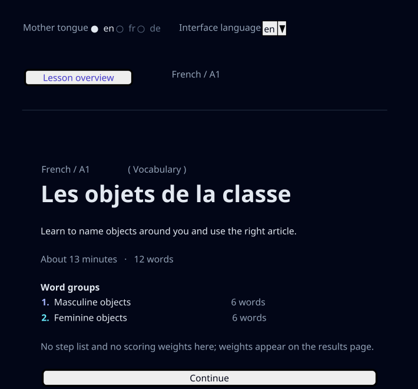
<!-- mockup:end mockups/03-vocabulary-lesson/01-startpage/lesson-start.puml -->


### Practice: enter an answer

The shared header shows estimated-duration progress and accumulated weighted points against 100. Reference choices are plain text; Continue locks the response and reveals feedback on this page.

<a id="mockup-03-vocabulary-lesson-06-typed-gaps-answer"></a>

[Salt source](mockups/03-vocabulary-lesson/06-typed-gaps/answer.puml)

<!-- mockup:begin mockups/03-vocabulary-lesson/06-typed-gaps/answer.puml -->
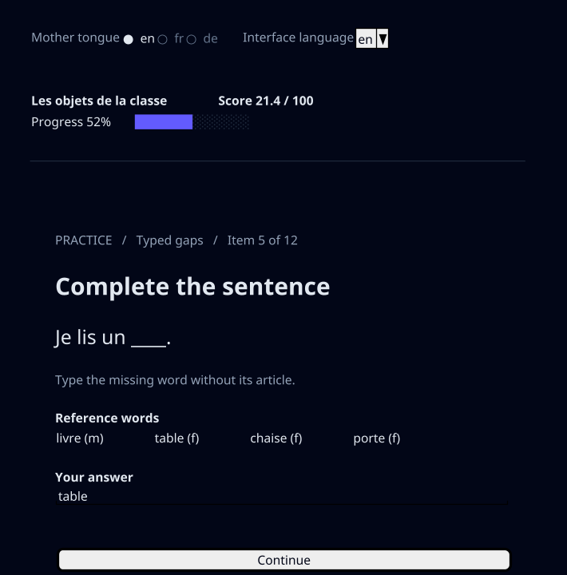
<!-- mockup:end mockups/03-vocabulary-lesson/06-typed-gaps/answer.puml -->


### Practice: confirm feedback

An incorrect response displays the correct answer and a short pre-generated explanation of why it is right. Continue confirms and advances. Fully correct responses use success feedback; accent/case-only responses use distinct partial-correct feedback with 0.5 points and the exact accepted answer. There is no extra Check button.

<a id="mockup-03-vocabulary-lesson-06-typed-gaps-feedback"></a>

[Salt source](mockups/03-vocabulary-lesson/06-typed-gaps/feedback.puml)

<!-- mockup:begin mockups/03-vocabulary-lesson/06-typed-gaps/feedback.puml -->
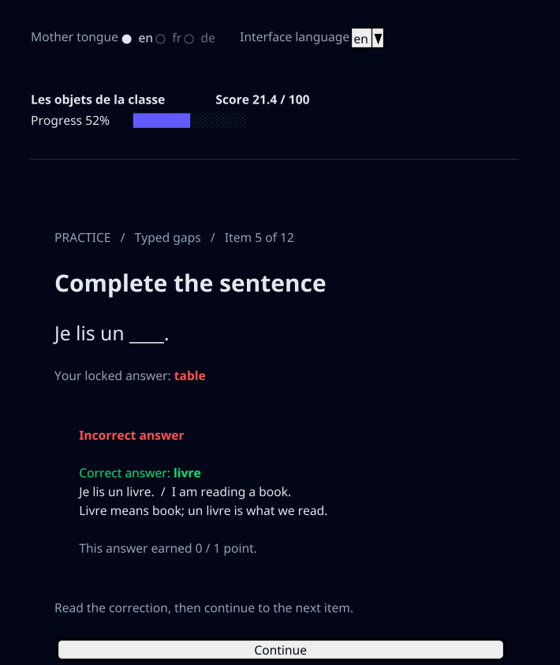
<!-- mockup:end mockups/03-vocabulary-lesson/06-typed-gaps/feedback.puml -->


### Exam page

The displayed countdown is illustrative; its initial limit comes from the brief. Continue advances without showing correctness. The score remains at the practice contribution until the exam finishes.

<a id="mockup-03-vocabulary-lesson-07-exam-exam-page"></a>

[Salt source](mockups/03-vocabulary-lesson/07-exam/exam-page.puml)

<!-- mockup:begin mockups/03-vocabulary-lesson/07-exam/exam-page.puml -->
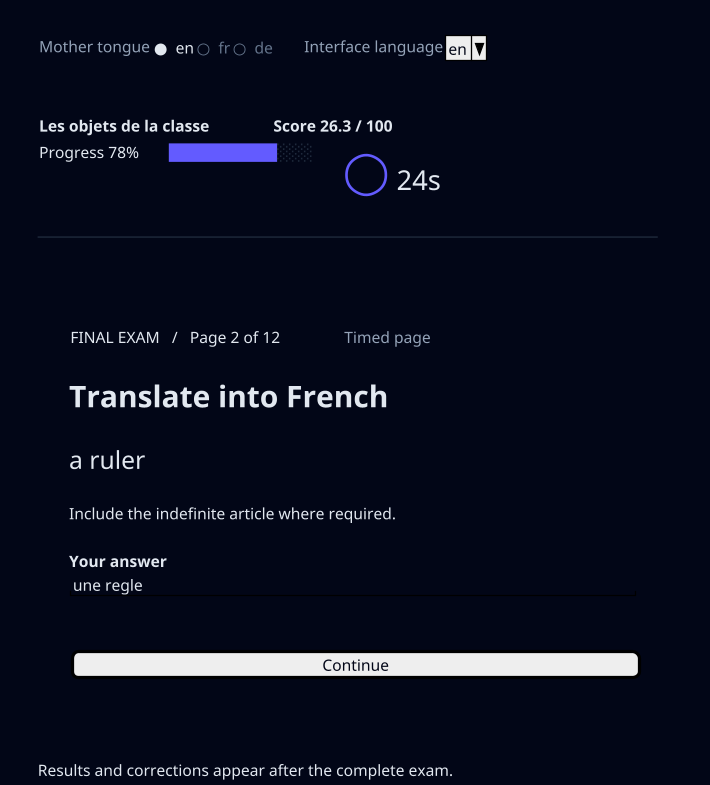
<!-- mockup:end mockups/03-vocabulary-lesson/07-exam/exam-page.puml -->


### Final results: exam selected

Exam answers show by default as flat screenshot-style rows beneath the score aggregates. Incorrect answers and corrections appear on separate labeled lines; correct answers do not repeat an identical correction. The button menu selects previous exercise results without leaving this final page. This example includes a noun-gender exercise: Matching 10/12, Gender 9/12, and Typed gaps 8/12 yield 27/36 practice points (75%); exam 8/12 yields a weighted total of 69.6/100 after rounding.

<a id="mockup-03-vocabulary-lesson-08-results-exam-results"></a>

[Salt source](mockups/03-vocabulary-lesson/08-results/exam-results.puml)

<!-- mockup:begin mockups/03-vocabulary-lesson/08-results/exam-results.puml -->
```plantuml
@startsalt
skinparam backgroundColor #020617
skinparam defaultFontName SansSerif
skinparam defaultFontSize 15
skinparam defaultFontColor #E2E8F0
scale 1.3
{
.
{ <color:#020617>xx</color> | {
{ <color:#94A3B8>Mother tongue</color> | { <color:#E2E8F0>●  en</color> | <color:#64748B>○  fr</color> | <color:#64748B>○  de</color> } | <color:#020617>xxx</color> | <color:#94A3B8>Interface language</color> | ^<color:#020617>en</color>^ }
.
{ <size:30><color:#E2E8F0><b>Your result</b></color></size> | <color:#020617>xxxxxx</color> | [ <color:#020617>   Lesson overview   </color> ] }
<color:#94A3B8>Les objets de la classe</color>
.
<color:#1E293B>──────────────────────────────────────────────────────────────────</color>
.
<color:#94A3B8>LESSON SCORE   /   FRENCH A1</color>
.
{ <back:#0F172A><size:42><color:#E2E8F0><b>  69.6 / 100  </b></color></size></back> | <color:#020617>xxx</color> | <color:#94A3B8>Progress 100%</color> }
.
.
<color:#E2E8F0>Practice: 27 / 36 (75.0%)   ·   Final exam: 8 / 12 (66.7%)</color>
<color:#94A3B8>Practice contributes 35%; the final exam contributes 65%.</color>
.
<color:#1E293B>──────────────────────────────────────────────────────────────────</color>
.
<color:#94A3B8>Choose results to review</color>
{ [ <color:#4338CA><b>Final exam 8 / 12</b></color> ] | <color:#020617>xx</color> | [ <color:#4338CA>Flashcards completed</color> ] }
.
{ [ <color:#4338CA>Matching 10 / 12</color> ] | <color:#020617>xx</color> | [ <color:#4338CA>Gender 9 / 12</color> ] | <color:#020617>xx</color> | [ <color:#4338CA>Typed gaps 8 / 12</color> ] }
.
<color:#1E293B>──────────────────────────────────────────────────────────────────</color>
.
<size:23><color:#E2E8F0><b>Your latest exam result — A1</b></color></size>
.
{ <size:24><color:#00E676>✓</color></size> | <color:#020617>xx</color> | {
<size:20><color:#E2E8F0>Translate a book into French, including its article.</color></size>
.
{ <color:#94A3B8>Your answer</color> | <color:#020617>xx</color> | <color:#00E676>un livre</color> }
.
<color:#00E676>Fully correct  ·  1 / 1</color>
} }
.
<color:#1E293B>──────────────────────────────────────────────────────────────────</color>
.
{ <size:24><color:#FBBF24>!</color></size> | <color:#020617>xx</color> | {
<size:20><color:#E2E8F0>Translate a ruler into French, including its article.</color></size>
.
{ <color:#94A3B8>Your answer</color> | <color:#020617>xx</color> | <color:#FBBF24>une regle</color> }
{ <color:#94A3B8>Correct answer</color> | <color:#020617>xx</color> | <color:#00E676>une règle</color> }
.
<color:#FBBF24>Accent / case correction  ·  0.5 / 1</color>
.
<color:#94A3B8>Règle uses an accent grave on e; its article is une.</color>
} }
.
<color:#1E293B>──────────────────────────────────────────────────────────────────</color>
.
{ <size:24><color:#FF5252>✕</color></size> | <color:#020617>xx</color> | {
<size:20><color:#E2E8F0>Translate a chair into French, including its article.</color></size>
.
{ <color:#94A3B8>Your answer</color> | <color:#020617>xx</color> | <color:#FF5252>un table</color> }
{ <color:#94A3B8>Correct answer</color> | <color:#020617>xx</color> | <color:#00E676>une chaise</color> }
.
<color:#FF5252>Incorrect  ·  0 / 1</color>
.
<color:#94A3B8>Chaise means chair and is feminine; use une chaise.</color>
} }
.
<color:#1E293B>──────────────────────────────────────────────────────────────────</color>
.
{ <size:24><color:#FF5252>✕</color></size> | <color:#020617>xx</color> | {
<size:20><color:#E2E8F0>Translate a board into French, including its article.</color></size>
.
{ <color:#94A3B8>Your answer</color> | <color:#020617>xx</color> | <color:#FF5252>No answer</color> }
{ <color:#94A3B8>Correct answer</color> | <color:#020617>xx</color> | <color:#00E676>un tableau</color> }
.
<color:#FF5252>Incorrect  ·  0 / 1</color>
<color:#94A3B8>Time expired; the saved answer was blank.</color>
.
<color:#94A3B8>Tableau is masculine; its indefinite article is un.</color>
} }
.
<color:#1E293B>──────────────────────────────────────────────────────────────────</color>
.
<color:#94A3B8>Remaining answers continue below (excerpt shown).</color>
.
[ <color:#4338CA>                  Restart lesson                  </color> ]
} | <color:#020617>xx</color> }
.
}
@endsalt
```
<!-- mockup:end mockups/03-vocabulary-lesson/08-results/exam-results.puml -->


### Final results: previous practice selected

Selecting a previous exercise keeps scores/menu visible and replaces the answer-review area with that exercise's locked responses, correct answers, and generated explanations. The example selects Gender; it does not repeat the exercise or change its score.

<a id="mockup-03-vocabulary-lesson-08-results-gender-results"></a>

[Salt source](mockups/03-vocabulary-lesson/08-results/gender-results.puml)

<!-- mockup:begin mockups/03-vocabulary-lesson/08-results/gender-results.puml -->
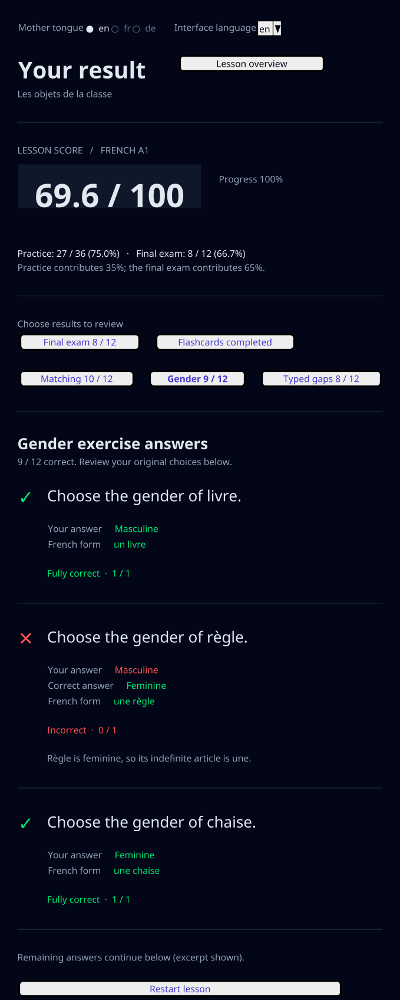
<!-- mockup:end mockups/03-vocabulary-lesson/08-results/gender-results.puml -->


### Gender exercise inside the overview

All twelve sample targets are on one page. Gender clues are hidden while answering. This initial state shows unanswered select boxes; Continue becomes available when all required choices are supplied. Continue locks the selections and transforms this page into the reviewed overview with correct forms, per-row right/wrong states, and correction explanations.

<a id="mockup-03-vocabulary-lesson-05-gender-overview-gender-select"></a>

[Salt source](mockups/03-vocabulary-lesson/05-gender-overview/gender-select.puml)

<!-- mockup:begin mockups/03-vocabulary-lesson/05-gender-overview/gender-select.puml -->
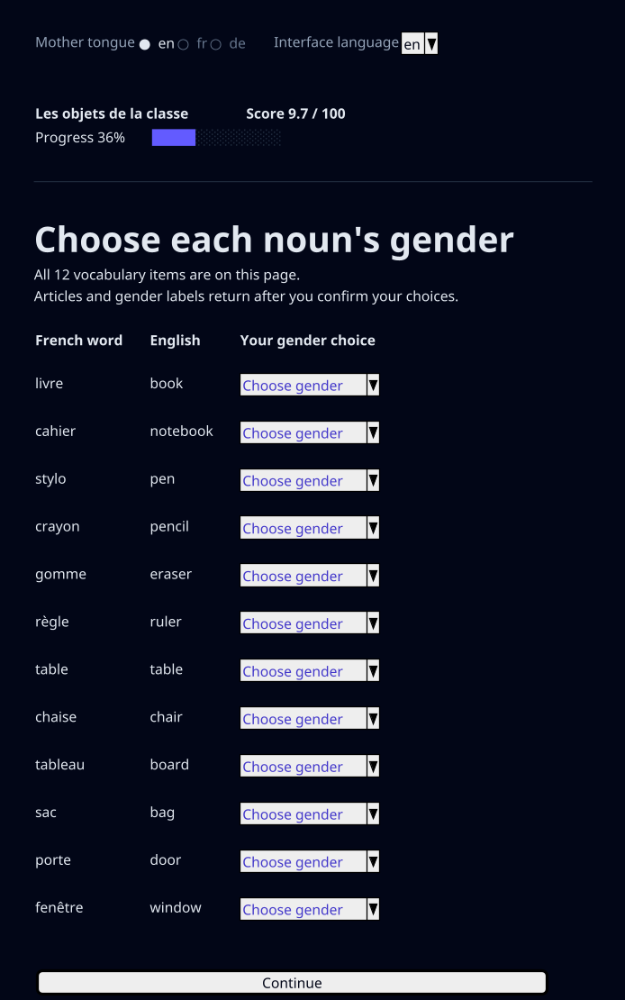
<!-- mockup:end mockups/03-vocabulary-lesson/05-gender-overview/gender-select.puml -->


<a id="mockup-03-vocabulary-lesson-05-gender-overview-reviewed-overview"></a>

[Salt source](mockups/03-vocabulary-lesson/05-gender-overview/reviewed-overview.puml)

<!-- mockup:begin mockups/03-vocabulary-lesson/05-gender-overview/reviewed-overview.puml -->
```plantuml
@startsalt
skinparam backgroundColor #020617
skinparam defaultFontName SansSerif
skinparam defaultFontSize 15
skinparam defaultFontColor #E2E8F0
scale 1.3
{
  .
  { <color:#020617>xxx</color> | {
{ <color:#94A3B8>Mother tongue</color> | { <color:#E2E8F0>●  en</color> | <color:#64748B>○  fr</color> | <color:#64748B>○  de</color> } | <color:#020617>xxx</color> | <color:#94A3B8>Interface language</color> | ^<color:#020617>en</color>^ }
.
  .
  { <color:#E2E8F0><b>Les objets de la classe</b></color> | <color:#020617>xxx</color> | . | <color:#020617>xxx</color> | <color:#E2E8F0><b>Score 18.5 / 100</b></color> }
  { <color:#E2E8F0>Progress 36%</color> | <color:#020617>xxx</color> | <color:#635BFF>████</color><color:#1E293B>░░░░░░░░</color> }
  .
  <color:#1E293B>──────────────────────────────────────────────────────────────────</color>
  .
  <color:#E2E8F0><size:30><b>Your vocabulary overview</b></size></color>
  <color:#E2E8F0>Gender exercise: 9 / 12 correct. Review your choices before continuing.</color>
  .
  {
    <color:#E2E8F0><b>Correct form</b></color> | <color:#020617>xxx</color> | <color:#E2E8F0><b>English</b></color> | <color:#020617>xxx</color> | <color:#E2E8F0><b>Your choice</b></color> | <color:#020617>xxx</color> | <color:#E2E8F0><b>Correct gender</b></color> | <color:#020617>xxx</color> | <color:#E2E8F0><b>Result</b></color> | <color:#020617>xxx</color> | <color:#E2E8F0><b>Audio</b></color>
    . | <color:#020617>xxx</color> | . | <color:#020617>xxx</color> | . | <color:#020617>xxx</color> | . | <color:#020617>xxx</color> | . | <color:#020617>xxx</color> | .
    <color:#E2E8F0>un livre</color> | <color:#020617>xxx</color> | <color:#E2E8F0>book</color> | <color:#020617>xxx</color> | <color:#E2E8F0>Masculine</color> | <color:#020617>xxx</color> | <color:#E2E8F0>Masculine</color> | <color:#020617>xxx</color> | <color:#00E676>Right</color> | <color:#020617>xxx</color> | [ <color:#4338CA>Listen</color> ]
    . | <color:#020617>xxx</color> | . | <color:#020617>xxx</color> | . | <color:#020617>xxx</color> | . | <color:#020617>xxx</color> | . | <color:#020617>xxx</color> | .
    <color:#E2E8F0>un cahier</color> | <color:#020617>xxx</color> | <color:#E2E8F0>notebook</color> | <color:#020617>xxx</color> | <color:#E2E8F0>Masculine</color> | <color:#020617>xxx</color> | <color:#E2E8F0>Masculine</color> | <color:#020617>xxx</color> | <color:#00E676>Right</color> | <color:#020617>xxx</color> | [ <color:#4338CA>Listen</color> ]
    . | <color:#020617>xxx</color> | . | <color:#020617>xxx</color> | . | <color:#020617>xxx</color> | . | <color:#020617>xxx</color> | . | <color:#020617>xxx</color> | .
    <color:#E2E8F0>un stylo</color> | <color:#020617>xxx</color> | <color:#E2E8F0>pen</color> | <color:#020617>xxx</color> | <color:#E2E8F0>Masculine</color> | <color:#020617>xxx</color> | <color:#E2E8F0>Masculine</color> | <color:#020617>xxx</color> | <color:#00E676>Right</color> | <color:#020617>xxx</color> | [ <color:#4338CA>Listen</color> ]
    . | <color:#020617>xxx</color> | . | <color:#020617>xxx</color> | . | <color:#020617>xxx</color> | . | <color:#020617>xxx</color> | . | <color:#020617>xxx</color> | .
    <color:#E2E8F0>un crayon</color> | <color:#020617>xxx</color> | <color:#E2E8F0>pencil</color> | <color:#020617>xxx</color> | <color:#E2E8F0>Masculine</color> | <color:#020617>xxx</color> | <color:#E2E8F0>Masculine</color> | <color:#020617>xxx</color> | <color:#00E676>Right</color> | <color:#020617>xxx</color> | [ <color:#4338CA>Listen</color> ]
    . | <color:#020617>xxx</color> | . | <color:#020617>xxx</color> | . | <color:#020617>xxx</color> | . | <color:#020617>xxx</color> | . | <color:#020617>xxx</color> | .
    <color:#E2E8F0>une gomme</color> | <color:#020617>xxx</color> | <color:#E2E8F0>eraser</color> | <color:#020617>xxx</color> | <color:#E2E8F0>Feminine</color> | <color:#020617>xxx</color> | <color:#E2E8F0>Feminine</color> | <color:#020617>xxx</color> | <color:#00E676>Right</color> | <color:#020617>xxx</color> | [ <color:#4338CA>Listen</color> ]
    . | <color:#020617>xxx</color> | . | <color:#020617>xxx</color> | . | <color:#020617>xxx</color> | . | <color:#020617>xxx</color> | . | <color:#020617>xxx</color> | .
    <color:#E2E8F0>une règle</color> | <color:#020617>xxx</color> | <color:#E2E8F0>ruler</color> | <color:#020617>xxx</color> | <color:#E2E8F0>Masculine</color> | <color:#020617>xxx</color> | <color:#E2E8F0>Feminine</color> | <color:#020617>xxx</color> | <color:#FF5252>Wrong</color> | <color:#020617>xxx</color> | [ <color:#4338CA>Listen</color> ]
    . | <color:#020617>xxx</color> | . | <color:#020617>xxx</color> | . | <color:#020617>xxx</color> | . | <color:#020617>xxx</color> | . | <color:#020617>xxx</color> | .
    <color:#E2E8F0>une table</color> | <color:#020617>xxx</color> | <color:#E2E8F0>table</color> | <color:#020617>xxx</color> | <color:#E2E8F0>Masculine</color> | <color:#020617>xxx</color> | <color:#E2E8F0>Feminine</color> | <color:#020617>xxx</color> | <color:#FF5252>Wrong</color> | <color:#020617>xxx</color> | [ <color:#4338CA>Listen</color> ]
    . | <color:#020617>xxx</color> | . | <color:#020617>xxx</color> | . | <color:#020617>xxx</color> | . | <color:#020617>xxx</color> | . | <color:#020617>xxx</color> | .
    <color:#E2E8F0>une chaise</color> | <color:#020617>xxx</color> | <color:#E2E8F0>chair</color> | <color:#020617>xxx</color> | <color:#E2E8F0>Feminine</color> | <color:#020617>xxx</color> | <color:#E2E8F0>Feminine</color> | <color:#020617>xxx</color> | <color:#00E676>Right</color> | <color:#020617>xxx</color> | [ <color:#4338CA>Listen</color> ]
    . | <color:#020617>xxx</color> | . | <color:#020617>xxx</color> | . | <color:#020617>xxx</color> | . | <color:#020617>xxx</color> | . | <color:#020617>xxx</color> | .
    <color:#E2E8F0>un tableau</color> | <color:#020617>xxx</color> | <color:#E2E8F0>board</color> | <color:#020617>xxx</color> | <color:#E2E8F0>Feminine</color> | <color:#020617>xxx</color> | <color:#E2E8F0>Masculine</color> | <color:#020617>xxx</color> | <color:#FF5252>Wrong</color> | <color:#020617>xxx</color> | [ <color:#4338CA>Listen</color> ]
    . | <color:#020617>xxx</color> | . | <color:#020617>xxx</color> | . | <color:#020617>xxx</color> | . | <color:#020617>xxx</color> | . | <color:#020617>xxx</color> | .
    <color:#E2E8F0>un sac</color> | <color:#020617>xxx</color> | <color:#E2E8F0>bag</color> | <color:#020617>xxx</color> | <color:#E2E8F0>Masculine</color> | <color:#020617>xxx</color> | <color:#E2E8F0>Masculine</color> | <color:#020617>xxx</color> | <color:#00E676>Right</color> | <color:#020617>xxx</color> | [ <color:#4338CA>Listen</color> ]
    . | <color:#020617>xxx</color> | . | <color:#020617>xxx</color> | . | <color:#020617>xxx</color> | . | <color:#020617>xxx</color> | . | <color:#020617>xxx</color> | .
    <color:#E2E8F0>une porte</color> | <color:#020617>xxx</color> | <color:#E2E8F0>door</color> | <color:#020617>xxx</color> | <color:#E2E8F0>Feminine</color> | <color:#020617>xxx</color> | <color:#E2E8F0>Feminine</color> | <color:#020617>xxx</color> | <color:#00E676>Right</color> | <color:#020617>xxx</color> | [ <color:#4338CA>Listen</color> ]
    . | <color:#020617>xxx</color> | . | <color:#020617>xxx</color> | . | <color:#020617>xxx</color> | . | <color:#020617>xxx</color> | . | <color:#020617>xxx</color> | .
    <color:#E2E8F0>une fenêtre</color> | <color:#020617>xxx</color> | <color:#E2E8F0>window</color> | <color:#020617>xxx</color> | <color:#E2E8F0>Feminine</color> | <color:#020617>xxx</color> | <color:#E2E8F0>Feminine</color> | <color:#020617>xxx</color> | <color:#00E676>Right</color> | <color:#020617>xxx</color> | [ <color:#4338CA>Listen</color> ]
    . | <color:#020617>xxx</color> | . | <color:#020617>xxx</color> | . | <color:#020617>xxx</color> | . | <color:#020617>xxx</color> | . | <color:#020617>xxx</color> | .
   }
  .
  {
    .
    { <color:#020617>xxx</color> | {
    <color:#E2E8F0><b>Why these corrections are right</b></color>
    .
    <color:#E2E8F0>Règle is feminine: use une règle.</color>
    <color:#E2E8F0>Table is feminine: use une table.</color>
    <color:#E2E8F0>Tableau is masculine: use un tableau.</color>
    .
     } | <color:#020617>xxx</color> }
    .
   }
  .
  <color:#94A3B8>Review the corrections, then continue to typed gaps.</color>
  .
  [ <color:#020617>                      Continue                      </color> ]
  .
   } | <color:#020617>xxx</color> }
  .
 }
@endsalt
```
<!-- mockup:end mockups/03-vocabulary-lesson/05-gender-overview/reviewed-overview.puml -->


### Browse the lesson stages and grammar exercises

The folder organization follows the lesson flow. Vocabulary uses `01-startpage/`, then `02-introduction/` through `07-exam/`, and `08-results/`; `06-listening/` sits beside `06-typed-gaps/` because both belong to practice stage 5, and `07-exam/` also holds the listening-dictation page. These folder numbers include the start page; the educational six-stage numbering remains unchanged. Grammar uses `01-startpage/`, `02-00-explanation/`, double-numbered exercise folders `02-01-exercise-pronoun-match/` through `02-06-exercise-error-spotter/`, then `03-feedback-placeholder/`, `04-exam/`, and `05-results/`. The exercise folders describe the available component types, not a requirement to use all six in one lesson. The single [root README](mockups/README.md) links every editable source and its embedded SPEC preview; there are no per-folder READMEs.

| Category | Folders and previews |
| --- | --- |
| [Lesson overview](mockups/README.md#lesson-overview) | Ordered lesson index. |
| [Artifact view](mockups/README.md#artifact-view) | Shared Outline layout, with category-specific vocabulary/grammar Draft and Content views. |
| [Vocabulary lesson](mockups/README.md#vocabulary-lesson) | Start; [01 introduction](mockups/03-vocabulary-lesson/02-introduction/introduction.puml); [02 flashcards](mockups/03-vocabulary-lesson/03-flashcards/front.puml) and [reveal](mockups/03-vocabulary-lesson/03-flashcards/revealed.puml); [03 matching](mockups/03-vocabulary-lesson/04-matching/matching.puml); 04 gender + reviewed overview; 05 typed gaps + feedback, [listening choice](mockups/03-vocabulary-lesson/06-listening/listening-choice.puml) and [no-voice help](mockups/03-vocabulary-lesson/06-listening/no-voice-help.puml); 06 exam and [listening dictation](mockups/03-vocabulary-lesson/07-exam/listening-dictation.puml); results. |
| [Grammar lesson](mockups/README.md#grammar-lesson) | [Start](mockups/04-grammar-lesson/01-startpage/lesson-start.puml); [explanation](mockups/04-grammar-lesson/02-00-explanation/singular-forms.puml); [pronoun matching](mockups/04-grammar-lesson/02-01-exercise-pronoun-match/pronoun-match.puml); [pronoun typing](mockups/04-grammar-lesson/02-02-exercise-pronoun-typing/pronoun-typing.puml); [choice gap](mockups/04-grammar-lesson/02-03-exercise-gap-choice/gap-choice.puml); [typed gap](mockups/04-grammar-lesson/02-04-exercise-gap-typing/gap-typing.puml) and [feedback](mockups/04-grammar-lesson/02-04-exercise-gap-typing/feedback.puml); [word order](mockups/04-grammar-lesson/02-05-exercise-word-order/word-order.puml); [error spotter](mockups/04-grammar-lesson/02-06-exercise-error-spotter/error-spotter.puml); [placeholder](mockups/04-grammar-lesson/03-feedback-placeholder/feedback-placeholder.puml); [exam](mockups/04-grammar-lesson/04-exam/mixed-exam.puml); [results](mockups/04-grammar-lesson/05-results/exam-results.puml). |

### Additional lesson screens

The remaining stage and grammar-exercise mockups use the same source-only, synchronized representation.

#### Shared raw JSON view

The initial tree opens only its root and any visible small containers. The second mockup shows Content after the user expands it: the three-entry objective and locale containers expand automatically, while six-step content stays collapsed. Example payloads illustrate the tree rules and do not claim generated sample files exist.

<a id="mockup-02-artifact-view-raw-json-json-tree"></a>

[Salt source](mockups/02-artifact-view/raw-json/json-tree.puml)

<!-- mockup:begin mockups/02-artifact-view/raw-json/json-tree.puml -->
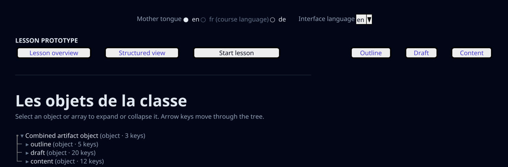
<!-- mockup:end mockups/02-artifact-view/raw-json/json-tree.puml -->

<a id="mockup-02-artifact-view-raw-json-json-tree-expanded"></a>

[Salt source](mockups/02-artifact-view/raw-json/json-tree-expanded.puml)

<!-- mockup:begin mockups/02-artifact-view/raw-json/json-tree-expanded.puml -->
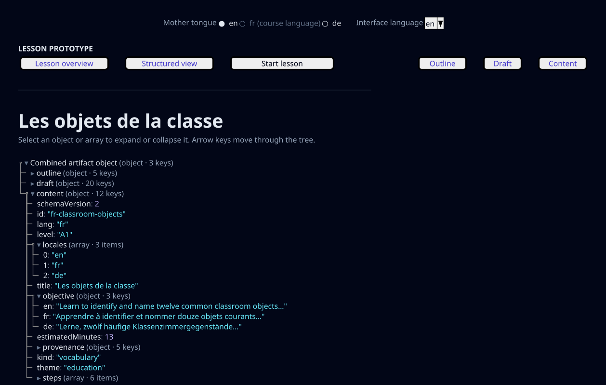
<!-- mockup:end mockups/02-artifact-view/raw-json/json-tree-expanded.puml -->

### Vocabulary: Introduction

<a id="mockup-03-vocabulary-lesson-02-introduction-introduction"></a>

[Salt source](mockups/03-vocabulary-lesson/02-introduction/introduction.puml)

<!-- mockup:begin mockups/03-vocabulary-lesson/02-introduction/introduction.puml -->
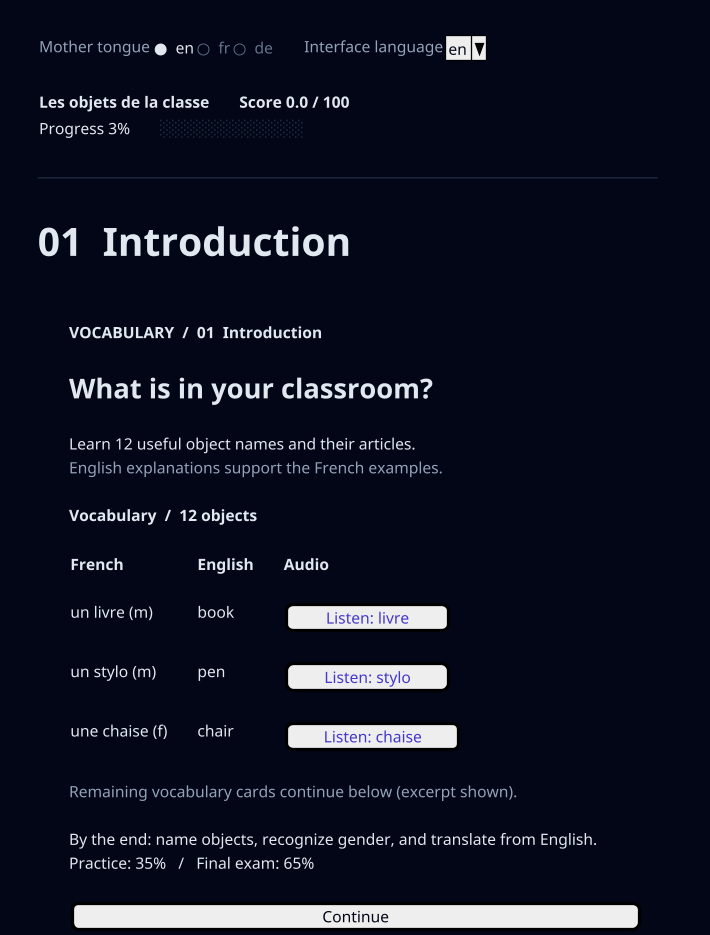
<!-- mockup:end mockups/03-vocabulary-lesson/02-introduction/introduction.puml -->

#### Vocabulary: Front

<a id="mockup-03-vocabulary-lesson-03-flashcards-front"></a>

[Salt source](mockups/03-vocabulary-lesson/03-flashcards/front.puml)

<!-- mockup:begin mockups/03-vocabulary-lesson/03-flashcards/front.puml -->
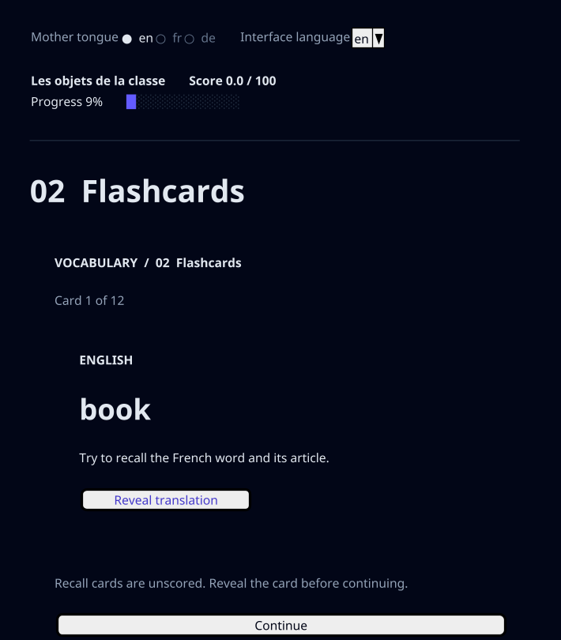
<!-- mockup:end mockups/03-vocabulary-lesson/03-flashcards/front.puml -->

#### Vocabulary: Revealed

<a id="mockup-03-vocabulary-lesson-03-flashcards-revealed"></a>

[Salt source](mockups/03-vocabulary-lesson/03-flashcards/revealed.puml)

<!-- mockup:begin mockups/03-vocabulary-lesson/03-flashcards/revealed.puml -->
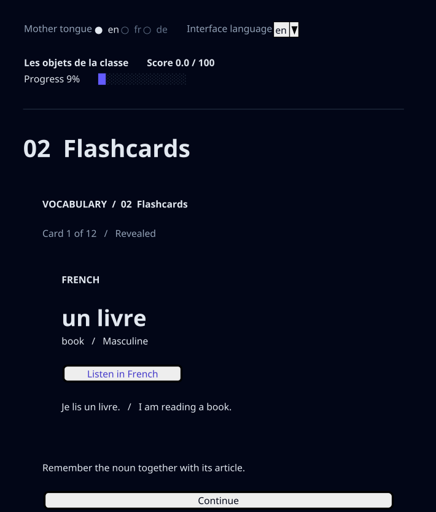
<!-- mockup:end mockups/03-vocabulary-lesson/03-flashcards/revealed.puml -->

#### Vocabulary: Matching

<a id="mockup-03-vocabulary-lesson-04-matching-matching"></a>

[Salt source](mockups/03-vocabulary-lesson/04-matching/matching.puml)

<!-- mockup:begin mockups/03-vocabulary-lesson/04-matching/matching.puml -->
```plantuml
@startsalt
skinparam backgroundColor #020617
skinparam defaultFontName SansSerif
skinparam defaultFontSize 15
skinparam defaultFontColor #E2E8F0
scale 1.3
{
.
{ <color:#020617>xxx</color> | {
{ <color:#94A3B8>Mother tongue</color> | { <color:#E2E8F0>●  en</color> | <color:#64748B>○  fr</color> | <color:#64748B>○  de</color> } | <color:#020617>xxx</color> | <color:#94A3B8>Interface language</color> | ^<color:#020617>en</color>^ }
.
{ <color:#E2E8F0><b>Les objets de la classe</b></color> | <color:#020617>xxx</color> | <color:#E2E8F0><b>Score 0.0 / 100</b></color> }
{ <color:#E2E8F0>Progress 25%</color> | <color:#020617>xxx</color> | <color:#635BFF>███</color><color:#1E293B>░░░░░░░░░</color> }
.
<color:#1E293B>──────────────────────────────────────────────────────────────────</color>
.
<color:#E2E8F0><size:30><b>03  Match translations</b></size></color>
.
{
.
{ <color:#020617>xxx</color> | {
<color:#E2E8F0><b>VOCABULARY  /  03  Match translations</b></color>
.
<color:#E2E8F0>All 12 targets on one exercise page; sample rows shown here.</color>
<color:#E2E8F0>Tap or keyboard-select one English word and its French partner.</color>
.
{
<color:#E2E8F0><b>English</b></color> | <color:#020617>xxx</color> | <color:#E2E8F0><b>French</b></color>
.
[ <color:#4338CA>book (selected)</color> ] | <color:#020617>xxx</color> | [ <color:#4338CA>une table (f)</color> ]
.
[ <color:#4338CA>chair</color> ] | <color:#020617>xxx</color> | [ <color:#4338CA>un livre (m) (selected)</color> ]
.
[ <color:#4338CA>table</color> ] | <color:#020617>xxx</color> | [ <color:#4338CA>une chaise (f)</color> ]
 }
.
<color:#94A3B8>Current pair: book — un livre (m)</color>
<color:#E2E8F0>1 of 12 pairs assigned; assignments remain editable until Continue.</color>

.
<color:#94A3B8>12 possible practice points. Continue locks all pairs and shows feedback.</color>
.
[ <color:#020617>                      Continue                      </color> ]
.
 } | <color:#020617>xxx</color> }
.
 }
.
 } | <color:#020617>xxx</color> }
.
 }
@endsalt
```
<!-- mockup:end mockups/03-vocabulary-lesson/04-matching/matching.puml -->

#### Vocabulary: Listening choice

<a id="mockup-03-vocabulary-lesson-06-listening-listening-choice"></a>

[Salt source](mockups/03-vocabulary-lesson/06-listening/listening-choice.puml)

<!-- mockup:begin mockups/03-vocabulary-lesson/06-listening/listening-choice.puml -->
```plantuml
@startsalt
skinparam backgroundColor #020617
skinparam defaultFontName SansSerif
skinparam defaultFontSize 15
skinparam defaultFontColor #E2E8F0
scale 1.3
{
.
{ <color:#020617>xxx</color> | {
{ <color:#94A3B8>Mother tongue</color> | { <color:#E2E8F0>●  en</color> | <color:#64748B>○  fr</color> | <color:#64748B>○  de</color> } | <color:#020617>xxx</color> | <color:#94A3B8>Interface language</color> | ^<color:#020617>en</color>^ }
.
{ <color:#E2E8F0><b>Les nombres de 0 à 20</b></color> | <color:#020617>xxx</color> | <color:#E2E8F0><b>Score 18.0 / 100</b></color> }
{ <color:#E2E8F0>Progress 58%</color> | <color:#020617>xxx</color> | <color:#635BFF>███████</color><color:#1E293B>░░░░░</color> }
.
<color:#1E293B>──────────────────────────────────────────────────────────────────</color>
.
<color:#E2E8F0><size:30><b>Choose what you hear</b></size></color>
.
{
.
{ <color:#020617>xxx</color> | {
<color:#94A3B8>PRACTICE   /   Listening   /   Item 3 of 8</color>
.
{ [ <color:#4338CA>Play audio</color> ] | <color:#020617>xxx</color> | [ <color:#4338CA>Play again</color> ] }
.
<back:#0F172A><color:#E2E8F0><size:21>   six                                          </size></color></back>
.
<back:#0F172A><color:#E2E8F0><size:21>   dix                                          </size></color></back>
.
<back:#0F172A><color:#E2E8F0><size:21>   seize                                        </size></color></back>
.
<back:#0F172A><color:#E2E8F0><size:21>   treize                                       </size></color></back>
.
.
<color:#94A3B8>Select the word you heard, then Continue to lock it.</color>
<color:#94A3B8>Continue then shows the result and a short explanation.</color>
.
[ <color:#020617>                      Continue                      </color> ]
.
 } | <color:#020617>xxx</color> }
.
 }
.
 } | <color:#020617>xxx</color> }
.
 }
@endsalt
```
<!-- mockup:end mockups/03-vocabulary-lesson/06-listening/listening-choice.puml -->

When no French voice exists, the listening page is replaced by this help page; Skip continues with the next exercise (D42).

#### Vocabulary: No-voice help

<a id="mockup-03-vocabulary-lesson-06-listening-no-voice-help"></a>

[Salt source](mockups/03-vocabulary-lesson/06-listening/no-voice-help.puml)

<!-- mockup:begin mockups/03-vocabulary-lesson/06-listening/no-voice-help.puml -->
```plantuml
@startsalt
skinparam backgroundColor #020617
skinparam defaultFontName SansSerif
skinparam defaultFontSize 15
skinparam defaultFontColor #E2E8F0
scale 1.3
{
.
{ <color:#020617>xxx</color> | {
{ <color:#94A3B8>Mother tongue</color> | { <color:#E2E8F0>●  en</color> | <color:#64748B>○  fr</color> | <color:#64748B>○  de</color> } | <color:#020617>xxx</color> | <color:#94A3B8>Interface language</color> | ^<color:#020617>en</color>^ }
.
{ <color:#E2E8F0><b>Les nombres de 0 à 20</b></color> | <color:#020617>xxx</color> | <color:#E2E8F0><b>Score 18.0 / 100</b></color> }
{ <color:#E2E8F0>Progress 58%</color> | <color:#020617>xxx</color> | <color:#635BFF>███████</color><color:#1E293B>░░░░░</color> }
.
<color:#1E293B>──────────────────────────────────────────────────────────────────</color>
.
<color:#E2E8F0><size:30><b>French voice unavailable</b></size></color>
.
{
.
{ <color:#020617>xxx</color> | {
<color:#94A3B8>PRACTICE   /   Listening   /   Item 3 of 8</color>
.
<color:#E2E8F0>This exercise uses your browser's speech synthesis.</color>
<color:#E2E8F0>No French voice was found, so the audio task cannot play.</color>
.
<color:#E2E8F0><b>Steps for Windows with Firefox:</b></color>
<color:#94A3B8>1. Open Settings → Time & language → Language & region.</color>
<color:#94A3B8>2. Add a language → French (France) → Next; tick Text-to-speech → Install.</color>
<color:#94A3B8>3. Close every Firefox window and start Firefox again.</color>
.
<color:#94A3B8>French already listed? … → Language options → Download next to Text-to-speech.</color>
<color:#94A3B8>Firefox uses these Windows voices from version 106 on.</color>
.
<color:#94A3B8>Only the steps for the detected system and browser are shown.</color>
<color:#94A3B8>You can skip this listening task now; it is left out of your score.</color>
.
[ <color:#020617>                        Skip                        </color> ]
.
 } | <color:#020617>xxx</color> }
.
 }
.
 } | <color:#020617>xxx</color> }
.
 }
@endsalt
```
<!-- mockup:end mockups/03-vocabulary-lesson/06-listening/no-voice-help.puml -->

#### Vocabulary: Listening dictation exam

<a id="mockup-03-vocabulary-lesson-07-exam-listening-dictation"></a>

[Salt source](mockups/03-vocabulary-lesson/07-exam/listening-dictation.puml)

<!-- mockup:begin mockups/03-vocabulary-lesson/07-exam/listening-dictation.puml -->
```plantuml
@startsalt
skinparam backgroundColor #020617
skinparam defaultFontName SansSerif
skinparam defaultFontSize 15
skinparam defaultFontColor #E2E8F0
scale 1.3
{
  .
  { <color:#020617>xxx</color> | {
{ <color:#94A3B8>Mother tongue</color> | { <color:#E2E8F0>●  en</color> | <color:#64748B>○  fr</color> | <color:#64748B>○  de</color> } | <color:#020617>xxx</color> | <color:#94A3B8>Interface language</color> | ^<color:#020617>en</color>^ }
.
  .
  { <color:#E2E8F0><b>Les nombres de 0 à 20</b></color> | <color:#020617>xxx</color> | . | <color:#020617>xxx</color> | <color:#E2E8F0><b>Score 27.1 / 100</b></color> }
  { <color:#E2E8F0>Progress 86%</color> | <color:#020617>xxx</color> | <color:#635BFF>██████████</color><color:#1E293B>░░</color> | <color:#020617>xxx</color> | <color:#635BFF><size:32>◯</size></color><color:#E2E8F0><size:21> 18s</size></color> }
  .
  <color:#1E293B>──────────────────────────────────────────────────────────────────</color>
  .
  .
  {
    .
    { <color:#020617>xxx</color> | {
    { <color:#E2E8F0>FINAL EXAM   /   Page 18 of 25</color> | <color:#020617>xxx</color> | . | <color:#020617>xxx</color> | <color:#94A3B8>Timed page</color> }
    .
    <color:#E2E8F0><size:23><b>Write what you hear</b></size></color>
    .
    { [ <color:#4338CA>Play audio</color> ] | <color:#020617>xxx</color> | [ <color:#4338CA>Play again</color> ] }
    .
    <color:#E2E8F0>Write the French word. Accents count for full credit.</color>
    .
    <color:#E2E8F0><b>Your answer</b></color>
    "<color:#E2E8F0>dix</color>                                                   "
    .
    .
    [ <color:#020617>                      Continue                      </color> ]
    .
     } | <color:#020617>xxx</color> }
    .
   }
  .
  <color:#E2E8F0>Results and corrections appear after the complete exam.</color>
  .
   } | <color:#020617>xxx</color> }
  .
 }
@endsalt
```
<!-- mockup:end mockups/03-vocabulary-lesson/07-exam/listening-dictation.puml -->

#### Grammar: Lesson start

<a id="mockup-04-grammar-lesson-01-startpage-lesson-start"></a>

[Salt source](mockups/04-grammar-lesson/01-startpage/lesson-start.puml)

<!-- mockup:begin mockups/04-grammar-lesson/01-startpage/lesson-start.puml -->
```plantuml
@startsalt
skinparam backgroundColor #020617
skinparam defaultFontName SansSerif
skinparam defaultFontSize 15
skinparam defaultFontColor #E2E8F0
scale 1.3
{
.
{ <color:#020617>xxx</color> | {
{ <color:#94A3B8>Mother tongue</color> | { <color:#E2E8F0>●  en</color> | <color:#64748B>○  fr</color> | <color:#64748B>○  de</color> } | <color:#020617>xxx</color> | <color:#94A3B8>Interface language</color> | ^<color:#020617>en</color>^ }
.
{ [ <color:#4338CA>Lesson overview</color> ] | <color:#020617>xxx</color> | <color:#94A3B8>French / A1</color> }
.
<color:#1E293B>──────────────────────────────────────────────────────────────────</color>
.
<color:#E2E8F0><size:30><b>Le verbe être au présent</b></size></color>
.
{
.
{ <color:#020617>xxx</color> | {
<color:#E2E8F0><b>YOUR LESSON</b></color>
.
<color:#E2E8F0><size:20><b>Say who someone is and how they are</b></size></color>
.
<color:#94A3B8>( Grammar )   ·   About 13 minutes</color>
.
<color:#94A3B8>No step list and no scoring weights here; weights appear on the results page.</color>
.
[ <color:#020617>                      Continue                      </color> ]
.
 } | <color:#020617>xxx</color> }
.
 }
.
 } | <color:#020617>xxx</color> }
.
 }
@endsalt
```
<!-- mockup:end mockups/04-grammar-lesson/01-startpage/lesson-start.puml -->

#### Grammar: Singular forms

<a id="mockup-04-grammar-lesson-02-00-explanation-singular-forms"></a>

[Salt source](mockups/04-grammar-lesson/02-00-explanation/singular-forms.puml)

<!-- mockup:begin mockups/04-grammar-lesson/02-00-explanation/singular-forms.puml -->
```plantuml
@startsalt
skinparam backgroundColor #020617
skinparam defaultFontName SansSerif
skinparam defaultFontSize 15
skinparam defaultFontColor #E2E8F0
scale 1.3
{
.
{ <color:#020617>xxx</color> | {
{ <color:#94A3B8>Mother tongue</color> | { <color:#E2E8F0>●  en</color> | <color:#64748B>○  fr</color> | <color:#64748B>○  de</color> } | <color:#020617>xxx</color> | <color:#94A3B8>Interface language</color> | ^<color:#020617>en</color>^ }
.
{ <color:#E2E8F0><b>Le verbe être au présent</b></color> | <color:#020617>xxx</color> | <color:#E2E8F0><b>Score 0.0 / 100</b></color> }
{ <color:#E2E8F0>Progress 8%</color> | <color:#020617>xxx</color> | <color:#635BFF>█</color><color:#1E293B>░░░░░░░░░░░</color> }
.
<color:#1E293B>──────────────────────────────────────────────────────────────────</color>
.
<color:#E2E8F0><size:30><b>Singular forms</b></size></color>
.
{
.
{ <color:#020617>xxx</color> | {
<color:#E2E8F0><b>GRAMMAR  /  Singular forms</b></color>
.
<color:#E2E8F0><size:21><b>Use the form that matches the subject</b></size></color>
.
{
<color:#E2E8F0><b>Subject</b></color> | <color:#020617>xxx</color> | <color:#E2E8F0><b>Form</b></color> | <color:#020617>xxx</color> | <color:#E2E8F0><b>Example</b></color>
.
<color:#E2E8F0>je</color> | <color:#020617>xxx</color> | <color:#E2E8F0>suis</color> | <color:#020617>xxx</color> | <color:#E2E8F0>Je suis étudiant.</color>
.
<color:#E2E8F0>tu</color> | <color:#020617>xxx</color> | <color:#E2E8F0>es</color> | <color:#020617>xxx</color> | <color:#E2E8F0>Tu es étudiant.</color>
.
<color:#E2E8F0>il / elle</color> | <color:#020617>xxx</color> | <color:#E2E8F0>est</color> | <color:#020617>xxx</color> | <color:#E2E8F0>Elle est étudiante.</color>
 }
.
[ <color:#4338CA>Listen to examples</color> ]
.
<color:#E2E8F0>Es and est sound alike, but their subjects are different.</color>
.
[ <color:#020617>                      Continue                      </color> ]
.
 } | <color:#020617>xxx</color> }
.
 }
.
 } | <color:#020617>xxx</color> }
.
 }
@endsalt
```
<!-- mockup:end mockups/04-grammar-lesson/02-00-explanation/singular-forms.puml -->

#### Grammar: Pronoun match

<a id="mockup-04-grammar-lesson-02-01-exercise-pronoun-match-pronoun-match"></a>

[Salt source](mockups/04-grammar-lesson/02-01-exercise-pronoun-match/pronoun-match.puml)

<!-- mockup:begin mockups/04-grammar-lesson/02-01-exercise-pronoun-match/pronoun-match.puml -->
```plantuml
@startsalt
skinparam backgroundColor #020617
skinparam defaultFontName SansSerif
skinparam defaultFontSize 15
skinparam defaultFontColor #E2E8F0
scale 1.3
{
.
{ <color:#020617>xxx</color> | {
{ <color:#94A3B8>Mother tongue</color> | { <color:#E2E8F0>●  en</color> | <color:#64748B>○  fr</color> | <color:#64748B>○  de</color> } | <color:#020617>xxx</color> | <color:#94A3B8>Interface language</color> | ^<color:#020617>en</color>^ }
.
{ <color:#E2E8F0><b>Le verbe être au présent</b></color> | <color:#020617>xxx</color> | <color:#E2E8F0><b>Score 0.0 / 100</b></color> }
{ <color:#E2E8F0>Progress 16%</color> | <color:#020617>xxx</color> | <color:#635BFF>██</color><color:#1E293B>░░░░░░░░░░</color> }
.
<color:#1E293B>──────────────────────────────────────────────────────────────────</color>
.
<color:#E2E8F0><size:30><b>Match forms to pronouns</b></size></color>
.
{
.
{ <color:#020617>xxx</color> | {
<color:#E2E8F0><b>GRAMMAR  /  Match forms to pronouns</b></color>
.
<color:#E2E8F0>Drag a form into each row, or choose it using the keyboard selector.</color>
.
{
<color:#E2E8F0><b>Available forms</b></color> | <color:#020617>xxx</color> | [ <color:#4338CA>suis</color> ] | <color:#020617>xxx</color> | [ <color:#4338CA>es</color> ] | <color:#020617>xxx</color> | [ <color:#4338CA>est</color> ]
 }
.
{
<color:#E2E8F0><b>Subject</b></color> | <color:#020617>xxx</color> | <color:#E2E8F0><b>Drop target / keyboard choice</b></color>
.
<color:#E2E8F0>je</color> | <color:#020617>xxx</color> | ^<color:#4338CA>Choose a form                   </color>^
.
<color:#E2E8F0>tu</color> | <color:#020617>xxx</color> | ^<color:#4338CA>Choose a form                   </color>^
.
<color:#E2E8F0>il / elle</color> | <color:#020617>xxx</color> | ^<color:#4338CA>Choose a form                   </color>^
 }
.
<color:#94A3B8>Continue locks the whole page before showing feedback.</color>
.
[ <color:#020617>                      Continue                      </color> ]
.
 } | <color:#020617>xxx</color> }
.
 }
.
 } | <color:#020617>xxx</color> }
.
 }
@endsalt
```
<!-- mockup:end mockups/04-grammar-lesson/02-01-exercise-pronoun-match/pronoun-match.puml -->

#### Grammar: Pronoun typing

<a id="mockup-04-grammar-lesson-02-02-exercise-pronoun-typing-pronoun-typing"></a>

[Salt source](mockups/04-grammar-lesson/02-02-exercise-pronoun-typing/pronoun-typing.puml)

<!-- mockup:begin mockups/04-grammar-lesson/02-02-exercise-pronoun-typing/pronoun-typing.puml -->
```plantuml
@startsalt
skinparam backgroundColor #020617
skinparam defaultFontName SansSerif
skinparam defaultFontSize 15
skinparam defaultFontColor #E2E8F0
scale 1.3
{
.
{ <color:#020617>xxx</color> | {
{ <color:#94A3B8>Mother tongue</color> | { <color:#E2E8F0>●  en</color> | <color:#64748B>○  fr</color> | <color:#64748B>○  de</color> } | <color:#020617>xxx</color> | <color:#94A3B8>Interface language</color> | ^<color:#020617>en</color>^ }
.
{ <color:#E2E8F0><b>Le verbe être au présent</b></color> | <color:#020617>xxx</color> | <color:#E2E8F0><b>Score 6.6 / 100</b></color> }
{ <color:#E2E8F0>Progress 24%</color> | <color:#020617>xxx</color> | <color:#635BFF>███</color><color:#1E293B>░░░░░░░░░</color> }
.
<color:#1E293B>──────────────────────────────────────────────────────────────────</color>
.
<color:#E2E8F0><size:30><b>Write forms for pronouns</b></size></color>
.
{
.
{ <color:#020617>xxx</color> | {
<color:#E2E8F0><b>GRAMMAR  /  Write forms for pronouns</b></color>
.
<color:#94A3B8>Type the present-tense form of être.</color>
.
{
<color:#E2E8F0><b>Subject</b></color> | <color:#020617>xxx</color> | <color:#E2E8F0><b>Your answer</b></color>
.
<color:#E2E8F0>je</color> | <color:#020617>xxx</color> | "<color:#E2E8F0>suis</color>                  "
.
<color:#E2E8F0>tu</color> | <color:#020617>xxx</color> | "<color:#94A3B8>Type here</color>             "
.
<color:#E2E8F0>il / elle</color> | <color:#020617>xxx</color> | "<color:#94A3B8>Type here</color>             "
 }
.
<color:#94A3B8>Each row is one point. Accents and capitalization affect full correctness.</color>
.
[ <color:#020617>                      Continue                      </color> ]
.
 } | <color:#020617>xxx</color> }
.
 }
.
 } | <color:#020617>xxx</color> }
.
 }
@endsalt
```
<!-- mockup:end mockups/04-grammar-lesson/02-02-exercise-pronoun-typing/pronoun-typing.puml -->

#### Grammar: Gap choice

<a id="mockup-04-grammar-lesson-02-03-exercise-gap-choice-gap-choice"></a>

[Salt source](mockups/04-grammar-lesson/02-03-exercise-gap-choice/gap-choice.puml)

<!-- mockup:begin mockups/04-grammar-lesson/02-03-exercise-gap-choice/gap-choice.puml -->
```plantuml
@startsalt
skinparam backgroundColor #020617
skinparam defaultFontName SansSerif
skinparam defaultFontSize 15
skinparam defaultFontColor #E2E8F0
scale 1.3
{
.
{ <color:#020617>xxx</color> | {
{ <color:#94A3B8>Mother tongue</color> | { <color:#E2E8F0>●  en</color> | <color:#64748B>○  fr</color> | <color:#64748B>○  de</color> } | <color:#020617>xxx</color> | <color:#94A3B8>Interface language</color> | ^<color:#020617>en</color>^ }
.
{ <color:#E2E8F0><b>Le verbe être au présent</b></color> | <color:#020617>xxx</color> | <color:#E2E8F0><b>Score 10.9 / 100</b></color> }
{ <color:#E2E8F0>Progress 34%</color> | <color:#020617>xxx</color> | <color:#635BFF>████</color><color:#1E293B>░░░░░░░░</color> }
.
<color:#1E293B>──────────────────────────────────────────────────────────────────</color>
.
<color:#E2E8F0><size:30><b>Choose the missing form</b></size></color>
.
{
.
{ <color:#020617>xxx</color> | {
<color:#E2E8F0><b>GRAMMAR  /  Choose the missing form</b></color>
.
<color:#E2E8F0><size:21>Tu ___ étudiant.</size></color>
.
<back:#0F172A><color:#E2E8F0><size:21>   suis                                         </size></color></back>
.
<back:#0F172A><color:#E2E8F0><size:21>   es                                           </size></color></back>
.
<back:#0F172A><color:#E2E8F0><size:21>   est                                          </size></color></back>
.
<back:#0F172A><color:#E2E8F0><size:21>   sommes                                       </size></color></back>
.
.
<color:#94A3B8>Select one answer, then Continue to lock it.</color>
.
[ <color:#020617>                      Continue                      </color> ]
.
 } | <color:#020617>xxx</color> }
.
 }
.
 } | <color:#020617>xxx</color> }
.
 }
@endsalt
```
<!-- mockup:end mockups/04-grammar-lesson/02-03-exercise-gap-choice/gap-choice.puml -->

#### Grammar: Feedback

<a id="mockup-04-grammar-lesson-02-04-exercise-gap-typing-feedback"></a>

[Salt source](mockups/04-grammar-lesson/02-04-exercise-gap-typing/feedback.puml)

<!-- mockup:begin mockups/04-grammar-lesson/02-04-exercise-gap-typing/feedback.puml -->
```plantuml
@startsalt
skinparam backgroundColor #020617
skinparam defaultFontName SansSerif
skinparam defaultFontSize 15
skinparam defaultFontColor #E2E8F0
scale 1.3
{
.
{ <color:#020617>xxx</color> | {
{ <color:#94A3B8>Mother tongue</color> | { <color:#E2E8F0>●  en</color> | <color:#64748B>○  fr</color> | <color:#64748B>○  de</color> } | <color:#020617>xxx</color> | <color:#94A3B8>Interface language</color> | ^<color:#020617>en</color>^ }
.
{ <color:#E2E8F0><b>Le verbe être au présent</b></color> | <color:#020617>xxx</color> | <color:#E2E8F0><b>Score 14.2 / 100</b></color> }
{ <color:#E2E8F0>Progress 42%</color> | <color:#020617>xxx</color> | <color:#635BFF>█████</color><color:#1E293B>░░░░░░░</color> }
.
<color:#1E293B>──────────────────────────────────────────────────────────────────</color>
.
<color:#E2E8F0><size:30><b>Review your answer</b></size></color>
.
{
.
{ <color:#020617>xxx</color> | {
<color:#E2E8F0><b>GRAMMAR  /  Review your answer</b></color>
.
<color:#FBBF24><b>Letters correct; accent needs attention   /   0.5 of 1 point</b></color>
.
<color:#E2E8F0>Task: Vous ___ prêts.</color>
<color:#94A3B8>Your answer: etes</color>
<color:#00E676>Correct answer: êtes</color>
.
{
.
{ <color:#020617>xxx</color> | {
<color:#E2E8F0><b>WHY THIS ANSWER IS RIGHT</b></color>
.
<color:#E2E8F0>Vous takes êtes, with an accent circonflexe on e.</color>
<color:#E2E8F0>Your letters match, so this answer earns half credit.</color>
.
 } | <color:#020617>xxx</color> }
.
 }
.
<color:#94A3B8>Continue confirms this feedback and advances.</color>
.
[ <color:#020617>                      Continue                      </color> ]
.
 } | <color:#020617>xxx</color> }
.
 }
.
 } | <color:#020617>xxx</color> }
.
 }
@endsalt
```
<!-- mockup:end mockups/04-grammar-lesson/02-04-exercise-gap-typing/feedback.puml -->

#### Grammar: Gap typing

<a id="mockup-04-grammar-lesson-02-04-exercise-gap-typing-gap-typing"></a>

[Salt source](mockups/04-grammar-lesson/02-04-exercise-gap-typing/gap-typing.puml)

<!-- mockup:begin mockups/04-grammar-lesson/02-04-exercise-gap-typing/gap-typing.puml -->
```plantuml
@startsalt
skinparam backgroundColor #020617
skinparam defaultFontName SansSerif
skinparam defaultFontSize 15
skinparam defaultFontColor #E2E8F0
scale 1.3
{
.
{ <color:#020617>xxx</color> | {
{ <color:#94A3B8>Mother tongue</color> | { <color:#E2E8F0>●  en</color> | <color:#64748B>○  fr</color> | <color:#64748B>○  de</color> } | <color:#020617>xxx</color> | <color:#94A3B8>Interface language</color> | ^<color:#020617>en</color>^ }
.
{ <color:#E2E8F0><b>Le verbe être au présent</b></color> | <color:#020617>xxx</color> | <color:#E2E8F0><b>Score 13.1 / 100</b></color> }
{ <color:#E2E8F0>Progress 42%</color> | <color:#020617>xxx</color> | <color:#635BFF>█████</color><color:#1E293B>░░░░░░░</color> }
.
<color:#1E293B>──────────────────────────────────────────────────────────────────</color>
.
<color:#E2E8F0><size:30><b>Type the missing form</b></size></color>
.
{
.
{ <color:#020617>xxx</color> | {
<color:#E2E8F0><b>GRAMMAR  /  Type the missing form</b></color>
.
<color:#E2E8F0><size:21>Vous ___ prêts.</size></color>
.
<color:#E2E8F0><b>Your answer</b></color>
"<color:#E2E8F0>etes</color>                                                   "
.
<color:#94A3B8>Continue locks your answer. Full credit includes the correct accents.</color>
.
[ <color:#020617>                      Continue                      </color> ]
.
 } | <color:#020617>xxx</color> }
.
 }
.
 } | <color:#020617>xxx</color> }
.
 }
@endsalt
```
<!-- mockup:end mockups/04-grammar-lesson/02-04-exercise-gap-typing/gap-typing.puml -->

#### Grammar: Word order

<a id="mockup-04-grammar-lesson-02-05-exercise-word-order-word-order"></a>

[Salt source](mockups/04-grammar-lesson/02-05-exercise-word-order/word-order.puml)

<!-- mockup:begin mockups/04-grammar-lesson/02-05-exercise-word-order/word-order.puml -->
```plantuml
@startsalt
skinparam backgroundColor #020617
skinparam defaultFontName SansSerif
skinparam defaultFontSize 15
skinparam defaultFontColor #E2E8F0
scale 1.3
{
.
{ <color:#020617>xxx</color> | {
{ <color:#94A3B8>Mother tongue</color> | { <color:#E2E8F0>●  en</color> | <color:#64748B>○  fr</color> | <color:#64748B>○  de</color> } | <color:#020617>xxx</color> | <color:#94A3B8>Interface language</color> | ^<color:#020617>en</color>^ }
.
{ <color:#E2E8F0><b>Le verbe être au présent</b></color> | <color:#020617>xxx</color> | <color:#E2E8F0><b>Score 18.6 / 100</b></color> }
{ <color:#E2E8F0>Progress 53%</color> | <color:#020617>xxx</color> | <color:#635BFF>██████</color><color:#1E293B>░░░░░░</color> }
.
<color:#1E293B>──────────────────────────────────────────────────────────────────</color>
.
<color:#E2E8F0><size:30><b>Put the words in order</b></size></color>
.
{
.
{ <color:#020617>xxx</color> | {
<color:#E2E8F0><b>GRAMMAR  /  Put the words in order</b></color>
.
<color:#E2E8F0>Build a statement using every token once.</color>
<color:#E2E8F0>Drag tokens or use their labeled move buttons.</color>
.
<color:#E2E8F0><b>Word bank</b></color>
{ [ <color:#4338CA>étudiant.</color> ] | [ <color:#4338CA>suis</color> ] | [ <color:#4338CA>Je</color> ] }
.
<color:#E2E8F0><b>Your sentence</b></color>
{ [ <color:#4338CA>Je</color> ] | [ <color:#4338CA>suis</color> ] | [ <color:#4338CA>étudiant.</color> ] }
{ [ <color:#4338CA>Move selected left</color> ] | [ <color:#4338CA>Move selected right</color> ] }
.
<color:#94A3B8>Continue locks the sentence before showing its result.</color>
.
[ <color:#020617>                      Continue                      </color> ]
.
 } | <color:#020617>xxx</color> }
.
 }
.
 } | <color:#020617>xxx</color> }
.
 }
@endsalt
```
<!-- mockup:end mockups/04-grammar-lesson/02-05-exercise-word-order/word-order.puml -->

#### Grammar: Error spotter

<a id="mockup-04-grammar-lesson-02-06-exercise-error-spotter-error-spotter"></a>

[Salt source](mockups/04-grammar-lesson/02-06-exercise-error-spotter/error-spotter.puml)

<!-- mockup:begin mockups/04-grammar-lesson/02-06-exercise-error-spotter/error-spotter.puml -->
```plantuml
@startsalt
skinparam backgroundColor #020617
skinparam defaultFontName SansSerif
skinparam defaultFontSize 15
skinparam defaultFontColor #E2E8F0
scale 1.3
{
.
{ <color:#020617>xxx</color> | {
{ <color:#94A3B8>Mother tongue</color> | { <color:#E2E8F0>●  en</color> | <color:#64748B>○  fr</color> | <color:#64748B>○  de</color> } | <color:#020617>xxx</color> | <color:#94A3B8>Interface language</color> | ^<color:#020617>en</color>^ }
.
{ <color:#E2E8F0><b>Le verbe être au présent</b></color> | <color:#020617>xxx</color> | <color:#E2E8F0><b>Score 21.9 / 100</b></color> }
{ <color:#E2E8F0>Progress 63%</color> | <color:#020617>xxx</color> | <color:#635BFF>████████</color><color:#1E293B>░░░░</color> }
.
<color:#1E293B>──────────────────────────────────────────────────────────────────</color>
.
<color:#E2E8F0><size:30><b>Find the grammar mistake</b></size></color>
.
{
.
{ <color:#020617>xxx</color> | {
<color:#E2E8F0><b>GRAMMAR  /  Find the grammar mistake</b></color>
.
<color:#E2E8F0>Choose the incorrect word in this sentence.</color>
.
{ [ <color:#4338CA>Tu</color> ] | [ <color:#4338CA>est</color> ] | [ <color:#4338CA>étudiant.</color> ] }
.
<color:#E2E8F0>Selected word: est</color>
.
<color:#E2E8F0><b>Write its correction</b></color>
"<color:#E2E8F0>es</color>                                                     "
.
<color:#94A3B8>Continue locks both your selected token and its correction.</color>
<color:#E2E8F0>You then see the result and a short explanation.</color>
.
[ <color:#020617>                      Continue                      </color> ]
.
 } | <color:#020617>xxx</color> }
.
 }
.
 } | <color:#020617>xxx</color> }
.
 }
@endsalt
```
<!-- mockup:end mockups/04-grammar-lesson/02-06-exercise-error-spotter/error-spotter.puml -->

#### Grammar: Feedback placeholder

<a id="mockup-04-grammar-lesson-03-feedback-placeholder-feedback-placeholder"></a>

[Salt source](mockups/04-grammar-lesson/03-feedback-placeholder/feedback-placeholder.puml)

<!-- mockup:begin mockups/04-grammar-lesson/03-feedback-placeholder/feedback-placeholder.puml -->
```plantuml
@startsalt
skinparam backgroundColor #020617
skinparam defaultFontName SansSerif
skinparam defaultFontSize 15
skinparam defaultFontColor #E2E8F0
scale 1.3
{
.
{ <color:#020617>xxx</color> | {
{ <color:#94A3B8>Mother tongue</color> | { <color:#E2E8F0>●  en</color> | <color:#64748B>○  fr</color> | <color:#64748B>○  de</color> } | <color:#020617>xxx</color> | <color:#94A3B8>Interface language</color> | ^<color:#020617>en</color>^ }
.
{ <color:#E2E8F0><b>Le verbe être au présent</b></color> | <color:#020617>xxx</color> | <color:#E2E8F0><b>Score 26.3 / 100</b></color> }
{ <color:#E2E8F0>Progress 72%</color> | <color:#020617>xxx</color> | <color:#635BFF>█████████</color><color:#1E293B>░░░</color> }
.
<color:#1E293B>──────────────────────────────────────────────────────────────────</color>
.
<color:#E2E8F0><size:30><b>Before your final exam</b></size></color>
.
{
.
{ <color:#020617>xxx</color> | {
<color:#E2E8F0><b>GRAMMAR  /  Before your final exam</b></color>
.
<color:#E2E8F0><size:20><b>Individual feedback would be here on production.</b></size></color>
.
<color:#94A3B8>The final exam starts next.</color>
<color:#94A3B8>Each page shows a countdown. Answers lock on Continue or when time expires.</color>
<color:#E2E8F0>Results appear only after the complete exam.</color>
.
[ <color:#020617>                      Continue                      </color> ]
.
 } | <color:#020617>xxx</color> }
.
 }
.
 } | <color:#020617>xxx</color> }
.
 }
@endsalt
```
<!-- mockup:end mockups/04-grammar-lesson/03-feedback-placeholder/feedback-placeholder.puml -->

#### Grammar: Mixed exam

<a id="mockup-04-grammar-lesson-04-exam-mixed-exam"></a>

[Salt source](mockups/04-grammar-lesson/04-exam/mixed-exam.puml)

<!-- mockup:begin mockups/04-grammar-lesson/04-exam/mixed-exam.puml -->
```plantuml
@startsalt
skinparam backgroundColor #020617
skinparam defaultFontName SansSerif
skinparam defaultFontSize 15
skinparam defaultFontColor #E2E8F0
scale 1.3
{
.
{ <color:#020617>xxx</color> | {
{ <color:#94A3B8>Mother tongue</color> | { <color:#E2E8F0>●  en</color> | <color:#64748B>○  fr</color> | <color:#64748B>○  de</color> } | <color:#020617>xxx</color> | <color:#94A3B8>Interface language</color> | ^<color:#020617>en</color>^ }
.
{ <color:#E2E8F0><b>Le verbe être au présent</b></color> | <color:#020617>xxx</color> | <color:#E2E8F0><b>Score 26.3 / 100</b></color> }
{ <color:#E2E8F0>Progress 83%</color> | <color:#020617>xxx</color> | <color:#635BFF>██████████</color><color:#1E293B>░░</color> | <color:#020617>xxx</color> | <color:#635BFF><size:32>◯</size></color><color:#E2E8F0><size:21> 48s</size></color> }
.
<color:#1E293B>──────────────────────────────────────────────────────────────────</color>
.
<color:#E2E8F0><size:30><b>Final exam  /  Page 2 of 5</b></size></color>
.
{
.
{ <color:#020617>xxx</color> | {
<color:#E2E8F0><b>EXAM  /  Final exam  /  Page 2 of 5</b></color>
.
{ <color:#94A3B8>Timed page</color> | <color:#020617>xxx</color> | <color:#E2E8F0>3 answers on this page</color> }
.
<color:#94A3B8>Type the forms of être for these subjects.</color>
.
{
<color:#E2E8F0><b>Subject</b></color> | <color:#020617>xxx</color> | <color:#E2E8F0><b>Your answer</b></color>
.
<color:#E2E8F0>nous</color> | <color:#020617>xxx</color> | "<color:#E2E8F0>sommes</color>                "
.
<color:#E2E8F0>vous</color> | <color:#020617>xxx</color> | "<color:#94A3B8>Type here</color>             "
.
<color:#E2E8F0>ils / elles</color> | <color:#020617>xxx</color> | "<color:#94A3B8>Type here</color>             "
 }
.
<color:#94A3B8>This example page has a 60-second limit defined in the brief.</color>
<color:#94A3B8>Continue or expiry locks the page; blank answers earn zero.</color>
<color:#94A3B8>You will see corrections after the complete exam.</color>
.
[ <color:#020617>                      Continue                      </color> ]
.
 } | <color:#020617>xxx</color> }
.
 }
.
 } | <color:#020617>xxx</color> }
.
 }
@endsalt
```
<!-- mockup:end mockups/04-grammar-lesson/04-exam/mixed-exam.puml -->

#### Grammar: Exam results

<a id="mockup-04-grammar-lesson-05-results-exam-results"></a>

[Salt source](mockups/04-grammar-lesson/05-results/exam-results.puml)

<!-- mockup:begin mockups/04-grammar-lesson/05-results/exam-results.puml -->
```plantuml
@startsalt
skinparam backgroundColor #020617
skinparam defaultFontName SansSerif
skinparam defaultFontSize 15
skinparam defaultFontColor #E2E8F0
scale 1.3
{
.
{ <color:#020617>xx</color> | {
{ <color:#94A3B8>Mother tongue</color> | { <color:#E2E8F0>●  en</color> | <color:#64748B>○  fr</color> | <color:#64748B>○  de</color> } | <color:#020617>xxx</color> | <color:#94A3B8>Interface language</color> | ^<color:#020617>en</color>^ }
.
{ <size:30><color:#E2E8F0><b>Your result</b></color></size> | <color:#020617>xxxxxx</color> | [ <color:#020617>   Lesson overview   </color> ] }
<color:#94A3B8>Le verbe être au présent</color>
.
<color:#1E293B>──────────────────────────────────────────────────────────────────</color>
.
<color:#94A3B8>LESSON SCORE   /   FRENCH A1</color>
.
{ <back:#0F172A><size:42><color:#E2E8F0><b>  78.3 / 100  </b></color></size></back> | <color:#020617>xxx</color> | <color:#94A3B8>Progress 100%</color> }
.
.
<color:#E2E8F0>Practice: 12 / 16 (75.0%)   ·   Final exam: 8 / 10 (80.0%)</color>
<color:#94A3B8>Practice contributes 35%; the final exam contributes 65%.</color>
.
<color:#1E293B>──────────────────────────────────────────────────────────────────</color>
.
<color:#94A3B8>Choose results to review</color>
[ <color:#4338CA><b>Final exam 8 / 10</b></color> ]
.
{ [ <color:#4338CA>Pronoun matching 3 / 3</color> ] | <color:#020617>xx</color> | [ <color:#4338CA>Pronoun typing 2 / 3</color> ] }
.
{ [ <color:#4338CA>Choice gaps 3 / 4</color> ] | <color:#020617>xx</color> | [ <color:#4338CA>Typed gaps 1 / 2</color> ] }
.
{ [ <color:#4338CA>Word order 2 / 2</color> ] | <color:#020617>xx</color> | [ <color:#4338CA>Error spotter 1 / 2</color> ] }
.
<color:#1E293B>──────────────────────────────────────────────────────────────────</color>
.
<size:23><color:#E2E8F0><b>Your latest exam result — A1</b></color></size>
.
{ <size:24><color:#FF5252>✕</color></size> | <color:#020617>xx</color> | {
<size:20><color:#E2E8F0>Tu ___ étudiant.</color></size>
.
{ <color:#94A3B8>Your answer</color> | <color:#020617>xx</color> | <color:#FF5252>est</color> }
{ <color:#94A3B8>Correct answer</color> | <color:#020617>xx</color> | <color:#00E676>es</color> }
.
<color:#FF5252>Incorrect  ·  0 / 1</color>
.
<color:#94A3B8>Tu takes es. Est is the form for il or elle.</color>
} }
.
<color:#1E293B>──────────────────────────────────────────────────────────────────</color>
.
{ <size:24><color:#FBBF24>!</color></size> | <color:#020617>xx</color> | {
<size:20><color:#E2E8F0>Vous ___ prêts.</color></size>
.
{ <color:#94A3B8>Your answer</color> | <color:#020617>xx</color> | <color:#FBBF24>etes</color> }
{ <color:#94A3B8>Correct answer</color> | <color:#020617>xx</color> | <color:#00E676>êtes</color> }
.
<color:#FBBF24>Accent / case correction  ·  0.5 / 1</color>
.
<color:#94A3B8>Vous takes êtes, with an accent circonflexe on e.</color>
} }
.
<color:#1E293B>──────────────────────────────────────────────────────────────────</color>
.
{ <size:24><color:#00E676>✓</color></size> | <color:#020617>xx</color> | {
<size:20><color:#E2E8F0>Nous ___ français.</color></size>
.
{ <color:#94A3B8>Your answer</color> | <color:#020617>xx</color> | <color:#00E676>sommes</color> }
.
<color:#00E676>Fully correct  ·  1 / 1</color>
} }
.
<color:#1E293B>──────────────────────────────────────────────────────────────────</color>
.
<color:#94A3B8>Remaining answers continue below (excerpt shown).</color>
.
[ <color:#4338CA>                  Restart lesson                  </color> ]
} | <color:#020617>xx</color> }
.
}
@endsalt
```
<!-- mockup:end mockups/04-grammar-lesson/05-results/exam-results.puml -->

## 9. Sample generation and review gates

“First ten” refers specifically to `content/outlines/fr-a1.json`: filter that outline by kind, preserve its order, then take ten; it does not mean the first twenty overall entries.

| Original ordinal | Grammar ID | Original ordinal | Vocabulary ID |
| --- | --- | --- | --- |
| 2 | `fr-subject-pronouns` | 3 | `fr-alphabet-and-accents` |
| 4 | `fr-verb-etre-present` | 5 | `fr-countries-and-nationalities` |
| 8 | `fr-indefinite-articles-and-noun-gender` | 9 | `fr-numbers-zero-to-twenty` |
| 10 | `fr-here-there-now-tomorrow` | 11 | `fr-classroom-objects` |
| 12 | `fr-er-verbs-present` | 14 | `fr-jobs-and-professions` |
| 15 | `fr-definite-articles-and-elision` | 16 | `fr-family-members` |
| 17 | `fr-yes-no-questions` | 18 | `fr-numbers-twenty-one-to-one-hundred` |
| 19 | `fr-verb-avoir-present` | 20 | `fr-classroom-instructions` |
| 22 | `fr-negation-ne-pas` | 21 | `fr-personal-details-on-a-form` |
| 25 | `fr-regular-noun-plurals` | 23 | `fr-days-of-the-week` |

Phase 1 creates **20 brief files and 20 lesson files**. Briefs must be reviewed with the user before sample lesson generation; lesson files must be reviewed before bulk expansion. Make concrete viewer pages and sample artifacts available at each gate.

Review checks: correct language pair, appropriate A1 vocabulary, full outline-intent coverage, article/gender applicability, mixed target difficulty where the topic allows (not forced), ordinary target average near 12 with around 8 for demanding lessons and at most 20 per lesson unless the lesson needs a larger inventory, manageable duration (allowing longer large-inventory lessons), correct examples/answer keys, sensible exercise selection, pitfalls, and exam coverage. Schema validity is necessary but does not replace this teaching-content review.

## 10. Phases and acceptance criteria

Detailed implementation issue bodies and dependencies are in [ISSUES.md](ISSUES.md). The backlog is published on GitHub; [ISSUES.md](ISSUES.md#published-issue-mapping) maps each logical ID to its issue.

| Phase | Deliverable | Exit criteria |
| --- | --- | --- |
| 0 | Specification and issues | Refine the spec, review it with Claude, retire the superseded requirements summary, then publish the dependency-linked backlog under Phase 0–Phase 5 milestones. |
| 1 | Skeleton and shared contracts | Catalog discovery of all outlines, listening exercise contract/renderers with no-voice help page, learning-language/level/category selection, independent en/fr/de mother-tongue/interface controls, multilingual brief/content contracts, structured artifact viewers and header-toggle JSON tree, `dist` deployment verified on Pages, category schemas, Makefile workflow with help/run/build/generation/test/mockup targets, offline generation, environment example, approved 20 briefs/20 lessons, start/session/exercise host, shared tests, vocabulary/grammar architecture review, retirement of legacy prompt/schema files after schema migration, and final index/artifact mockup update from the prototype. |
| 2 | Vocabulary | Introduction/audio, flashcards, matching, integrated noun-gender/reviewed overview, typed reference gaps, timed translation exam, immediate confirmed practice feedback, final results with exam/practice answer review menu, weighted progress/score header, listening choice/dictation with the no-voice help page, all 48 vocabulary lessons generatable/playable (D44), and complete journeys/tests. Close with vocabulary mockups updated from actual pages. |
| 3 | Grammar | Six practice interactions, 2–4 block flow, production-feedback placeholder, timed mixed exams, final results with exam/practice answer review menu and scores, all 48 grammar lessons generatable/playable, end-to-end tests, and final grammar mockup updates from actual pages. |
| 4 | Functions | Requirements and schema review first; then define generation, interaction, scoring, content, and acceptance issues. Finish implementation with mockups refreshed from actual pages. |
| 5 | Reading | Requirements and schema review first; then define generation, interaction, scoring, content, and acceptance issues. Finish implementation with mockups refreshed from actual pages. |

Phase 1 viewers can inspect grammar/vocabulary content before exercise renderers are complete. The session host is tested with fixtures and only starts lessons whose renderers are available; it must not pretend unimplemented exercises are playable.

### Required issue order and phase-closing tasks

Use the following review, cleanup, and mockup gates in the issue plan. Full issue bodies and all implementation dependencies remain in [ISSUES.md](ISSUES.md). Cleanup is carried out when its issue's prerequisites are met; source requirements and schema definitions must be preserved in their maintained replacements first.

| Issue | Task | Ordering |
| --- | --- | --- |
| [P0-01](https://github.com/bastian-schnitzler/lesson_prototype/issues/5) | Create and refine the specification | First phase 0 task. |
| [P0-02](https://github.com/bastian-schnitzler/lesson_prototype/issues/6) | Review the specification with Claude | After P0-01; record review findings and resolve agreed changes. |
| [P0-03](https://github.com/bastian-schnitzler/lesson_prototype/issues/7) | Remove the superseded requirements summary and all its SPEC references | After the Claude review; preserve its requirements in SPEC. |
| [P0-04](https://github.com/bastian-schnitzler/lesson_prototype/issues/8) | Publish the agreed GitHub backlog | After review/cleanup; apply title prefixes, milestones, dependencies, and diagrams/mockups. |
| [P1-01](https://github.com/bastian-schnitzler/lesson_prototype/issues/9) | Build the React skeleton and create the Makefile workflow | Add local run/browser configuration, help, tests, and mockup synchronization targets. |
| [P1-03](https://github.com/bastian-schnitzler/lesson_prototype/issues/11) | Define executable brief and content schemas | Migrate needed definitions before retiring draft files. |
| [P1-04](https://github.com/bastian-schnitzler/lesson_prototype/issues/12) | Remove the legacy prompt/schema directory, its files, and all its SPEC references | After P1-03 and P0-03; executable imports and applicable checks must pass. |
| [P1-11](https://github.com/bastian-schnitzler/lesson_prototype/issues/20) | Add the vocabulary listening exercise and no-voice help page | After P1-03 and P1-09; before the P1-10 contract review. |
| [P1-12](https://github.com/bastian-schnitzler/lesson_prototype/issues/19) | Improve index and artifact-view mockups from the running prototype | Final phase 1 issue, after sample reviews, listening support, and shared-contract review. |
| [P2-05](https://github.com/bastian-schnitzler/lesson_prototype/issues/52) | Deliver formatted introduction and explanation text from generation | After P2-04; brainstorm and record the format decision first, then migrate or regenerate existing briefs/lessons. Consider running it before the P2-04 bulk generation to avoid regenerating twice. |
| P2-06 | Author briefs and lessons for the remaining vocabulary lessons | Brief first, then lesson, written by Claude without the generator; batches of about five with review checkpoints (D44). |
| P2-07 | Author briefs and lessons for the remaining grammar lessons | Same procedure for the 38 grammar entries; P3-06 re-validates them with the phase 3 interactions. |
| [P2-08](https://github.com/bastian-schnitzler/lesson_prototype/issues/25) | Improve vocabulary lesson mockups from the running prototype | Final phase 2 issue, after complete-session validation and formatted text. |
| [P3-07](https://github.com/bastian-schnitzler/lesson_prototype/issues/32) | Improve grammar lesson mockups from the running prototype | Final phase 3 issue, after complete grammar integration. |
| [P4-02](https://github.com/bastian-schnitzler/lesson_prototype/issues/34) | Improve function lesson mockups from the running prototype | Final phase 4 task; deferred until requirements and future implementation issues are complete. |
| [P5-02](https://github.com/bastian-schnitzler/lesson_prototype/issues/36) | Improve reading lesson mockups from the running prototype | Final phase 5 task; deferred until requirements and future implementation issues are complete. |

Each phase-closing mockup issue is the **last issue of its milestone** (D30): it carries the highest logical ID in its phase (P1-12, P2-08, P3-07, P4-02, P5-02) and depends, directly or transitively, on every other issue of that phase. When work is added to a phase, the new issue takes the mockup issue's place in the numbering and the mockup issue moves to the end; existing GitHub issue numbers stay unchanged.

Phase-closing mockup work compares actual pages and representative states with their editable Salt sources, refreshes the matching embedded PlantUML fences and checks source/Markdown parity, and updates the single root mockup README, SPEC links, and applicable published issue assets. Record the prototype revision used for comparison and resolve/document discrepancies with the agreed specification. Phase completion includes this mockup refresh. Phase 0 produces the specification rather than application pages, so its closing task is backlog publication.

### GitHub issue titles and milestones

Published issue titles must start with `P<phase-number>-<two-digit-issue-number>:` followed by a concise description, for example **P0-01: Create spec**. This follows the user's concrete example; the prefix is a roadmap ID, distinct from the actual GitHub issue number used in branch names and URLs.

Create or reuse milestones named exactly **Phase 0**, **Phase 1**, **Phase 2**, **Phase 3**, **Phase 4**, and **Phase 5**, with descriptions reflecting each phase's deliverables and exit criteria. Assign every published issue, including reviews, cleanup tasks, future requirements tasks, and closing mockup tasks, to the corresponding milestone. Verify assignment during publication and keep milestones aligned when subsequent spec/issue changes are synchronized.

### Keep GitHub issues synchronized

After the initial backlog is published, **every change to `docs/SPEC.md` or `docs/ISSUES.md` must include the corresponding GitHub issue refresh in the same change workflow**. GitHub must reflect the latest specification; synchronization is ongoing work, not a one-time phase 0 export.

Update affected issue titles and bodies, scope, acceptance criteria, dependencies, and applicable Mermaid diagrams, embedded PlantUML source, and server-rendered mockup/source links. Keep issue title prefixes and phase milestone assignments current. Refresh specification version/commit references across the published backlog so they point to the latest specification. Preserve existing issue numbers and URLs; create issues for newly agreed work and record their mappings in `ISSUES.md`. Explicitly mark superseded scope and identify follow-up work when a change affects completed implementation.

Verify the updated issues on GitHub, including dependency links and rendered assets, before reporting the documentation change complete. If GitHub access prevents synchronization, report which updates remain pending and complete them when access is restored; do not describe the backlog as synchronized while remote changes remain unapplied. This requirement applies from the P0-04 publication onward.

### Branch naming

Name branches after the logical issue ID used in ISSUES.md and in the GitHub title prefix:

```text
P<phase-number>-<two-digit-issue-number>-<short-description>
```

Keep the ID exactly as in ISSUES.md (uppercase `P`, two-digit issue number) and add a brief lowercase description separated by hyphens. For example, P0-02 uses `P0-02-claude-spec-review` and P1-01 could use `P1-01-build-lesson-index`. The ID stays the same before and after publication, so branch names do not depend on GitHub issue numbers; link the GitHub issue from the pull request instead. The already merged P0-01 branch `p0-01-create-spec` predates this rule and is not renamed. Record the branch name when work on each issue begins.

**Before starting work on any issue, check the current branch.** If it is not that issue's branch, switch to it when it exists (`git switch <branch>`), otherwise create it from the up-to-date main branch (`git switch main && git pull && git switch -c <branch>`). Never start an issue's work on `main` or on another issue's branch. Carry over uncommitted work only when it belongs to the new issue.

### Cross-cutting verification

- Contract tests: valid/invalid briefs and lessons, category sequences, immutable IDs, hashes, derived exam answers, per-page estimated durations, brief-defined exam time limits, required correction explanations, noun-gender applicability, and missing language imports.
- Generator integration tests with a fake Gemini adapter and temporary directory: reuse, missing-stage generation, invalid response repair, bounded failure, network errors, atomic writes, concurrent invocations for one ID, sectioned content assembly, and partial success.
- Shared unit tests: single-Continue lock/confirm transitions, accent/case classifications and half credit, ligature/umlaut digraph half credit, accent-sensitive homographs, immutable scores, multi-unit grading, mixed exam aggregation, duration-weighted progress, sealed exam score display, timeout/submit races, deadline persistence, content-change resume rejection, in-memory last-try reset/real-zero/latest-completion behavior, result-menu immutability, noun-gender scoring, and zero-denominator handling.
- Component checks: original order/ordinals under filters, one highest-artifact Content label, ephemeral last-try score column, and readiness-gated Start, shared Outline and typed vocabulary/grammar Draft/Content views, full arrays accessible in structured mode, raw JSON header toggle with exact recursive expansion rules, read-only previews without session mutations, combined detail header, no generation controls, typed-only reference choices, feedback confirmation, gender visibility, exam answer suppression, countdowns, keyboard operation, and error states.
- Vocabulary end-to-end journey: load deployed fixture files, complete all six stages, submit/confirm correct and incorrect practice responses, finish timed exam pages, review exam/practice answers through the results menu, test noun-gender overview and explanations, listening choice/dictation and the no-voice help/skip path, reload/resume, and verify scores and transient index values.
- Grammar end-to-end journeys: conjugation, article/gap, and word-order lessons; timed mixed exam, correction explanations, and final results menu; production-feedback placeholder in the correct sequence; progress, hidden exam scores, and total correctness.
- Multi-course/localization checks: discover additional outline fixtures, fr/A1 defaults and missing-fr fallback, available-level filtering, duplicate course/ID rejection, fetch race handling, independent native/interface selection, disabled same-language mother tongue, complete en/fr/de maps, unchanged scoring/timers on interface switches, and raw-tree zero/null/empty/3-child/4-child/deep nesting cases.
- Build/deployment checks: no secret in generated output, base-path-safe assets/content, missing content behavior, Pages URL availability, and refreshed routes.

CI does not call Gemini. Live generation and pedagogical review are separate authoring checks using the configured `.env` credentials.

## 11. Requirements still needed for functions and reading

Do not invent their lesson sequences now. Each requirements review must define introduction/text/dialogue presentation, interaction types, target-language/native-language balance, item counts, duration, audio needs, retries/hints, exact answer or rubric rules, final exam, scoring, feedback, and content review criteria.

The outline already supplies 14 functions and 10 reading intents. Use those as the future generation inputs once their schema and runtime contracts are agreed. Reuse the shared preparation/session/scoring host where it fits; introduce new typed payloads and renderers explicitly.

### GitHub issue diagrams and mockups

When publishing the agreed backlog, include relevant Mermaid flows as fenced `mermaid` blocks and applicable Salt sources as fenced `plantuml` blocks. Include server-rendered mockup image URLs derived from the current source for GitHub display, since GitHub does not render PlantUML fences natively. Link each editable `.puml` at the specification commit and verify diagram/image rendering. Never commit PNG/SVG copies in the mockup folder. Keep each issue's examples focused on its scope and refresh its copied PlantUML source and image URL whenever the corresponding source changes. Include specification/dependency links as well. The backlog was published in P0-04; keep these assets current under the synchronization rule.

## 12. Revision log

| Version | Date | Change |
| --- | --- | --- |
| 0.1 | 2026-10-05 | Initial repository-grounded draft, architecture choices, flows, UI mockups, schema plan, score policy, sample IDs, and phased issue backlog. |
| 0.2 | 2026-10-05 | Confirmed local generation/static Pages demo, English native language, applicable gender/article rules, and separately weighted final exam; exact weight remains open. |
| 0.3 | 2026-10-05 | Confirmed 65% final exam / 35% practice, index.html as the Pages entry point with external JSON/module assets, and the original requirements as the source. Updated scoring examples and issue criteria. |
| 0.4 | 2026-10-05 | Confirmed browser speech. Replaced individualized grammar feedback analysis with the fixed production placeholder; updated schema scope, flow, phase criteria, and issues. Vocabulary target-count decision remains open. |
| 0.5 | 2026-10-05 | Confirmed full necessary vocabulary inventories, grouped stages, and longer duration where needed. Added a proposed ordinary target of 10 items (usually 8–12), without treating that recommendation as confirmed. |
| 0.6 | 2026-10-05 | Confirmed an ordinary vocabulary average near 12, around 8 for demanding lessons, and ideally mixed difficulty within each topic. Added count/difficulty rationale to briefs and review criteria; updated the A1 planning baseline to 576 taught targets before exceptions. |
| 0.7 | 2026-10-05 | Confirmed offline generation, combined state-linked detail pages, readiness-gated Start, one Continue lock/confirm flow, duration-weighted progress and score header, timed exam pages with brief-defined limits, final results with exam/practice answer review menu, and 50% accent/case-only credit. Replaced dense code mockups with rendered, spaced Salt layouts. |
| 0.8 | 2026-10-05 | Added final-results exam/practice menu, in-memory last-try index scores, highest-artifact labels, mandatory generated correction explanations, integrated noun-gender exercise/reviewed overview, and relevant Mermaid/Salt assets in future GitHub issue bodies. |
| 0.9 | 2026-10-05 | Replaced JSON-first artifact views with shared Outline and typed vocabulary/grammar Draft/Content components and read-only previews. Moved mockups to docs/mockups with category/stage/exercise folders; added missing vocabulary stages and all grammar exercise screens, exam, and results. Updated phase 1 scope and GitHub issue asset mapping. |
| 0.10 | 2026-10-05 | Confirmed phase/issue/description branch naming. Split artifact views into 02-artifact-view, renumbered vocabulary/grammar folders to 03/04, and aligned all mockup links and regeneration commands with docs/mockups. |
| 0.11 | 2026-10-06 | Restyled vocabulary and grammar final results to match the supplied screenshot while retaining scores, result menus, explanations, half credit, and timeout markers. Numbered every lesson subfolder, double-numbered grammar exercise types, and consolidated all mockup navigation into one root README. |
| 0.12 | 2026-10-06 | Required every post-publication SPEC.md/ISSUES.md change to refresh and verify GitHub issues, including specification references, scope, acceptance criteria, dependencies, and relevant diagrams/mockups. |
| 0.13 | 2026-10-06 | Applied the results-inspired dark design across all 27 page mockups, including explicit text/control colors and consistent success/error/half-credit colors. Aligned the shared application design tokens and phase 1 acceptance criteria. |
| 0.14 | 2026-10-06 | Required correction explanations to name French accents/diacritics and use “umlaut ä/ö/ü” for future German feedback. Updated result, practice, and artifact examples and content-generation acceptance criteria. |
| 0.15 | 2026-10-06 | Added Claude review and gated retirement of superseded requirements/schema sources, phase-ending mockup refresh issues, colon-prefixed GitHub titles, and mandatory phase milestones. Renumbered drafts and dependencies and corrected temporary legacy source paths to their current locations. |
| 0.16 | 2026-10-06 | Embedded all 27 Salt sources as synchronized plantuml code fences, removed exported mockup images, documented VS Code server preview setup, and required Makefile workflow targets starting in P1-01. Updated generation, test, build, mockup, and publication issue contracts. |
| 0.17 | 2026-10-06 | Replaced the website reference with a register of the supplied landing and corrected setup/start/exam/results screenshots; specified shared dark surfaces, light primary actions, wide choice cards, circular exam countdown, and prominent score summaries. Adjusted mockups and synchronized all 27 embedded sources. Preserved and embedded the four distinct locally supplied originals; the supplementary language-start image remains available only in the conversation. |
| 0.18 | 2026-10-06 | Preserved and embedded the corrected Deutsch start screenshot as R3, completing the five local design references. Updated issue acceptance criteria and removed the missing-image notice. |
| 0.19 | 2026-10-06 | Expanded outline discovery to a build-derived multi-course catalog and language/level/category controls. Added independent mother-tongue/interface preferences, required en/fr/de brief/content maps, localized runtime support, and the artifact header JSON tree toggle with recursive expansion rules. Refreshed all headers and added two shared JSON-view mockups; all 29 sources are synchronized. Confirmed starting-page-only mother-tongue selection and an immutable session mother tongue; interface language remains switchable. |
| 0.20 | 2026-10-06 | Applied the P0-02 Claude review ([record](reviews/2026-10-06-p0-02-claude-spec-review.md)). Confirmed D5/D11/D16 (no pending label in the exam header). Added D38–D45: same-language mother tongue disabled, indefinite exam article kept, accent-sensitive homographs and half-credit ligature/umlaut digraphs, vocabulary listening choice/dictation with a no-voice help page (new P1-12), answer keys during exams documented as a limitation, and all 48 vocabulary lessons required in phase 2. Clarified catalog scanner ownership, per-entry outline hashes, sectioned content generation, rounding, runtime shuffle seeds, label/prompt disambiguation, single-token error spotting, and whitespace normalization. Added three listening mockups; all 32 sources are synchronized. Preferences persist in browser storage across reloads (D45); skipped listening units are left out of scores, progress and results. Added the check-branch-before-work rule and changed branch names to `P<phase>-<two-digit-issue>-<description>` (D24). D13 remains open. |
| 0.21 | 2026-10-06 | P0-03: retired the superseded requirements file after the P0-02 traceability check confirmed every requirement is represented; removed its input-table rows and references. SPEC is now the maintained requirements document. |
| 0.22 | 2026-10-06 | P0-04: published the backlog as GitHub issues #5–#36 under milestones Phase 0–Phase 5 and linked the issue-order table to them. Updated `content/outlines/fr-a1.json` (same structure and 48/48/14/10 mix; 12 entries replaced, 13 intents reworded, order changed). Refreshed the first-ten sample IDs and ordinals in section 9 (`fr-regular-noun-plurals` replaces `fr-pronoun-on`; `fr-numbers-twenty-one-to-one-hundred` replaces `fr-rooms-of-the-home`) and the vocabulary artifact mockup ordinal (lesson 11). |
| 0.23 | 2026-10-06 | P1-01/P1-02: filter bar above the index heading, header action order, only-child JSON tree expansion; recorded the verified GitHub Pages settings and URL, the Pages workflow, and the `build`, `preview`, `check-dist` and `smoke` targets. |
| 0.24 | 2026-10-06 | Mockup-refresh issues are always the last issue of their milestone (D30). Swapped logical IDs so the listening issue is P1-11 (#20) and the phase 1 mockup refresh is P1-12 (#19), which now also depends on P1-04. The Outline card shows topic/theme only as its localized name. |
| 0.25 | 2026-10-06 | P1-03: executable multilingual brief/content schemas, cross-reference validation, free-text answer classifier and contract fixtures; the manifest records `valid`/`stale`/`invalid`/`malformed` per artifact and readiness requires valid, current files. |
| 0.26 | 2026-10-06 | P1-04: retired superseded prompt/schema definitions after confirming shared enums and contracts were preserved. Replaced obsolete input/migration references with maintained src/schemas and artifact-validation modules. |
| 0.27 | 2026-10-06 | P1-05: implemented offline multilingual brief generation, local Gemini configuration, structured-output prompts, validation and atomic writes. Documented explicit regeneration, bounded retries/repair, locks, batch failure reporting and public model provenance. |
| 0.28 | 2026-10-06 | P1-06: `make sample-briefs` and the twenty reviewed first-ten fr/A1 briefs; structured `VocabularyBriefView`/`GrammarBriefView`. Vocabulary target rule (D14): average about 12, at most 20 per lesson unless the lesson needs a larger inventory, mixed difficulty where the topic allows it without forcing it. Generator: comma-separated model chain with fallback, several keys tried three times per model, 500 s request timeout, staggered parallel batch workers (`GEMINI_CONCURRENCY`, `GEMINI_WORKER_STAGGER_S`), prompt version `brief-v2`. |
| 0.29 | 2026-10-06 | P1-09: session engine (plan, scoring, reducer, storage), start/resume page, session host with duration-weighted progress, live score header and per-page countdown, final results with exam/practice menu. Baseline renderers for every vocabulary and grammar item type make both categories playable in phase 1; phases 2/3 refine individual renderers. |
| 0.30 | 2026-10-07 | P1-11: listening choice/dictation audio speaks the teaching form (IPA pronunciation text is shown in previews, not spoken); dictation must accept the teaching form. Without a learning-language voice, listening pages show the help page with Skip, and other Listen controls become **Install language** buttons opening the help in a modal dialog. The help is personalised to the detected OS and browser with researched Windows (language feature Text-to-speech; Firefox 106+), macOS (Manage Voices) and Linux (Speech Dispatcher, Snap/Flatpak caveat) steps. |
| 0.31 | 2026-10-07 | P1-10: reviewed the shared plan/session/scoring/renderer contracts against all twenty samples ([record](reviews/2026-10-07-p1-10-contract-review.md)); every sample plays to 100 and 0 in a permanent contract test. Listening-choice pages must be homogeneous; unknown item types fail plan building; grammar units carry `ruleIds`; the session stores presentation progress (`revealed`). Ownership of shared matching, typing, token, audio and result controls is recorded for phases 2 and 3. |
| 0.32 | 2026-10-07 | P1-12: refreshed the index, vocabulary/grammar artifact-view and Raw JSON mockups from the prototype at `ac00dea` (comparison record in the [mockup README](mockups/README.md#phase-1-comparison)). Draft views show target groups and teaching blocks as numbered tabs like the Content view; grammar form tables are labelled Subject / Form / Example. Follow-ups recorded: repeated grammar step labels in content, rule IDs versus rule numbers. |
| 0.33 | 2026-10-07 | Added P2-05: generation delivers formatted (for example Markdown) vocabulary introductions and grammar explanations, which the app renders. The issue brainstorms the format, validation and migration/regeneration of existing briefs and lessons. The vocabulary mockup refresh moves to P2-06 (#25) and stays last in phase 2 (D30). |
| 0.34 | 2026-10-07 | P2-01: reviewed vocabulary renderer composition and answer policies ([record](reviews/2026-10-07-p2-01-vocabulary-review.md)). Split the renderer registry into shared unit controls, vocabulary and grammar renderers. Removed `acceptedVariants` from briefs and `extraAnswers` from content generation: exam answers derive only from exam forms (plus undisambiguated gender variants). Enforced article agreement, teaching form ∈ exam forms and genuine article exceptions; fixed three samples (alphabet, jobs, personal details) and the brief prompt (`brief-v3`). |
| 0.35 | 2026-10-07 | P2-05: D46 restricted Markdown for vocabulary introductions and grammar explanations, with a shared parser/renderer, locale-parity validation, updated content prompts, and hand-reformatted sample texts. |
| 0.38 | 2026-10-07 | Added P2-06 and P2-07: the remaining 38 vocabulary and 38 grammar briefs and lessons are hand-authored by Claude (brief first, then lesson) in reviewed batches; P2-04 and P3-06 no longer generate them. The vocabulary mockup refresh moves to P2-08 (#25) and stays last (D30). |
| 0.36 | 2026-10-07 | P2-02: introduction text without word table; start page with a category badge, total word count and colour-coded word groups, without step list, scored-step count and weights (start mockups updated so the rule is not lost again); matching feedback lists only mistakes and a fully correct page skips it after a success animation; sentence audio on flashcards; flashcard groups on one page (two columns on wide screens) with a size-stable flip card, flip progress stored in the session and a turn-all gate; two-column, independently shuffled, keyboard-operable matching with Bézier pair curves on wide screens and numbers on phones, purple paired boxes; wider lesson content; start-page stages in one column. |
