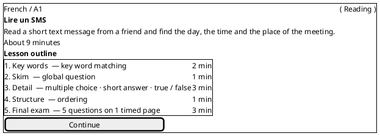
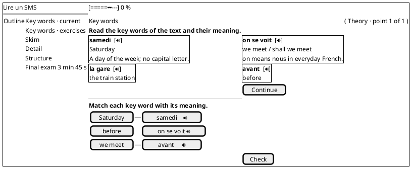
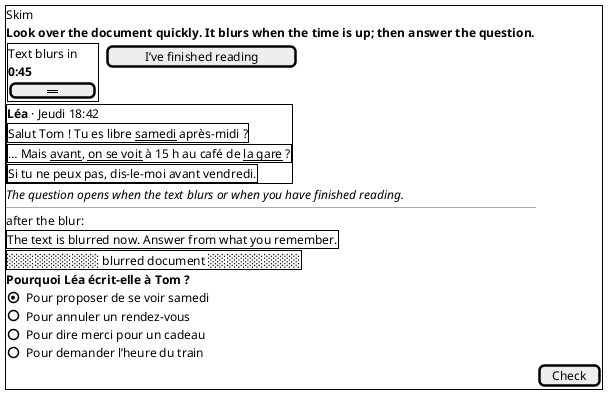
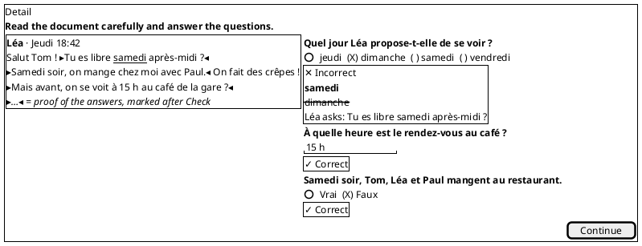
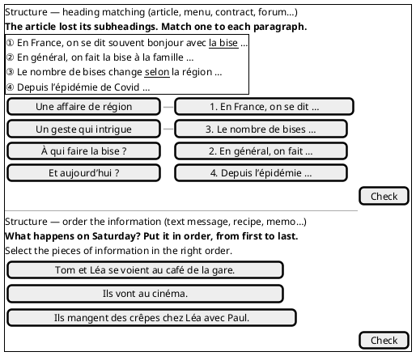
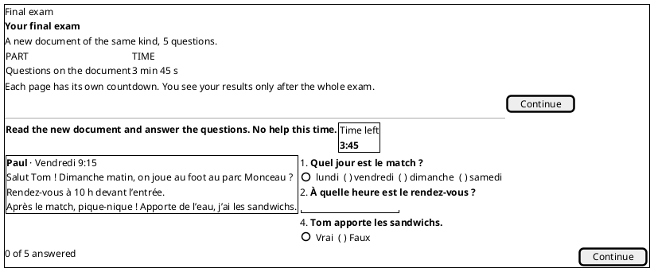
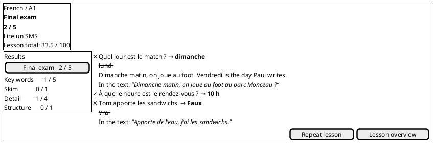

# Reading lessons: requirement (#115)

Design: **prepare, then read**. A reading lesson teaches a few key words, lets the learner skim a real-looking document, then read it for detail and structure, and ends with a short exam on a second document of the same kind.

The design is prototyped and playable in `lessonProto` (spec: `docs/reading-lessons.md`). It ships 16 French lessons from A1 to C2: a text message, public signs, a party invitation, a menu, a recipe, an email, a parents’ forum, a company memo, an article, an editorial, a La Fontaine fable, dictionary entries, a contract, a press release, a courtroom plea and a comic monologue. The numbers below come from that prototype.

**Needs:** nothing. **Unblocks:** #117, then #83, #84, #91–#93.

---

## 1. What the learner sees

Every reading lesson has the same five stages, from A1 to C2. The document is always shown in a **skin** that matches its genre: a phone thread for a text message, prices aligned on the right for a menu, numbered clauses for a contract, one verse per line for a poem, and so on.

| # | Stage | ≈ Time (A1) | What the learner does | Counts for |
|---|---|---|---|---|
| 1 | **Key words** | 1 min 30 | Sees 4–6 key words from the text, each with audio, its meaning and a one-line explanation. Then matches each word with its meaning. | practice |
| 2 | **Skim** | 1 min | Sees the document with the key words highlighted and a countdown (45 s at A1). When the time is up, or when the learner presses *I’ve finished reading*, the document blurs and **one global question** opens: what kind of document is it, who wrote it, or why. | practice |
| 3 | **Detail** | 2 min 30 | Answers 3–4 questions with the document open beside them (stacked on phones). After *Check*, the sentences that prove each answer are marked in the document. | practice |
| 4 | **Structure** | 1 min | Does **one** task: matches a heading to each part, **or** puts the parts back in order without seeing the document, **or** puts pieces of information in the order the text gives them (for texts without paragraphs). | practice |
| 5 | **Exam** | 3 min 30 | Gets a **second, shorter document of the same genre** and 5 questions on 1–2 pages. Each page has its own countdown. There is no highlighting, no help and no feedback until the end. | exam |

The result screen then shows the exam score, the lesson score out of 100, and a review of every part. A wrong answer shows the right answer, a short explanation and **the sentence of the text that proves it** (“In the text: …”).

## 2. Exercises: fixed and varying parts

| Fixed in every lesson | Varies from lesson to lesson |
|---|---|
| The five stages, in this order | The genre and its skin |
| 4–6 key words: one list, then one matching | The key words |
| One skim question about the whole document | What it asks: `genre`, `author` or `purpose` |
| 3–4 detail questions | Their types (below) and their order |
| One structure task | `heading_matching`, `order_parts` or `order_information` |
| An exam of 5 questions on a second document of the same genre | The question types, and whether they sit on 1 or 2 pages |
| One final score from 0 to 100 | Text lengths and skim time, which follow the level (section 5) |

There are three question types, used in the detail stage and in the exam:

- **Multiple choice**: 3–4 options, exactly one right.
- **True / false**: from B1 a third answer is added, **not stated**. A not-stated statement must be plausible and really absent from the text.
- **Short answer**: a fact of 1–4 words typed from the text, such as a day, a time or a price. Several spellings are accepted. An answer that is wrong only in accents or capital letters earns half a point.

## 3. The exam

- It uses a new document of the same genre, about half as long as the main one. It is about facts the main document does not give.
- It has 5 questions, in any mix of the three types, on 1 or 2 pages. A1–A2 use one page; the authored B1+ lessons use two (3 + 2).
- An information page comes first. It lists the pages and their time limits.
- Each page has a countdown of about 1.5 × the estimated time. When the time runs out, the page is locked as it is and the next page opens.
- Results appear only after the last page.

## 4. Constraints of the current design

| Constraint | How the design meets it | Point to confirm |
|---|---|---|
| One score from 0 to 100, stored by `PUT .../lessons/:id/result` | Yes. Score = 30 % practice + 70 % exam, from the points of every answer. Only this final number is stored. | Reading weights the exam 70 % (vocabulary and grammar use 65 %). Does the backend need to know the weights, or only the score? |
| `theme`, never `topic` | Yes. The brief carries the outline’s `theme`. | – |
| The whole lesson is in the course language | Partly. The **document, questions, options, answers, headings, pieces to order and key words** are always in the course language. In the prototype, the instructions, the explanations and the key-word meanings are shown in the learner’s language, as in the other kinds. | Show everything in the course language (simpler, harder at A1), or keep the support text in the learner’s language? |
| A lesson takes ten minutes | A1–A2 take 9–10 minutes. Longer texts take longer: B1 12, B2 13, C1 15, C2 17 minutes. | Cap the texts so every level fits 10 minutes, or let higher levels run longer? |

`docs/LESSONS.md` is cited as the source of these constraints, but it is missing from ft_transcendence at f03431e.

## 5. Text length and skim time

Words are whitespace-separated tokens that contain at least one letter or digit: `l'heure` counts as one word, `15` as one, `€` and `?` as none. The count covers everything the document shows: title, meta lines, headings, texts and values.

| Level | Main document | Exam document (≈ ½) | Skim time |
|---|---|---|---|
| A1 | 40–80 | 20–40 | 45 s |
| A2 | 80–150 | 40–75 | 60 s |
| B1 | 150–250 | 75–125 | 75 s |
| B2 | 250–400 | 125–200 | 90 s |
| C1 | 400–550 | 200–275 | 120 s |
| C2 | 500–700 | 250–350 | 150 s |

These are starting values, to be tuned after play tests. A document outside its range is invalid.

## 6. Data a reading lesson needs

The schema has two parts: a **brief**, which plans the lesson, and the **content**, which is what the frontend renders. Text in the course language is marked *(course)*. Support text is marked *(support)*: it is one string if everything is in the course language, or one string per language otherwise (see section 4).

### 6.1 Brief

| Field | Type | Rule |
|---|---|---|
| `kind` | `"reading"` | |
| `theme` | theme | Equals the outline entry. |
| `title`, `objective` | text | `title` *(course)*; `objective` *(support)* |
| `genre` | enum | `text_message`, `sign`, `menu`, `classified_ad`, `postcard`, `profile`, `programme`, `article`, `letter`, `forum_post`, `dictionary_entry`, `contract`, `recipe`, `speech`, `poem`, `other` |
| `situation` | *(support)* | Who writes to whom, and why. |
| `readerTask` | *(support)* | What the learner must find (from the outline intent). |
| `keywords[4–6]` | `{ id, term, meaning, explanation }` | `term` *(course)*. `meaning` is a gloss: in the course language, or one per learner language. The first meaning of each key word is unique in the lesson, because the matching uses it. |
| `documents.main`, `documents.exam` | `{ targetWords, partCount, contents }` | `targetWords` is within the level range. `contents` says what the text contains, so the generator writes the planned text. |
| `skim` | `{ focus, skimSeconds }` | `focus` is `genre`, `author` or `purpose`; `skimSeconds` comes from the table in section 5. |
| `detailQuestions[3–4]` | `{ id, type, focus }` | `type` is `choice`, `true_false` or `short_answer`. |
| `structureTask` | enum | `heading_matching` or `order_parts` (both need ≥ 3 parts), or `order_information`. |
| `examPages[1–2]` | `{ id, types[], itemCount, timeLimitS }` | `itemCount` adds up to exactly 5. |
| `estimatedMinutes` | int | The rounded sum of the stage estimates. |

### 6.2 Content (rendered by the frontend)

```
documents[2]: {
  documentId: "main" | "exam", genre,
  title (course) | null, meta[0–4] (course: sender, date, byline…),
  parts[1–12]: { partId, heading (course) | null,
                 segments[1–20]: { segmentId, text (course), value (course) | null } },
  highlights[]: { keywordId, segmentId, text }        // main document only
}
stages:
  keywords:  { keywordIds[], matching: [{ keywordId, explanation (support) }] }
  skim:      { documentId: "main", skimSeconds, question: Choice }
  detail:    { documentId: "main", questions: Question[3–4] }
  structure: { documentShown: bool, task: HeadingMatching | Order }
  exam:      { documentId: "exam", pages[1–2]: { pageId, timeLimitS, questions: Question[] } }

Choice     = { id, question (course), options[3–4]: { id, text (course) }, answerId, explanation (support) }
TrueFalse  = { id, statement (course), allowNotStated, answer: true | false | not_stated, evidence[], explanation }
Short      = { id, question (course), accepted: { answers[1–8], accentSensitive[] }, evidence[], explanation }
Question   = Choice & { evidence[] } | TrueFalse | Short          // evidence = segmentIds that prove the answer
HeadingMatching = { headings: { id, text (course) }[], pairs: { partId, headingId, explanation }[] }
Order      = { mode: parts | information, pieces[3–6]: { id, text (course), partId | null },
               acceptedOrders[1–2]: pieceId[], explanation }
```

- A **segment** is a sentence, a line, a verse or a menu line. Questions point at segments, so the text is cut where each fact sits.
- `value` is a right-aligned value, such as a price or a quantity.
- Both documents are stored once per lesson. Pages only refer to them.
- The true/false labels (`Vrai`, `Faux`, `Pas dans le texte`) come from the app and are never translated.

### 6.3 Validation rules (a failure makes the lesson invalid)

**Documents**
- Both documents have the brief’s genre and part count, and their word counts are in range.
- Every highlight is found word for word in its segment.
- Every key word is highlighted in the main document. The exam document has no highlights.

**Questions**
- Options are unique, with exactly one right.
- Evidence points at the document of its stage. It is required for every answer except not stated, which has none.
- `allowNotStated` is false at A1–A2 and true from B1.

**Structure**
- Heading matching pairs every part exactly once, and the main document then shows no part headings.
- `order_parts` hides the document.

**Exam**
- The exam has exactly 5 questions on the planned pages, with the planned limits.
- Only exam pages have a countdown.

## 7. Mockups (PlantUML Salt)

The screens below are the prototype’s. The outline sidebar, the progress bar, the matching board, the countdown and the results are the same components as in vocabulary and grammar lessons.

### Lesson start



### Stage 1: key words, then matching



### Stage 2: skim, then the question after the blur



### Stage 3: detail, after *Check*



### Stage 4: structure (heading matching, and an ordering variant)



### Stage 5: exam (information page, then a timed page)



### Results



## 8. What `LessonBriefSchema` lacks today

Today (f03431e) a draft is `{ title, summary, brief: { objective, points[2–6], examples[3–8], pitfalls[1–4], vocabulary?[6–15] } }`. For reading it needs:

1. **A brief per kind.** `kind: "reading"` must have its own brief: `examples` and `pitfalls` make no sense for reading, and `vocabulary` needs 6–15 entries where reading has 4–6 key words.
2. **New fields.** `genre`, the document plan (`targetWords`, `partCount`, `contents`), the skim focus and time, the detail question types, the structure task and the exam pages.
3. **Constants.** The word ranges and skim times per level, the count limits, and the score weights.
4. **A home for the content.** The documents with their segments, the questions and the evidence have no place yet. #83 must decide whether the content is generated once and stored, or generated for each learner.

## 9. Questions for the #117 owner

1. Is the whole lesson in the course language, or only the document and questions (section 4)?
2. Ten minutes for every level, or longer for B2–C2?
3. Are the word ranges and skim times right as starting values?
4. Keep the evidence marks? They need segment ids in the text and on every question.
5. Is a fixed 30/70 weighting fine, given that the backend stores only the final score?
